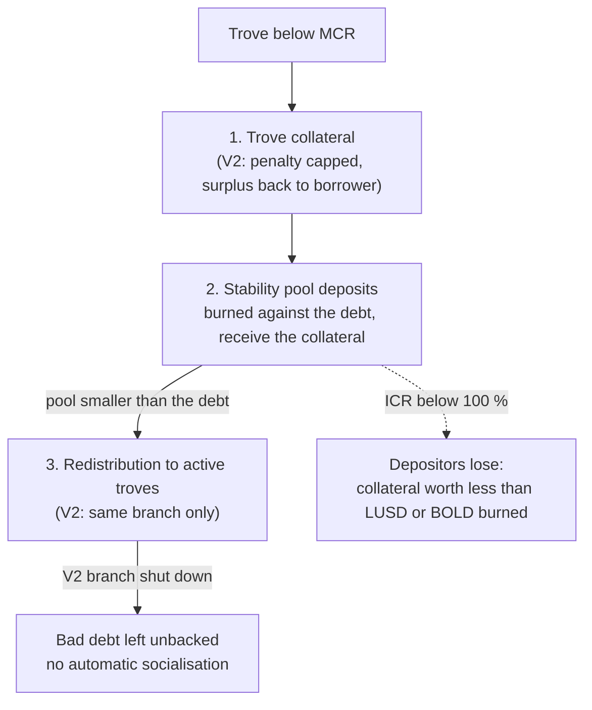
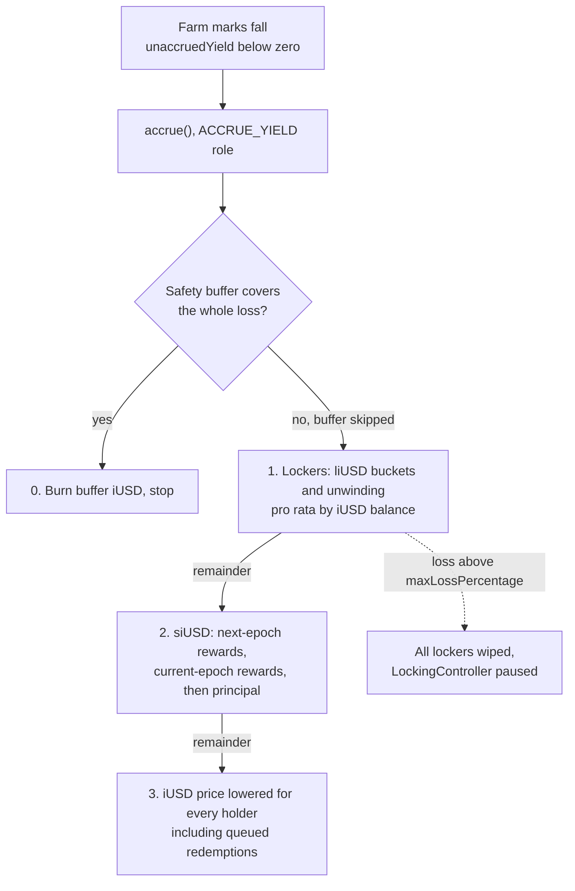
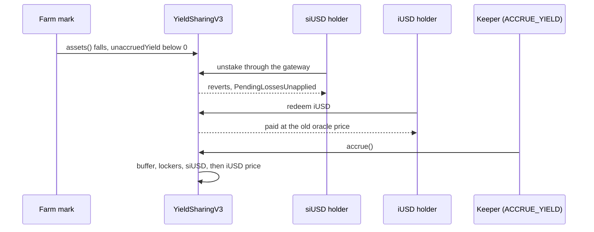
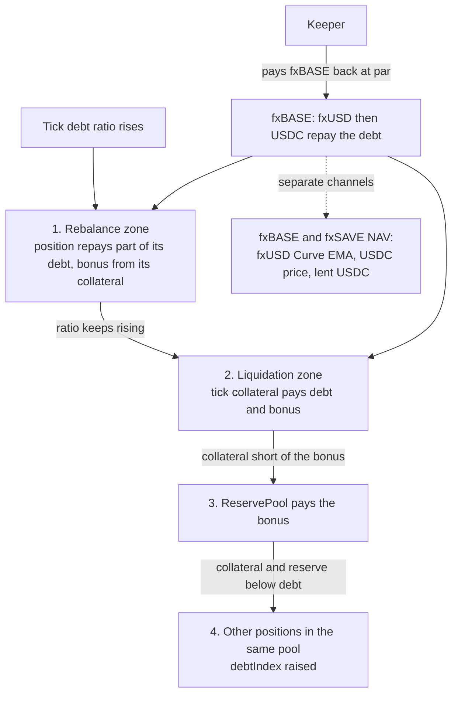

A stablecoin backed by assets that can lose value has to say who pays when they do. Some designs answer with a capital structure: holders who accept the first loss earn more yield, and plain holders are protected until those junior layers are used up. Others answer at the level of the loan: the borrower's collateral pays first, then a pool of depositors, then the other borrowers.

This article compares three such designs through their contracts. [infiniFi](https://github.com/InfiniFi-Labs/infinifi-protocol) issues iUSD against a portfolio of yield farms and stacks two junior tokens on top of it, liUSD and siUSD. [f(x) Protocol](https://github.com/AladdinDAO/fx-protocol-contracts) mints fxUSD as the debt of leveraged positions and deleverages them in stages before any loss is shared. Liquity's stability pool, covered in depth in [How Liquity V1 Works - LUSD, Troves, the Stability Pool, Redemptions and Recovery Mode]({{site.url_complet}}/2026/10/22/liquity-v1-lusd-troves-stability-pool/), serves as the baseline. For each one the question is the same: in which order is a loss applied, when does it become visible, and who can be hit without having chosen to take risk.

> This article has been made with the help of [Claude Code](https://claude.com/product/claude-code) and several custom skills

[TOC]

## What you need to know first

The article assumes the reader knows stablecoins, lending and liquidations in general. A few mechanisms one level below are used without being derived:

- **Collateralised debt positions.** A borrower locks collateral and mints a stablecoin as debt; when the collateral ratio falls below a threshold, the position is liquidated. Liquity and f(x) are both built on this model, with different thresholds and liquidation paths.
- **Stability pool.** A pool of stablecoin deposits that repays a liquidated debt and receives the collateral in exchange. Its depositors usually gain, because the collateral is worth more than the debt at liquidation, and lose only when it is worth less.
- **First-loss capital.** Capital placed in front of other holders so that it absorbs losses before they do, in exchange for a share of the yield. [Insuring Composable DeFi - First-Loss Capital Along the Attack Graph]({{site.url_complet}}/2026/07/02/defi-composable-first-loss-capital-insurance/) discusses where such capital can be placed in a chain of protocols.
- **ERC-4626 share price.** A vault following [ERC-4626](https://eips.ethereum.org/EIPS/eip-4626) issues shares whose value is `totalAssets / totalSupply`. Burning assets inside the vault lowers that price for every holder at once, which is how siUSD takes a loss.
- **Booked price versus market price.** A token can be valued by a number the protocol writes itself (an admin-set oracle, a NAV computed from internal balances) rather than by a trade. A loss then exists economically before it appears in the price, and the gap matters to anyone who can exit at the old price.
- **Socialised loss.** When debt cannot be repaid by its own collateral, a protocol can raise the debt of every other borrower instead of letting the stablecoin go under-collateralised. Liquity calls this redistribution; f(x) does it through a debt index.
- **Keepers and role-gated calls.** Liquidations, rebalances and loss accounting are triggered by external transactions. Some are permissionless, others require a role, and the difference decides how fast a loss is applied.

## Three places to put a loss

The three designs differ less in their parameters than in where the loss-absorbing capital sits.

- **Liquity** puts it in a pool of stablecoin depositors that buys liquidated collateral at a discount. The pool's risk is the price of the collateral at the moment of liquidation.
- **infiniFi** puts it in junior tokens of the same stablecoin. iUSD is a claim on a portfolio of farms, and liUSD and siUSD holders agree to be written down first when that portfolio loses value.
- **f(x)** puts it mainly in the borrowers. Positions are deleveraged in a rebalance zone before liquidation, the stability pool only swaps stablecoins at par for the keeper's token, and debt that collateral cannot cover is added to the other borrowers of the same pool.

The sections below follow each design from the event that creates a loss to the last holder who can be charged with it.

## Liquity's stability pool, the baseline

### Liquity V1

A Liquity V1 trove is liquidatable when its individual collateral ratio (ICR) falls below the 110 % minimum collateral ratio. The liquidation runs in two steps ([`dev/README.md`, *Liquidation and the Stability Pool*](https://github.com/liquity/dev/blob/3e64ee1b52c50d51587c64c1cf75e0ba82934979/README.md)):

1. **Offset.** LUSD from the stability pool equal to the trove's debt is burned, and the trove's ETH, minus 0.5 % paid to the liquidator, is shared between depositors in proportion to their deposits.
2. **Redistribution.** If the pool holds less LUSD than the debt, the pool offsets what it can, and the remaining debt and collateral are redistributed to every active trove in proportion to its collateral.

A depositor's result per liquidation depends only on the ICR of the liquidated trove, because in a mixed liquidation the collateral share matches the debt share. A worked example, with the 200 LUSD liquidation reserve left out for clarity:

- A trove holds 10 ETH at 2,000 USD and owes 18,500 LUSD, an ICR of about 108.1 %. The pool burns 18,500 LUSD and receives 9.95 ETH worth 19,900 USD: a gain of 1,400 USD for the depositors.
- If the price had fallen fast enough for the same debt to be liquidated at an ICR of 95 % (collateral worth 17,575 USD), the depositors would receive 0.995 × 17,575 = 17,487.1 USD for 18,500 LUSD burned: a loss of about 1,013 USD.

The README states the second case directly: liquidations below 100 % happen in "flash crashes, oracle failures" and give stability depositors a net loss. Two rules protect the pool from its own depositors. Withdrawals from the pool are blocked while any trove has an ICR below 110 %, so a depositor cannot leave just before a pending liquidation. In Recovery Mode (total collateral ratio below 150 %), troves with an ICR of 100 % or less are redistributed rather than offset, so the pool does not take liquidations that are certain to lose.

The loss order of V1 is therefore: the borrower's collateral, then the stability pool's LUSD, then the other borrowers through redistribution. LUSD holders outside the pool are not written down by any of these steps.

### Liquity V2

[How Liquity V2 Works - BOLD, User-Set Interest Rates, Redemption Routing and Branch Shutdown]({{site.url_complet}}/2026/10/22/liquity-v2-bold-user-set-interest-rates/) covers BOLD in full; three changes to the waterfall matter here.

- **One pool per collateral branch.** WETH, wstETH and rETH each have their own stability pool, and redistribution only reaches troves of the same branch.
- **A capped penalty.** The pool keeps collateral worth `debt × 1.05`. A redistribution takes `debt × 1.10` on the WETH branch and `debt × 1.20` on the wstETH and rETH branches. The rest goes to `CollSurplusPool` for the borrower, unlike V1, where the whole collateral was seized in Normal Mode.
- **Shutdown can leave bad debt.** When a branch's total collateral ratio falls below its shutdown threshold or its oracle fails, the branch shuts down for good. Known issue 9 of the [bold README](https://github.com/liquity/bold/blob/d262669ef3c4d37bf0544df3bb2624c07b8a5ee0/README.md) says the branch may be left with remaining bad debt, so that "a portion of the BOLD supply can never be redeemed". The code does not socialise it automatically; the README lists options such as redirecting redemption fees or governance-directed interest to burn BOLD.

Since V5 the pool always keeps 1 BOLD (`MIN_BOLD_IN_SP`), so an offset never empties it completely.



## infiniFi, a waterfall on a portfolio

### Three tokens on one balance sheet

infiniFi mints iUSD against collateral such as USDC and deploys that collateral into farms: Aave, Pendle principal tokens, Ethena, Maple, Morpho and others, split between liquid farms and maturity farms that cannot be withdrawn before a date. On top of iUSD sit two junior tokens:

- **siUSD**, an ERC-4626 vault over iUSD. Rewards are deposited for the next one-week epoch and released linearly during it.
- **liUSD**, one locked token per duration bucket, such as 2, 4 or 6 weeks of unwinding. Each bucket has a reward multiplier, and a holder who calls `startUnwinding` waits the bucket's duration in `UnwindingModule` before withdrawing.

There is no liquidation in this design. A loss is a fall in the value of the farms, measured by `YieldSharingV3.unaccruedYield()`:

```solidity
// src/finance/YieldSharingV3.sol
uint256 assetsInReceiptTokens = assets.divWadDown(receiptTokenPrice);
return int256(assetsInReceiptTokens) - int256(ReceiptToken(receiptToken).totalSupply());
```

`assets` is `Accounting.totalAssetsValue()`, the sum over farms of `farm.assets()` times the asset's oracle price. Each farm reports its own `assets()`, so a loss enters the accounting when a farm's mark falls. The mark depends on the farm: a Pendle oracle for a PT, `convertToAssets` for an ERC-4626 farm, an off-chain NAV for a fund. A negative value is a loss that has not been applied yet.

### The order of the waterfall

`accrue()` reads `unaccruedYield()` and, when it is negative, calls `_handleNegativeYield(loss)`. The order is written in that function:

```solidity
// src/finance/YieldSharingV3.sol, _handleNegativeYield (abridged)
uint256 safetyBuffer = ReceiptToken(receiptToken).balanceOf(address(this));
if (safetyBuffer >= _negativeYield) { ReceiptToken(receiptToken).burn(_negativeYield); return; }

uint256 lockingReceiptTokens = LockingController(lockingModule).totalBalance();
if (_negativeYield <= lockingReceiptTokens) { LockingController(lockingModule).applyLosses(_negativeYield); return; }
LockingController(lockingModule).applyLosses(lockingReceiptTokens);
_negativeYield -= lockingReceiptTokens;

uint256 stakedReceiptTokens = ReceiptToken(receiptToken).balanceOf(stakedToken);
if (_negativeYield <= stakedReceiptTokens) { StakedToken(stakedToken).applyLosses(_negativeYield); return; }
StakedToken(stakedToken).applyLosses(stakedReceiptTokens);
_negativeYield -= stakedReceiptTokens;

uint256 newPrice = price.mulDivDown(totalSupply - _negativeYield, totalSupply);
FixedPriceOracle(oracle).setPrice(newPrice);
```

Each tier has its own rule:

- **The safety buffer is all or nothing.** It is iUSD held by `YieldSharingV3`, refilled first out of profits up to `safetyBufferSize`. It absorbs a loss only if it covers the whole of it; a larger loss skips it, and the buffer's iUSD then takes only the last-tier repricing like any other iUSD.
- **Lockers are hit pro rata, not by multiplier.** `LockingController.applyLosses` splits the amount between the unwinding positions and the buckets in proportion to their iUSD balances. Unwinding positions lose through a lower `slashIndex` in `UnwindingModule`; buckets lose through burned iUSD and a lower `totalReceiptTokens` each. The reward multiplier of a longer bucket earns it more yield but does not change its share of a loss. A loss larger than `maxLossPercentage` (0.999999e18) of the locked balance wipes every locker and pauses the `LockingController`.
- **siUSD loses its own rewards first.** `StakedToken.applyLosses` slashes the rewards waiting for the next epoch, then the unvested rewards of the current epoch, and only then burns principal, which lowers the share price.
- **iUSD is repriced last.** Whatever is left lowers the iUSD price written in its `FixedPriceOracle`, by `price × (supply − loss) / supply`. Every holder is hit, including iUSD waiting in the redemption queue, which stays in `totalSupply` until it is funded.



### A worked example

Take an iUSD supply of 100 M, a safety buffer of 0.5 M, 10 M held by lockers and 30 M inside siUSD. These balances are illustrative, not deployment values.

- **A 15 M loss.** The buffer is smaller than the loss and is skipped. Lockers lose their 10 M. siUSD absorbs the remaining 5 M, first from pending rewards, then from principal. The iUSD price stays at 1.
- **A 45 M loss.** Lockers lose 10 M and siUSD loses 30 M, which burns 40 M of iUSD and leaves a supply of 60 M. The last 5 M sets the iUSD price to `(60 − 5) / 60`, about 0.9167. The check: 60 M iUSD at 0.9167 is 55 M, the value left after a 45 M loss on 100 M. The 0.5 M buffer is part of the 60 M and is repriced with it.

### Pending loss and the keeper

`accrue()` is restricted to the `ACCRUE_YIELD` role and to an unpaused `YieldSharingV3`. The repository's deployment configuration (`deployment/configuration/roles.1.json`) grants that role to the deployer, the team multisig, a short timelock and two keepers named `KEEPER_REBALANCE` and `KEEPER_LOSS`; whether the live grants match was not checked on-chain.

Between the moment a farm's mark falls and the next `accrue()`, the loss is **pending**: it is visible in `unaccruedYield()` but applied to nobody. The contracts treat the two exits differently during that window:

- **siUSD exits are blocked.** `StakedToken.maxRedeem` and `maxWithdraw` return 0 while `unaccruedYield() < 0`, and the gateway reverts with `PendingLossesUnapplied`. A staker cannot leave before taking its share.
- **iUSD redemptions are not.** `RedeemController.redeem` pays at the current iUSD oracle price, which the last tier has not lowered yet. An iUSD holder who redeems early leaves at 1; if the loss later reaches the last tier, the remaining holders carry the difference.

The error's own comment tells a user who sees it to "call YieldSharing.accrue()", which a user without the role cannot do. How quickly a pending loss is applied therefore depends on the keepers' schedule, which the code does not state.



## f(x) Protocol, losses inside the position pool

### fxUSD as the debt of leveraged positions

In the current f(x) design, fxUSD is minted only as the debt of NFT positions in per-collateral long pools, such as wstETH and WBTC, managed by one `PoolManager`. A position's debt ratio is `debt / (coll × price)`, and positions with similar ratios share a tick, so rebalances and liquidations act on a whole tick at once. fxUSD's backing is the collateral of the long pools at the oracle price, plus a USDC reserve inside the fxUSD contract that fills when keepers pay in USDC.

Each tick falls in one of four zones, set by admin parameters (`BasePool.sol`):

| Zone | Condition on the tick's debt ratio | What happens | Bonus to the keeper |
|---|---|---|---|
| Healthy | below `rebalanceDebtRatio` | nothing | none |
| Rebalance | from `rebalanceDebtRatio` to `liquidateDebtRatio` | just enough debt is repaid to bring the tick back to `rebalanceDebtRatio`; positions stay open | `rebalanceBonusRatio` of the collateral taken |
| Liquidation | at or above `liquidateDebtRatio` | up to the whole tick's debt is repaid | `liquidateBonusRatio`, topped up from `ReservePool` when the tick lacks collateral |
| Bad debt | collateral plus reserve below debt | all collateral and reserve are taken, the unpaid debt is added to the rest of the pool | none |

### Rebalance: the position pays first

The rebalance amount comes from `_getRawDebtToRebalance`. With `D` the tick's debt, `V` its collateral value, `t` the target ratio and `i` the bonus, the debt to repay is `x = (D − t·V) / (1 − (1 + i)·t)`. The keeper receives collateral worth `x·(1 + i)`.

With illustrative values `D = 880`, `V = 1,000`, `t = 0.85` and `i = 2.5 %`, the tick starts at a ratio of 0.88. The keeper repays about 233.0 of debt and takes collateral worth about 238.8, of which 5.8 is the bonus. The tick ends with a debt of about 647.0 against collateral worth about 761.2, a ratio of 0.85. The bonus is paid out of the positions' own collateral: the rebalance zone is a partial liquidation that leaves the positions open with lower leverage.

### Liquidation and bad debt

In the liquidation zone the keeper repays up to the whole tick's debt and receives the collateral plus `liquidateBonusRatio`. When the tick's collateral cannot pay the bonus, `ReservePool` supplies it. When collateral and reserve together are worth less than the debt, `_liquidateTick` takes all of both, repays only their value, and spreads the rest over the pool:

```solidity
// src/core/pool/BasePool.sol, _liquidateTick
uint256 rawBadDebt = _convertToRawDebt(vars.tickDebtShares - debtShares, vars.debtIndex, Math.Rounding.Down);
...
vars.debtIndex += (rawBadDebt * E96) / vars.totalDebtShares;
```

An example with round numbers: a pool owes 10,000 fxUSD, and a tick with a debt of 1,050 holds collateral worth 1,000 with no reserve left. The keeper repays 1,000 and takes all the collateral. The 50 left are added to the remaining 8,950 of debt through `debtIndex`, about 0.56 % more debt for every other position in the pool. The pool then owes 9,000, which matches the 9,000 fxUSD still in circulation. The other borrowers of the same collateral pool absorb the bad debt; borrowers of other pools and fxUSD holders do not.

### The stability pool fxBASE and fxSAVE

`FxUSDBasePool` (fxBASE) holds fxUSD and USDC deposits, and `PoolManager.rebalance` and `liquidate` can only be called through it. A keeper calls `FxUSDBasePool.rebalance` or `liquidate` with a token and a maximum amount. fxBASE spends its fxUSD first, then its USDC, to repay the tick's debt; the keeper receives the collateral and the bonus, and pays fxBASE back the same USD amount in the token it chose (`_afterRebalanceOrLiquidate`), with fxUSD counted at par.

So fxBASE converts stablecoins at par into the keeper's stablecoin and never holds the liquidated collateral. That is the main contrast with Liquity: a fall in collateral below the debt is not a loss for fxBASE depositors, because the keeper, not the pool, takes the collateral. fxBASE depositors are exposed through other channels:

- **The fxUSD price.** `nav()` values fxBASE's fxUSD at the Curve fxUSD/USDC EMA times Chainlink USDC/USD, so a depeg on Curve lowers the NAV without any transaction.
- **USDC.** The USDC side is valued at Chainlink's USDC/USD price, and deposits are refused below `stableDepegPrice`.
- **Lent USDC.** The asset manager can lend part of the USDC through a strategy such as `AaveV3Strategy`, which adds that venue's risk.

Exits from fxBASE wait `redeemCoolDownPeriod` after `requestRedeem`, or pay an instant fee capped at 5 % (`MAX_INSTANT_REDEEM_FEE`). fxSAVE (`SavingFxUSD`) is an ERC-4626 vault over fxBASE shares staked through Convex, with `nav() = fxBASE.nav() × convertToAssets(1e18) / 1e18`; its withdrawals go through the same cooldown.



## The three designs side by side

| | Liquity (V1, V2) | infiniFi | f(x) Protocol |
|---|---|---|---|
| What creates a loss | a trove liquidated with collateral worth less than its debt | a fall in the farms' reported `assets()` | a tick whose collateral falls below its debt and bonus |
| First to pay | the borrower's collateral | the safety buffer, only if it covers the whole loss | the position's own collateral, through rebalance |
| Opt-in absorbers | stability pool depositors | liUSD lockers, then siUSD stakers | keepers and fxBASE only convert at par; the reserve pays bonuses |
| Who can lose without opting in | other troves, by redistribution | every iUSD holder, by repricing | other borrowers of the same pool, by `debtIndex` |
| Terminal tier | V1: none beyond redistribution; V2: bad debt left on a shut-down branch | the iUSD price | the fxUSD backing, if a pool's total collateral falls below its debt (*derived*) |
| When the loss is applied | in the liquidation transaction, by anyone | at `accrue()`, by a role holder | in the rebalance or liquidation transaction, by any keeper with tokens |
| What the absorbers earn | liquidation discount; V2 also 75 % of interest | profit share weighted by multipliers | fxBASE: funding and rewards; keepers: the bonus |
| Exit limits in stress | V1: no SP withdrawal while any ICR is below 110 % | siUSD blocked while a loss is pending; liUSD waits its bucket | fxBASE and fxSAVE cooldown, or an instant fee up to 5 % |
| How the junior value is marked | collateral at the oracle price | admin-set iUSD price and farm self-reports | Curve EMA for fxUSD, Chainlink for USDC |

Read across the rows, the table shows three properties. They are *derived* from the code paths above, not stated in any of the projects' documents:

- **infiniFi is the only design where plain holders are written down by the protocol.** Liquity and f(x) keep the stablecoin's supply matched to debt by charging borrowers; infiniFi has no borrowers to charge, so the terminal tier is the iUSD price itself.
- **Only infiniFi applies losses on a schedule.** In Liquity and f(x) the transaction that creates the loss also applies it. In infiniFi the loss waits for a role holder, and the order in which holders can exit during the wait favours iUSD redeemers over stakers.
- **f(x)'s stability pool takes no collateral risk.** Liquity's pool is a buyer of last resort for collateral; fxBASE is a stablecoin swap facility whose risk is the stablecoins themselves.

## Conclusion

The three designs place the same economic loss in different hands: Liquity in a pool of collateral buyers, infiniFi in junior tokens of the stablecoin, f(x) in the borrowers of the affected pool.

- **Liquity** offsets a liquidated debt against stability pool deposits, which gain on liquidations above 100 % ICR and lose below; the remainder is redistributed to other troves, and in V2 a shut-down branch can leave bad debt that nothing socialises automatically.
- **infiniFi** applies a loss in a fixed order: the safety buffer if it covers the whole loss, then lockers pro rata, then siUSD rewards and principal, then the iUSD price for every holder, queued redemptions included.
- **infiniFi's loss is pending until `accrue()`**, a role-gated call; siUSD exits are blocked during that window while iUSD redemptions still pay at the old price.
- **f(x)** deleverages a tick in a rebalance zone, liquidates it with a bonus topped up by a reserve, and adds any unpaid debt to the other positions of the same pool through `debtIndex`.
- **fxBASE and fxSAVE** do not hold liquidated collateral; their depositors are exposed to the fxUSD Curve EMA, the USDC price and lent USDC, with a cooldown or an instant fee to leave.
- **The main risks** are the self-reported farm marks and the keeper schedule in infiniFi, the admin-set thresholds and oracle switches in f(x), and liquidations below 100 % or a branch shutdown in Liquity.


## Annex

### Key Terms

| Term | Definition |
|------|------------|
| **Collateral ratio (ICR)** | The value of a position's collateral divided by its debt; Liquity liquidates a trove below its minimum collateral ratio. |
| **Debt ratio** | f(x)'s inverse measure, `debt / (coll × price)`; a higher value means a riskier position. |
| **Stability pool** | A pool of stablecoin deposits that repays liquidated debt and receives the collateral in exchange. |
| **Offset** | In Liquity, cancelling a liquidated debt against an equal amount of stability pool deposits. |
| **Redistribution** | In Liquity, moving the debt and collateral the stability pool could not cover to the other active troves. |
| **Branch shutdown** | In Liquity V2, the irreversible stop of one collateral branch after its total ratio falls below the shutdown threshold or its oracle fails. |
| **First-loss capital** | Capital that absorbs losses before other holders, in exchange for extra yield. |
| **Loss waterfall** | The fixed order in which a protocol charges a loss to successive groups of holders. |
| **iUSD** | infiniFi's receipt token, minted against collateral and valued by an admin-set `FixedPriceOracle`. |
| **siUSD** | infiniFi's staked iUSD, an ERC-4626 vault that takes losses after the lockers. |
| **liUSD** | infiniFi's locked iUSD, one token per unwinding-duration bucket, the first tier after the safety buffer. |
| **Safety buffer** | iUSD held by `YieldSharingV3`, refilled from profits, burned against a loss only if it covers the whole loss. |
| **Pending loss** | A negative `unaccruedYield()` that `accrue()` has not yet applied to any tier. |
| **unaccruedYield** | infiniFi's measure of profit or loss: total farm value in iUSD minus iUSD supply. |
| **Tick** | In f(x), a group of positions with similar debt ratios, rebalanced and liquidated together. |
| **Rebalance zone** | f(x)'s range of debt ratios where a tick is partly deleveraged back to a target ratio. |
| **debtIndex** | f(x)'s multiplier from debt shares to debt; raising it spreads bad debt over every position of a pool. |
| **fxBASE** | f(x)'s stability pool of fxUSD and USDC, through which every rebalance and liquidation is called. |
| **fxSAVE** | An ERC-4626 vault over fxBASE shares, valued by fxBASE's NAV. |
| **Keeper** | An external account that sends the transactions a protocol needs, such as liquidations or loss accounting. |

### Invariants

| Invariant | Enforced by | Breaks if |
|-----------|-------------|-----------|
| infiniFi lockers are charged before siUSD, and siUSD before the iUSD price. | The sequence in `YieldSharingV3._handleNegativeYield`. | A new YieldSharing version reorders the tiers or governance replaces the contract. |
| siUSD holders cannot exit while a loss is pending. | `StakedToken.maxRedeem` and `maxWithdraw` returning 0 when `unaccruedYield() < 0`. | The check is removed, or `unaccruedYield()` reads a stale or wrong farm value. |
| After `accrue()`, iUSD supply times its price equals the farms' value. | The last tier sets `price × (supply − loss) / supply`. | A farm's `assets()` is mis-marked, so the value being matched is wrong. |
| f(x) fxUSD supply matches the long pools' debt after a bad-debt liquidation. | `debtIndex` raised by the unpaid debt over the remaining shares. | The pool has no remaining positions to carry the debt, or the index rounding drifts. |
| fxBASE is repaid at par for the stablecoins it spends in a rebalance or liquidation. | `_afterRebalanceOrLiquidate` pulling the same USD amount from the keeper. | The USDC price used is wrong, or fxUSD trades below par while counted at 1. |
| Liquity V1 stability pool deposits cannot leave while a trove is under 110 %. | The withdrawal check in `StabilityPool`. | A fork removes the check, letting depositors avoid pending liquidations. |

### Integration Notes

| Behaviour | What an integrator should do |
|-----------|------------------------------|
| siUSD's `deposit` and `redeem` revert when called directly; only the infiniFi gateway can enter or exit. | Route through the gateway and treat siUSD as non-standard ERC-4626. |
| siUSD's `maxRedeem` returns 0 during a pending loss. | Do not read a zero as an empty position; check `YieldSharingV3.unaccruedYield()`. |
| iUSD's price is a stored number that changes only at `accrue()`. | A lender pricing iUSD or siUSD should also watch `unaccruedYield()`, because the price lags the loss. |
| fxBASE and fxSAVE NAVs move with the Curve fxUSD EMA, without any transaction in the vault. | Price them from `nav()` and monitor the fxUSD EMA, not only the vault's events. |
| fxBASE and fxSAVE exits wait for a cooldown, or pay up to 5 %. | Model exit time and the instant fee when holding them in a strategy that may need to sell. |
| In Liquity V2, a shut-down branch disables normal redemptions and leaves only urgent redemptions. | A holder of BOLD on a shut-down branch's collateral should expect redemptions in any trove order with a 2 % bonus. |

### Risks

The three protocols disclose risks in their code and READMEs rather than in a dedicated risk page that was read for this article. The points below come from the code paths described above; anything marked (*derived*) is this article's reasoning. Admin holders were not checked on-chain, and the gaps say what to verify.

#### Smart contracts and transparency

- **infiniFi.** The contracts are published on GitHub and use roles from `InfiniFiCore`; `GOVERNOR` can run `emergencyAction`, an arbitrary call on any `CoreControlled` contract. That power can fix a bug or change any rule, so the holder of `GOVERNOR` and any timelock in front of it decide the risk. No audit report is in the repository.
- **f(x).** The core contracts sit behind proxies with OpenZeppelin `AccessControl`. `DEFAULT_ADMIN_ROLE` can change pools, ratios, fees and oracles; no timelock appears in the repository, so whether one guards the admin is deployment state. No audit report is in the repository.
- **Liquity.** V1 and V2 are immutable: rules cannot change under a depositor, and a bug cannot be patched in place. V2 went through several audit iterations before its launch and a redeployment in May 2025 after a ChainSecurity review and a Cantina competition.

#### External dependencies

- **infiniFi** trusts each farm's self-reported `assets()`, so its waterfall inherits the pricing of every farm, from a Pendle PT oracle to an off-chain NAV. Cross-chain farms add CCIP and LayerZero bridges.
- **f(x)** depends on the Curve fxUSD/USDC EMA, Chainlink USDC/USD, and Curve EMA and spot pools for collateral prices; Aave sets the funding rate and holds lent USDC.
- **Liquity** depends on Chainlink feeds (V1 with Tellor as fallback); a V2 oracle failure shuts the branch down.

#### Depeg

- **iUSD** holds its value only through the farms; once lockers and siUSD are used up, its price is lowered by the loss. Before `accrue()`, the price shows 1 while the backing is lower (*derived*).
- **fxUSD** has a redemption path for collateral when its EMA is below peg and a USDC reserve used by `PegKeeper`; fxBASE's NAV moves with fxUSD's Curve price.
- **LUSD and BOLD** have a hard floor through redemptions at face value minus a fee; a V2 branch left with bad debt leaves part of BOLD without backing.

#### Collateral and market risk

- **f(x)** positions are leveraged longs on wstETH and WBTC; a fast fall can skip the rebalance zone and reach bad debt, which then lands on the other positions of the pool.
- **Liquity** stability pools lose when collateral falls below the debt before liquidation; redistribution can push other troves under the threshold and cascade.
- **infiniFi's** market risk is that of its farms, including maturity farms whose marks depend on an oracle.

#### Liquidity

- **infiniFi** pays redemptions from liquid farms and queues the rest; maturity farms cannot fund the queue before maturity, and queued iUSD takes the last-tier repricing.
- **fxBASE and fxSAVE** exits wait a cooldown or pay up to 5 %.
- **Liquity V1** blocks stability pool withdrawals while any trove is under 110 %.

#### Centralisation and governance

- **infiniFi.** `ORACLE_MANAGER` sets the iUSD price and asset oracles, and `ACCRUE_YIELD` decides when losses apply. The repository's configuration grants `ACCRUE_YIELD` to a deployer, a team multisig, a short timelock and two keepers; this was not confirmed on-chain.
- **f(x).** `DEFAULT_ADMIN_ROLE` changes oracles and thresholds with immediate effect in code; `EMERGENCY_ROLE` can pause.
- **Liquity.** No admin over core parameters; V2 governance directs only the 25 % of interest sent to the `InterestRouter`.

#### Loss sharing

- **infiniFi.** Lockers, then stakers, then every iUSD holder; a pending loss lets iUSD redeemers exit at 1 ahead of the repricing (*derived*).
- **f(x).** The position, the reserve, then the other positions of the same pool through `debtIndex`.
- **Liquity.** Stability pool depositors, then other troves; in V2, bad debt on a shut-down branch stays with BOLD holders unless governance acts.

#### Regulatory

None found specific to the loss design.

#### Summary

| Risk | Where it comes from | What the design does about it | What remains |
|---|---|---|---|
| Mis-marked farm | infiniFi `farm.assets()` self-reports | The waterfall charges lockers and stakers first | A wrong mark mints or slashes against every tier |
| Delayed loss application | infiniFi `accrue()` gated by `ACCRUE_YIELD` | siUSD exits blocked while a loss is pending | iUSD redeemers can exit at the old price |
| Buffer skipped | infiniFi buffer used only if it covers the whole loss | None | A loss slightly larger than the buffer leaves it unused |
| Bad debt in a pool | f(x) tick collateral below debt | Rebalance zone, liquidation bonus, `ReservePool` | Other positions of the pool carry the unpaid debt |
| fxUSD depeg | Curve EMA mark in fxBASE `nav()` | Redemptions and `PegKeeper` | fxBASE and fxSAVE NAV fall with the EMA |
| Admin changes | f(x) `DEFAULT_ADMIN_ROLE`, infiniFi `GOVERNOR` and `ORACLE_MANAGER` | Role separation | Holders and timelocks not confirmed on-chain |
| Liquidation below 100 % | Liquity fast price fall or oracle failure | Recovery Mode in V1, penalties capped in V2 | Stability pool depositors lose the difference |
| Branch shutdown | Liquity V2 TCR below SCR or oracle failure | Urgent redemptions with a 2 % bonus | Bad debt not socialised automatically |

## Frequently Asked Questions

**Q: In which order does infiniFi apply a loss?**

The safety buffer first, but only if it covers the whole loss. Otherwise the lockers (liUSD buckets and unwinding positions) lose pro rata, then siUSD loses its next-epoch rewards, its current-epoch rewards and its principal, and whatever remains lowers the iUSD price for every holder.

**Q: Why does a Liquity stability pool depositor usually gain from a liquidation, and when does it lose?**

A trove is liquidated just below its minimum collateral ratio, 110 % on V1, so the collateral the pool receives is worth more than the debt it burns. When the price falls fast enough for a trove to be liquidated below 100 %, as in a flash crash or an oracle failure, the collateral is worth less than the debt and the depositors lose the difference.

**Q: What is a pending loss in infiniFi, and who benefits from it?**

It is the period when `unaccruedYield()` is negative but `accrue()` has not yet run. During it:

- siUSD holders cannot exit, because `maxRedeem` returns 0;
- iUSD holders can still redeem at the old oracle price.

If the loss is large enough to reach the last tier, the iUSD holders who redeemed early avoided a repricing that the remaining holders take.

**Q: Why does f(x)'s fxBASE not lose money when a position goes into bad debt?**

fxBASE does not keep the liquidated collateral. It spends fxUSD or USDC to repay the debt, the keeper takes the collateral and the bonus, and the keeper pays fxBASE back the same USD amount at par. The part of the debt the collateral cannot cover is added to the other positions of the pool through `debtIndex`. fxBASE's losses come instead from the fxUSD Curve price, the USDC price and any USDC lent through a strategy.

**Q: A tick in f(x) has a debt of 880 against collateral worth 1,000, the target ratio is 0.85 and the bonus 2.5 %. How much debt does a rebalance repay?**

The rebalance repays `x = (D − t·V) / (1 − (1 + i)·t) = (880 − 850) / (1 − 1.025 × 0.85)`, about 233.0. The keeper takes collateral worth about 238.8, and the tick ends at a debt of about 647.0 against 761.2, a ratio of 0.85.

**Q: Which holders can lose money without having chosen a junior position, in each design?**

Each design has one such group:

- **Liquity:** other borrowers, through redistribution when the stability pool is too small, and on V2 BOLD holders if a shut-down branch leaves bad debt.
- **infiniFi:** every iUSD holder, including those in the redemption queue, once lockers and siUSD are used up.
- **f(x):** the other borrowers of the same collateral pool, through `debtIndex`.

**Q: Why does infiniFi's safety buffer protect less than its size suggests?**

`_handleNegativeYield` burns the buffer only when the buffer is at least as large as the loss. A loss slightly larger than the buffer skips it entirely and goes to the lockers, so the buffer protects against small losses and does nothing against a larger one, apart from taking the last-tier repricing as ordinary iUSD.

## Gaps

The points below were not settled by the sources read for this article.

| Gap | Why it matters | What to read or verify |
|-----|----------------|------------------------|
| Live values of infiniFi's `safetyBufferSize`, `maxLossPercentage`, buckets and multipliers, and the deployed YieldSharing version, were not read on-chain. | The worked example uses illustrative balances, and the real tier sizes decide where a given loss stops. | The deployed `YieldSharingV3` and `LockingController` proxies, and `deployment/configuration/` in [infinifi-protocol](https://github.com/InfiniFi-Labs/infinifi-protocol/tree/2ac1b13a624e65e819ee82a982a8d5382cde921a). |
| The holders of infiniFi's `ACCRUE_YIELD`, `ORACLE_MANAGER` and `GOVERNOR` roles are taken from the repository's configuration, not from the chain. | The speed of loss application and the power to reprice iUSD depend on them. | Role grant events on `InfiniFiCore`; `deployment/configuration/roles.1.json`. |
| The keeper's schedule for `accrue()` is not documented in the code. | It sets how long a pending loss lets iUSD redeemers exit at the old price. | infiniFi's documentation at docs.infinifi.xyz (not read; exact page unknown) and the history of `YieldAccrued` events. |
| f(x) threshold values (`rebalanceDebtRatio`, `liquidateDebtRatio`, bonuses, cooldown) were not read on-chain. | The rebalance example uses illustrative values. | The deployed `PoolManager`, long pools and `FxUSDBasePool` of [fx-protocol-contracts](https://github.com/AladdinDAO/fx-protocol-contracts/tree/5e198e93657db008a57129e7eea21a996618f17f). |
| f(x)'s documentation describes a "liquidation brake" that was not matched to a mechanism in the code. | The article describes the rebalance zone as the closest mechanism; the docs may mean something else. | f(x)'s documentation on fxprotocol.gitbook.io (not read; exact page unknown). |
| The short-pool side of f(x) and its credit-note settlement were not traced. | Long pools lend to short pools, so a killed short pool may add a loss path not covered here. | `core/short/ShortPoolManager.sol` and `PoolManager.redeemForSettle` in the pinned repository. |
| Whether infiniFi lockers can call `startUnwinding` during a pending loss was not checked. | It decides whether lockers have any exit before the waterfall applies. | `LockingController.startUnwinding` in the pinned infiniFi repository. |
| No audit report was read for infiniFi or f(x). | Known findings on the loss paths may change the analysis. | Each project's audit page, public URLs not confirmed. |

## References

### Analyzed source

- [InfiniFi-Labs/infinifi-protocol](https://github.com/InfiniFi-Labs/infinifi-protocol) — analyzed at commit [`2ac1b13a624e65e819ee82a982a8d5382cde921a`](https://github.com/InfiniFi-Labs/infinifi-protocol/tree/2ac1b13a624e65e819ee82a982a8d5382cde921a), 2026-11-16 (`src/finance/YieldSharingV3.sol`, `src/locking/LockingController.sol`, `src/locking/UnwindingModule.sol`, `src/tokens/StakedToken.sol`, `src/gateway/InfiniFiGatewayV2.sol`)
- [AladdinDAO/fx-protocol-contracts](https://github.com/AladdinDAO/fx-protocol-contracts) — analyzed at commit [`5e198e93657db008a57129e7eea21a996618f17f`](https://github.com/AladdinDAO/fx-protocol-contracts/tree/5e198e93657db008a57129e7eea21a996618f17f), 2026-11-16 (`contracts/core/pool/BasePool.sol`, `contracts/core/FxUSDBasePool.sol`, `contracts/core/SavingFxUSD.sol`, `contracts/core/PoolManager.sol`)
- [liquity/dev](https://github.com/liquity/dev) (Liquity V1) — analyzed at commit [`3e64ee1b52c50d51587c64c1cf75e0ba82934979`](https://github.com/liquity/dev/tree/3e64ee1b52c50d51587c64c1cf75e0ba82934979), after `@liquity/lib-ethers-v3.4.0`, 2026-11-16 (`README.md`)
- [liquity/bold](https://github.com/liquity/bold) (Liquity V2) — analyzed at commit [`d262669ef3c4d37bf0544df3bb2624c07b8a5ee0`](https://github.com/liquity/bold/tree/d262669ef3c4d37bf0544df3bb2624c07b8a5ee0), after `@liquity2/app-v1.11.0`, 2026-11-16 (`README.md`, `contracts/src/Dependencies/Constants.sol`)

### Specifications

- [ERC-4626: Tokenized Vaults](https://eips.ethereum.org/EIPS/eip-4626)

### Related articles

- [How Liquity V1 Works - LUSD, Troves, the Stability Pool, Redemptions and Recovery Mode]({{site.url_complet}}/2026/10/22/liquity-v1-lusd-troves-stability-pool/)
- [How Liquity V2 Works - BOLD, User-Set Interest Rates, Redemption Routing and Branch Shutdown]({{site.url_complet}}/2026/10/22/liquity-v2-bold-user-set-interest-rates/)
- [Insuring Composable DeFi - First-Loss Capital Along the Attack Graph]({{site.url_complet}}/2026/07/02/defi-composable-first-loss-capital-insurance/)
- [How Pendle V2 Works - SY, PT and YT, the Rate AMM, Oracles and PT as Collateral]({{site.url_complet}}/2026/11/16/pendle-v2-pt-yt-amm/)
- [Risk of Ethena's USDe and sUSDe - Backing Venues, Depeg Priors and a Leveraged PT Position]({{site.url_complet}}/2026/10/11/ethena-usde-risk-backing-venues-leveraged-positions/)
- [How Morpho Blue Works - Isolated Lending Markets, Shares, Liquidations and Bad Debt]({{site.url_complet}}/2026/10/10/morpho-blue-lending-markets/)

### Tooling

- [Claude Code](https://claude.com/product/claude-code)
