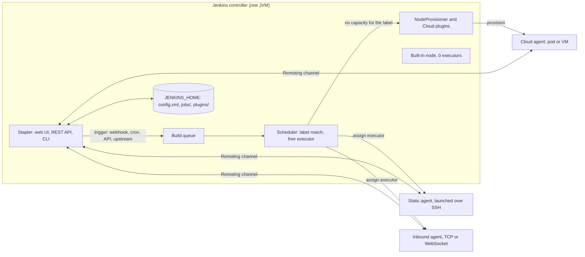
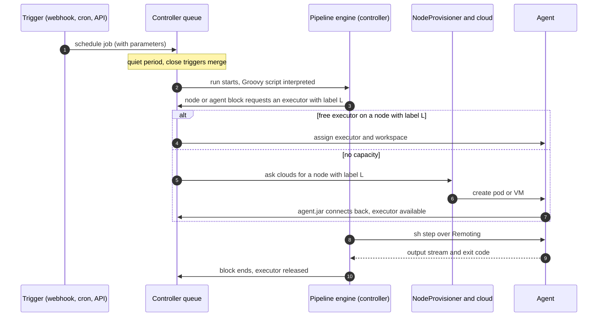

[Jenkins](https://www.jenkins.io/) is an open-source automation server written in Java. It watches source repositories, runs builds and tests when something changes, and can carry the result on to a deployment, which is why it sits at the centre of many CI/CD setups. Almost everything it can do comes from plugins: the core is a small web application that stores configuration, schedules work and hands that work to other machines.

This article explains how that core is put together. It follows a build from the trigger to the agent that runs it, then looks at the object model, the plugin system, the files under `JENKINS_HOME`, the Stapler web layer, the Pipeline engine and its continuation-passing interpreter, Configuration as Code and scaling. It ends with a real deployment: the Helm values and container images the Jenkins project uses for its own controllers.

The statements come from the jenkins.io documentation and from three repositories of the Jenkins infrastructure team, read at the commits pinned in the references. Security is covered only where the architecture creates a boundary; the companion article, [Jenkins Security]({{site.url_complet}}/2026/11/17/jenkins-security/), covers it in depth.

> This article has been made with the help of [Claude Code](https://claude.com/product/claude-code) and several custom skills

[TOC]

## What you need to know first

The article assumes familiarity with Git, builds and the command line, and relies on the following concepts without developing them.

- **Continuous integration and delivery.** Continuous integration builds and tests every change merged into a shared branch; continuous delivery keeps the result deployable at all times. Jenkins is the server that runs those builds.
- **Java web application (WAR) and servlet container.** A WAR file bundles a Java web application; a servlet container such as Jetty or Tomcat runs it and passes it HTTP requests. `jenkins.war` embeds its own container, so it can also run on its own.
- **Java class loaders.** The JVM loads classes through a tree of class loaders, each one asking its parent first. Jenkins gives each plugin its own loader, which explains several plugin errors described below.
- **Groovy.** A dynamic language for the JVM with a Java-like syntax. Jenkins Pipelines and many administration scripts are written in it.
- **Continuation-passing style (CPS).** A way of compiling a program so that "what to do next" is an explicit object rather than the call stack. Once execution state is an object, it can be written to disk and resumed later, which is what Jenkins does with Pipelines.
- **XML object serialization.** Libraries such as XStream turn Java objects into XML and back by reflection, without a schema. Jenkins stores almost all its state this way.
- **Kubernetes and Helm.** Kubernetes runs containers in pods; Helm installs applications on it from versioned charts configured by a values file. The last section reads such values files.

## What Jenkins is for, and where it came from

The documentation defines Jenkins as "a self-contained, open source automation server which can be used to automate all sorts of tasks related to building, testing, and delivering or deploying software". It runs from native packages, from Docker images, or from any machine with a Java runtime through `java -jar jenkins.war`.

The problem it solves is coordination. A team pushes changes many times a day; each change has to be compiled, tested on several platforms, scanned and packaged, and someone has to find out quickly when a change breaks the build. Jenkins receives the change notification, decides which jobs to run, finds a machine with the right tools, runs the job there, keeps the logs and artifacts, and reports the result. The jenkins.io home page puts the extension count at "2300+ community contributed plugins", covering source control systems, build tools, test reports, notifications and cloud providers.

The project started as **Hudson**, which Kohsuke Kawaguchi created while working at Sun Microsystems. The project's own Google Season of Docs applications give 2006 as its founding year. After Oracle acquired Sun, the community and Oracle disagreed over control of the Hudson name. A community vote closed in January 2011 with 214 eligible votes to rename and 14 for the status quo, and the project continued as Jenkins, moving its mailing lists, GitHub organisation (`jenkinsci`) and infrastructure under the new name.

Two release lines exist today. A **weekly** release ships new features and fixes; every 12 weeks one weekly release is chosen as a **Long-Term Support** (LTS) baseline, which then receives backported fixes every 4 weeks.

## The controller, nodes, agents and executors

A Jenkins installation has one **controller**: in the glossary's words, "the central, coordinating process which stores configuration, loads plugins, and renders the various user interfaces". The controller was called "master" until a terminology change; the term "agent" replaced "slave", and some system properties and class names (`slaveAgentPort`, `SlaveComputer`) keep the old words.

The work itself runs on **nodes**:

- **Agents** are separate processes, typically on another machine or in a container, that connect to the controller and run tasks it sends them. The node documentation describes an agent as "a small (170KB single jar) Java client process that connects to a Jenkins controller and is assumed to be unreliable".
- **The built-in node** is a node inside the controller process itself. It was called the "master node" before Jenkins 2.307 and 2.319.1. A build that runs there has the same file-system access as the Jenkins process, including `JENKINS_HOME`.
- **Clouds** are configurations that create agents on demand, such as the Kubernetes, Amazon EC2 or Azure VM Agents plugins, and remove them when idle.

Each node has a number of **executors**, slots that each run one task at a time. The executor count is the node's concurrency: four executors means four builds can run there at once. The documentation's sizing advice is that one executor per node is the safest configuration, and one per CPU core can work if the tasks are small. The built-in node should have **zero** executors: the controller then only serves HTTP, holds state and schedules, and no build can touch the controller's files.

Nodes carry **labels**, free-text tags such as `linux`, `docker` or `arm64`. A job restricts where it runs with a label expression, and a node can be set either to take any job or only jobs whose label expression matches it. When no free executor matches, tasks wait in the queue, a situation the documentation calls executor starvation.

Jenkins also monitors each node's free disk space, temporary space, swap, clock difference and response time, and takes a node offline when a threshold is crossed. The scaling guide recommends making agents **fungible**: standard images with tools installed by the build or by tool installers, so that any agent with a label can replace any other.



## Remoting and how agents connect

The controller talks to agents through **Remoting**, which the developer documentation describes as "an executable JAR, which implements the communication layer in Jenkins", used for controller-to-agent and controller-to-CLI communication. Once a channel is open, the controller sends work over it and the agent starts the build processes and streams their output back. How the work is encoded on the channel is documented in the Remoting repository, not on jenkins.io (see Gaps).

What differs between setups is who opens the connection. The documentation's section "Choose the connection direction" separates the two cases, and the launch methods follow from it:

| Launch method | Who connects | Transport | Typical use |
|---|---|---|---|
| SSH launcher | Controller connects to the agent host | SSH, using Jenkins' built-in SSH client; the controller's public key is in the agent's `authorized_keys` | Static Linux or Windows agents the controller can reach; the scaling guide calls it "the preferred and the most stable way" |
| Inbound agent, TCP | Agent connects to the controller | Dedicated TCP port, protocol `JNLP4-connect`; `jenkins.model.Jenkins.slaveAgentPort` is `-1` (disabled) by default since Jenkins 2.0 | Agents behind NAT or a firewall, older setups |
| Inbound agent, WebSocket | Agent connects to the controller | The controller's normal HTTP(S) port, since Jenkins 2.217; only implemented on the Jetty container | Containers and cloud agents; no extra port to open |
| Cloud plugin | Plugin creates the machine, which then connects inbound | Usually WebSocket or TCP | Kubernetes pods, EC2 or Azure VMs created per build |

An inbound agent is started with `java -jar agent.jar` and the controller URL, a per-agent secret and its name; the JAR can be downloaded from the controller at `/jnlpJars/agent.jar`. The old name "JNLP agent" comes from Java Web Start, which the inbound mechanism originally used; parts of the scaling guide still use that wording, and its own comments mark it as outdated.

Cloud provisioning has two timing properties worth knowing when agents seem slow to appear. `hudson.slaves.NodeProvisioner.initialDelay` waits about 100 seconds after startup before provisioning from clouds, so that static agents can connect and take the load first, and the provisioner then re-evaluates demand periodically.

The Remoting channel is also a security boundary: an agent can send requests back to the controller, and Jenkins filters them. That filtering is a subject of the [security article]({{site.url_complet}}/2026/11/17/jenkins-security/).

## The build queue

Everything that wants an executor goes through the **build queue**. The sequence below follows one build of a Pipeline job.



The steps in prose:

1. **Trigger.** A build can be requested by an SCM webhook or poll, a cron-like timer, an upstream job finishing, a user, the CLI `build` command, or an HTTP `POST` to `/job/<name>/build` (or `/buildWithParameters`).
2. **Quiet period.** The task waits for a configurable delay, set globally or per job, so that several commits arriving close together produce one build rather than several.
3. **Matching.** The scheduler looks for a free executor on a node whose labels satisfy the task's label expression.
4. **Provisioning.** If nothing matches, the `NodeProvisioner` asks the configured clouds for a new node with that label.
5. **Execution and release.** The executor runs the task, then becomes free again; a cloud agent that stays idle is removed.

For a Pipeline, step 3 happens inside the run. The Pipeline documentation says a `node` block "schedules the steps contained within it to run by adding an item to the Jenkins queue. As soon as an executor is free on a node, the steps will run", and it allocates a workspace there. A Pipeline with three `node` blocks therefore enters the queue three times.

The queue survives a restart. Its content is written to disk when it changes, with a maximum delay controlled by `hudson.model.Queue.Saver.DELAY_SECONDS` (60 seconds by default since Jenkins 2.109), a trade-off the documentation describes as queue consistency after a crash against I/O load.

## The object model

Jenkins is easier to understand once the classes behind the UI are known, because the same objects appear in the URLs, in the XML files and in the plugin API.

The root is a singleton, `jenkins.model.Jenkins`, whose legacy superclass `hudson.model.Hudson` still carries the project's first name. It holds the top-level items, the nodes, the global configuration and the security settings, and every other model object can be reached from it.

Below the root:

- **Items** are the entities of the UI: folders, Pipelines and other jobs. The traditional job hierarchy is `FreestyleProject` → `Project` → `AbstractProject` → `Job` → `AbstractItem` → `Item`.
- **Runs** are the executions of a job, paired with the job type: `FreestyleBuild` for a freestyle job, `WorkflowRun` for a Pipeline. A run is what the UI calls a build.
- **Actions** attach data and UI to an object. Jobs, runs and nodes are `Actionable`; an `Action` stores arbitrary data, adds a link to the side panel and contributes a URL segment through `getUrlName()`. Test reports and coverage pages are typically actions on a run.
- **Builders, publishers, SCMs, build wrappers and triggers** are the building blocks of a freestyle job: the steps that run, the post-build reporters, the source checkout, the environment around the build and what starts it.

Pipeline needed a different shape. `WorkflowJob` extends `Job` directly, because it "cannot act like an `AbstractProject`": it has no single SCM, no single workspace and no fixed list of build steps. Rather than add a level to the hierarchy, Jenkins moved the reusable parts into mixins: `ParameterizedJobMixIn` lets any job be scheduled with parameters and through the REST trigger, `SCMTriggerItem` handles SCM polling, and `LazyBuildMixIn` loads build records lazily. Plugins that still accept only `AbstractProject` cannot be used from Pipeline, and the documentation's migration advice is to accept `Job` and `Run` instead.

The pattern that holds the configuration together is **Describable / Descriptor**. A `Describable` is a configured instance, for example one shell build step in one job, with its command. Its `Descriptor` is a single object per type that acts like a class object: it creates instances from submitted forms, holds global settings for the type, and validates form fields through methods named `doCheckXxx`.

Instances are built from a form, a YAML file or Pipeline arguments through the same constructor, annotated `@DataBoundConstructor`, plus optional `@DataBoundSetter` setters. That shared binding is why one class can be configured from the web UI, from Configuration as Code and from a Pipeline step without three separate parsers.

## Extension points and plugins

### Extension points

An **extension point** is an interface or abstract class that models one aspect of Jenkins' behaviour: a kind of build step, an SCM, a security realm, a cloud, a view of the UI. A plugin contributes an implementation by annotating it with `@Extension`.

Discovery happens at build time. The plugin development guide explains that an annotation processor, SezPoz, records every `@Extension` class in an index inside the plugin; at startup Jenkins reads those indexes instead of scanning the class path. Code that needs the implementations asks for them by type:

```java
for (Checker c : ExtensionList.lookup(Checker.class)) {
    c.check(target);
}
```

This is a service locator: the code that defines `Checker` compiles against the interface only and finds every implementation from core and from all installed plugins at run time. The security configuration page uses the same mechanism to list all `SecurityRealm` implementations. jenkins.io publishes a generated index of extension points, built when the website is built.

### Plugins as packages

A plugin is a `.hpi` or `.jpi` archive, built with Maven (`plugin-pom` and `maven-hpi-plugin`) or with a Gradle plugin. Jenkins stores it as `JENKINS_HOME/plugins/<name>.jpi` and unpacks it next to the archive into `plugins/<name>/`, with a `META-INF/` manifest and the JARs under `WEB-INF/lib/`. Plugin dependencies are recorded in the manifest, for example `Plugin-Dependencies: a:1.13,b:1.6`, and can be optional.

Plugins are first-class participants. The architecture page lists that they take part in XStream persistence alongside core objects, contribute Jelly or Groovy views with the same conventions as core, ship static resources, and add Stapler web endpoints. To a user, nothing distinguishes a core feature from a plugin feature, and Pipeline itself is a set of plugins.

### Class loading

Each enabled plugin gets its own class loader, which delegates to Jenkins core and to the class loaders of the plugins it depends on. The chain is the Java platform, then the servlet container's class path, then core (`jenkins.war!/WEB-INF/lib/*.jar`), then one loader per plugin. A special `UberClassLoader` delegates to all enabled plugins and can find any plugin class.

Two consequences follow:

- **Name clashes are allowed between unrelated plugins.** Two plugins that do not depend on each other can each contain a class with the same name.
- **Plugins are not isolated from core's libraries.** A plugin that bundles a different version of a library core already ships sees core's version first. The `pluginFirstClassLoader` flag inverts this, and the documentation lists its "discontents"; its preferred alternatives are shading the library or depending on a *library wrapper plugin* that ships it once for all plugins.

The documentation also explains a common `ClassNotFoundException`: a class is loaded by the loader that defines it, so a library inside plugin A cannot see classes in a plugin B that depends on A, even though B can see A.

### Installing and updating plugins

The **Update Center** at `updates.jenkins.io` publishes plugin metadata, and plugin releases are stored in the project's Maven repository. Installing a plugin from the Plugin Manager pulls its dependencies automatically. Plugins can also be installed with the CLI `install-plugin` command, by uploading a `.hpi`, or by copying the file into `JENKINS_HOME/plugins` and restarting. Container deployments usually do something else again: they list plugins with pinned versions in a `plugins.txt` and run `jenkins-plugin-cli` while building the image, which the last section shows.

Some features that used to be part of core were split out into plugins (JUnit and Subversion support, for example). Jenkins adds those *detached plugins* as implied dependencies of older plugins built against a core version that still contained them, so the older plugins keep working.

## JENKINS_HOME: state without a database

Jenkins has no database. The persistence documentation states that it "uses the file system to store its data", in directories under `JENKINS_HOME` that follow the structure of the object model. Console output is plain text, some data is in Java properties files, and the majority of structured data, including project configuration and build records, is XML written by XStream. The default location is `/var/lib/jenkins` for the Linux packages.

The scaling guide gives the layout (abridged):

```text
JENKINS_HOME
 +- config.xml          root configuration (the Jenkins object)
 +- *.xml               other site-wide configuration, one file per component
 +- identity.key.enc    RSA key pair that identifies the instance
 +- secrets/            master.key, hudson.util.Secret, InstanceIdentity.KEY, initialAdminPassword
 +- userContent/        files served under /userContent/
 +- fingerprints/       artifact fingerprint records
 +- plugins/            <name>.jpi plus the unpacked <name>/ directory
 +- jobs/
     +- <JOB>/
         +- config.xml  job configuration
         +- workspace/  only for builds on the built-in node
         +- builds/<BUILD_ID>/  build.xml, log, changelog.xml, archived artifacts
     +- <FOLDER>/
         +- config.xml
         +- jobs/       nested items
```

A Pipeline run also writes its execution state, `program.dat`, inside its build directory (see the CPS section).

Storing objects with XStream makes persistence almost free for plugin authors, at the cost of compatibility work when a class changes. The documented techniques are:

- **`transient` fields**, which XStream does not write. Jenkins still reads them from XML by default, including from a user-submitted `config.xml`, so the keyword is not a deserialization boundary.
- **`readResolve()`**, which runs after loading and migrates old fields into new ones.
- **Aliases** for renamed classes, registered on the XStream instance that stores them (`Items.XSTREAM2` for job configuration, `Run.XSTREAM2` for build records), often from an `@Initializer` that runs before plugins start.
- **Custom converters** for complex migrations.

Two operational points follow from the layout. Builds can be moved out of `jobs/` to another disk with the system property `jenkins.model.Jenkins.buildsDir` (since 2.119), with the caveat that Jenkins migrates nothing for you. And a backup must include `secrets/`: the `master.key` and `hudson.util.Secret` pair is what decrypts stored credentials, so a restored `JENKINS_HOME` without it loads configuration it cannot decrypt. Workspaces do not need backing up. For deployments that outgrow local disk, *pluggable storage* plugins move artifacts, logs and other data to external services such as S3 or Azure Blob Storage.

## The web layer: Stapler

Every page, API endpoint and form in Jenkins is served through **Stapler**, a web framework that maps URLs onto the object graph instead of onto a routing table. The `Jenkins` object is bound to the root URL, and Stapler resolves each path segment by reflection on the current object:

| URL | Resolved as |
|---|---|
| `/log/` | `Jenkins#getLog()` |
| `/job/foo/` | `getJob("foo")`, a getter with an argument, then the `index.jelly` view of the job |
| `/job/foo/1/` | `Job#getDynamic("1", ...)`, a dynamic getter returning build number 1 |
| `/job/foo/changes` | the `changes.jelly` view of the job class |
| `/job/foo/1/artifact/...` | `Run#doArtifact(...)`, an action method |
| `/job/foo/config.xml` | `AbstractItem#doConfigDotXml(...)`, a method annotated `@WebMethod(name="config.xml")` |

Objects can change the walk. A `StaplerProxy` returns another object from `getTarget()` and has the highest priority, which Jenkins uses for permission checks: returning `this` only after checking access hides all getters and views of the object from a user without permission. `StaplerFallback` has the lowest priority, and an `Action`'s `getUrlName()` adds sub-URLs to any `Actionable` object. Setting the system property `stapler.trace` adds `X-Stapler-Trace-*` headers to each response that explain how the request was routed, which is the quickest way to find the Java method behind a URL.

Routing by reflection would expose every public getter, so Jenkins restricts it. Since 2.138.4 and 2.154 only methods and fields that Jenkins considers "routable" are dispatched: a web method needs an indicator such as `@RequirePOST`, a `StaplerRequest` parameter or an `HttpResponse` return type, or an explicit `@StaplerDispatchable` annotation.

Views are Jelly or Groovy files stored next to the class they render, under `src/main/resources/<package>/<Class>/`: `index.jelly` for the main page, `config.jelly` for the configuration form of a `Describable`, `global.jelly` for a `Descriptor`'s global settings. Forms are submitted as structured JSON and bound back to objects through `@DataBoundConstructor`, and the Descriptor's `doCheckXxx` and `doFillXxxItems` methods drive field validation and drop-down lists.

## Pipeline

### Jenkinsfile, Declarative and Scripted

**Pipeline** is a suite of plugins that defines a delivery process as code, usually in a file named `Jenkinsfile` committed to the repository. Two syntaxes run on the same engine and share the same steps:

```groovy
// Declarative
pipeline {
    agent { label 'linux' }
    options { timeout(time: 30, unit: 'MINUTES') }
    stages {
        stage('Build') { steps { sh 'make' } }
        stage('Test')  { steps { sh 'make test' } }
    }
    post { always { junit 'reports/*.xml' } }
}
```

```groovy
// Scripted
node('linux') {
    stage('Build') { sh 'make' }
    stage('Test') {
        try { sh 'make test' }
        finally { junit 'reports/*.xml' }
    }
}
```

**Declarative** imposes a fixed structure of sections and directives, from `pipeline`, `agent`, `stages`, `steps` and `post` to `options`, `environment`, `when`, `parallel` and `matrix`. It validates that structure before running and supports features such as restarting from a stage. A `script {}` block embeds Scripted code where needed. **Scripted** is general-purpose Groovy with `node` and `stage` blocks and ordinary flow control such as `if` and `try/catch`. The `agent` directive accepts `any`, `none` (each stage chooses), a label, a node specification, `docker`, `dockerfile` or a Kubernetes pod template.

### Where the code runs

The best-practices page states that "for a Pipeline, Groovy code *always* executes on controller", using controller memory and CPU. Only steps that start processes, such as `sh`, `bat` or `powershell`, run on the agent, inside the workspace that the enclosing `node` or `agent` block allocated.

The consequence is a set of anti-patterns the documentation names: parsing a large JSON file with `JsonSlurper` and `readFile`, making HTTP calls with `httpRequest`, or looping over many small steps. Each of these loads the controller, so the advice is to do the work in a single `sh` step on the agent and send back only the result.

### CPS: a program that survives a restart

Pipeline scripts are not run by the normal Groovy runtime. The `workflow-cps` plugin parses them with the Groovy compiler but runs most of the program inside its own interpreter, after a continuation-passing-style transform. In the documentation's words, this turns the code "into a version that can save its current state to disk (a file called `program.dat` inside your build directory) and continue running even after Jenkins has restarted".

Resumability has a price:

- Local variables must be serializable, because they are written to `program.dat`.
- Methods annotated `@NonCPS` run as ordinary Groovy, which is faster and supports every language construct, but they cannot call Pipeline steps and cannot be paused.
- Calling CPS-transformed code from non-CPS code fails in counterintuitive ways. Typical cases are a closure passed to `toSorted`, an overridden `toString`, a closure inside a GString and a constructor. The documentation lists these as "CPS method mismatches", and the runtime detects the most common one.

Shell steps come from a separate plugin, Pipeline: Nodes and Processes (`workflow-durable-task-step`), which runs them as processes on the agent. Together with `program.dat`, this is what lets the Pipeline overview state that Pipelines "can survive both planned and unplanned restarts of the Jenkins controller".

How often state is written is configurable through the **Speed/Durability Setting**, globally, per job, per branch or with the `properties` step:

| Setting | Behaviour |
|---|---|
| `MAX_SURVIVABILITY` | Default. Writes state at every step with atomic writes; slowest. |
| `SURVIVABLE_NONATOMIC` | Writes at every step without atomic writes; faster, especially on network file systems. |
| `PERFORMANCE_OPTIMIZED` | Greatly reduces disk I/O. After a *dirty* shutdown (SIGKILL, out-of-memory killer, a killed VM), running Pipelines may lose data and behave like freestyle jobs. |

A graceful shutdown persists state in every mode. The scaling guide suggests a global default of performance-optimized with maximum durability on critical jobs or release branches.

### Shared libraries

Common Pipeline code is shared through **shared libraries**. A library is a repository with three directories:

- `vars/` holds global variables that act as custom steps, each with optional `.txt` help;
- `src/` holds Groovy classes added to the class path;
- `resources/` holds files that Pipelines load with `libraryResource`.

A Pipeline loads one with `@Library('name@version') _` or the `library` step, or automatically if the library is marked "Load implicitly". Library code is CPS-transformed like the rest of the script.

Where the library is declared changes what it can do. A library configured under *Global Trusted Pipeline Libraries* runs outside the Groovy sandbox and can call any Java method, and the documentation warns that "anyone able to push commits to this SCM repository could obtain unlimited access to Jenkins". Global untrusted libraries and all folder-level libraries run in the sandbox. The security article covers the sandbox and script approval.

### Multibranch Pipelines and organization folders

A **Multibranch Pipeline** is a folder that Jenkins fills itself. Jenkins scans a repository, on a schedule or when a webhook arrives, and creates one child Pipeline job for each branch or pull request that contains a `Jenkinsfile`; it removes children when their branch disappears, according to an orphaned-item strategy. Each child gets `BRANCH_NAME` and `checkout scm` checks out the exact commit that triggered it. An **Organization Folder** goes one level up: it scans a whole GitHub organization or Bitbucket team and creates a multibranch project for every repository that has a `Jenkinsfile`.

## CLI and REST API

Jenkins has two programmatic interfaces besides the UI.

The **CLI** is either the `jenkins-cli.jar` client, downloaded from `/jnlpJars/jenkins-cli.jar`, or a plain SSH client talking to Jenkins' built-in SSH service, which is disabled by default on a new installation. The JAR client has three modes; since Jenkins 2.391 the default is `-webSocket`, with `-http` and `-ssh` as alternatives, and it authenticates with `-auth user:apitoken`. Plugins add commands by extending `CLICommand` or by annotating model methods with `@CLIMethod`.

The **remote access API** is not one endpoint. Appending `/api/` to almost any URL returns the object behind it in XML, JSON (with JSONP) or a Python-compatible format: `/api/json` for the root, `/job/foo/lastSuccessfulBuild/api/json` for one build. Query parameters shape the output: `tree=` selects fields, `depth=` controls how deep nested objects are expanded, and `xpath=` and `exclude=` filter the XML form. Writes go through ordinary URLs: `POST /job/foo/build`, `/buildWithParameters`, `GET` or `POST` on `.../config.xml` to read or replace a job's configuration, and `createItem` to create one. Scripts authenticate with HTTP Basic and an API token, which also removes the need for a CSRF crumb.

The **Script Console** at `/script` runs arbitrary Groovy inside the controller JVM or on an agent. It is an administration tool with full control of the instance, and is discussed in the security article.

## Configuration as Code

The `configuration-as-code` plugin (JCasC) configures a controller from YAML instead of from the web UI. By default it reads `$JENKINS_HOME/jenkins.yaml`; the `CASC_JENKINS_CONFIG` environment variable can point to other files, directories or URLs, which are combined and must not overwrite each other's values (a conflict raises a `ConfiguratorException`). The file has four sections:

- **`jenkins`** for the root object: system settings, nodes and clouds.
- **`tool`** for build tool installations.
- **`unclassified`** for every other global and plugin configuration.
- **`credentials`** for stored credentials.

JCasC does not have its own model. It walks the same `Describable` classes and `@DataBoundSetter` properties the UI uses, which is why the plugin can export the current configuration as YAML from the UI. Changes can be applied without a restart with *Reload existing configuration*.

The documentation's rule is to configure a controller "either with CasC or with the UI, but not by both": the UI still allows editing values that came from YAML, but those edits are overwritten at the next restart. Jobs are usually created separately, for example with a Job DSL seed job. The older alternative to JCasC is Groovy hook scripts in `init.groovy.d/`, which run at the end of startup with few safety checks.

## Scaling

A controller grows in two directions in the documentation's terms: *vertically*, with more jobs and builds on one controller, and *horizontally*, with more controllers. Builds scale out through agents and clouds, which add executors without loading the controller. The controller itself remains one process holding its state on disk, and every job configuration is loaded at startup, so a large instance starts slowly.

The scaling guide gives rough sizing equations, which assume a controller with 5 cores and one core per 100 jobs, so 500 jobs per controller:

```text
controllers = number of jobs / 500
executors   = number of jobs * 0.03
jobs        = number of developers * 3.333
```

For 1,500 jobs this gives 3 controllers and 45 executors. The guide presents these as a starting point to adjust to the types of builds and tests an organization runs, not as measured capacity limits. When an organization needs several controllers, it suggests splitting them by product line rather than by environment or by team.

Other levers in the documentation:

- **Storage.** Prefer large over fast disks for `JENKINS_HOME`, but Pipeline durability benefits from SSDs; enforce build discarders; separate build records with `buildsDir`.
- **Pipeline load.** Use the performance-optimized durability, combine steps, log less, and move work to agents.
- **Kubernetes.** Run the controller as a Deployment with a persistent volume and let the Kubernetes plugin create an agent pod per build from pod templates, using the `jenkins/inbound-agent` image or a custom one.
- **Manageability.** Keep a test controller for upgrades, monitor with the Metrics plugin, and back up `JENKINS_HOME`.

## A real deployment: how the Jenkins project runs its own controllers

The Jenkins infrastructure team publishes the configuration of its own controllers. Three repositories, read at the commits pinned in the references, show how the pieces above fit together in production. The figures below are those of 2026-11-17; the team's automation updates them weekly.

**The controller image is core plus a pinned plugin list.** `jenkins-infra/docker-jenkins-lts` contains a four-instruction Dockerfile:

```dockerfile
FROM jenkins/jenkins:2.580.2-jdk25

COPY logos /usr/share/jenkins/ref/userContent/logos
COPY plugins.txt /usr/share/jenkins/ref/plugins.txt
RUN jenkins-plugin-cli \
  --plugin-file /usr/share/jenkins/ref/plugins.txt \
  --verbose
```

`plugins.txt` pins 121 plugins to exact versions. The weekly image used for weekly.ci.jenkins.io is built the same way from `docker-jenkins-weeklyci` on `jenkins/jenkins:2.591-jdk25` and pins 116.

A `cst.yml` container-structure test checks that the image contains key plugins such as `kubernetes.jpi`, `workflow-aggregator.jpi`, `git.jpi` and `configuration-as-code.jpi`, and an `updatecli` configuration opens pull requests when core or a plugin has a new release. The resulting image, `jenkinsciinfra/jenkins-lts`, is tagged `<image version>-<core version>`, for example `2.3.124-2.580.2`.

**Controllers are Helm releases.** In `jenkins-infra/kubernetes-management`, each cluster has a helmfile (`clusters/<cluster>.yaml`). On the `privatek8s-sponsored` cluster, `infra-ci-jenkins-io` and `release-ci-jenkins-io` are releases of the official `jenkins/jenkins` chart, version 5.13.3, each in its own namespace and each with a persistent volume claim holding `JENKINS_HOME`. Their values files live under `config/privatek8s-sponsored/`.

**Plugins come only from the image.** The values set `installPlugins: false`, so the chart installs nothing at startup, and `overwritePlugins: true`, which the file's own comment explains: it "deletes the content of `$JENKINS_HOME/plugins` on each pod restart to ensure only container image plugins are used". A plugin installed by hand from the UI disappears at the next restart, and upgrading a plugin means building and deploying a new image.

**Everything else is JCasC.** `controller.JCasC.defaultConfig: false` discards the chart's default YAML, and `configScripts` provides the configuration in named blocks:

- credentials (a GitHub App, Azure managed identities, a Kubernetes service-account token), with secret values injected as `${VAR}` from encrypted files that are not in the public repository;
- `numExecutors: 0` on the controller and a `kubernetes` cloud with `webSocket: true`, so agent pods connect back over HTTPS without a dedicated TCP port;
- an LDAP security realm and `globalMatrix` authorization;
- the Jenkins URL and a separate resource root URL (`assets.<host>`) for serving build artifacts;
- on infra.ci.jenkins.io, a global shared library named `pipeline-library`, loaded implicitly.

**The network is split.** infra.ci.jenkins.io serves its UI on a private ingress, and a second ingress on a public host exposes only the `/github-webhook` path so GitHub can reach it. The values enable the chart's Kubernetes network policy and run the controller pod as a non-root user (UID 1000).

Read against the architecture, the setup applies most of the documentation's advice at once: the built-in node runs nothing, agents are disposable pods, the plugin set is versioned and tested like code, and the controller's configuration can be rebuilt from Git plus the encrypted secrets. What remains on the persistent volume is mostly job and build history.

## Where security fits

Several boundaries described above are security boundaries, and they are covered in the companion article [Jenkins Security - Threat Model, Permissions, Groovy, Credentials and Nine Years of Advisories]({{site.url_complet}}/2026/11/17/jenkins-security/):

- the built-in node and controller isolation, the reason executors are set to 0;
- the Remoting channel and the filtering of agent-to-controller requests;
- the Groovy sandbox, script approval and trusted shared libraries;
- Stapler routing restrictions, CSRF protection and the resource root URL;
- credentials encryption with the `secrets/` keys, the Script Console, and plugin vulnerabilities.

## Conclusion

Jenkins is a Java web application whose controller holds all state and schedules work, while agents run the builds over Remoting.

- **Nodes and executors.** The controller, its built-in node, static agents and cloud agents are all nodes; executors are their concurrency slots, and labels decide which tasks they accept. The built-in node is set to zero executors.
- **Agent connections.** SSH launchers connect from the controller; inbound agents connect from outside over a TCP port that is disabled by default, or over WebSocket on the HTTP port since 2.217.
- **Queue.** Every build, and every `node` block of a Pipeline, enters the queue, waits out a quiet period, and is matched to a free executor or causes a cloud to provision one.
- **Model and plugins.** A single `Jenkins` root object holds items, runs, actions and Describable/Descriptor pairs. Plugins add `@Extension` implementations found through a compile-time index, each with its own class loader.
- **Storage and web.** `JENKINS_HOME` is a tree of XStream XML files with no database, and Stapler maps URLs onto the same object graph, which is also where `/api/json` comes from.
- **Pipeline.** The Groovy script runs on the controller under a CPS interpreter that writes `program.dat` so it can resume after a restart; only process steps run on agents.
- **Operations.** JCasC rebuilds global configuration from YAML; the Jenkins project's own controllers combine an image with pinned plugins, a Helm chart, JCasC and agent pods over WebSocket.


## Annex

### Key Terms

| Term | Definition |
|------|------------|
| **Controller** | The central Jenkins process that stores configuration, loads plugins, serves the UI and API, and schedules builds; formerly called "master". |
| **Node** | Any machine or process able to run builds, either an agent or the controller's built-in node. |
| **Built-in node** | The node that runs inside the controller process, with the controller's file-system access; recommended to have zero executors. |
| **Agent** | A Java process, usually on another machine or in a container, that connects to the controller and runs the tasks it is sent. |
| **Executor** | A slot on a node that runs one task at a time; the number of executors is the node's build concurrency. |
| **Label** | A free-text tag on a node, such as `linux` or `docker`, matched against a job's label expression to choose where it runs. |
| **Cloud** | A configuration, provided by a plugin, that creates agents on demand (Kubernetes pods, cloud VMs) and removes them when idle. |
| **Remoting** | The library and JAR implementing the communication channel between the controller and agents or CLI clients. |
| **Inbound agent** | An agent that opens the connection to the controller itself, over a dedicated TCP port or over WebSocket; formerly called a JNLP agent. |
| **Build queue** | The controller's list of tasks waiting for an executor, persisted to disk so that it survives a restart. |
| **Quiet period** | A delay before a queued build starts, so that several triggers arriving close together produce a single build. |
| **Item / Job / Run** | An item is any entity of the UI (folder, job); a job is a configured unit of work; a run (build) is one execution of a job. |
| **Action** | An object attached to a job, run or node that stores data and contributes a side-panel link and a URL. |
| **Describable / Descriptor** | A configured instance of a type, and the per-type object that creates such instances from forms or YAML, holds global settings and validates fields. |
| **Extension point** | An interface or abstract class modelling one aspect of Jenkins' behaviour; plugins implement it in classes annotated `@Extension`. |
| **Plugin (.hpi / .jpi)** | A packaged extension with its own class loader, stored in `JENKINS_HOME/plugins` and installed from the Update Center or baked into an image. |
| **JENKINS_HOME** | The directory holding all controller state as XML and text files: global configuration, jobs, build records, plugins and secrets. |
| **XStream** | The library that serializes Jenkins' Java objects to XML and back, used for configuration and build records. |
| **Stapler** | The web framework that maps each URL segment to a getter, view or action method on the Jenkins object graph. |
| **Jenkinsfile** | A file in the repository that defines a Pipeline in Declarative or Scripted syntax. |
| **CPS (workflow-cps)** | The continuation-passing-style interpreter that runs Pipeline Groovy on the controller and saves its state to `program.dat` so it can resume. |
| **Shared library** | A repository of reusable Pipeline code (`vars/`, `src/`, `resources/`) loaded by Pipelines; trusted libraries run outside the sandbox. |
| **Multibranch Pipeline** | A folder that scans a repository and creates one Pipeline job per branch or pull request containing a Jenkinsfile. |
| **JCasC** | The Configuration as Code plugin, which applies a YAML description of the controller's global configuration. |

### Invariants

| Invariant | Enforced by | Breaks if |
|-----------|-------------|-----------|
| Pipeline Groovy code runs in the controller JVM; only process steps run on agents. | The workflow-cps interpreter, which executes the script on the controller and delegates `sh`/`bat` to the node of the enclosing block. | Never; heavy parsing in Groovy therefore always loads the controller. |
| A build can only start on an executor of a node whose labels match the task's label expression. | The queue's scheduler and the NodeProvisioner. | No node or cloud offers the label, and the task waits indefinitely (executor starvation). |
| Every persisted object is reachable under `JENKINS_HOME` in a path that mirrors the object model. | XStream persistence through `XmlFile`, one file per object. | A plugin stores data elsewhere (external storage plugins do so on purpose), or `buildsDir` moves build records. |
| A running Pipeline can resume after a controller restart. | `program.dat` written by CPS, and shell steps run by the Pipeline: Nodes and Processes plugin on the agent. | The durability setting is `PERFORMANCE_OPTIMIZED` and the controller stops uncleanly. |
| Each plugin sees core and its declared dependencies, not unrelated plugins. | The per-plugin class loader delegation. | Code uses `UberClassLoader` or the thread context loader to reach other plugins. |
| Configuration set by JCasC is the configuration after a restart. | The plugin re-applying `jenkins.yaml` at startup. | Values are only edited in the UI, which are then lost at the next restart. |

### Integration Notes

| Behaviour | What an integrator should do |
|-----------|------------------------------|
| The REST API is the model itself, under `/api/` of any URL, and expands nested objects only to a default depth. | Use `tree=` to request exactly the fields needed, rather than raising `depth=`, which can return very large documents. |
| A `node` block in Pipeline enters the build queue each time it is reached. | Count queue time per `node` block when measuring Pipeline latency, and group work into fewer blocks. |
| Plugins written against `AbstractProject` or `AbstractBuild` do not work from Pipeline. | Accept `Job` and `Run`, implement `SimpleBuildStep` for build steps, and use `ParameterizedJobMixIn` / `SCMTriggerItem` for scheduling and polling. |
| `transient` fields are not written but are still read from XML by default. | Do not rely on `transient` to keep a field from being set by a submitted `config.xml`; see the persistence documentation. |
| The inbound TCP port is disabled by default. | Use WebSocket for inbound agents unless a dedicated port is required, and expose `/jnlpJars/agent.jar` through the same URL. |
| In a container with `overwritePlugins: true`, plugins installed from the UI vanish on restart. | Change `plugins.txt` and rebuild the image instead. |

## Frequently Asked Questions

**Q: What is the difference between the controller, the built-in node and an agent?**

The controller is the Jenkins process: it holds configuration and build history, serves the UI and API, and schedules work. The built-in node is a node that lives inside that process, so a build running on it has the controller's file-system access, including `JENKINS_HOME`. An agent is a separate process, usually on another machine or in a container, connected over Remoting. The recommended setup gives the built-in node zero executors, so all builds run on agents.

**Q: An agent sits behind NAT and the controller cannot open a connection to it. Which launch method fits, and what has to be open?**

An inbound agent, because the agent opens the connection. It needs a route to the controller URL. Over WebSocket, available since Jenkins 2.217 on the Jetty container, the agent uses the controller's normal HTTP(S) port, so no other port is required. Over the TCP transport, the controller's inbound agent port must also be enabled and reachable, since it is disabled (`-1`) by default.

**Q: Why does a heavy `JsonSlurper` call in a Jenkinsfile slow down every build on the instance, even though the job runs on an agent?**

Because Pipeline Groovy always executes on the controller, inside the CPS interpreter; only steps such as `sh` run on the agent. Parsing a large file in Groovy loads it into controller memory (twice, according to the best-practices page) and uses controller CPU, which every other job shares. The fix is to process the file in an `sh` step on the agent and return only the result.

**Q: How does a Pipeline survive a controller restart, and when does it not?**

The workflow-cps plugin transforms the script into continuation-passing style, so its execution state is an object that it writes to `program.dat` in the build directory. Shell steps run as processes on the agent through the Pipeline: Nodes and Processes plugin. After the restart, the Pipeline is loaded from `program.dat` and continues.

It may not resume if the durability setting is `PERFORMANCE_OPTIMIZED` and the controller stopped uncleanly (SIGKILL, out-of-memory killer), because state was not written at every step. A graceful shutdown persists state in every mode.

**Q: How does a request to `/job/foo/1/api/json` reach Java code?**

Stapler starts at the `Jenkins` root object and resolves each segment by reflection: `job/foo` calls `getJob("foo")`, `1` calls the job's `getDynamic("1", ...)` to get the build, and `api` reaches the API object exposed for that build, which renders the build's exported properties as JSON. Objects implementing `StaplerProxy` can intercept the walk, which Jenkins uses to check permissions. `stapler.trace` shows the route in response headers.

**Q: The Jenkins project's controllers set `installPlugins: false`, `overwritePlugins: true` and `numExecutors: 0`. What does each setting achieve?**

Each one closes a different way for the running controller to drift from its definition:

- `installPlugins: false` stops the Helm chart from downloading plugins at startup, so the plugin set comes only from the image built from `plugins.txt`.
- `overwritePlugins: true` deletes `JENKINS_HOME/plugins` at each pod restart, so a plugin added by hand from the UI does not survive.
- `numExecutors: 0` removes the built-in node's executors, so every build runs in an agent pod rather than in the controller's process.

Together with JCasC, the controller can be rebuilt from Git, the image and the encrypted secrets.

## Gaps

Several internals are not documented on jenkins.io, or only as stubs, and some facts in this article come from outside the docs that were read.

| Gap | Why it matters | What to read or verify |
|-----|----------------|------------------------|
| The developer page on scheduling is an empty stub, so the internal queue states and extension points (`QueueTaskDispatcher`, `LoadBalancer`, how a Pipeline's own run is scheduled) are not described here. | Queue internals are what one reads when debugging builds stuck in the queue. | `hudson.model.Queue` in [jenkinsci/jenkins](https://github.com/jenkinsci/jenkins) (`core/src/main/java/hudson/model/Queue.java`) and the [Jenkins Javadoc](https://javadoc.jenkins.io/). |
| Remoting internals (how work is serialized, remote class loading, the `JNLP4-connect` handshake) are not in the docs read, which only link the Remoting README. | They explain agent performance and the agent-to-controller boundary. | The [jenkinsci/remoting README](https://github.com/jenkinsci/remoting/blob/master/README.md) and its `docs/` folder. |
| The split between `Node` (configuration) and `Computer` (runtime state) and the `@ExportedBean` / `@Exported` mechanism behind `/api/` are only mentioned in passing in the docs; the article does not detail them. | Readers following the model into the code meet these classes first. | `hudson.model.Computer`, `hudson.model.Node` and `org.kohsuke.stapler.export` in the [Jenkins Javadoc](https://javadoc.jenkins.io/). |
| The startup sequence (`InitMilestone` order) and when JCasC is applied within it are not documented (the initialization page is a stub). | Ordering between plugins, JCasC and init scripts decides which configuration wins. | `jenkins.InitMilestone` in the [Jenkins Javadoc](https://javadoc.jenkins.io/) and the [configuration-as-code plugin documentation](https://github.com/jenkinsci/configuration-as-code-plugin). |
| How durable tasks keep `sh` steps running during a restart is stated in the docs but its mechanism is not described. | Matters when a step's output is lost after a restart. | The [durable-task plugin](https://github.com/jenkinsci/durable-task-plugin) and workflow-durable-task-step plugin READMEs. |
| The 2006 founding year comes from the project's Google Season of Docs applications, and the Sun/Oracle background from 2011 blog posts, not from a dated history page. | The history paragraph rests on them. | `content/sigs/docs/gsod/2021/organization-proposal.adoc` and the [2011 rename post](https://www.jenkins.io/blog/2011/01/29/jenkins/) in the jenkins.io repository. |
| The infra.ci.jenkins.io controller runs an image (`jenkinsciinfra/jenkins-infraci`) built from a repository that was not read; the image analysis covers `docker-jenkins-lts` used by release.ci.jenkins.io. | The infra.ci plugin list may differ from the 121 plugins quoted. | The jenkins-infra organization on GitHub, searching for the `jenkins-infraci` image source. |
| The encrypted values (`secrets/`, sops), the `jenkins-infra/helm-charts` and `pipeline-library` repositories were not read. | Agent pod templates and shared-library code are part of the real setup. | [jenkins-infra/helm-charts](https://github.com/jenkins-infra/helm-charts) and [jenkins-infra/pipeline-library](https://github.com/jenkins-infra/pipeline-library). |
| Version-dependent facts (WebSocket agents since 2.217, CLI WebSocket default since 2.391, built-in node rename in 2.307, image and plugin versions) were read on 2026-11-17. | They change with each release, and the infra repositories change weekly through updatecli. | `content/doc/book/managing/system-properties.adoc`, the changelogs in the jenkins.io repository, and the pinned commits below. |
| The agent size quoted from the node documentation ("a small (170KB single jar)") may be out of date; it is a documentation figure, not a measurement. | The number gives a reader a sense of how light an agent is. | The size of `agent.jar` served at `/jnlpJars/agent.jar` by a current controller, and `content/doc/book/managing/nodes.adoc` in the jenkins.io repository. |
| The scaling equations come from the scaling guide without the data they were derived from. | They are rules of thumb, not measured limits. | [Architecting for Scale](https://www.jenkins.io/doc/book/scaling/architecting-for-scale/) and a load test on the actual workload. |

## References

### Analyzed source

- [jenkins-infra/jenkins.io](https://github.com/jenkins-infra/jenkins.io) (documentation source) — analyzed at commit [`39e4020b363558216017486859a0198b8be59e79`](https://github.com/jenkins-infra/jenkins.io/tree/39e4020b363558216017486859a0198b8be59e79), 2026-11-17
- [jenkins-infra/kubernetes-management](https://github.com/jenkins-infra/kubernetes-management) — analyzed at commit [`d18af889d084eb105413cffbdf78d7d6db6ad5e3`](https://github.com/jenkins-infra/kubernetes-management/tree/d18af889d084eb105413cffbdf78d7d6db6ad5e3), 2026-11-17 (`clusters/privatek8s-sponsored.yaml`, `config/privatek8s-sponsored/infra.ci.jenkins.io.yaml`, `config/privatek8s-sponsored/release.ci.jenkins.io.yaml`, `config/publick8s-sponsored/weekly-ci-jenkins-io.yaml`)
- [jenkins-infra/docker-jenkins-lts](https://github.com/jenkins-infra/docker-jenkins-lts) — analyzed at commit [`5f3ffd3f3f68f08ca7a322b297ac20f3f8ae5337`](https://github.com/jenkins-infra/docker-jenkins-lts/tree/5f3ffd3f3f68f08ca7a322b297ac20f3f8ae5337), 2026-11-17
- [jenkins-infra/docker-jenkins-weeklyci](https://github.com/jenkins-infra/docker-jenkins-weeklyci) — analyzed at commit [`58375fbbd2168f98a998f6c2a8980a0566cc50bb`](https://github.com/jenkins-infra/docker-jenkins-weeklyci/tree/58375fbbd2168f98a998f6c2a8980a0566cc50bb), 2026-11-17

### Jenkins User Handbook

- [Jenkins documentation overview](https://www.jenkins.io/doc/)
- [Glossary](https://www.jenkins.io/doc/book/glossary/)
- [Installing Jenkins (release lines)](https://www.jenkins.io/doc/book/installing/)
- [Managing Nodes](https://www.jenkins.io/doc/book/managing/nodes/)
- [Built-in node migration](https://www.jenkins.io/doc/book/managing/built-in-node-migration/)
- [Using Jenkins agents](https://www.jenkins.io/doc/book/using/using-agents/)
- [Executor starvation](https://www.jenkins.io/doc/book/using/executor-starvation/)
- [Managing Plugins](https://www.jenkins.io/doc/book/managing/plugins/)
- [Jenkins CLI](https://www.jenkins.io/doc/book/managing/cli/)
- [Remote Access API](https://www.jenkins.io/doc/book/using/remote-access-api/)
- [Configuration as Code](https://www.jenkins.io/doc/book/managing/casc/)
- [Features controlled by system properties](https://www.jenkins.io/doc/book/managing/system-properties/)
- [Architecting for Scale](https://www.jenkins.io/doc/book/scaling/architecting-for-scale/)
- [Scaling Jenkins on Kubernetes](https://www.jenkins.io/doc/book/scaling/scaling-jenkins-on-kubernetes/)
- [Pluggable storage](https://www.jenkins.io/doc/book/using/pluggable-storage/)
- [Pipeline](https://www.jenkins.io/doc/book/pipeline/), [Pipeline Syntax](https://www.jenkins.io/doc/book/pipeline/syntax/), [Branches and Pull Requests](https://www.jenkins.io/doc/book/pipeline/multibranch/), [Extending with Shared Libraries](https://www.jenkins.io/doc/book/pipeline/shared-libraries/)
- [Pipeline Best Practices](https://www.jenkins.io/doc/book/pipeline/pipeline-best-practices/), [Scaling Pipelines](https://www.jenkins.io/doc/book/pipeline/scaling-pipeline/), [Pipeline CPS Method Mismatches](https://www.jenkins.io/doc/book/pipeline/cps-method-mismatches/)

### Jenkins Developer Guide

- [Architecture](https://www.jenkins.io/doc/developer/architecture/) and [Model](https://www.jenkins.io/doc/developer/architecture/model/)
- [Extensions and Plugins](https://www.jenkins.io/doc/developer/architecture/extensions/)
- [Remoting](https://www.jenkins.io/doc/developer/architecture/remoting/)
- [Plugin development](https://www.jenkins.io/doc/developer/plugin-development/) and [Dependencies and Class Loading](https://www.jenkins.io/doc/developer/plugin-development/dependencies-and-class-loading/)
- [Writing Pipeline-compatible plugins](https://www.jenkins.io/doc/developer/plugin-development/pipeline-integration/)
- [Persistence](https://www.jenkins.io/doc/developer/persistence/)
- [Routing Requests](https://www.jenkins.io/doc/developer/handling-requests/routing/) and [Stapler reference documentation](https://github.com/stapler/stapler/blob/master/docs/reference.adoc)

### History

- [Hudson's future](https://www.jenkins.io/blog/2011/01/11/hudsons-future/), jenkins.io blog, 11 January 2011
- [Jenkins!](https://www.jenkins.io/blog/2011/01/29/jenkins/), jenkins.io blog, 29 January 2011

### Related articles

- [Jenkins Security - Threat Model, Permissions, Groovy, Credentials and Nine Years of Advisories]({{site.url_complet}}/2026/11/17/jenkins-security/)
- [How GitHub Dependabot Works: From an Update Job to a Pull Request]({{site.url_complet}}/2026/11/05/how-github-dependabot-works/)
- [Isolating Untrusted Build Tools: How Dependabot's Credential Proxy Works]({{site.url_complet}}/2026/11/05/dependabot-credential-proxy-isolation/)
- [Linux Isolation Primitives - Defense in Depth Beyond the Castle Model]({{site.url_complet}}/2026/06/29/linux-isolation-primitives-defense-in-depth/)
- [Docker en bref]({{site.url_complet}}/2021/05/11/docker-en-bref/)
