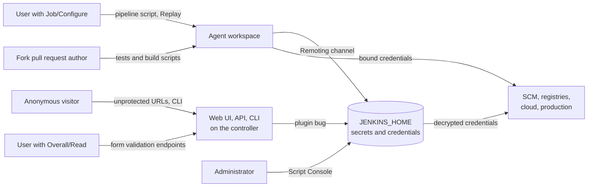
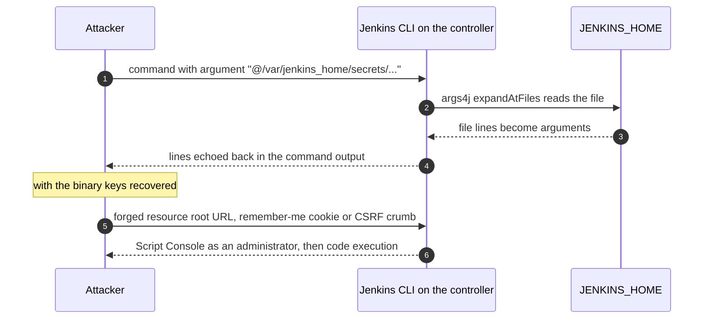

[Jenkins](https://www.jenkins.io/) is an open-source automation server: a Java controller that schedules builds, and agents that run them, extended by more than 2,000 plugins. A companion article, [How Jenkins works]({{site.url_complet}}/2026/11/17/jenkins-architecture/), describes that architecture; this one looks at what an attacker can do with it and what an administrator can do about it.

A Jenkins controller holds the credentials of every system it deploys to, runs code written by people who are not its administrators, and produces the artifacts other people install. Its security model has to separate those parties inside one Java process, and most of the issues in the project's security advisories are in plugins, where the most frequent classes are checks a plugin forgot: permission checks, CSRF protection and output escaping.

The article follows the Jenkins documentation and the project's security advisories at a pinned commit, counts the 1,541 issues those advisories published between November 2017 and October 2026, and ends with the configuration the Jenkins project uses for its own controllers.

> This article has been made with the help of [Claude Code](https://claude.com/product/claude-code) and several custom skills

[TOC]

## What you need to know first

The article assumes the reader knows what continuous integration is and has seen a `Jenkinsfile`. These mechanisms are used below without being derived:

- **Controller, agents and Remoting.** The controller is the Jenkins process that serves the UI and stores configuration in `JENKINS_HOME`; agents are separate processes, often on other machines, connected through the Remoting library (`agent.jar`), which exchanges serialized Java objects. [How Jenkins works]({{site.url_complet}}/2026/11/17/jenkins-architecture/) covers both. Here the Remoting channel is treated as a trust boundary.
- **Stapler URL routing.** Jenkins maps a URL path onto a graph of Java objects and calls their public `do*` methods and getters by name. Any such method is an HTTP endpoint, so a plugin method that forgets a permission check is an API open to anyone with Overall/Read, or to everyone on a URL that opts out of that requirement.
- **Pipeline Groovy (CPS).** Pipelines are Groovy scripts executed on the controller, transformed so they can pause and resume. A `Jenkinsfile` is therefore code running inside the controller's JVM, which is why it has to run in a sandbox.
- **Multibranch and organization folders.** A multibranch project creates one job per branch or pull request of a repository and builds the `Jenkinsfile` found in each; an organization folder does the same for every repository of an organization, with one SCM credential used for scanning.
- **CSRF and CSP.** Cross-site request forgery makes a logged-in victim's browser send a request the attacker chose; Content-Security-Policy is a response header that tells the browser which scripts and resources a page may load. Both are browser-side defences that Jenkins applies to its own UI and to files users upload.
- **CVSS 3.1.** The [Common Vulnerability Scoring System](https://www.first.org/cvss/v3.1/specification-document) scores a vulnerability from a vector such as `AV:N/AC:L/PR:N/UI:N/S:U/C:H/I:H/A:H`. The Jenkins security team assigns the vector and the severity label of every advisory issue with its own conventions, used in the statistics below.

## Why a CI server is a high-value target

A CI server combines three things an attacker wants, in one process, with one set of administrators:

- **Credentials.** Jenkins stores SCM tokens, cloud keys, registry passwords, SSH keys and deployment secrets, encrypted with keys kept on the same disk. Reading the controller's `secrets/` directory and the encrypted values is enough to decrypt all of them ([credentials documentation](https://www.jenkins.io/doc/book/security/credentials/)).
- **Code execution by design.** Running other people's code is the product. A build executes `Makefile`s, tests and `Jenkinsfile`s that the administrators did not write, and an administrator can run arbitrary Groovy on the controller through the Script Console.
- **Position in the supply chain.** The artifacts Jenkins builds, signs and publishes are installed downstream. Control of a build is control of what those users receive, which MITRE ATT&CK lists as [Compromise Software Supply Chain (T1195.002)](https://attack.mitre.org/techniques/T1195/002/).

ATT&CK v19.2 also has a technique for the CI-specific path, T1677 [Poisoned Pipeline Execution](https://attack.mitre.org/techniques/T1677), with three variants that map directly to Jenkins: editing the pipeline file itself, editing the tests and build scripts the pipeline calls, and opening a pull request from a fork that triggers the pipeline. The credentials stored in `JENKINS_HOME` fall under T1552.001 [Credentials In Files](https://attack.mitre.org/techniques/T1552/001/), and an internet-facing controller under T1190 [Exploit Public-Facing Application](https://attack.mitre.org/techniques/T1190/).

The Jenkins documentation draws the same boundaries. The people who control what a build runs are less trusted than the administrator: anyone with Job/Configure, the authors of build scripts such as `pom.xml` or `Makefile`, and the authors of the code under test ([controller isolation](https://www.jenkins.io/doc/book/security/controller-isolation/)). A `Jenkinsfile` is a build script in the same sense. The diagram shows the entry points into the controller and what each one leads to.



Every arrow into `JENKINS_HOME` other than the administrator's is supposed to be closed by a control described below: permission checks on web endpoints, agent-to-controller access control on the Remoting channel, and the Groovy sandbox for pipeline code. Many of the advisories in the last sections are failures of one of those three. Others take a different route: cross-site scripting reaches the controller through an administrator's browser, and a secret stored in plain text leaks without crossing any boundary.

## The security model: realms, authorization strategies and permissions

Jenkins separates authentication from authorization ([access control](https://www.jenkins.io/doc/book/security/access-control/)):

- **The security realm** says who a user is and which groups they belong to. Built in are Jenkins' own user database, delegation to the servlet container, and Unix users and groups. The user database has been the default since Jenkins 2.214, which removed the "Enable security" checkbox. Plugins add LDAP, Active Directory, SAML, OpenID Connect, GitHub and others.
- **The authorization strategy** says what that user may do. "Anyone can do anything" and "Legacy mode" are for test instances only. "Logged-in users can do anything" is what the setup wizard configures, and it is safe only while every account is fully trusted; combined with a realm that lets anyone sign up or log in with a public GitHub or Google account, it hands Overall/Administer to strangers. The documentation recommends the matrix strategies of the [Matrix Authorization Strategy plugin](https://plugins.jenkins.io/matrix-auth/), where grants are additive and can be scoped to folders, jobs and agents.

A matrix entry for the `anonymous` user or the `authenticated` group is a grant to everyone in that category, so Overall/Administer for `authenticated` is "Logged-in users can do anything" under another name.

### What each permission gives in practice

The [permissions reference](https://www.jenkins.io/doc/book/security/access-control/permissions/) is more useful than the permission names, because several permissions give much more than they say:

| Permission | What it gives in practice |
|---|---|
| None (anonymous) | The login and signup pages, `/jnlpJars/` (agent and CLI jars), the agent listener, and every `UnprotectedRootAction` (in core: `/cli/`, `/whoAmI/`, `/wsagents/`, `/instance-identity/` and others; in plugins: SCM webhook endpoints). These endpoints must do their own checks. |
| Overall/Read | The basic API, the list of all agents, search, and every form-validation and autocompletion URL of every extension point. A `doCheck*` or `doFill*` method without its own permission check is open to anyone with Overall/Read. |
| Overall/Administer | Everything: install or upload plugins, run Groovy on the controller and on every agent, run any shell command anywhere. |
| Agent/Configure, Agent/Create | Point jobs at a machine the user controls, and read everything those builds see: files, environment, credentials. |
| Job/Configure | Change a job, which implies Run/Replay: re-run a Pipeline with an edited script. With credentials in scope, it is the ability to use those credentials. |
| Job/Workspace | Browse the workspace: source code and intermediate build output. |
| Run/Update | Edit build descriptions, which the markup formatter renders as HTML. |
| Credentials/Create, View, Update | From the Credentials plugin. Create should be held by very few people. |

Overall/Administer is the one permission with no ceiling. The documentation says that an instance where an untrusted user obtained it is compromised: the instance should be replaced, every secret rotated, and every artifact produced since the compromise checked. The project's [reporting rules](https://www.jenkins.io/security/reporting/) follow from this: "an administrator can execute code" is not a vulnerability, because that is what the permission is.

Two smaller permissions exist to give administration without that ceiling. Overall/Manage, defined in [JEP-223](https://github.com/jenkinsci/jep/tree/master/jep/223), covers configuration that is not security-critical. Overall/SystemRead, from [JEP-224](https://github.com/jenkinsci/jep/tree/master/jep/224), gives read-only access to the global configuration, for controllers configured as code. The older Overall/RunScripts, UploadPlugins and ManageUpdateSites permissions are obsolete; only Administer matters now.

### Builds run as SYSTEM

Permissions apply to users. Builds are another matter. By default a build runs as the internal SYSTEM user, with full permissions: it can run on any node, create or delete jobs, and start or cancel any other build ([access control for builds](https://www.jenkins.io/doc/book/security/build-authorization/)). On an instance with fine-grained permissions this is a privilege escalation: a user who can configure one job adds `build job: 'deploy-production'` to its Pipeline and starts a job they have no permission to start. The Agent/Build permission is not enforced at all in that state, since what Jenkins checks is the build's identity, not the user's.

The fix the documentation names is the [Authorize Project plugin](https://plugins.jenkins.io/authorize-project/), which configures, globally or per project, which user a build runs as. The same page notes that the plugin is not actively maintained and has known limitations. The security team does not treat "builds can start jobs the user cannot" as a vulnerability: it is this documented configuration issue.

## Controller isolation and the agent boundary

The [controller isolation](https://www.jenkins.io/doc/book/security/controller-isolation/) page starts from one fact: a build on the built-in node runs inside the controller's process and file system, with the same access to `JENKINS_HOME` and `secrets/` as Jenkins itself. Out of the box Jenkins is configured to build there. The recommended setting is zero executors on the built-in node (Manage Jenkins » Nodes » Built-In Node » Configure), or the [Job Restrictions plugin](https://plugins.jenkins.io/job-restrictions/) to decide which jobs may run there whatever label their configuration asks for.

Moving builds to agents does not end the problem; it moves the boundary to the Remoting channel. An attacker controls an agent process when a build ran their code, or when they hold Agent/Connect. That process can send objects and file requests to the controller. Three mechanisms stand in the way:

- **Agent → Controller Access Control** rejects commands and file accesses from the agent that the controller did not allow. It is always on, and cannot be disabled, since Jenkins 2.326 ([JEP-235](https://www.jenkins.io/doc/book/security/controller-isolation/jep-235/)); earlier versions had a switch that should be checked.
- **The required role check** (Jenkins 2.319, LTS 2.303.3) rejects any `Callable` sent from agent to controller whose `checkRoles` method neither throws nor calls the role checker. Two system properties re-open this, and either one set on a controller is a finding unless each allowed class was reviewed.
- **The JEP-200 class filter** limits which classes can be deserialized from the channel.

Even with all three, an agent can still write the build directories of the builds it is running, so whatever Jenkins later serves from those directories is content the agent influenced. Before Jenkins 2.319 and LTS 2.303.3 (SECURITY-2428), it could write any build directory except `build.xml`. The advisories show how often the boundary itself fails:

- [2021-11-04](https://www.jenkins.io/security/advisory/2021-11-04/), SECURITY-2455, Critical: a series of bypasses of the path filtering in agent-to-controller access control, with eleven CVE IDs (CVE-2021-21685 to CVE-2021-21695).
- [2024-08-07](https://www.jenkins.io/security/advisory/2024-08-07/), SECURITY-3430 / CVE-2024-43044, Critical: `ClassLoaderProxy#fetchJar` let an agent read any file from the controller, which the advisory says can lead to code execution.
- [2026-08-05](https://www.jenkins.io/security/advisory/2026-08-05/), SECURITY-3911 / CVE-2026-70426, Critical: the JEP-200 filter was not applied to classes resolved through a fallback path of Remoting deserialization, which "could be leveraged to execute code on the Jenkins controller".

The practical consequence is to assume that a build which runs untrusted code can take over its agent, and to give such builds agents that hold nothing else: ephemeral cloud agents per build, separate agents per team, agent processes running as an operating-system user with no access to `JENKINS_HOME` and no `sudo`. The site's article on [Linux isolation primitives]({{site.url_complet}}/2026/06/29/linux-isolation-primitives-defense-in-depth/) covers the operating-system side of that separation.

## Groovy: Script Console, sandbox, approvals and trusted libraries

Groovy runs in several places in Jenkins, and each has a different level of trust.

### The Script Console

The [Script Console](https://www.jenkins.io/doc/book/managing/script-console/) runs arbitrary Groovy as the Jenkins process. It is available at `/script` and `/scriptText`, on each agent's page, and through the CLI commands `groovy` and `groovysh`. The documentation lists what that means: run operating-system commands on the controller and agents, read any file the process can read, decrypt every configured credential, and change or disable the security configuration. Changes made from a script may not appear in the normal audit logs. It requires Overall/Administer, and it is the reason the documentation says Jenkins and its agents must never run as `root`.

The Script Console is also why so many issues are rated as they are. A stored cross-site scripting bug that runs in an administrator's browser can submit a script to `/scriptText` with the administrator's session, so the security team scores stored XSS with `C:H/I:H/A:H` ([vulnerability conventions](https://www.jenkins.io/security/vulnerabilities/)).

### The sandbox and script approval

Pipeline, Job DSL, Email Extension templates and other features let users who are not administrators write Groovy. The [Script Security plugin](https://plugins.jenkins.io/script-security/) runs that code in a sandbox that allows only method signatures on an allowlist; the same rules apply to scripts written by administrators ([script approval](https://www.jenkins.io/doc/book/managing/script-approval/)). Code outside the sandbox needs an administrator's approval in Manage Jenkins » In-process Script Approval, and three properties of that screen matter:

- **An approval is global.** Approving a whole script approves that text for every job that submits it, and an approved script that reads user-controlled parameters can still be used against the controller.
- **Signatures are approved one by one.** An approval is not tied to a job: it applies to every sandboxed script on the instance. Approving signatures such as `java.lang.Runtime exec`, `java.io.File` access, `Jenkins.getInstance` or reflection (the article's examples, not a list from the documentation) therefore effectively removes the sandbox for every Pipeline.
- **"Approve assuming permissions check"** allows a signature only when the running user holds the permission the method would itself check (for `ItemGroup.getItems()`, Job/Read). Plain "Approve" can bypass permission checks.

The sandbox has a long history of bypasses. In the advisory archive, 52 issue titles mention a sandbox, classpath or script approval bypass, all rated High; 26 of them are in `script-security` itself and 8 in `workflow-cps`, and the [2026-09-16 advisory](https://www.jenkins.io/security/advisory/2026-09-16/) alone fixed six Script Security sandbox bypasses (CVE-2026-92122 to CVE-2026-92126, and CVE-2026-92129). Keeping `script-security` and `workflow-cps` current is part of keeping the sandbox at all.

### Shared libraries and hook scripts

[Global Trusted Pipeline Libraries](https://www.jenkins.io/doc/book/pipeline/shared-libraries/) run **outside** the sandbox, so they can wrap unsafe APIs behind safe steps. The documentation's warning is direct: "anyone able to push commits to this SCM repository could obtain unlimited access to Jenkins". Configuring a trusted library needs Overall/RunScripts, which today means Administer; folder-scoped libraries, and libraries loaded on the fly by the Pipeline: GitHub Groovy Libraries plugin, are always untrusted. Push access to a trusted library repository is therefore an administrator permission held outside Jenkins, and it should be granted like one.

Hook scripts are the last Groovy entry point: `init.groovy`, `init.groovy.d/*.groovy` and `boot-failure.groovy` in `JENKINS_HOME` run with full privileges at startup. This turns any file-write bug that can reach `JENKINS_HOME` (or `plugins/`) into code execution at the next restart, which is why the security team rates path traversal `C:H/I:H/A:H`.

## Credentials and secrets

### Storage

Jenkins encrypts secrets with AES in CBC mode with PKCS#5 padding and random IVs; the keys are stored in `$JENKINS_HOME/secrets/`, protected by `secrets/master.key`, which is stored **unencrypted** ([developer documentation on secrets](https://www.jenkins.io/doc/developer/security/secrets/)). The encryption protects against someone who reads a `config.xml` or a CasC export. It does not protect against someone who reads `secrets/` as well. The [credentials documentation](https://www.jenkins.io/doc/book/security/credentials/) draws the operational conclusions: keep `secrets/` out of backups and out of SCM, store a copy of it apart from the backups, and treat "backup plus `secrets/`" as full access to everything Jenkins can reach.

### Scope

The same page asks administrators to "build from the bottom": start with no access, and define each credential at the lowest level that needs it. A credential defined on the controller is available to every Pipeline it runs; one defined on a folder is available only to the Pipelines in that folder.

Scope matters because of who can use a credential. The [multibranch security page](https://www.jenkins.io/doc/book/security/securing-org-folders-and-multibranch-pipelines/) says that any user with Job/Create where a credential is available must be trusted to use that credential arbitrarily, and that Job/Configure is often enough. With Pipeline, the same holds for anyone whose `Jenkinsfile` changes get built.

In an organization folder or a multibranch project, the credential used to scan the repositories, often a powerful SCM token, is also available to the child Pipelines. Write access to one repository then gives that token, and through it access to other repositories. The page lists the mitigations: fine-grained tokens with one folder per scope, GitHub App credentials restricted to specific repositories, and a centralized Pipeline definition that contributors cannot edit.

### Masking and Groovy interpolation

Jenkins masks bound secrets in the console log. Masking prevents a secret from being printed by accident; it does not stop a Pipeline that has the secret from sending it somewhere. A build that runs untrusted code inside `withCredentials` has given that code the credential.

The [Jenkinsfile documentation](https://www.jenkins.io/doc/book/pipeline/jenkinsfile/#string-interpolation) adds a mistake specific to Groovy. A double-quoted string is a GString, interpolated by Groovy before the shell sees it:

```groovy
withCredentials([string(credentialsId: 'api-token', variable: 'TOKEN')]) {
    // Groovy interpolates the secret into the command line: visible in `ps`,
    // shell metacharacters in it are executed, and a mangled value is no longer masked.
    sh "curl -H 'Authorization: Bearer ${TOKEN}' https://api.example.com/deploy"

    // Single quotes: Groovy passes `$TOKEN` through and the shell expands it.
    sh 'curl -H "Authorization: Bearer $TOKEN" https://api.example.com/deploy'
}
```

The documentation calls the third effect credential mangling: a secret containing special characters, interpolated by Groovy, reaches the log in a modified form that no longer matches the value the masker looks for, so the mangled value, nearly identical to the secret, is printed unmasked.

## Jenkinsfiles and untrusted pull requests

The question for a Pipeline is who can change what it runs. For multibranch projects, the answer depends on the branch source: the GitHub Branch Source plugin treats anyone who can write to a branch of the repository as trusted. A pull request from a fork that is not allowed to change the `Jenkinsfile` can still change the tests or build scripts that the trusted `Jenkinsfile` calls. If those run inside `withCredentials`, the pull request author can capture the credential without touching the Pipeline. This is ATT&CK's "indirect" and "public" Poisoned Pipeline Execution in Jenkins terms.

Interpolation also creates a command-injection path. The documentation's example:

```groovy
pipeline {
    agent any
    parameters {
        string(name: 'STATEMENT', defaultValue: 'hello; ls /', description: 'What should I say?')
    }
    stages {
        stage('Example') {
            steps {
                sh("echo ${STATEMENT}")   // runs `echo hello; ls /` on the agent
            }
        }
    }
}
```

Groovy builds the string `echo hello; ls /` and passes it to the shell, so whoever controls the parameter runs commands on the agent. The same holds for any value an attacker can influence: branch names, pull request titles, `CHANGE_*` variables, file contents. Single quotes (`sh('echo $STATEMENT')`) let the shell read the variable as data.

Several other Pipeline risks follow from earlier sections:

- **`agent any` with executors on the built-in node** runs the `Jenkinsfile`'s steps with controller file access.
- **Run/Replay**, implied by Job/Configure, re-runs any build with an edited script.
- **`@Library` of a trusted library** runs unsandboxed code from whoever can push to that repository.
- **`build job:`** starts downstream jobs as SYSTEM unless build authorization is configured.
- **Special environment variables.** Anyone who can set `PATH`, `LD_PRELOAD` or similar variables changes what runs; since Jenkins 2.248 administrators can configure global build-step environment filters ([environment variables](https://www.jenkins.io/doc/book/security/environment-variables/)).
- **Abuse.** Spam or crypto-mining pull requests consume agents. A `timeout` in the `Jenkinsfile`, capped cloud agents, and opt-in pull-request building limit the cost.

For comparison with another build system that runs untrusted build tools next to credentials, the site's article on [Dependabot's credential proxy]({{site.url_complet}}/2026/11/05/dependabot-credential-proxy-isolation/) shows a design where the build process never holds the secret at all.

## Browser-side protections: CSRF, CSP, resource root URL and markup

### CSRF crumbs

State-changing POST requests must carry a crumb ([CSRF protection](https://www.jenkins.io/doc/book/security/csrf-protection/)). The default crumb issuer hashes the user name, the web session ID and an instance salt. Requests authenticated with a user name and an API token are exempt, since a cross-site attacker cannot attach the token. Two settings weaken this: the system property that disables CSRF protection entirely, and `hudson.security.csrf.DefaultCrumbIssuer.EXCLUDE_SESSION_ID=true`, or its equivalent in the Strict Crumb Issuer plugin, "Check the session ID" left unchecked. Without the session ID, a crumb can be forged by someone who has read the crumb salt from `secrets/`, a step CVE-2024-23897 made possible.

### Content-Security-Policy and the resource root URL

Workspaces, archived artifacts, `/userContent/`, HTML Publisher reports and other files that users or builds produce are served with a restrictive policy: `sandbox allow-same-origin; default-src 'none'; img-src 'self'; style-src 'self';`. That stops a malicious HTML report from running JavaScript in the Jenkins origin ([user content](https://www.jenkins.io/doc/book/security/user-content/)). Administrators who need reports with scripts are asked not to relax the header through `hudson.model.DirectoryBrowserSupport.CSP`, and to configure a **resource root URL** instead: a different host name from which Jenkins serves those files without the CSP header, so the scripts run in an origin that holds no Jenkins session.

The documentation states two properties of those URLs. They require no authentication until they expire (30 minutes by default), so sharing one shares the file. And they are signed with an HMAC whose key lives in `secrets/`; the 2024-01-24 advisory lists forged resource root URLs as one of the routes from a file read to code execution.

Since Jenkins 2.539 the Jenkins UI itself can be served with a CSP ([CSP for the Jenkins UI](https://www.jenkins.io/doc/book/security/csp/)). It is disabled by default, because many of the more than 2,000 plugins use inline scripts or other constructs the policy forbids; violations are logged even while enforcement is off, so an administrator can measure what would break before turning it on.

### Markup formatter

Descriptions of jobs, builds and users are rendered by the configured [markup formatter](https://www.jenkins.io/doc/book/security/markup-formatter/). "Plain text" escapes everything and "Safe HTML" (OWASP Markup Formatter plugin) allows a safe subset. A formatter that allows arbitrary HTML is unsafe even when Job/Configure is restricted: every user with Overall/Read can edit their own profile description, which the same formatter renders, giving stored XSS against whoever views it. Combined with the Script Console, that is a path from a low-privilege account to code execution.

## CLI, API tokens and exposed services

Jenkins exposes few services, and the [services page](https://www.jenkins.io/doc/book/security/services/) lists them:

- **The web UI and API**, on port 8080 by default, which also carries the CLI over WebSocket or HTTP.
- **The TCP port for inbound agents.** It is disabled in most packages but exposed at port 50000 in the Docker images, and it answers an HTTP request with the Jenkins version. WebSocket agents (Jenkins 2.217 and later) need no extra port.
- **The SSH server** of the SSH Server plugin, disabled by default, which offers the CLI over SSH with keys from user profiles.

Scripted clients should authenticate with an API token rather than a password ([CLI documentation](https://www.jenkins.io/doc/book/managing/cli/)), passed with `-auth @file` or environment variables so the token does not appear in the process list. Tokens are bound to a user and revocable; they also keep working for accounts that the external directory has locked, until the realm plugin checks the account status ([plugin developer security guide](https://www.jenkins.io/doc/developer/security/)), so offboarding has to revoke them explicitly.

The CLI has been the entry point of several critical issues. In [2017-04-26](https://www.jenkins.io/security/advisory/2017-04-26/), SECURITY-429 / CVE-2017-1000353 was an unauthenticated remote code execution: a serialized `SignedObject` sent to the Remoting-based CLI was deserialized outside the existing blocklist. That advisory recommended disabling the Remoting CLI, deprecated since Jenkins 2.54, in favour of the HTTP and SSH modes. The next section follows the 2024 case in detail.

## Notable advisories

The table lists core advisories referred to in this article, read from the advisory files. Severities are the Jenkins security team's.

| Date | Issue | CVE | Severity | What happened |
|---|---|---|---|---|
| 2016-02-24 | SECURITY-232 | CVE-2016-0788 | Critical | Unauthenticated attackers could open a JRMP listener through the Remoting module and execute code. |
| 2017-04-26 | SECURITY-429 | CVE-2017-1000353 | Critical | Unauthenticated RCE through deserialization in the Remoting-based CLI. |
| 2018-12-05 | SECURITY-595 | CVE-2018-1000861 | Critical | Code execution through crafted URLs: Stapler's naming conventions let a URL invoke methods never meant as endpoints. |
| 2019-07-17 | SECURITY-626 | CVE-2019-10353 | High | CSRF crumbs checked only the user and IP address and did not expire; crumbs now include the web session ID. |
| 2020-03-25 | SECURITY-1774 | CVE-2020-2160 | High | CSRF protection for any URL could be bypassed. |
| 2021-11-04 | SECURITY-2455 | CVE-2021-21685 to 21695 | Critical | Several bypasses of path filtering in agent-to-controller access control. |
| 2024-01-24 | SECURITY-3314 | CVE-2024-23897 | Critical | Arbitrary file read through the CLI, which can lead to RCE. |
| 2024-01-24 | SECURITY-3315 | CVE-2024-23898 | High | Cross-site WebSocket hijacking of the CLI. |
| 2024-08-07 | SECURITY-3430 | CVE-2024-43044 | Critical | Arbitrary file read through agent connections, which can lead to RCE. |
| 2026-08-05 | SECURITY-3911 | CVE-2026-70426 | Critical | Agent-to-controller deserialization filter bypass. |
| 2026-10-28 | SECURITY-4125 | CVE-2026-117612 | High | RCE in XStream deserialization through `resolves-to` handling. |
| 2026-10-28 | SECURITY-4122 | CVE-2026-117618 | High | Race condition in the setup wizard allows creating an administrator account. |

The 2016-02-24 and 2017-04-26 advisories predate the structured format and are not part of the counts in the next section.

### CVE-2024-23897: from a CLI argument to code execution

The [2024-01-24 advisory](https://www.jenkins.io/security/advisory/2024-01-24/) is the clearest example of how a read-only bug becomes a full compromise in Jenkins. The CLI parses arguments with the args4j library, which by default replaces an argument of the form `@/path/to/file` with the lines of that file (`expandAtFiles`). Jenkins 2.441 and earlier, and LTS 2.426.2 and earlier, did not disable that feature, so the contents of any file the controller can read ended up in the command's arguments, and from there in the output an attacker sees:

- with Overall/Read, an attacker reads whole files;
- without it, the first few lines; the security team found ways to read three lines with no plugins installed.

Binary files such as the keys in `secrets/` can be read too, but through the controller's default character encoding: with UTF-8 roughly half of the bytes of random binary data are replaced, which makes a 32-byte HMAC key infeasible to recover. The advisory therefore lists the follow-on attacks with conditions attached:



The advisory lists five routes to code execution, each with several conditions. All of them require the attacker to recover **binary** keys through the file read, which the advisory describes as infeasible on controllers reading files as UTF-8 (more than 90 % of instances reporting usage statistics) and feasible with encodings such as Windows-1252:

- a forged resource root URL, when that feature is enabled (two variants);
- a forged "Remember me" cookie for an administrator, a feature that is on by default, which also needs Overall/Read to read past the first lines of a file;
- a forged crumb, when the session ID is not part of crumbs;
- forged console notes that inject script into build logs, when the attacker controls build output.

Decrypting stored secrets needs the binary keys plus the encrypted values, which the advisory notes can come from places other than the CLI, such as backups that exclude `secrets/` or Configuration-as-Code YAML.

The fix in Jenkins 2.442, LTS 2.426.3 and LTS 2.440.1 disables `@file` expansion; the system property `hudson.cli.CLICommand.allowAtSyntax` turns it back on, which the advisory strongly discourages on any network reachable by users who are not administrators. The same advisory changed how the team scores this class: arbitrary file read, previously rated as a confidentiality issue only, is now scored high on confidentiality, integrity and availability.

Two configuration details changed the exposure of a given instance. An instance that grants Overall/Read to `anonymous` gave every visitor whole-file read. An instance without a resource root URL, with "Remember me" disabled and with session IDs in crumbs had fewer of the listed escalation routes, though the advisory warns that its list "is not definitive".

## What nine years of advisories say about plugins

The sections above describe protections built into Jenkins core, yet most published vulnerabilities are in plugins: 1,354 of the 1,541 advisory issues counted (87.9 %) affect at least one plugin. The numbers below come from the advisory files of the jenkins.io repository at commit `39e4020b`, counted with a script kept in the site's [verification directory](https://github.com/rya-sge/access-denied/tree/main/verification/jenkins-security).

**Method.** From 2017-11-08, and for every advisory since 2018, each advisory file starts with a YAML list of issues, each with an ID, a title, a CVE, a CVSS severity and the affected plugins with their fixed version. The script parses all 147 such files (2017-11-08 to 2026-10-28) and counts 1,541 issues. Older advisories, and five free-text advisories published between 2017-11-16 and 2017-12-14, are not counted. An issue is a "plugin issue" when it lists at least one plugin, and "core" otherwise. Vulnerability classes are assigned by keyword matching on the issue **title**; one issue can match several classes or none.

### Where the issues are

| Measure | Count | Share of 1,541 |
|---|---:|---:|
| Plugin issues | 1,354 | 87.9 % |
| Core-only issues | 187 | 12.1 % |
| Distinct plugins named | 729 | |
| Plugin issues with no fixed version at publication | 518 | 38.3 % of plugin issues |

When a plugin maintainer does not respond, the Jenkins security team publishes the issue anyway, with "As of publication of this advisory, there is no fix", so that administrators can decide to remove the plugin. The project explains this policy on its [unresolved issues page](https://www.jenkins.io/security/plugins/#unresolved). In 518 of 1,354 plugin issues, none of the affected plugins had a fixed version listed when the advisory was published. A plugin can be fixed after publication without the advisory file listing the fix, so the figure is an upper bound on what is still open today, not a count of it.

### Severity

| Severity | Issues | Share |
|---|---:|---:|
| Critical | 10 | 0.6 % |
| High | 453 | 29.4 % |
| Medium | 870 | 56.5 % |
| Low | 208 | 13.5 % |

Of the ten Critical issues, seven concern core or what ships with it: the Stapler routing bug, two agent boundary bypasses, the two file reads (one of them through agent connections), and the bundled Jetty and Git. Three are in plugins: a hardcoded password, an authentication bypass and an insufficient validation of token claims.

### Classes

| Class (title keywords) | Issues | Share of 1,541 | Most frequent severity |
|---|---:|---:|---|
| Missing or incorrect permission check | 368 | 23.9 % | Medium (333) |
| Secrets stored or shown in plain text | 299 | 19.4 % | Low (157) |
| CSRF | 266 | 17.3 % | Medium (213) |
| Cross-site scripting | 246 | 16.0 % | High (168) |
| Path traversal, arbitrary file read or write | 81 | 5.3 % | Medium (49) |
| XML external entity (XXE) | 72 | 4.7 % | High (62) |
| Sandbox or script approval bypass | 52 | 3.4 % | High (52) |
| Session fixation, open redirect, timing comparison | 44 | 2.9 % | Medium (21) |
| Unsafe deserialization or code execution | 40 | 2.6 % | High (30) |
| Server-side request forgery | 37 | 2.4 % | Medium (37) |
| TLS or SSH validation disabled | 36 | 2.3 % | Medium (35) |
| Agent-to-controller bypass | 24 | 1.6 % | Medium (11) |
| None of the above | 205 | 13.3 % | |

The shares add up to more than 100 % because 205 issues match two or more classes; the most common pair comes from the 169 titles that start with "CSRF vulnerability and missing permission check". The classes map to the developer guidance in the [plugin security documentation](https://www.jenkins.io/doc/developer/security/):

- **Missing permission checks** are `doCheck*`, `doFill*Items` and `do*` web methods without `checkPermission` or `hasPermission`, reachable with Overall/Read. A frequent impact is enumerating credential IDs.
- **CSRF** is a side-effecting method that accepts GET; the fix is `@POST` or `@RequirePOST`.
- **Plain-text secrets** are `String` fields instead of `hudson.util.Secret`, readable on disk and in the configuration form's HTML.
- **XSS** is unescaped output in Jelly views; the security team rates stored XSS High because of the Script Console.
- **XXE** comes from a default XML parser reading workspace files, and can read `secrets/master.key`.

### What these counts do not show

- **They count published issues, not vulnerabilities.** A popular plugin that is audited often will have more advisories than an abandoned one that nobody reads, so the per-plugin counts measure scrutiny as much as quality.
- **The yearly series is not a trend.** Among full years, issues per year range from 47 in 2024 to 299 in 2019, and two years, 2019 and 2022, carry 593 of them. Large batches of plugin issues published at once can produce such peaks; the files do not say why a batch was published when it was, and 2026 is counted only to 28 October.
- **The severity is the Jenkins team's scoring.** Its conventions raise stored XSS, path traversal and, since 2024, file read to high impact on all three CVSS metrics, and score plain-text secrets in global configuration as requiring local access.
- **The classifier reads titles only.** In a random sample of 40 titles read by hand, every assigned label matched the title and the two unlabelled titles belonged to none of the classes. That checks precision on a small sample, not how many issues a title describes too vaguely to classify.

| Year | 2017 (8 Nov. only) | 2018 | 2019 | 2020 | 2021 | 2022 | 2023 | 2024 | 2025 | 2026 (to 28 Oct.) |
|---|---:|---:|---:|---:|---:|---:|---:|---:|---:|---:|
| Issues | 2 | 153 | 299 | 218 | 94 | 294 | 212 | 47 | 82 | 140 |

The site's article on the [GitHub Advisory Database]({{site.url_complet}}/2026/11/05/github-advisory-database-what-the-data-says/) discusses the same limits for a much larger advisory corpus.

## A reference configuration: the Jenkins project's own controllers

The Jenkins infrastructure team runs its controllers from Helm values and Configuration-as-Code YAML in the public [jenkins-infra/kubernetes-management](https://github.com/jenkins-infra/kubernetes-management) repository. The file for `infra.ci.jenkins.io`, read at commit `d18af889`, applies most of the hardening above. An excerpt, with unrelated keys removed:

```yaml
controller:
  podSecurityContextOverride:
    runAsUser: 1000
    runAsNonRoot: true
  overwritePlugins: true        # plugins come from the container image only
  JCasC:
    configScripts:
      agent-settings: |
        jenkins:
          numExecutors: 0       # nothing builds on the built-in node
          clouds:
            - kubernetes:
                webSocket: true
                namespace: "jenkins-infra-agents"
      security: |
        security:
          contentSecurityPolicy:
            enforce: true
          scriptApproval:
            approvedSignatures:
              - "method org.jenkinsci.plugins.workflow.steps.FlowInterruptedException getCauses"
              - "new java.lang.RuntimeException java.lang.Throwable"
      jenkins-url-and-resource-root: |
        unclassified:
          location:
            url: "https://infra.ci.jenkins.io"
          resourceRoot:
            url: "https://assets.infra.ci.jenkins.io"
      matrix-settings: |
        jenkins:
          authorizationStrategy:
            globalMatrix:
              entries:
              - group:
                  name: "admins"
                  permissions:
                  - "Overall/Administer"
              - group:
                  name: "authenticated"
                  permissions:
                  - "Job/Build"
                  - "Job/ExtendedRead"
                  - "Job/Read"
                  - "Overall/Read"
                  - "Overall/SystemRead"
              - group:
                  name: "jenkins-admins"
                  permissions:
                  - "Overall/Administer"
  installPlugins: false
  ingress:
    ingressClassName: private-nginx
  secondaryingress:
    paths:
      - /github-webhook
    ingressClassName: public-nginx
```

Read against the earlier sections:

- **Isolation.** Zero executors on the built-in node; Kubernetes agents run as pods in a separate namespace and connect over WebSocket, and ephemeral Azure VM agents are launched over SSH (with `executeInitScriptAsRoot: true`). Whether the inbound TCP agent port is closed depends on Helm chart defaults that the file does not set. The controller pod runs as a non-root user, and a Kubernetes network policy is enabled.
- **Authorization.** An LDAP realm, a global matrix with Overall/Administer only for two admin groups, and every other account limited to reading, building and viewing configuration.
- **Browser side.** UI CSP is enforced, and user content is served from a separate `assets.` host.
- **Groovy.** Two approved signatures in total, both on exception classes.
- **Plugins.** Plugins are frozen in the container image and bumped by pull requests. `overwritePlugins: true` deletes `JENKINS_HOME/plugins` at each pod restart, so a plugin installed from the UI does not survive a restart.
- **Exposure.** The UI is on a private ingress; the only public path is `/github-webhook`, on its own host name.
- **Credentials.** Values are injected as `${VARIABLE}` from encrypted secrets and never appear in the file. Cloud credentials use the `SYSTEM` scope, which the [credentials guide](https://www.jenkins.io/doc/book/using/using-credentials/) reserves for the controller's own functions, such as agent connections, and does not extend to jobs. The GitHub App credential is restricted to the `jenkins-infra` organization's repositories, and the SSH host key of `github.com` is pinned.

Three settings in these files suit the Jenkins project and need a second look before they are reused on another instance:

- **Job configurations visible to every account.** Job/ExtendedRead is granted to every authenticated user, so every LDAP account can read every job configuration. That suits an open-source project, not a private one.
- **Anonymous read on a public controller.** `weekly.ci.jenkins.io` grants Overall/Read and Job/Read to `anonymous`. On a controller still vulnerable to CVE-2024-23897 (before 2.442 and LTS 2.426.3), that grant gives any visitor whole-file read. The files are a 2026 snapshot and do not show the configuration in January 2024.
- **Build authorization and the trusted library.** The `infra.ci` file disables the administrative monitor `jenkins.security.QueueItemAuthenticatorMonitor`, whose name points to build authorization (section *Builds run as SYSTEM*), and declares an implicitly loaded global library from `jenkins-infra/pipeline-library`. If, as the `globalLibraries` key suggests, that is a Global Trusted Pipeline Library, push rights on that repository are equivalent to administrator rights on the controller (see Gaps).

## Conclusion

Jenkins concentrates credentials, code execution and release artifacts behind one controller, and its security model separates the parties that share it with a small number of controls.

- **Overall/Administer has no ceiling.** Through the Script Console it is code execution on the controller and every agent, and decryption of every credential; it should be held by a few named people and never by `authenticated` or `anonymous`.
- **Builds are not users.** They run as SYSTEM unless build authorization is configured, and a build on the built-in node runs with the controller's file access.
- **The agent boundary is attacked often.** Critical advisories in 2021, 2024 and 2026 broke agent-to-controller protections, so builds that run untrusted code need agents that hold nothing else.
- **The Groovy sandbox is only as strong as its approvals.** One approved dangerous signature, or push access to a trusted library repository, removes it for the whole instance.
- **Credential masking stops accidents only.** Any code that runs inside a credential binding can exfiltrate the secret, which includes tests and build scripts changed by a pull request.
- **A file read can become a full compromise.** In CVE-2024-23897, keys read from `secrets/` could be used to forge a resource URL, a cookie or a crumb, each leading to the Script Console under the conditions the advisory lists.
- **Plugins carry 87.9 % of advisory issues.** Missing permission checks, plain-text secrets, CSRF and XSS lead the 1,541 issues published since November 2017, and 38.3 % of plugin issues had no fix listed when announced, so the plugin list itself is part of the attack surface.

The Security Implementation Checklist in the annex turns these points into checks, and the Jenkins project's own `infra.ci.jenkins.io` configuration shows most of them applied in code.


## Annex

### Key Terms

| Term | Definition |
|------|------------|
| **Controller** | The central Jenkins process: it serves the UI and API, stores configuration and secrets in `JENKINS_HOME`, and schedules builds. |
| **Agent** | A process, usually on another machine or container, that runs builds for the controller and talks to it over Remoting. |
| **Built-in node** | The executors of the controller process itself; a build there runs with the controller's file-system access. |
| **Remoting** | The library (`agent.jar`) that connects agents to the controller by exchanging serialized Java objects and file requests. |
| **Security realm** | The authentication component: it establishes who a user is and which groups they belong to. |
| **Authorization strategy** | The component that decides which permissions a user or group holds, globally or per folder, job or agent. |
| **Overall/Administer** | The permission that allows everything, including the Script Console, plugin installation and running code on every node. |
| **SYSTEM** | The internal user under which builds and background tasks run by default, with full permissions. |
| **Build authorization** | Configuration (through the Authorize Project plugin) that makes builds run as a real user instead of SYSTEM. |
| **Agent → Controller Access Control** | The always-on filter that rejects commands and file accesses an agent sends to the controller without permission. |
| **JEP-200 class filter** | The allowlist that limits which Java classes may be deserialized from Remoting and XStream data. |
| **Stapler** | The web framework that maps URLs to Java objects and calls their `do*` methods, making each such method an HTTP endpoint. |
| **Script Console** | The administrator page and API that run arbitrary Groovy in the controller or an agent process. |
| **Groovy sandbox** | The Script Security mechanism that runs non-administrator Groovy against an allowlist of method signatures. |
| **Script approval** | The administrator screen where whole unsandboxed scripts or individual method signatures are approved, instance-wide. |
| **Global Trusted Pipeline Library** | A shared library configured by an administrator that runs outside the sandbox for every Pipeline. |
| **Credential binding** | A step such as `withCredentials` that exposes a stored secret to a block of the Pipeline as an environment variable or file. |
| **Crumb** | The CSRF token Jenkins requires on state-changing requests, derived from the user, the session ID and an instance salt. |
| **Resource root URL** | A separate host name from which Jenkins serves user content through signed, time-limited URLs without the CSP header. |
| **Markup formatter** | The component that renders user-supplied descriptions as text or HTML. |

### Security Implementation Checklist

The checklist is derived from the Jenkins documentation read for this article. Each row can be checked on a running controller or its configuration-as-code files.

#### Updates and plugins

| Check | Security requirement | Failure mode if violated |
|:---:|------------|------------|
| ☐ | Core is a current LTS or weekly release, and installed plugins are updated after each advisory. | Published issues, including Critical file reads and agent boundary bypasses, stay exploitable. |
| ☐ | Unused plugins are removed, and no plugin listed with an unresolved issue or a suspended distribution is installed. | An announced issue with no fix stays on the instance indefinitely. |
| ☐ | Plugins come from a reviewed list (container image or CasC), not installed ad hoc from the UI. | A plugin added for one job widens the attack surface of every user. |

#### Authentication and authorization

| Check | Security requirement | Failure mode if violated |
|:---:|------------|------------|
| ☐ | Authorization is not "Anyone can do anything", "Legacy mode", or "Logged-in users can do anything" with a realm open to sign-up or public accounts. | Anonymous or self-registered users hold Overall/Administer. |
| ☐ | No matrix grant gives Overall/Administer to `anonymous` or `authenticated`; Administer is held by a few named people or one group. | Every account is an administrator, so every phished account is a full compromise. |
| ☐ | Grants to `anonymous` are reviewed, and Overall/Read for `anonymous` is absent on private instances. | Bugs gated by Overall/Read, such as whole-file read in CVE-2024-23897, become unauthenticated. |
| ☐ | Agent/Configure, Agent/Create, Credentials/Create and Job/Configure on folders holding credentials are restricted. | A user redirects builds to their own machine or uses credentials they cannot view. |
| ☐ | Build authorization is configured where permissions are fine-grained. | Builds run as SYSTEM and start or cancel jobs the user has no access to. |

#### Nodes and agents

| Check | Security requirement | Failure mode if violated |
|:---:|------------|------------|
| ☐ | The built-in node has 0 executors, or job restrictions limit what runs there. | A `Jenkinsfile` reads `secrets/` and `JENKINS_HOME` directly. |
| ☐ | Jenkins and agent processes run as unprivileged users, and agents cannot read `JENKINS_HOME`. | Script Console or build code runs as `root`; an agent compromise reads controller files. |
| ☐ | No agent-to-controller escape-hatch property is set (role-check bypasses, `jenkins.security.s2m.*`, class-filter suppression). | A compromised agent executes code on the controller. |
| ☐ | Builds of untrusted code (fork pull requests, other teams) run on ephemeral or dedicated agents. | One build reads another team's workspace or persists on a shared agent. |

#### Groovy

| Check | Security requirement | Failure mode if violated |
|:---:|------------|------------|
| ☐ | In-process Script Approval is reviewed; no approved signature grants process execution, file access, reflection or `Jenkins.getInstance`. | One approval removes the sandbox for every Pipeline. |
| ☐ | Signatures are approved "assuming permissions check" where the option exists. | A sandboxed script bypasses Job/Read or other checks through the approved method. |
| ☐ | Every Global Trusted Pipeline Library comes from a repository where push rights are limited to administrators. | Anyone who can push to the library runs unsandboxed code on the controller. |
| ☐ | `init.groovy.d` and other hook scripts are known and reviewed. | A file-write bug, or an unknown script, runs with full privileges at the next restart. |

#### Credentials

| Check | Security requirement | Failure mode if violated |
|:---:|------------|------------|
| ☐ | Credentials are defined at the lowest folder that needs them; controller-level credentials meant only for Jenkins itself use the `SYSTEM` scope. | Every Pipeline on the instance can bind every credential. |
| ☐ | Multibranch and organization-folder scan credentials are least-privilege, per-scope tokens or repository-restricted GitHub App credentials. | Write access to one repository yields a token for many. |
| ☐ | No untrusted code (pull-request tests or scripts) runs inside a credential binding. | The pull request author exfiltrates the credential; masking does not prevent it. |
| ☐ | Secrets are never interpolated in Groovy GStrings passed to `sh`, `bat`, `powershell` or `pwsh`. | The secret appears in process listings, executes metacharacters, or is mangled and printed unmasked. |
| ☐ | `secrets/` is readable only by the Jenkins user, excluded from backups and SCM, and stored separately. | A backup or repository leak decrypts every credential. |

#### Web, CLI and network

| Check | Security requirement | Failure mode if violated |
|:---:|------------|------------|
| ☐ | CSRF protection is on, crumbs include the session ID, and no CSRF escape-hatch property is set. | Cross-site requests change configuration; crumbs become forgeable after a `secrets/` read. |
| ☐ | A resource root URL on a separate host serves user content, and `DirectoryBrowserSupport.CSP` is not relaxed. | An archived HTML report runs JavaScript with the viewer's Jenkins session. |
| ☐ | The markup formatter is Plain text or Safe HTML. | Any Overall/Read user plants stored XSS in their profile description. |
| ☐ | UI CSP enforcement is enabled once the installed plugins are compatible (Jenkins 2.539 and later). | An XSS bug in a plugin runs inline script in the Jenkins origin. |
| ☐ | The TCP agent port is disabled or firewalled (WebSocket agents preferred), the SSH server is off unless needed, and the UI is behind HTTPS with only webhook paths public. | Version disclosure and direct exposure of the CLI and agent protocols to the internet. |
| ☐ | Scripted clients use API tokens passed by file or environment, and tokens are revoked when an account is offboarded. | Passwords in scripts, or tokens that outlive a locked directory account. |
| ☐ | `hudson.cli.CLICommand.allowAtSyntax` and other security escape-hatch system properties are not set. | Fixed vulnerabilities, including CVE-2024-23897, are re-enabled. |

## Frequently Asked Questions

**Q: Why is Overall/Administer treated as equivalent to a full compromise of the instance?**

Overall/Administer gives access to the Script Console, which runs arbitrary Groovy in the controller and agent processes. From there a user can run operating-system commands, read any file the process can read, decrypt every stored credential and change the security configuration, possibly without an audit trail. The documentation therefore says an instance where an untrusted user obtained the permission must be replaced and all its secrets rotated.

---

**Q: A user can configure one Pipeline job but has no permission on a production deployment job. How can they still start it, and what fixes it?**

By default builds run as SYSTEM, which has every permission. The user adds `build job: 'deploy-production'` to the Pipeline they can configure, and the build starts the other job with SYSTEM's rights. Configuring build authorization with the Authorize Project plugin makes builds run as a real user, so the permission check applies. The documentation notes the plugin is not actively maintained.

---

**Q: A fork pull request cannot modify the `Jenkinsfile`. Why can it still steal a credential?**

The trusted `Jenkinsfile` may call tests, a `Makefile` or a build script from the repository inside `withCredentials`. The pull request can change those files, and they run with the secret in their environment. Masking only hides the value in the console log; the modified script can send it elsewhere. The fix is to never run untrusted code inside a credential binding, or to build untrusted pull requests without credentials.

---

**Q: What is wrong with `sh "curl -H 'Token: ${TOKEN}' ..."` and how should it be written?**

The double quotes make it a Groovy GString, so Groovy inserts the secret into the command text before the shell runs. The documentation lists three consequences:

- the secret appears in operating-system process listings;
- shell metacharacters in the secret are executed;
- a secret with special characters can be mangled, so the log masker no longer recognizes and hides it.

Writing `sh 'curl -H "Token: $TOKEN" ...'` passes `$TOKEN` through to the shell, which expands it from the environment.

---

**Q: CVE-2024-23897 was an arbitrary file read. Why did the Jenkins team rate it Critical, and which settings changed how far it could go?**

The file read reached `secrets/`. With the binary keys recovered, an attacker can forge a resource root URL, a "Remember me" cookie for an administrator, or a CSRF crumb, and use the resulting access to reach the Script Console. The advisory lists the conditions for each route:

- every route: the binary keys must be readable, which is realistic mainly when the controller reads files in a non-UTF-8 encoding such as Windows-1252;
- a resource root URL enabled;
- "Remember me" enabled (the default), plus Overall/Read to read whole files;
- crumbs that exclude the session ID.

Overall/Read for `anonymous` turned the partial read (first lines) into a whole-file read for any visitor. Since this advisory, the team scores file-read vulnerabilities high on confidentiality, integrity and availability.

---

**Q: Of the 1,541 advisory issues counted, 87.9 % are in plugins. Does that mean plugins are less secure than core?**

Not on its own. The count covers 729 distinct plugins against one core, and it measures published issues, which depend on how often a component is audited.

The data does show that the plugin list is part of the attack surface. The leading classes are mistakes made once per endpoint or field, and 38.3 % of plugin issues had no fixed version listed when announced.

---

**Q: Which three controls separate a `Jenkinsfile` author from the controller, and what is the typical failure of each?**

- **Executor placement.** Zero executors on the built-in node keeps build steps off the controller; the failure is a node or label that lets `agent any` land there.
- **The agent boundary.** Agent-to-controller access control and the JEP-200 filter stop a compromised agent from acting on the controller; the failures are Critical bypasses such as SECURITY-2455, CVE-2024-43044 and CVE-2026-70426.
- **The Groovy sandbox.** Pipeline code on the controller runs against an allowlist; the failures are sandbox bypasses, dangerous approved signatures, and trusted libraries open to untrusted pushers.

## Gaps

The points below were not settled by the sources read for this article.

| Gap | Why it matters | What to read or verify |
|-----|----------------|------------------------|
| The fork pull request trust settings of the GitHub Branch Source plugin (which `Jenkinsfile` revision an untrusted PR uses) are not in the local Jenkins documentation. | The pull request section relies only on "branch writers are trusted". | The [GitHub Branch Source plugin documentation](https://plugins.jenkins.io/github-branch-source/) on trust settings. |
| The 518 plugin issues without a fixed version are counted at publication; later fixes may exist without the advisory file listing them. | The "38.3 %" is not the share still unfixed today. | The [unresolved plugin list](https://www.jenkins.io/security/plugins/) and the update center's security warnings. |
| The cause of the 2019 and 2022 peaks in issue counts is not stated in the advisory files. | Readers may read the yearly series as a trend. | The Jenkins security team's blog posts for those years, not read for this article. |
| The vulnerability classes come from keyword matching on titles, checked on a 40-title sample for precision only. | Class counts are approximate and recall is unmeasured. | Re-run [the classification script](https://github.com/rya-sge/access-denied/tree/main/verification/jenkins-security) with a larger manual sample, or classify descriptions. |
| The meaning of disabling `jenkins.security.QueueItemAuthenticatorMonitor` on `infra.ci.jenkins.io` is inferred from the class name; the local documentation does not describe the monitor. | The reference-configuration section does not claim what the warning was about. | The class in [jenkinsci/jenkins](https://github.com/jenkinsci/jenkins) core. |
| That the CasC `globalLibraries` key configures Global Trusted Pipeline Libraries (as opposed to untrusted ones) comes from general knowledge of the plugin, not from a document read. | The statement that push rights on `pipeline-library` equal administrator rights depends on it. | The [Pipeline: Groovy Libraries plugin](https://plugins.jenkins.io/pipeline-groovy-lib/) CasC reference. |
| The `pipeline-library` retriever on `infra.ci` discovers `pull/*` refs and excludes `pull/` versions from caching, which suggests pull-request versions are loaded; whether a Pipeline can request `@Library('pipeline-library@pull/N/head')` (version override) and whether trusted status then applies was not checked. | If both hold, the exposure extends from users with push rights to pull-request authors whose ref is loaded. | The [Pipeline: Groovy Libraries plugin documentation](https://plugins.jenkins.io/pipeline-groovy-lib/) (`allowVersionOverride`, default) and `config/privatek8s-sponsored/infra.ci.jenkins.io.yaml` lines 656-678. |
| Advisories after 2026-10-28 are not included; the local documentation copy is dated 2026-11-17. | Version advice and counts age quickly. | The [Jenkins security advisories index](https://www.jenkins.io/security/advisories/). |
| The mechanism by which CVE-2024-23897 file contents reach the attacker (command error output) is described generally; the advisory does not detail it. | The sequence diagram simplifies that step. | The [2024-01-24 advisory](https://www.jenkins.io/security/advisory/2024-01-24/) and the SonarSource write-up it credits. |

## References

### Analyzed source

- [jenkins-infra/jenkins.io](https://github.com/jenkins-infra/jenkins.io) (documentation and security advisories) — analyzed at commit [`39e4020b363558216017486859a0198b8be59e79`](https://github.com/jenkins-infra/jenkins.io/tree/39e4020b363558216017486859a0198b8be59e79), 2026-11-17
- [jenkins-infra/kubernetes-management](https://github.com/jenkins-infra/kubernetes-management) (`config/privatek8s-sponsored/infra.ci.jenkins.io.yaml`, `release.ci.jenkins.io.yaml`, `config/publick8s-sponsored/weekly-ci-jenkins-io.yaml`) — analyzed at commit [`d18af889d084eb105413cffbdf78d7d6db6ad5e3`](https://github.com/jenkins-infra/kubernetes-management/tree/d18af889d084eb105413cffbdf78d7d6db6ad5e3), 2026-11-17
- [Advisory statistics script and README](https://github.com/rya-sge/access-denied/tree/main/verification/jenkins-security), run on the jenkins.io commit above

### Jenkins documentation

- [Access Control](https://www.jenkins.io/doc/book/security/access-control/) and [Permissions](https://www.jenkins.io/doc/book/security/access-control/permissions/)
- [Access Control for Builds](https://www.jenkins.io/doc/book/security/build-authorization/)
- [Controller Isolation](https://www.jenkins.io/doc/book/security/controller-isolation/) and [JEP-235 agent-to-controller protections](https://www.jenkins.io/doc/book/security/controller-isolation/jep-235/)
- [Securing Builds](https://www.jenkins.io/doc/book/security/securing-builds/)
- [CSRF Protection](https://www.jenkins.io/doc/book/security/csrf-protection/)
- [User Content and the resource root URL](https://www.jenkins.io/doc/book/security/user-content/)
- [Content-Security-Policy for the Jenkins UI](https://www.jenkins.io/doc/book/security/csp/)
- [Markup Formatter](https://www.jenkins.io/doc/book/security/markup-formatter/)
- [Script Console](https://www.jenkins.io/doc/book/managing/script-console/) and [In-process Script Approval](https://www.jenkins.io/doc/book/managing/script-approval/)
- [Extending with Shared Libraries](https://www.jenkins.io/doc/book/pipeline/shared-libraries/)
- [Using Credentials](https://www.jenkins.io/doc/book/security/credentials/) and [Storing Secrets (developer guide)](https://www.jenkins.io/doc/developer/security/secrets/)
- [Securing Organization Folders and Multibranch Pipelines](https://www.jenkins.io/doc/book/security/securing-org-folders-and-multibranch-pipelines/)
- [Using a Jenkinsfile: string interpolation](https://www.jenkins.io/doc/book/pipeline/jenkinsfile/#string-interpolation)
- [Environment Variables from Users](https://www.jenkins.io/doc/book/security/environment-variables/)
- [Jenkins CLI](https://www.jenkins.io/doc/book/managing/cli/) and [Exposed Services and Ports](https://www.jenkins.io/doc/book/security/services/)
- [Plugin developer security guide](https://www.jenkins.io/doc/developer/security/)
- [Vulnerability classes and scoring conventions](https://www.jenkins.io/security/vulnerabilities/), [Reporting Security Vulnerabilities](https://www.jenkins.io/security/reporting/), [Plugins with unresolved issues](https://www.jenkins.io/security/plugins/)
- [JEP-223 Overall/Manage](https://github.com/jenkinsci/jep/tree/master/jep/223), [JEP-224 Overall/SystemRead](https://github.com/jenkinsci/jep/tree/master/jep/224)

### Security advisories

- [Jenkins Security Advisory 2016-02-24](https://www.jenkins.io/security/advisory/2016-02-24/) (SECURITY-232, CVE-2016-0788)
- [Jenkins Security Advisory 2017-04-26](https://www.jenkins.io/security/advisory/2017-04-26/) (SECURITY-429, CVE-2017-1000353)
- [Jenkins Security Advisory 2018-12-05](https://www.jenkins.io/security/advisory/2018-12-05/) (SECURITY-595, CVE-2018-1000861)
- [Jenkins Security Advisory 2019-07-17](https://www.jenkins.io/security/advisory/2019-07-17/) (SECURITY-626, CVE-2019-10353)
- [Jenkins Security Advisory 2020-03-25](https://www.jenkins.io/security/advisory/2020-03-25/) (SECURITY-1774, CVE-2020-2160)
- [Jenkins Security Advisory 2021-11-04](https://www.jenkins.io/security/advisory/2021-11-04/) (SECURITY-2455)
- [Jenkins Security Advisory 2024-01-24](https://www.jenkins.io/security/advisory/2024-01-24/) (SECURITY-3314, CVE-2024-23897; SECURITY-3315, CVE-2024-23898)
- [Jenkins Security Advisory 2024-08-07](https://www.jenkins.io/security/advisory/2024-08-07/) (SECURITY-3430, CVE-2024-43044)
- [Jenkins Security Advisory 2026-08-05](https://www.jenkins.io/security/advisory/2026-08-05/) (SECURITY-3911, CVE-2026-70426)
- [Jenkins Security Advisory 2026-09-16](https://www.jenkins.io/security/advisory/2026-09-16/) (Script Security sandbox bypasses)
- [Jenkins Security Advisory 2026-10-28](https://www.jenkins.io/security/advisory/2026-10-28/) (SECURITY-4122, SECURITY-4125)
- [Jenkins Security Advisories index](https://www.jenkins.io/security/advisories/)

### Standards and frameworks

- [CVSS v3.1 Specification](https://www.first.org/cvss/v3.1/specification-document), FIRST
- MITRE ATT&CK Enterprise v19.2: [T1677 Poisoned Pipeline Execution](https://attack.mitre.org/techniques/T1677), [T1195.002 Compromise Software Supply Chain](https://attack.mitre.org/techniques/T1195/002/), [T1552.001 Credentials In Files](https://attack.mitre.org/techniques/T1552/001/), [T1190 Exploit Public-Facing Application](https://attack.mitre.org/techniques/T1190/)

### Related articles

- [How Jenkins Works - Controller, Agents, Plugins, Pipeline and JENKINS_HOME]({{site.url_complet}}/2026/11/17/jenkins-architecture/)
- [Isolating Untrusted Build Tools: How Dependabot's Credential Proxy Works]({{site.url_complet}}/2026/11/05/dependabot-credential-proxy-isolation/)
- [A Threat Model of the Dependency Update Path: What Dependabot Protects and What It Exposes]({{site.url_complet}}/2026/11/05/dependency-update-path-threat-model/)
- [Inside the GitHub Advisory Database: What the Data Says and What It Does Not]({{site.url_complet}}/2026/11/05/github-advisory-database-what-the-data-says/)
- [Linux Isolation Primitives - Defense in Depth Beyond the Castle Model]({{site.url_complet}}/2026/06/29/linux-isolation-primitives-defense-in-depth/)
- [Four ATT&CK Techniques for Getting Into Accounts - Valid Accounts, Brute Force, Password Guessing and Password Spraying]({{site.url_complet}}/2026/09/09/mitre-attack-valid-accounts-brute-force/)

### Tooling

- [Claude Code](https://claude.com/product/claude-code)
