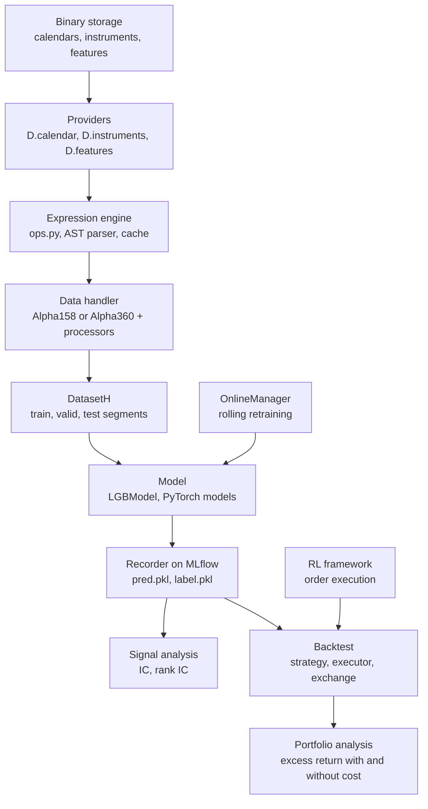
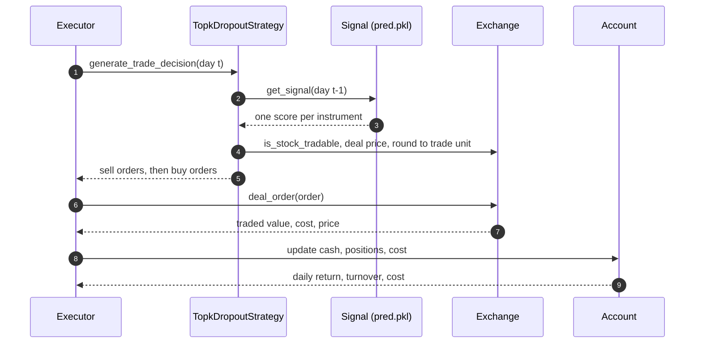

[qlib](https://github.com/microsoft/qlib) is an open-source Python platform from Microsoft for AI-driven quantitative investment research. It treats the search for a stock-selection signal as a machine-learning pipeline: market data is stored in a compact binary format, features are written as formulas over that data, a model learns to predict next-period returns, and a backtester turns the predictions into a portfolio with trading costs. Every step is a configurable Python class, so the same research can be run from a script or from a YAML file.

This article reads the source of qlib v0.9.8, commit `5435523` of October 2026, layer by layer. It explains the concepts needed to judge qlib's output: alpha factors, labels, the information coefficient, excess return after costs and look-ahead. It then runs the whole chain offline on a small synthetic dataset whose every number is reproduced in the text. It ends with a security review of the code, because a qlib configuration file, a saved model or a downloaded dataset can each run code or carry unverified data.

> This article has been made with the help of [Claude Code](https://claude.com/product/claude-code) and several custom skills

[TOC]

## What you need to know first

The article assumes basic Python, pandas and [supervised machine learning]({{site.url_complet}}/2025/01/22/supervised-unsupervised-learning/), and relies on the following mechanisms without deriving them:

- **Cross-sectional prediction.** On each trading day the model scores every stock in a universe, and only the ranking between stocks on that day matters. A score of 0.2 against 0.1 means "prefer the first stock", not "it will return 20 %".
- **Gradient-boosted decision trees.** An ensemble of shallow trees trained one after another, each correcting the errors of the previous ones. [LightGBM](https://lightgbm.readthedocs.io/) is the implementation qlib uses by default; it handles hundreds of tabular features without scaling them.
- **Backtest.** A simulation of a trading rule on historical data: on each past day, decide trades using only information available that day, then book the next day's returns and the costs. A backtest is only as honest as its separation of past and future.
- **Benchmark and excess return.** A long-only portfolio is compared with an index or an ETF that a passive investor could hold instead. The excess return is the daily return of the portfolio minus that of the benchmark.
- **Pearson and Spearman correlation.** Pearson correlation measures a linear relation between values; Spearman correlation is the Pearson correlation of their ranks, and is insensitive to outliers. qlib reports both as the IC and the rank IC.
- **Look-ahead bias.** Any use, during a simulated decision, of data that would not have existed at that time. It inflates backtests, and nothing in the output of a backtest reveals it.
- **MLflow.** [MLflow](https://mlflow.org/) is an open-source experiment tracker that stores the parameters, metrics and output files of each training run; MLflow calls those files artifacts. qlib's recorder is built on it.
- **Pickle deserialisation.** Python's `pickle` format can encode instructions to call arbitrary functions while an object is loaded, so loading an untrusted pickle file runs the author's code.

## What qlib is and what it covers

qlib was presented in [Yang et al., *Qlib: An AI-oriented Quantitative Investment Platform* (arXiv:2009.11189, 2020)](https://arxiv.org/abs/2009.11189) and is released under the MIT licence. Its README describes it as covering "the entire chain of quantitative investment: alpha seeking, risk modeling, portfolio optimization, and order execution", with three modelling paradigms: supervised learning on tabular features, models of market dynamics that adapt to concept drift, and reinforcement learning for sequential trading decisions.

The version read here is the `v0.9.8` tag on GitHub. The Python package on PyPI, `pyqlib`, stopped at 0.9.7 at the time of writing, so the worked example below builds qlib from the tagged source. The README also warns that recent source changes (a restricted expression parser, an explicit `trusted` flag for loading Python files) change how existing configurations behave; the security section comes back to them.

Those changes came after version 0.9.7, so the PyPI package most likely still evaluates expressions with Python's `eval` and has no `trusted` gate. That package was not inspected for this article, and the Gaps section lists the point.

The components are loosely coupled: each layer can be used alone, and each is configured as a dictionary naming a class and its arguments. The diagram shows the layers and what flows between them.



The companion articles on [QuantLib]({{site.url_complet}}/2026/11/18/quantlib-architecture-pricing-library/) and [PyPortfolioOpt]({{site.url_complet}}/2026/11/18/pyportfolioopt-portfolio-optimization/) cover two other tasks of a quant library: pricing a derivative, and turning expected returns into portfolio weights. qlib prices no derivatives, and its portfolio construction (a top-k selection strategy and an enhanced-indexing optimiser) is built around its own signals; its main output is the expected-return signal that an optimiser such as PyPortfolioOpt can consume.

## Architecture, layer by layer

### Data layer and binary storage

qlib does not read CSV or a database during research. It reads a directory with three sub-directories:

- **`calendars/day.txt`**: one trading date per line. Every time series is indexed by a position in this calendar.
- **`instruments/all.txt`**: one line per symbol, `SYMBOL<TAB>start<TAB>end`. Other files in the folder define sub-universes such as `csi300`.
- **`features/<symbol>/<field>.day.bin`**: one file per symbol and field (`close`, `open`, `volume`, ...), in lowercase.

Each `.bin` file is a flat array of little-endian 32-bit floats. The first float is the calendar index of the series' first value, and the values follow. Reading day `i` is a seek to byte `4·(i − start) + 4` and a 4-byte read, so a feature window is a single contiguous read with no parsing. The cost is that the format carries no metadata, no checksum and no timestamps of publication: a value is assumed to have been known on the day it is stored under.

*Implementation:* `qlib/data/storage/file_storage.py`, `FileFeatureStorage` (line 285).

Research code reads this folder through providers grouped under the object `D`, which return the trading calendar, the instrument lists and the feature values. `qlib.init()` selects a local folder or a client to a remote qlib-server, and a region that sets the market rules. The Chinese region sets a trade unit of 100 shares and a ±9.5 % price-limit threshold; the US region sets a trade unit of 1 and no limit.

Expression results are cached in memory and optionally on disk. A separate point-in-time provider stores financial-statement data by publication date, which is the only part of the data layer that records when a value became known.

*Implementation:* `qlib/data/data.py`, `D.calendar()`, `D.instruments()`, `D.list_instruments()`, `D.features()` and `LocalPITProvider` at line 746; `qlib.init(provider_uri=..., region=...)`, with the `REG_CN` and `REG_US` rules in `qlib/config.py` at lines 317-326; the cache in `qlib/data/cache.py`.

Two scripts build and check the folder. The first converts one CSV per symbol into the layout above. The second reports missing values, missing OHLCV columns, a missing `factor` and day-to-day jumps above 50 % in price or 300 % in volume. A third script downloads a ready-made dataset; the security section explains why the worked example does not use it.

The `factor` field is the split and dividend adjustment factor: the ratio of the adjusted price to the original price on each day. qlib stores adjusted prices, and its simulated exchange uses the factor for one thing only, converting an order's adjusted share count back to real shares so that it can be rounded to the trade unit. If the factor is missing, that rounding is disabled.

*Implementation:* `scripts/dump_bin.py` (command `dump_all`), `scripts/check_data_health.py` and `scripts/get_data.py`; the factor definition in `docs/component/data.rst`, and its use in `Exchange.round_amount_by_trade_unit()`, `qlib/backtest/exchange.py`.

### The expression engine

A feature is a string such as `Mean($close, 5)`. `$field` loads a stored field, and qlib's operators combine fields in three families:

- **Element-wise**: `Abs`, `Log`, `Sign`.
- **Arithmetic and comparison**: `Add`, `Greater`, `If`.
- **Rolling over a window of days**: `Ref`, `Mean`, `Std`, `Max`, `Rank`, `Slope`, `EMA`, `Corr` and others.

*Implementation:* `qlib/data/ops.py`.

Before evaluation, a helper rewrites the string into Python syntax: `$close` becomes `Feature("close")` and `Mean(` becomes `Operators.Mean(`. A dedicated parser then evaluates the result by walking its abstract syntax tree against a whitelist of node types and operators. The parent commit still passed the rewritten string to Python's `eval`; the whitelist, added in [pull request #2340](https://github.com/microsoft/qlib/pull/2340) on 8 October 2026, means an expression can no longer call arbitrary Python.

*Implementation:* `qlib/utils/__init__.py`, `parse_field()` (line 291), and `qlib/data/expression_parser.py`; before the change, `eval(parse_field(field))` in `qlib/data/data.py`, line 397.

`Ref(x, N)` is the operator that decides whether a feature looks into the future. Its docstring and code give three cases:

- **`N > 0`** shifts the series back in time: `Ref($close, 1)` is yesterday's close.
- **`N < 0`** shifts it forward: `Ref($close, -1)` is tomorrow's close, which is legitimate in a label and a leak in a feature.
- **`N = 0`** does not mean "today". It returns the first value of the loaded series, repeated on every date, and qlib logs a warning that the window cannot be computed accurately.

```python
# qlib/data/ops.py, class Ref, lines 800-809
    def _load_internal(self, instrument, start_index, end_index, *args):
        series = self.feature.load(instrument, start_index, end_index, *args)
        # N = 0, return first day
        if series.empty:
            return series  # Pandas bug, see: https://github.com/pandas-dev/pandas/issues/21049
        elif self.N == 0:
            series = pd.Series(series.iloc[0], index=series.index)
        else:
            series = series.shift(self.N)  # copy
        return series
```

The direction of a ratio matters as much as the sign of `N`. The worked example, described below, uses a dataset that ends on 11 April 2018 and in which only the close prices are real. It queried AAPL around 10 April 2018:

| AAPL | close | r1 | inv | ma5 | label |
|---|---:|---:|---:|---:|---:|
| 2018-04-09 | 170.050003 | 0.009918 | −0.009821 | 170.246002 | −0.004675 |
| 2018-04-10 | 173.250000 | 0.018818 | −0.018470 | 171.218002 | NaN |
| 2018-04-11 | 172.440002 | −0.004675 | 0.004697 | 171.384003 | NaN |

The columns are `$close`, then r1 = `$close/Ref($close, 1) - 1`, inv = `Ref($close, 1)/$close - 1`, ma5 = `Mean($close, 5)` and label = `Ref($close, -2)/Ref($close, -1) - 1`.

`$close/Ref($close, 1) - 1` is the daily return (+1.88 % on 10 April). `Ref($close, 1)/$close - 1` is a different quantity (−1.85 %), close to the negated return but not equal to it. The last column is qlib's default label, discussed next: on 9 April it equals the return from 10 to 11 April (172.44 / 173.25 − 1 = −0.4675 %), and it is `NaN` on the last two days of the data because those future prices do not exist.

### Data handlers: Alpha158 and Alpha360

A data handler loads a list of feature expressions and a label expression over a date range and a universe, then applies processors. `DataHandlerLP` keeps three copies of the data: raw, processed for inference, and processed for learning, because some processors (dropping rows without a label, normalising the label) only make sense during training.

*Implementation:* `qlib/data/dataset/handler.py`, `DataHandlerLP` (line 382).

qlib ships two ready-made handlers:

- **`Alpha158`** computes 158 hand-designed factors: 9 candlestick-shape features such as `KMID` and `KLEN`, the ratios of open, high, low and VWAP to the close, and 29 rolling operators such as the rate of change `ROC`, a moving average, a standard deviation, a slope and a price-volume correlation, each over windows of 5, 10, 20, 30 and 60 days. That gives 9 + 4 + 29 × 5 = 158. It suits tree models. Its default inference processors are empty, so features are not normalised.
- **`Alpha360`** gives a model the raw history instead: the close, open, high, low, VWAP and volume of each of the last 60 days, divided by today's close (or today's volume), so 6 × 60 = 360 columns. It suits sequence models (LSTM, GRU, Transformer) that learn their own features, and applies `ProcessInf`, `ZScoreNorm` and `Fillna` before inference.

*Implementation:* `qlib/contrib/data/handler.py`, `Alpha360` at line 48 and `Alpha158` at line 98; the expressions, including `MA`, `STD`, `BETA` and `CORR`, in `qlib/contrib/data/loader.py`.

Both use the same label, `Ref($close, -2)/Ref($close, -1) - 1`: the return from the close of day t+1 to the close of day t+2, for a prediction made with data up to the close of day t. The one-day gap is there because a signal computed after day t's close can be traded at day t+1 at the earliest; the timeline table in the Backtest section below shows how the backtest lines up with it. The default learning processors are `DropnaLabel` and `CSZScoreNorm` on the label, which replaces each day's labels by their cross-sectional z-score, so the model learns relative rather than absolute returns.

Processors that are fitted, such as `ZScoreNorm`, learn their statistics between `fit_start_time` and `fit_end_time`. If `fit_end_time` lies after the end of the training segment, the normalisation has seen validation or test data.

### DatasetH and its segments

`DatasetH` wraps a handler and splits its dates into named segments, usually `train`, `valid` and `test`; the validation segment drives early stopping. Preparing a segment with the feature and label column sets returns a pandas frame indexed by date and instrument. `TSDatasetH` returns rolling windows of rows instead, for sequence models.

*Implementation:* `qlib/data/dataset/__init__.py`, `DatasetH` at line 72, `TSDatasetH` at line 642 and `dataset.prepare("train", col_set=["feature", "label"])`, which returns a frame indexed by `(datetime, instrument)`.

The segments are plain date ranges, and qlib does not insert a gap between them, so with the default label the last two training days carry labels computed from prices inside the validation period. With daily data and thousands of training days the effect is small, but it is the same mechanism as a larger leak, and a purged gap removes it.

### Models

Every model implements the same interface: it is fitted on a dataset and predicts a named segment of it, and a sub-class adds fine-tuning. LightGBM is the default implementation; XGBoost, CatBoost, a linear model and `DoubleEnsemble` sit next to it. 26 PyTorch model files cover 19 architectures, among them LSTM, GRU, Transformer, TabNet, HIST and TRA, several in two variants for `DatasetH` and `TSDatasetH`.

*Implementation:* `qlib/model/base.py`, `Model.fit(dataset)`, `Model.predict(dataset, segment)` and `ModelFT`; `qlib/contrib/model/gbdt.py`, `LGBModel` (line 16); the other models in `qlib/contrib/model/`.

The PyTorch, XGBoost and CatBoost models are imported only if their libraries are installed; the container image used for the worked example contains LightGBM only, and qlib logs that the others are skipped. `examples/benchmarks/` holds one directory per model with YAML configurations and published results on the Chinese CSI 300 and CSI 500 universes.

### Workflow: R, recorders and MLflow

qlib wraps MLflow in a global experiment manager, `R`. Starting an experiment opens an MLflow run, the run is then returned as a recorder, and record templates write artifacts into it:

- **`SignalRecord`** saves the model's test-segment predictions as `pred.pkl` and the matching labels as `label.pkl`.
- **`SigAnaRecord`** computes the daily IC and rank IC series (`sig_analysis/ic.pkl`, `ric.pkl`) and logs their mean and their ICIR as metrics. The ICIR is the mean divided by the standard deviation, defined under IC and rank IC below.
- **`PortAnaRecord`** runs a backtest from a strategy and exchange configuration and saves the daily report, the positions and `port_analysis_1day.pkl`, the risk analysis of the excess return with and without cost.

*Implementation:* `qlib.workflow.R`, `R.start(experiment_name=...)` and `R.get_recorder()`; the record templates in `qlib/workflow/record_temp.py`.

The default tracking URI is a local `mlruns` folder. The MLflow recorder also stores, as artifacts, the output of three git commands run in the current directory, which captures uncommitted changes, and qlib's task trainer tags each run with the host name.

*Implementation:* `qlib/workflow/recorder.py`, `MLflowRecorder._log_uncommitted_code()` runs `git diff`, `git status` and `git diff --cached` at lines 372-387; `qlib/model/trainer.py` sets the host-name tag at line 47.

The `qrun` command runs the same chain from a YAML file: a `qlib_init` block, then the model, the dataset and the record templates under `task`. Each entry is a dictionary naming a class, its module and its arguments, which one helper, `init_instance_by_config`, instantiates. The YAML is first rendered as a Jinja template with environment variables as context.

*Implementation:* `qlib/cli/run.py`, Jinja rendering at lines 69-77; `task.model`, `task.dataset` and `task.record` are `class`/`module_path`/`kwargs` dictionaries passed to `init_instance_by_config` in `qlib/utils/mod.py`.

### Backtest: strategy, executor and exchange

The backtest in `qlib/backtest/` separates three roles:

- **The strategy** decides what to trade. `TopkDropoutStrategy` is described under TopkDropout and turnover below; `WeightStrategyBase` and `EnhancedIndexingStrategy` produce target weights instead, the latter through an enhanced-indexing optimiser.

  *Implementation:* `qlib/contrib/strategy/signal_strategy.py`, `TopkDropoutStrategy` at line 74 and `EnhancedIndexingStrategy` at line 374; the optimiser in `qlib/contrib/strategy/optimizer/`.
- **The executor** decides when and how the decisions are executed. `SimulatorExecutor` fills orders once per step. `NestedExecutor` runs an inner strategy and executor at a finer frequency inside each outer step, for example a daily portfolio decision executed by an intraday order-splitting strategy.
- **The exchange** knows prices and rules: the price field used for fills, the opening and closing costs as fractions of the traded value with defaults of 0.15 % and 0.25 %, a minimum cost per order of 5 currency units by default, a market-impact cost, the price-limit threshold and the trade unit from the region.

  *Implementation:* `qlib/backtest/exchange.py`, parameters `deal_price`, `open_cost`, `close_cost`, `min_cost` and `impact_cost` (defaults at lines 48-50).

The sequence below shows one daily step. The strategy for day t asks the signal for the prediction of the previous step, so the decision uses a score computed from data up to the close of day t−1.

*Implementation:* `qlib/contrib/strategy/signal_strategy.py`, `generate_trade_decision()` calls `get_step_time(trade_step, shift=1)` (line 141).



The table follows one score through the backtest, with the default label and fills at the close (`deal_price: "close"`). Here t−1 is the day the score is computed, which the Data handlers section calls day t.

| Moment | What happens |
|---|---|
| Close of day t−1 | The features use data up to this close and the model scores every stock. The label of this score is the return from the close of t to the close of t+1. |
| Close of day t | The strategy for day t reads that score and trades. Orders fill at this close, and their costs are booked on day t. |
| Close of day t+1 | Positions are valued at this close. The gain from the close of t to the close of t+1 is booked as the return of day t+1. |

A position therefore earns exactly the return that the label of its selecting score measures. Each backtest step also runs from its own day to the next date of the calendar, so the last backtest day must be followed by one more trading day in the data. With the default label, the backtest can end at the latest one trading day before the end of the data, and its last step then trades on the last score that has a label.

*Implementation:* `qlib/backtest/account.py`, lines 269-287, for the daily return computed from the value at the end of the bar; `qlib/backtest/utils.py`, line 131, where `TradeCalendarManager.get_step_time()` ends each step at the next calendar date.

The backtest needs a benchmark instrument that exists in the data. The default is `SH000300`, the CSI 300 index, whatever the region, so a run on US data asks for an instrument that is not in the data unless `benchmark` is set.

*Implementation:* `qlib/backtest/__init__.py`, default `benchmark` (lines 182, 222 and 284).

### Online serving and rolling retraining

The online module turns research into a scheduled process. A manager holds one or more online strategies; the rolling strategy retrains a model on a moving window at a fixed interval and marks which trained models are online on each date, and two updaters extend stored predictions and labels as new data arrives. A simulation method replays that process over history, so that a rolling backtest uses, on each date, only the models that would have existed then. This part was read but not run for this article.

*Implementation:* `qlib/workflow/online/`, `OnlineManager` with `simulate()` (line 302 of `manager.py`), `OnlineStrategy`, `RollingStrategy`, `PredUpdater` and `LabelUpdater`.

### Reinforcement learning

qlib's reinforcement-learning module is a framework for sequential decisions, used in the examples for order execution: splitting a large parent order into child orders over a day. Its building blocks are a simulator that holds the state transitions, state and action interpreters that translate between the simulator and a neural network, a reward, and PPO and DQN policies built on the [Tianshou](https://github.com/thu-ml/tianshou) library. Single-asset order-execution simulators come with it, and the project lists `torch` and `tianshou<=0.4.10` as its dependencies. It was read but not run here.

*Implementation:* `qlib/rl/`, `Simulator`, `Reward`, `PPO` and `DQN`; the simulators in `qlib/rl/order_execution/`; the dependencies in `pyproject.toml`.

## Concepts for judging a signal

### Alpha factors and labels

An alpha factor is a number computed for each stock and day that is expected to rank stocks by future return. Alpha158's `ROC5` (the close five days ago divided by today's close) is a factor; so is a model's output. Despite its name, `ROC` is defined in qlib's code as that inverted ratio, `Ref($close, d)/$close`, the same direction that the expression-engine section warns is not the return. For a tree model the inversion does not matter, since it only reverses the order of the values.

*Implementation:* `qlib/contrib/data/loader.py`, the `ROC` fields (lines 149-153).

The label is the quantity the model is trained to predict, and its definition fixes the trading horizon: with the default label, a prediction on day t targets the move from t+1 to t+2, and the backtest holds positions for about a day before re-ranking (the timeline table in the Backtest section shows the days).

### IC and rank IC

qlib groups predictions and labels by date and correlates them across instruments. For day t, with $$s_{i,t}$$ the score and $$y_{i,t}$$ the label of instrument $$i$$:

$$
\begin{aligned}
IC_t &= \rho\big(s_{1..n,t},\; y_{1..n,t}\big) \\
RankIC_t &= \rho\big(\operatorname{rank}(s_{1..n,t}),\; \operatorname{rank}(y_{1..n,t})\big) \\
ICIR &= \frac{\overline{IC}}{\sigma_{IC}}
\end{aligned}
$$

where $$\rho$$ is the Pearson correlation across the $$n$$ instruments of the day, $$\overline{IC}$$ the mean of the daily values and $$\sigma_{IC}$$ their standard deviation.

*Implementation:* `qlib/contrib/eva/alpha.py`, `calc_ic()` (line 160).

`SigAnaRecord` reports the mean IC, the ICIR, and the same pair for the rank IC. Daily ICs are noisy, so the mean alone says little: with $$T$$ days, $$ICIR \cdot \sqrt{T}$$ is the t-statistic of the mean IC under the assumption that daily ICs are independent, and it shows whether the mean differs from zero by more than chance. [Sampling and Standard Error]({{site.url_complet}}/2026/10/26/sampling-standard-error-mean/) derives the standard error behind it. A large gap between IC and rank IC means a few extreme scores or returns drive the Pearson value.

### TopkDropout and turnover

`TopkDropoutStrategy(topk, n_drop)` holds `topk` stocks and changes at most `n_drop` of them per day:

1. Rank the stocks not held by score and keep the best `n_drop + topk − held` as candidates.
2. Rank held stocks and candidates together; sell the held stocks that fall in the bottom `n_drop` of that combined ranking.
3. Buy the best candidates until `topk` stocks are held again, splitting the available cash, times `risk_degree` (0.95 by default), equally among the stocks bought. Positions already held are not rebalanced.

qlib's daily turnover is the traded value of that day, buys plus sells, divided by the portfolio value of the previous day. `n_drop` caps it: with `topk = 5` and `n_drop = 1`, at most one fifth of the portfolio is replaced each day, and each replacement pays a sell cost and a buy cost. `hold_thresh` sets a minimum holding period, and `only_tradable` and `forbid_all_trade_at_limit` handle suspended or limit-locked stocks.

*Implementation:* `qlib/backtest/account.py`, where each fill adds its traded value to the turnover at line 186 and `turnover_rate` is computed at line 287.

### Excess return with and without cost

`PortAnaRecord` computes two daily series from the backtest report, $$e_t^{\text{gross}} = r_t - b_t$$ and $$e_t^{\text{net}} = r_t - b_t - c_t$$, where $$r_t$$ is the portfolio return, $$b_t$$ the benchmark return and $$c_t$$ the cost as a fraction of portfolio value. qlib's risk analysis then reports, by default:

$$
\begin{aligned}
\text{annualized return} &= N \cdot \bar e, \qquad N = 238 \text{ for daily data} \\
\text{information ratio} &= \frac{\bar e}{\sigma_e} \cdot \sqrt{N} \\
\text{max drawdown} &= \min_t \big( S_t - \max_{v \le t} S_v \big), \qquad S_t = \textstyle\sum_{u \le t} e_u
\end{aligned}
$$

where $$\bar e$$ and $$\sigma_e$$ are the mean and the sample standard deviation of the daily series.

Two conventions differ from what a reader may expect. The default mode is `"sum"`: returns are added, not compounded, which the code comments justify as avoiding an exponentially skewed curve; a `"product"` mode exists. And the daily scaler is fixed at 238, not the 252 commonly used for US markets, even with `region=REG_US`. Both change the annualised figure, not the ranking of two strategies evaluated the same way.

*Implementation:* `qlib/contrib/evaluate.py`, `risk_analysis()` and `cal_risk_analysis_scaler()`, whose daily value is 238 (lines 26-52).

A daily-rebalanced strategy pays costs on every swap, so the gap between the two series is the price of its turnover. In the worked example below that gap is larger than the net result.

### Look-ahead and leakage

qlib prevents some leaks by construction: the strategy reads the previous step's signal, and the label sits in its own column, apart from the features. It leaves others to the user. The ones to check in every configuration:

- **Negative `Ref` in a feature.** Any `Ref(x, -k)` outside the label reads the future. The worked example below shows what a single such feature does to the IC.
- **Label overlap at segment boundaries.** The last two days of each segment have labels computed from the next segment's prices; leave a gap of at least the label horizon between segments when it matters.
- **Processor fitting window.** `fit_end_time` must not pass the end of the training segment.
- **Universe chosen with hindsight.** A list of today's large companies, applied to the past, contains the winners and omits the companies that were delisted. The binary format has no record of index membership history unless the instruments file provides start and end dates per symbol.
- **Data revised after the fact.** Price fields are stored by trading date, not by publication date; only the point-in-time provider records when fundamental data became known.
- **Backtest end.** The last backtest day trades on the previous day's score, so that score must have a label: with the default label, end the backtest at least one trading day before the end of the data (timeline table in the Backtest section).

## Using qlib end to end

The full sequence, as run for this article, has six steps. The verification folder linked in the references holds the exact scripts.

1. **Build the data.** Write one CSV per symbol with a date and a symbol column, the open, high, low and close prices, the volume, the VWAP and the adjustment factor (1.0 for adjusted prices), then convert and check it; the column names appear in the command:

   ```bash
   python scripts/dump_bin.py dump_all --data_path csv --qlib_dir qlib_data \
      --freq day --date_field_name date --symbol_field_name symbol \
      --include_fields open,high,low,close,volume,vwap,factor
   python scripts/check_data_health.py check_data --qlib_dir qlib_data
   ```

2. **Initialise and query.**

   ```python
   import qlib
   from qlib.constant import REG_US
   from qlib.data import D
   qlib.init(provider_uri="qlib_data", region=REG_US)
   D.features(["AAPL"], ["$close/Ref($close, 1) - 1"], start_time="2018-04-09", end_time="2018-04-11")
   ```

3. **Define the dataset.** `fit_end_time` equals the end of the training segment.

   ```python
   from qlib.utils import init_instance_by_config
   handler = {"class": "Alpha158", "module_path": "qlib.contrib.data.handler", "kwargs": {
       "start_time": "2010-01-01", "end_time": "2018-04-11",
       "fit_start_time": "2010-01-01", "fit_end_time": "2014-12-31", "instruments": "all"}}
   dataset = init_instance_by_config({"class": "DatasetH", "module_path": "qlib.data.dataset", "kwargs": {
       "handler": handler, "segments": {"train": ("2010-01-01", "2014-12-31"),
       "valid": ("2015-01-01", "2016-06-30"), "test": ("2016-07-01", "2018-04-11")}}})
   ```

4. **Choose the model and the backtest.** The benchmark is an instrument of the dataset, the costs are explicit, and the backtest ends on 10 April 2018, one trading day before the data: its last step trades on the score of 9 April, the last date with a label.

   ```python
   model = init_instance_by_config({"class": "LGBModel", "module_path": "qlib.contrib.model.gbdt",
       "kwargs": {"loss": "mse", "learning_rate": 0.05, "num_leaves": 31, "num_threads": 4, "seed": 0}})
   port = {"strategy": {"class": "TopkDropoutStrategy", "module_path": "qlib.contrib.strategy",
                        "kwargs": {"signal": (model, dataset), "topk": 5, "n_drop": 1}},
           # a configuration only: PortAnaRecord builds the strategy in step 5, which then
           # calls model.predict(), so the model needs to be fitted only before that step
           "backtest": {"start_time": "2016-07-01", "end_time": "2018-04-10", "account": 1_000_000,
                        "benchmark": "SPY", "exchange_kwargs": {"deal_price": "close",
                        "open_cost": 0.0005, "close_cost": 0.0015, "min_cost": 5}}}
   ```

5. **Train and record.** The signal is analysed before the backtest, so a signal with no IC is not tuned through its backtest.

   ```python
   from qlib.workflow import R
   from qlib.workflow.record_temp import SignalRecord, SigAnaRecord, PortAnaRecord
   with R.start(experiment_name="demo"):
       model.fit(dataset)
       rec = R.get_recorder()
       SignalRecord(model, dataset, rec).generate()
       SigAnaRecord(rec).generate()
       PortAnaRecord(rec, port, "day").generate()
   ```

6. **Or run it from YAML.** The shipped LightGBM configuration on Alpha158 encodes the same chain for `qrun`. The shipped configurations target the Chinese `cn_data` dataset and the `csi300` universe, so the data path, the region, the market, the benchmark and the dates have to be changed for other data.

   *Source:* `examples/benchmarks/LightGBM/workflow_config_lightgbm_Alpha158.yaml`, keys `provider_uri`, `region`, `market` and `benchmark`.

## Worked example on synthetic data

### Data and setup

The example runs qlib 0.9.8, built from commit `5435523` in a container with no network access, on 21 instruments: 20 US stocks and the SPY ETF, from 2 January 2008 to 11 April 2018 (2,587 trading days). The prices come from the test fixtures of the PyPortfolioOpt library, which contain adjusted closes only. Each instrument starts at its first price in that file, and three start late: GM in November 2010, FB in May 2012 and BABA in September 2014. The training segment therefore has about 19.4 instruments per day on average (24,411 rows over 1,258 days), while the validation and test segments have all 21 on every day.

**The data is synthetic beyond the close.** Open, high, low and VWAP are set equal to the close and volume to a constant 1,000,000, so 48 of Alpha158's 158 columns carry no information: the 9 candlestick features, the 4 price ratios and 25 volume statistics are constant, and the 10 price-volume correlations are empty. The factors built on highs and lows repeat information from the close. The example tests qlib's data conversion, training, recording, signal analysis and backtest code. Its returns are not a strategy result and say nothing about how Alpha158 or LightGBM perform on real data.

`check_data_health.py` reported no missing values and one jump above the 50 % threshold: AMD's close rose 52.3 % on 22 April 2016, which the data shows on all price fields because they are copies of the close. The dataset splits as follows:

| Segment | Dates | Trading days | Rows (stock-days) | Features |
|---|---|---:|---:|---:|
| train | 2010-01-01 to 2014-12-31 | 1,258 | 24,411 | 158 |
| valid | 2015-01-01 to 2016-06-30 | 377 | 7,917 | 158 |
| test | 2016-07-01 to 2018-04-11 | 447 | 9,387 | 158 |

### Signal quality

On the 447 test days, LightGBM's predictions gave:

| Measure | Value |
|---|---:|
| Mean IC | 0.0632 |
| Standard deviation of daily IC | 0.4196 |
| ICIR | 0.15 |
| t-statistic of the mean IC (ICIR × √447) | 3.18 |
| Share of days with IC > 0 | 55.7 % |
| Mean rank IC | 0.0239 |
| t-statistic of the mean rank IC | 1.92 |

The mean IC differs from zero by about three standard errors, but the rank IC is less than half of it and its t-statistic of 1.92 is below the conventional 1.96 for a two-sided 5 % test. The difference suggests that the Pearson IC is carried by a few extreme predictions.

A single score far from the others weighs heavily in a Pearson correlation over 21 points, while in a rank correlation it only counts as the first place. The first test day shows such a pattern: AAPL, AMZN and BABA all received the same score (0.004218) while AMD received 0.1993, which is expected when 48 features are constant or empty and many others are built from the close alone. One day does not prove the pattern holds over the 447 days; the distribution of daily scores was not analysed.

With 21 instruments per test day, each daily IC is a correlation of about 20 points, which explains the standard deviation of 0.42.

### Backtest

`TopkDropoutStrategy(topk=5, n_drop=1)` traded at the close from 1 July 2016 to 10 April 2018 (446 days), with 0.05 % cost on buys, 0.15 % on sells and a 5 USD minimum, against SPY:

| Series | Mean daily | Std daily | Annualised (×238) | Information ratio | Max drawdown |
|---|---:|---:|---:|---:|---:|
| Benchmark (SPY) | 0.0628 % | 0.667 % | 14.9 % | 1.45 | −10.4 % |
| Excess return without cost | 0.0546 % | 0.979 % | 13.0 % | 0.86 | −17.3 % |
| Excess return with cost | 0.0151 % | 0.978 % | 3.6 % | 0.24 | −23.5 % |

For the benchmark row, qlib applies the same risk analysis to SPY's own daily return, with nothing subtracted: its information ratio of 1.45 is the mean daily return over its standard deviation times $$\sqrt{238}$$, and its drawdown is measured on the summed returns, like the other two rows.

*Implementation:* `qlib/workflow/record_temp.py`, `risk_analysis(report_normal["bench"])` in `PortAnaRecord` (line 532).

The mean daily cost was 0.0395 % of portfolio value, which is 9.4 percentage points a year on qlib's ×238 scale and exactly the gap between the two excess-return rows (13.0 − 3.6). The mean daily turnover was 0.40: about one stock sold and one bought per day out of five, as `n_drop = 1` allows. Summed over the 446 days, the excess return with cost is 6.7 %; compounded, it is 4.7 %.

### What the example does not show

Checked against the "statistical sins", the list of common errors in drawing conclusions from data given in [MIT 6.0002, lectures 14 and 15](https://ocw.mit.edu/courses/6-0002-introduction-to-computational-thinking-and-data-science-fall-2016/), the result has six limits, and each applies to any qlib backtest:

- **Data quality.** Constant volume and identical OHLC prices remove 48 of the 158 factors and turn others into copies of close-based ones; a real study needs real OHLCV data.
- **Universe chosen in hindsight.** The 20 stocks are a fixed list of large US companies selected after the period, not the index members of each date, and SPY itself is in the tradeable universe. A universe defined by index membership on each date is required to avoid survivorship bias.
- **Statistical significance.** An information ratio of 0.24 over 446 days corresponds to a t-statistic of $$0.24 \cdot \sqrt{446/238} \approx 0.33$$ for the mean daily excess return with cost, and 1.18 without cost. Neither is distinguishable from zero.
- **One window, one configuration.** The test covers 21 months of a rising market, with `topk`, `n_drop` and the model parameters fixed before the run. Trying several configurations and reporting the best would require a correction for the number of trials.
- **Annualisation convention.** With 252 instead of 238 days, the gross excess return would read 13.8 % instead of 13.0 %; both are a sum of daily returns, not a compounded rate.
- **Cost model.** Fixed proportional costs at the close, with no market impact or spread, are the optimistic case. The cost row already removes about three quarters of the gross excess return.

### What a leak does

To show the size of a look-ahead error, the example scored a single expression that peeks into the label window, `Ref($close, -2)/$close - 1`, with no model at all. Its mean daily IC against the label on the test days is **0.68**, about eleven times the trained model's 0.063. It stays below 1 because the expression covers the closes from t to t+2 while the label covers t+1 to t+2: it contains the label plus the return from t to t+1, which acts as noise. A feature list that contains one such expression produces a model with an excellent IC and a backtest that cannot be reproduced in trading.

qlib's own benchmark table reports mean ICs between 0.0099 and 0.0522 for its models on the CSI 300 universe; an IC far above that range is a reason to look for a negative `Ref` before looking for a better model.

*Source:* `examples/benchmarks/README.md`.

## Security review: risks by design

The review covered the package source, the scripts and the build files at commit `5435523`, read-only, with every line reference below re-checked. It found no backdoor, no telemetry and no network access when qlib is imported or initialised. The build script compiles two Cython extensions and does nothing else. Recent commits harden the code: the expression parser replaced `eval`, loading a configuration class from a Python file path now requires `trusted: true`, and recorder artifacts are loaded through a restricted unpickler that accepts a list of safe classes.

*Implementation:* reviewed paths `qlib/`, `scripts/`, `setup.py` and `pyproject.toml`; the extensions `qlib/data/_libs/rolling.pyx` and `expanding.pyx`; the unpickler in `qlib/utils/pickle_utils.py`.

The remaining risks come from the design: qlib is a research tool in which configurations, saved models and datasets are inputs that run code or are trusted as given. Each row names the location and the rule that follows from it.

| Risk | Where (commit `5435523`) | Consequence | Rule |
|---|---|---|---|
| A configuration can instantiate any importable class | `init_instance_by_config`, `qlib/utils/mod.py:95`, `:143-170` | `{"class": "Popen", "module_path": "subprocess", ...}` runs a command; `trusted` only gates `.py` file paths | Run only configurations you wrote or read in full |
| `qrun` renders the YAML as a Jinja template with environment variables | `qlib/cli/run.py:69`, `:77` | A YAML file is a program, and can read any environment variable it names | Treat a shared YAML like a shared script |
| Unrestricted unpickling remains | `Serializable.load`, `qlib/utils/serial.py:150`; `torch.load(..., weights_only=False)`, `qlib/rl/trainer/trainer.py:203` | Loading a saved model, dataset or RL checkpoint from someone else runs their code | Never load pickles or checkpoints you did not produce |
| Dataset download without checksum, from a personal account | `qlib/tests/data.py:19` (`SunsetWolf/qlib_dataset` releases), used by `scripts/get_data.py`; `delete_old=True` by default | The archive is not verified, may be stale, and replaces the target folder | Build data with `dump_bin.py`, or download into an empty folder and label the data unverified |
| A model downloads a file at training time | `qlib/contrib/model/pytorch_hist.py:292-294` (HIST concept matrix, `urllib.request.urlretrieve`) | Training needs network and trusts that URL | Provide the file, or run without network and expect a failure |
| MLflow records local context | `qlib/workflow/recorder.py:372-387` (`git diff`, `git status`, `git diff --cached`), `qlib/model/trainer.py:47` (host name) | Uncommitted changes, including secrets in tracked files, land in `mlruns` and in any remote tracking server | Run outside a repository with sensitive changes, keep the tracking URI local |
| NFS provider runs `sudo mount.nfs` | `qlib/__init__.py:95` | A remote `provider_uri` triggers a privileged mount | Use local paths |

One observation from the run confirms the MLflow row. In the container, which has no `git` binary, `_log_uncommitted_code` failed with `git: not found` and logged nothing, so the leak depends on where qlib is run.

The container itself is the main mitigation: it runs with `--network none`, as a non-root user, with only the working folder mounted. It does not cover the supply chain. `pip freeze` in the image lists 192 packages besides qlib, MLflow, Jupyter and LightGBM among them, installed from PyPI without pinned versions and not audited by this review; [A Threat Model of the Dependency Update Path]({{site.url_complet}}/2026/11/05/dependency-update-path-threat-model/) describes what pinning and update tooling do and do not protect against.

## Conclusion

qlib turns stock-selection research into a reproducible machine-learning pipeline whose layers can be replaced one at a time. Read at v0.9.8 and run offline, it shows the following:

- **Data** is a folder of flat float32 files indexed by a trading calendar, built from CSV by `dump_bin.py`; it is fast to read and carries no checksum or publication date.
- **Features** are expressions over that data, evaluated by a whitelisted parser; the sign of `Ref` decides between a lagged feature and a leak.
- **Alpha158 and Alpha360** are two ready-made feature sets, 158 hand-designed factors for tree models and 360 normalised price and volume lags for sequence models, both with a label two days ahead.
- **The workflow** records predictions, IC analysis and backtests as MLflow artifacts, from Python or from a `qrun` YAML.
- **The backtest** separates strategy, executor and exchange, trades on the previous step's signal, and reports excess return with and without cost on a summed, ×238 scale.
- **The worked example** produced an IC of 0.063 and a gross excess return of 13.0 % a year that fell to 3.6 % after costs, with t-statistics too low to claim any edge, on data that is synthetic by construction.
- **The main risks** are by design: configurations, YAML files and pickles execute code, the bundled dataset download is unverified, and MLflow stores the local `git diff` and host name.


## Annex

### Key Terms

| Term | Definition |
|------|------------|
| **Alpha factor** | A number computed per stock and day that is expected to rank stocks by future return; a model's prediction is also a factor. |
| **Label** | The quantity a model is trained to predict; in Alpha158 and Alpha360, the return from the close of t+1 to the close of t+2. |
| **Cross-sectional normalisation** | Replacing each day's values by their z-score across stocks that day (`CSZScoreNorm`), so only relative values remain. |
| **Calendar index** | The position of a date in `calendars/day.txt`; every stored value is addressed by it. |
| **Provider** | The object behind `D.calendar`, `D.instruments` and `D.features` that reads the local folder or a remote server. |
| **Expression** | A formula over stored fields, such as `Mean($close, 5)`, evaluated by the operators in `ops.py`. |
| **`Ref(x, N)`** | The shift operator: past values for N > 0, future values for N < 0, the first loaded value for N = 0. |
| **Data handler** | A class that loads feature and label expressions over a universe and dates and applies processors; `Alpha158` and `Alpha360` are two. |
| **Processor** | A transformation applied by a handler, either fitted on a date range (`ZScoreNorm`) or stateless (`DropnaLabel`, `CSZScoreNorm`). |
| **DatasetH** | The dataset class that splits a handler's dates into named segments such as train, valid and test. |
| **Recorder** | An MLflow run wrapped by qlib, in which record templates save predictions, labels and analyses as artifacts. |
| **IC (information coefficient)** | The daily Pearson correlation between predictions and labels across stocks, averaged over days. |
| **Rank IC** | The same correlation computed on ranks (Spearman), insensitive to outlying scores or returns. |
| **ICIR** | The mean IC divided by the standard deviation of daily IC; multiplied by the square root of the number of days, it is the t-statistic of the mean IC. |
| **TopkDropoutStrategy** | A strategy holding the `topk` best-scored stocks and replacing at most `n_drop` of them per day. |
| **Executor** | The backtest component that turns trade decisions into executed orders, once per step or through a nested inner strategy. |
| **Exchange** | The backtest component that holds prices, costs, trade units and price limits and fills orders. |
| **Excess return with cost** | The portfolio's daily return minus the benchmark's and minus the trading cost, the figure on which a signal should be judged. |
| **Information ratio** | The mean daily excess return divided by its standard deviation, times the square root of the annualisation scaler (238 in qlib). |
| **Look-ahead bias** | Use of data that did not exist at the simulated decision time, which inflates IC and backtest results. |

### Integration Notes

| Behaviour | What an integrator should do |
|-----------|------------------------------|
| `Ref($close, 1)/$close - 1` is not the daily return. | Write returns as `$close/Ref($close, 1) - 1`. |
| `Ref(x, 0)` returns the first value of the loaded window, not today's value. | Use `x` directly for today's value. |
| The backtest benchmark defaults to `SH000300` in every region. | Always set `benchmark` to an instrument present in the data. |
| The last two days of the data have no label, and each backtest day trades on the previous day's score. | End the backtest at least one trading day before the end of the data, so that its last step trades on a labelled score. |
| `risk_analysis` annualises a sum of daily returns with N = 238. | Compare strategies under the same setting, or pass `N=252` and `mode="product"` when reporting a compounded US figure. |
| Alpha158 does not normalise features at inference by default. | Add inference processors before using it with a model that needs scaled inputs. |
| Segments are adjacent date ranges with no purge gap. | Leave a gap of at least the label horizon between segments. |
| `MLflowRecorder` stores `git diff` of the working directory. | Run experiments outside repositories that hold secrets, and keep the tracking URI local. |
| A configuration may name any importable class. | Read every `class` and `module_path` before running a configuration or YAML you did not write. |

## Frequently Asked Questions

**Q: Where does qlib store a stock's closing prices, and how does it find the value for a given day?**

In `features/<symbol>/close.day.bin`, a flat array of little-endian float32 values. The first float is the calendar index of the first stored day. To read day `i`, the storage class seeks to byte `4·(i − start) + 4` and reads four bytes; a window of days is one contiguous read. The calendar index comes from the date's line number in `calendars/day.txt`.

**Q: What is the difference between Alpha158 and Alpha360, and which models is each meant for?**

Alpha158 is a set of 158 engineered factors: candlestick shapes, price ratios, and 29 rolling statistics over five window lengths. It is meant for tree models such as LightGBM, which use the features as given.

Alpha360 contains the last 60 days of six raw series, the four prices, VWAP and volume, each divided by today's close or volume. It is meant for sequence models such as LSTM or Transformer, which learn their own features from the raw history.

**Q: Why is the default label `Ref($close, -2)/Ref($close, -1) - 1` and not the next day's return?**

The features for day t use data up to the close of day t, so the earliest trade on that information is on day t+1. The label therefore measures the return from the close of t+1 to the close of t+2, the first return a strategy acting on the signal could earn. In the backtest, the strategy on day t uses the prediction made on day t−1, which matches this one-day gap.

The timeline table in the Backtest section follows one score from its computation to the return it earns.

**Q: A model reaches an IC of 0.6 on the test segment. What should be checked first?**

Leakage, before anything else:

- Search the feature list for a negative `Ref`; in the worked example a single such expression reached an IC of 0.68 without a model.
- Check that `fit_end_time` does not pass the end of the training segment.
- Check whether the universe was chosen with knowledge of the test period.

qlib's published benchmarks on CSI 300 stay between 0.0099 and 0.0522, so a value of this size points to a leak before it points to a better model.

**Q: In the worked example, the excess return falls from 13.0 % to 3.6 % a year. Where does the difference come from, and does the 3.6 % show an edge?**

The difference is the trading cost: the strategy replaced about one of its five stocks per day, and the mean daily cost of 0.0395 % of portfolio value, multiplied by qlib's 238-day scaler, is 9.4 percentage points a year, the exact gap.

The 3.6 % does not show an edge. Its information ratio of 0.24 over 446 days gives a t-statistic of about 0.33, the data is synthetic beyond the close, the universe was chosen in hindsight, and the test covers one 21-month window. The run demonstrates that qlib's pipeline works, not that the signal does.

**Q: Why is a qlib YAML file treated as code in the security review?**

For two reasons. `qrun` renders the file as a Jinja template with environment variables as context, so the template can read any variable it names. And every class and module pair in it is passed to `init_instance_by_config`, which imports and instantiates any installed class, such as `subprocess.Popen`, with the arguments the file gives. The `trusted` flag added in recent versions only applies to loading a Python file by path.

## Gaps

The following points were not settled by the sources read for this article and should be verified before relying on them.

| Gap | Why it matters | What to read or verify |
|-----|----------------|------------------------|
| Only LightGBM with Alpha158 and TopkDropout was run; PyTorch models, `qrun` on a full YAML, nested executors, online rolling and the RL framework were read, not executed. | Their descriptions rest on the code and docstrings only. | The `examples/` folder of [microsoft/qlib at v0.9.8](https://github.com/microsoft/qlib/tree/54355232463878d2eebb91fe0ee5fa7fa1f5976c/examples), in particular `benchmarks/`, `nested_decision_execution/`, `online_srv/` and `rl_order_execution/`. |
| The worked example uses synthetic OHLCV data built from closes only. | No figure in it says anything about Alpha158 or LightGBM on real markets. | Rebuild the data with real OHLCV prices (qlib's `scripts/data_collector/`) and re-run the [verification scripts](https://github.com/rya-sge/access-denied/tree/main/verification/microsoft-qlib-quant-research-platform). |
| Whether AMD's 52.3 % move on 22 April 2016, flagged by the health check, is a real price move or an error in the input file was not checked against a source. | It decides whether the health-check warning is a data error. | AMD's historical prices for April 2016 from an exchange or data vendor. |
| The IC range used to judge a suspicious IC (0.0099 to 0.0522) comes from qlib's benchmarks on Chinese CSI 300 data. | Typical IC levels differ between markets, universes and horizons. | The [examples/benchmarks README](https://github.com/microsoft/qlib/blob/54355232463878d2eebb91fe0ee5fa7fa1f5976c/examples/benchmarks/README.md) and published IC studies for the market being tested. |
| The two hardening commits ([#2339](https://github.com/microsoft/qlib/pull/2339) and [#2340](https://github.com/microsoft/qlib/pull/2340)) come 35 commits after `v0.9.7` and carry the `v0.9.8` tag, while the README still calls them unreleased and PyPI stops at 0.9.7. | A user installing `pyqlib` from PyPI probably runs code that still evaluates expressions with `eval` and has no `trusted` gate; the PyPI package itself was not inspected. | The [qlib releases page](https://github.com/microsoft/qlib/releases) and the `pyqlib` history on PyPI (URL not checked for this article). |
| The 192 packages that `pip freeze` lists in the image besides qlib were not reviewed and are not pinned. | A compromised dependency would not be caught by the source review. | `pip freeze` in the image, then an audit with a tool such as `pip-audit`. |
| The `SunsetWolf/qlib_dataset` archive was not downloaded or inspected. | Its contents, date range and integrity are unknown. | The releases of the repository named in `qlib/tests/data.py`, downloaded into an isolated folder. |

## References

### Analyzed source

- [microsoft/qlib](https://github.com/microsoft/qlib) — analyzed at commit [`54355232463878d2eebb91fe0ee5fa7fa1f5976c`](https://github.com/microsoft/qlib/tree/54355232463878d2eebb91fe0ee5fa7fa1f5976c) (release [v0.9.8](https://github.com/microsoft/qlib/releases/tag/v0.9.8)), 2026-11-18
- [PyPortfolio/PyPortfolioOpt](https://github.com/PyPortfolio/PyPortfolioOpt) — price fixtures `tests/resources/stock_prices.csv` and `spy_prices.csv` used as input data, at commit [`a6638d2e06dae6f444fd022cfd4b3c528902a85b`](https://github.com/PyPortfolio/PyPortfolioOpt/tree/a6638d2e06dae6f444fd022cfd4b3c528902a85b), 2026-11-18
- [Verification scripts and recorded output for this article](https://github.com/rya-sge/access-denied/tree/main/verification/microsoft-qlib-quant-research-platform) (`prep.py`, `pipeline.py`, `expected-output.txt`)

### Papers and documentation

- Yang, X. et al., [*Qlib: An AI-oriented Quantitative Investment Platform*, arXiv:2009.11189](https://arxiv.org/abs/2009.11189), 2020
- [qlib documentation](https://qlib.readthedocs.io/)
- [qlib documentation, data layer](https://qlib.readthedocs.io/en/latest/component/data.html)
- [qlib documentation, workflow](https://qlib.readthedocs.io/en/latest/component/workflow.html)
- [qlib documentation, online serving](https://qlib.readthedocs.io/en/latest/component/online.html)
- [qlib documentation, reinforcement learning](https://qlib.readthedocs.io/en/latest/component/rl.html)
- [LightGBM documentation](https://lightgbm.readthedocs.io/)
- [MLflow](https://mlflow.org/)
- [Tianshou](https://github.com/thu-ml/tianshou)
- MIT OpenCourseWare, [*6.0002 Introduction to Computational Thinking and Data Science*, Fall 2016](https://ocw.mit.edu/courses/6-0002-introduction-to-computational-thinking-and-data-science-fall-2016/), lectures 14 and 15 on statistical sins
- [Claude Code](https://claude.com/product/claude-code)

### Related articles

- [QuantLib - Architecture of the Open-Source Quantitative Finance Library, with Python and C++ Examples]({{site.url_complet}}/2026/11/18/quantlib-architecture-pricing-library/)
- [PyPortfolioOpt - How a Python Library Turns Price History into Portfolio Weights]({{site.url_complet}}/2026/11/18/pyportfolioopt-portfolio-optimization/)
- [Machine Learning - Supervised vs. Unsupervised Learning]({{site.url_complet}}/2025/01/22/supervised-unsupervised-learning/)
- [Sampling and Standard Error - Estimating a Population Mean from One Random Sample]({{site.url_complet}}/2026/10/26/sampling-standard-error-mean/)
- [A Threat Model of the Dependency Update Path: What Dependabot Protects and What It Exposes]({{site.url_complet}}/2026/11/05/dependency-update-path-threat-model/)
