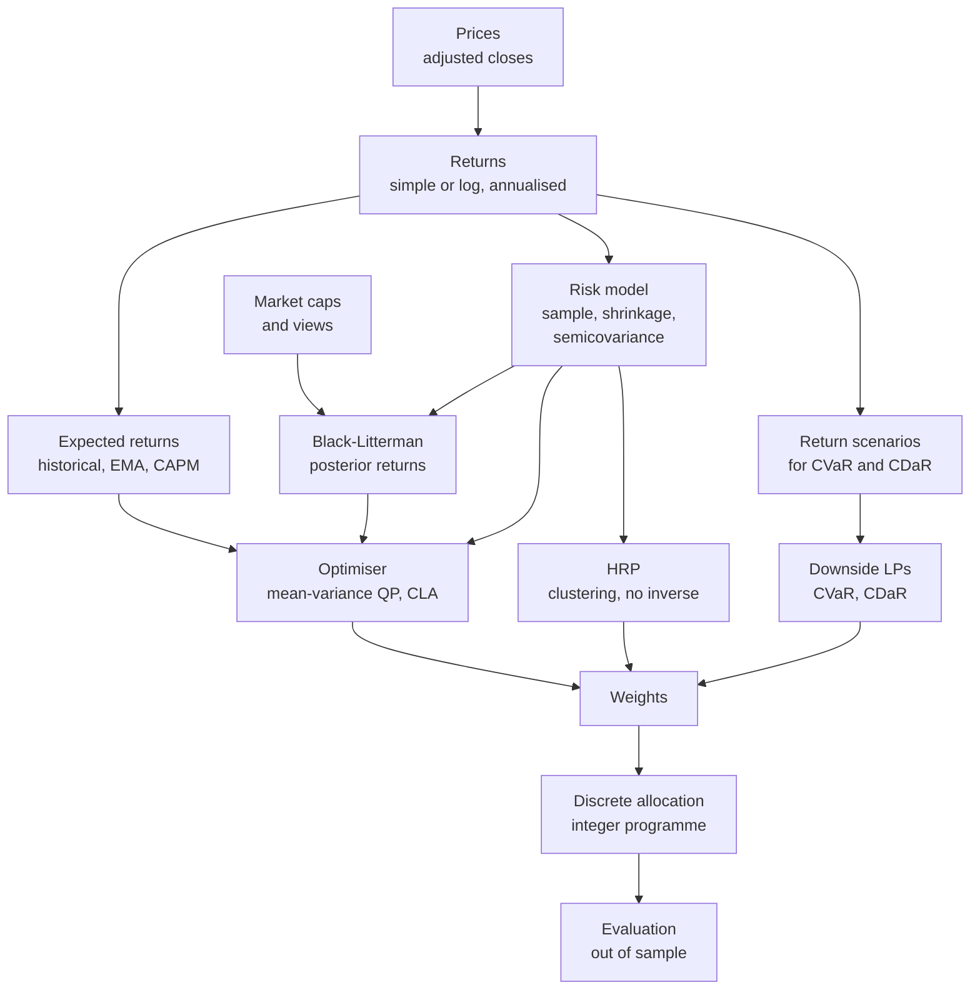
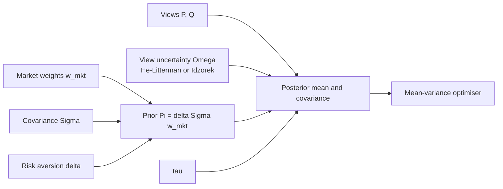
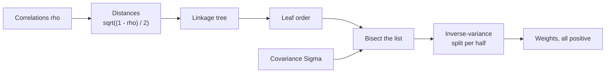

Portfolio optimisation chooses how much money to put in each asset from estimates of their returns and of how they move together. A library such as [PyPortfolioOpt](https://github.com/PyPortfolio/PyPortfolioOpt) turns those estimates into weights in a few lines, and the companion article [PyPortfolioOpt - How a Python Library Turns Price History into Portfolio Weights]({{site.url_complet}}/2026/11/18/pyportfolioopt-portfolio-optimization/) shows how its modules work and where they surprise a caller. This article covers what the library assumes the user already knows: the statistics of returns, the estimation of a covariance matrix, the optimisation models from Markowitz's 1952 mean-variance model to Hierarchical Risk Parity, published in 2016, and the evaluation of the result.

Most concepts are presented the same way: the intuition, the formula, a small worked example and, where the concept has pitfalls of its own, what goes wrong in practice and where it sits in the chain from prices to an order ticket. Most examples use two to ten assets with made-up inputs, the covariance simulations use 30 to 100 simulated assets, and one Black-Litterman check re-uses the 20-stock sample data of the companion article, so every number can be recomputed; the scripts that produce them are kept with the article in its [verification folder](https://github.com/rya-sge/access-denied/tree/main/verification/portfolio-optimization-concepts-markowitz-black-litterman). The tool appears only as a pointer, in sentences of the form "PyPortfolioOpt implements this as ...".

> This article has been made with the help of [Claude Code](https://claude.com/product/claude-code) and several custom skills

[TOC]

## What you need to know first

The article builds most of its concepts from the ground up. It assumes the following:

- **Expectation, variance and covariance.** A return is a random variable; its expectation is the mean outcome, its variance the mean squared deviation, and the covariance of two returns measures whether they deviate together. Every risk measure below is built from these.
- **Vectors and matrices.** Weights $$w$$, expected returns $$\mu$$ and the covariance matrix $$\Sigma$$ are written as vectors and matrices, so a portfolio return is $$w^{\top}\mu$$ and a portfolio variance is the quadratic form $$w^{\top}\Sigma w$$. The closed-form results also use the matrix inverse $$\Sigma^{-1}$$.
- **Standard error of a mean.** A mean estimated from $$T$$ independent observations with standard deviation $$\sigma$$ has a standard error $$\sigma/\sqrt T$$. [Sampling and Standard Error - Estimating a Population Mean from One Random Sample]({{site.url_complet}}/2026/10/26/sampling-standard-error-mean/) derives it; this article relies on it in every estimation section.
- **The normal distribution and quantiles.** A quantile is the value below which a given share of outcomes falls. Value-at-risk is a quantile of the loss distribution, and confidence statements about estimates use normal quantiles, as in [Confidence Intervals and the Central Limit Theorem - MIT 6.0002 Lecture 7 in Python]({{site.url_complet}}/2026/10/26/confidence-intervals-central-limit-theorem/).
- **Lagrange multipliers.** To optimise a function under an equality constraint, one adds the constraint times a multiplier and sets the derivatives to zero. This gives the closed-form portfolios of the Markowitz section.

## A concept map

The concepts form a chain. Prices become returns; estimators turn returns into an expected-return vector and a risk model; a model or optimiser turns those into weights; the weights become share counts; and only an evaluation on data the optimiser did not see says whether any of it worked.

The table maps each section to the step it belongs to and to the PyPortfolioOpt module that implements it.

| Step | Concepts (section) | PyPortfolioOpt module |
|---|---|---|
| Data to returns | simple and log returns, compounding, annualisation | `expected_returns.returns_from_prices` |
| Expected returns | sample mean and its error, EMA, CAPM | `expected_returns` |
| Risk model | covariance, positive semidefiniteness, shrinkage, semicovariance | `risk_models` |
| Model | Markowitz, tangency portfolio, quadratic utility | `efficient_frontier`, `objective_functions` |
| Solver | convexity, DCP, the max-Sharpe variable change, CLA | `base`, `cla` |
| Prior and views | Black-Litterman, Idzorek, He-Litterman | `black_litterman` |
| Other risk measures | semivariance, CVaR, CDaR, HRP | `efficient_frontier`, `hierarchical_portfolio` |
| Execution | discrete allocation | `discrete_allocation` |
| Evaluation | out-of-sample tests, overfitting, survivorship | none: the user's job |

## Returns and annualisation

### Simple and log returns

The simple return of an asset from $$t-1$$ to $$t$$ is the relative price change; the log return is the logarithm of the price ratio:

$$
\begin{aligned}
r_t = \frac{P_t}{P_{t-1}} - 1, \qquad \ell_t = \ln \frac{P_t}{P_{t-1}} = \ln(1 + r_t)
\end{aligned}
$$

The two behave differently under aggregation. Simple returns add across assets: a portfolio's simple return is $$\sum_i w_i r_{i,t}$$, the identity behind $$w^{\top}\mu$$. Log returns add across time: the log return over $$T$$ periods is $$\sum_t \ell_t$$. No single return type has both properties, which is why mean-variance optimisation works with simple returns and multi-period growth is discussed in logs.

A price that goes from 100 to 150 and back to 100 shows the difference. The simple returns are +50 % and -33.3 %; the log returns are +0.405 and -0.405, which sum to zero, the correct answer for a round trip.

### Arithmetic mean, geometric mean and volatility drag

The same path has an arithmetic mean simple return of $$(0.5 - 0.333)/2 = 8.33\%$$ per period, yet the investor ends where they started. The geometric mean, or compound annual growth rate (CAGR) when periods are years, is the constant rate that reproduces the final wealth:

$$
\begin{aligned}
g = \left( \prod_{t=1}^{T} (1 + r_t) \right)^{1/T} - 1
\end{aligned}
$$

and here $$g = 0$$. For returns with mean $$a$$ and volatility $$\sigma$$ the two are linked approximately by $$g \approx a - \sigma^2/2$$, the volatility drag: an asset with an 8 % arithmetic mean and 20 % volatility grows at about 6 % a year.

The two means answer different questions. The arithmetic mean is the expected one-period return, which is the input the single-period Markowitz model needs. The geometric mean describes realised growth over many periods. PyPortfolioOpt's `mean_historical_return` returns the CAGR by default and the arithmetic mean times the frequency with `compounding=False`; on the 100-150-100 path, with `frequency=2` (each step treated as half a year), the first gives 0 and the second $$2 \times 8.33\% = 16.7\%$$.

### Annualisation

Daily statistics are scaled to a year with the number of trading days, conventionally 252. The mean scales with time by linearity of expectation. The variance also scales with time if daily returns are uncorrelated with a constant variance, so the volatility then scales with the square root of time:

$$
\begin{aligned}
\mu_{\text{year}} = 252\,\mu_{\text{day}}, \qquad \sigma^2_{\text{year}} = 252\,\sigma^2_{\text{day}}, \qquad \sigma_{\text{year}} = \sqrt{252}\,\sigma_{\text{day}}
\end{aligned}
$$

A daily mean of 0.04 % and a daily volatility of 1 % become 10.08 % and 15.87 % a year. Compounding the daily mean instead, $$1.0004^{252} - 1$$, gives 10.60 %: the gap between the two conventions is as large as many of the return differences an optimiser acts on.

**What goes wrong.** The square-root rule assumes no autocorrelation: returns that trend or mean-revert scale differently. Mixing frequencies, such as weekly prices with `frequency=252`, inflates every statistic by a constant factor, and a risk-free rate quoted per year must be compared with annualised portfolio figures. **Where it sits.** First step of the chain; every later number inherits its convention.

## Expected returns and their estimation error

### The standard error of a historical mean

The obvious estimate of an asset's expected return is the sample mean of its past returns. Its standard error, for an annualised mean estimated from $$T$$ years of data with annual volatility $$\sigma$$, is

$$
\begin{aligned}
\text{SE}(\hat\mu) = \frac{\sigma}{\sqrt{T}}
\end{aligned}
$$

where $$T$$ is measured in years. Sampling more often does not help, although the prerequisite formula in observations seems to say otherwise.

With daily data, $$T$$ years give $$252T$$ observations, but each has a volatility of only $$\sigma/\sqrt{252}$$. The daily mean then has a standard error of $$(\sigma/\sqrt{252})/\sqrt{252T} = \sigma/(252\sqrt T)$$, and annualising it, a multiplication by 252, gives back $$\sigma/\sqrt T$$. The number of observations cancels: daily data over ten years gives the same precision on the mean as monthly data over ten years, and only the calendar span counts. [Merton (1980)](https://doi.org/10.1016/0304-405X(80)90007-0) made this point for the market's expected return; variances, by contrast, do become more precise with higher-frequency data.

A stock with 20 % volatility observed for 10 years has a standard error of 6.3 percentage points on its mean, so an approximate 95 % interval is ±12 points around the estimate. Reducing the standard error to 1 point would take $$(0.20/0.01)^2 = 400$$ years of stable history.

### Exponentially weighted means

An exponentially weighted moving average (EMA) gives recent returns more weight, with a decay set by a span $$s$$ through the weight factor $$\alpha = 2/(s+1)$$. It reacts faster to a change in the mean, at the price of using fewer effective observations and so a larger error.

On a series whose daily mean steps from 0.02 % for 500 days to 0.10 % for 250 days, the plain mean annualises (times 252, without compounding) to 11.8 %, a 500-day EMA to 18.5 % and the last year alone to 25.2 %. Which one is "right" depends on whether the step is a change in the true mean or noise. PyPortfolioOpt implements this as `ema_historical_return(prices, span=500)`, which compounds by default; `compounding=False` gives the figures above.

### CAPM expected returns

The Capital Asset Pricing Model of [Sharpe (1964)](https://doi.org/10.1111/j.1540-6261.1964.tb02865.x) states that, in equilibrium, an asset's expected excess return is proportional to its covariance with the market portfolio:

$$
\begin{aligned}
\mathbb E[R_i] = r_f + \beta_i \left( \mathbb E[R_m] - r_f \right), \qquad \beta_i = \frac{\operatorname{Cov}(R_i, R_m)}{\operatorname{Var}(R_m)}
\end{aligned}
$$

With $$\beta = 1.2$$, a 3 % risk-free rate and a 5 % market risk premium, the expected return is $$3\% + 1.2 \times 5\% = 9\%$$. Betas are estimated far more precisely than means, because they come from covariances: on 10 years of simulated daily data with a true beta of 1.2, the estimate was 1.19.

CAPM does not remove the estimation problem; it concentrates it in one number, the market premium. If that premium is itself a historical average, it carries the same $$\sigma/\sqrt T$$ error.

One draw of the simulation above shows it. The simulated market had a true arithmetic drift of 7.6 % a year, or an expected growth rate of about 6.5 % after volatility drag, but its realised growth rate over the ten years was -3.8 %. PyPortfolioOpt's `capm_return` puts that realised, compounded market return into the formula, with the beta it estimates from the same prices, about 1.2: $$3\% + 1.2 \times (-3.8\% - 3\%) \approx -5.2\%$$ for the asset. A premium taken from long-run studies or from Black-Litterman's reverse optimisation, below, avoids that.

**What goes wrong.** The optimiser treats $$\hat\mu$$ as exact. Assets whose estimates are high by chance get the largest weights, which is the "error maximiser" effect of the Markowitz section. **Where it sits.** Input of every return-seeking objective (max Sharpe, efficient return, utility); the minimum-variance portfolio and HRP do not use it.

## Covariance, correlation and risk models

### Covariance matrix and portfolio variance

For $$n$$ assets, $$\Sigma$$ is the $$n \times n$$ matrix with variances on the diagonal and covariances $$\sigma_{ij} = \rho_{ij}\sigma_i\sigma_j$$ off it, where $$\rho_{ij}$$ is the correlation. The portfolio variance is

$$
\begin{aligned}
\sigma_p^2 = w^{\top}\Sigma w = \sum_{i}\sum_{j} w_i w_j \rho_{ij} \sigma_i \sigma_j
\end{aligned}
$$

Diversification is the off-diagonal terms: with correlations below 1, the portfolio volatility is less than the weighted average of the volatilities.

A valid covariance matrix is **positive semidefinite** (PSD): $$x^{\top}\Sigma x \geq 0$$ for every vector $$x$$, which is the statement that no portfolio has negative variance. Equivalently, all its eigenvalues are non-negative. The eigenvectors, read as weight vectors of unit length, are uncorrelated portfolios, and the eigenvalues are their variances. The three-asset example used through the rest of the article has the inputs below; its expected returns serve the Markowitz section and its market weights the Black-Litterman section.

| Asset | Volatility | Correlation with A / B / C | Expected return | Market weight |
|---|---|---|---|---|
| A | 15 % | 1 / 0.3 / 0.2 | 8 % | 50 % |
| B | 20 % | 0.3 / 1 / 0.5 | 12 % | 30 % |
| C | 30 % | 0.2 / 0.5 / 1 | 15 % | 20 % |

Its covariance matrix has eigenvalues 0.0184, 0.0284 and 0.1058, all positive.

A matrix assembled from pairwise estimates, from different time windows, or edited by hand can fail the test. The optimiser then sees a portfolio with negative variance and either fails or exploits it. PyPortfolioOpt passes every risk model through `fix_nonpositive_semidefinite`, which sets negative eigenvalues to zero (the `spectral` method) or adds a constant to the diagonal.

### Why the sample covariance is a poor input

The sample covariance $$S = \frac{1}{T-1}\sum_t (r_t - \bar r)(r_t - \bar r)^{\top}$$ is unbiased, but it has $$n(n+1)/2$$ parameters: 210 for 20 assets, 125,250 for 500. Three problems follow.

- **Singularity when $$T \leq n$$.** The matrix has rank at most $$T-1$$. With 50 assets and 40 observations the sample matrix had rank 39 and a smallest eigenvalue of zero up to rounding, so the optimiser finds combinations of assets that appear riskless.
- **Spread eigenvalues.** Even when $$T \gt n$$, sampling noise pushes the small eigenvalues down and the large ones up. With 100 uncorrelated assets of unit variance and 200 observations, the sample eigenvalues ranged on average from 0.094 to 2.83 instead of all being 1, close to the Marchenko-Pastur limits $$(1 \pm \sqrt{n/T})^2 = 0.086$$ and $$2.914$$, the bounds that the eigenvalues of a pure-noise sample covariance approach as $$n$$ and $$T$$ grow with $$n/T$$ fixed. The ratio of the largest to the smallest eigenvalue, called the condition number, was about 30 for a true value of 1. The optimiser loads on the directions with the smallest estimated variance, which are those whose variance is most underestimated.
- **Missing data.** Assets listed at different dates leave holes. Computing each covariance on its own overlapping window keeps the data but can break positive semidefiniteness; filling holes with zero returns keeps the matrix PSD but makes the asset look calm. Zero-filling multiplies the volatility measured on the observed dates by the square root of the observed share. A simulated stock with a true volatility of 31.7 %, listed only for the last 25 % of a window, measures 33.1 % on that quarter and 16.6 % once the missing returns are set to zero: $$33.1\% \times \sqrt{0.25} \approx 16.6\%$$. PyPortfolioOpt's `CovarianceShrinkage.ledoit_wolf()` always replaces missing returns by zero, whatever the shrinkage target, and the PyPortfolioOpt article measured the effect on real data.

### Shrinkage and Ledoit-Wolf

Shrinkage replaces the sample matrix by a weighted average with a structured target $$F$$ that has few parameters:

$$
\begin{aligned}
\hat\Sigma = \delta F + (1 - \delta) S, \qquad 0 \leq \delta \leq 1
\end{aligned}
$$

The target is biased but stable, the sample matrix unbiased but noisy, and the intensity $$\delta$$ trades one against the other. This $$\delta$$ is not the risk aversion of the Markowitz and Black-Litterman sections, which shares the letter; the annex lists the symbols that are reused. Three targets are common:

- **Scaled identity**: every asset has the average variance, and no pair is correlated.
- **Single factor**: covariances come from each asset's exposure to one market factor.
- **Constant correlation**: each asset keeps its own variance, and every pair has the average correlation.

Ledoit and Wolf derived the intensity that minimises the expected squared (Frobenius) distance to the true matrix, and an estimator of it from the data. For the constant-correlation target of ["Honey, I Shrunk the Sample Covariance Matrix"](https://doi.org/10.3905/jpm.2004.110) it has the form

$$
\begin{aligned}
\delta^{\star} = \max\left(0, \min\left(1, \frac{\hat\kappa}{T}\right)\right), \qquad \hat\kappa = \frac{\hat\pi - \hat\rho}{\hat\gamma}
\end{aligned}
$$

where $$\hat\pi$$ sums the estimated variances of the entries of $$S$$, $$\hat\rho$$ corrects for their covariance with the target's entries, and $$\hat\gamma$$ is the squared distance between $$S$$ and $$F$$. The $$1/T$$ factor carries the intuition: the more data, the less shrinkage. The identity-target version is in [Ledoit and Wolf (2004b)](https://doi.org/10.1016/S0047-259X(03)00096-4), the estimator that scikit-learn implements.

A simulation with 30 assets, volatilities from 10 % to 40 % and a common correlation of 0.3 shows both the effect and its limits:

| Observations $$T$$ | Mean $$\delta$$ (identity target) | Frobenius error, LW identity / sample | True vol of min-variance portfolio: sample / LW identity / LW const-corr |
|---|---|---|---|
| 60 | 0.168 | 0.950 | 9.01 % / 8.00 % / 6.58 % |
| 250 | 0.044 | 0.987 | 6.81 % / 6.79 % / 6.45 % |
| 1,000 | 0.011 | 0.997 | not run |

The optimal minimum-variance portfolio has a true volatility of 6.40 %. With 60 observations, weights computed from the sample matrix have a true volatility of 9.01 %; shrinkage to the identity brings it to 8.00 %, and shrinkage to the constant-correlation target, which matches the structure of the true matrix, to 6.58 %.

In this simulation the choice of target mattered more than the estimate of $$\delta$$. The Frobenius column shows the limit: shrinkage to the identity reduces the error of the matrix as a whole by only 5 % at 60 observations, and by less with more data, yet it changes the minimum-variance portfolio noticeably. PyPortfolioOpt implements this as `CovarianceShrinkage(prices).ledoit_wolf(shrinkage_target=...)`, with `constant_variance` (the scaled identity) as default.

### Semicovariance and exponential covariance

Two variants change what counts as risk or which data counts most:

- **Semicovariance** keeps only returns below a benchmark $$b$$: $$\frac{1}{T}\sum_t \min(r_t - b, 0)\min(r_t - b, 0)^{\top}$$. It treats upside volatility as harmless. Plugging it into a mean-variance optimiser in place of $$\Sigma$$ is a heuristic: the PyPortfolioOpt documentation, citing Estrada, notes that the result is not efficient in mean-semivariance space, and that the exact problem is a separate convex programme (see the downside-risk section). For a two-asset toy with five returns and benchmark 0, the matrix computed by hand matched PyPortfolioOpt's `semicovariance` entry by entry.
- **Exponential covariance** weights recent pairs of returns more, like the EMA mean, so the matrix follows volatility regimes. It uses fewer effective observations, so every problem of the previous subsection gets worse.

**Where it sits.** Input of every mean-variance objective and of HRP. Of the two estimates, the covariance is the one that can be improved with more frequent data; the mean cannot.

## Mean-variance optimisation (Markowitz 1952)

### The problem

[Markowitz (1952)](https://doi.org/10.1111/j.1540-6261.1952.tb01525.x) proposed to describe each portfolio by two numbers, its expected return $$w^{\top}\mu$$ and its variance $$w^{\top}\Sigma w$$, and to keep only the efficient ones: those for which no other portfolio offers a higher return for the same variance, or a lower variance for the same return. For a target return $$m$$ the problem is

$$
\begin{aligned}
\min_{w} \quad & w^{\top}\Sigma w \\
\text{subject to} \quad & w^{\top}\mu = m, \quad \mathbf 1^{\top} w = 1
\end{aligned}
$$

a quadratic programme (QP): a quadratic objective with linear constraints. Additional linear constraints such as $$w \geq 0$$ keep it a QP.

### Closed-form solutions without inequality constraints

With only the two equality constraints, the Lagrangian gives a closed form, derived analytically by [Merton (1972)](https://doi.org/10.2307/2329621). Define the scalars

$$
\begin{aligned}
A = \mathbf 1^{\top}\Sigma^{-1}\mathbf 1, \quad B = \mathbf 1^{\top}\Sigma^{-1}\mu, \quad C = \mu^{\top}\Sigma^{-1}\mu, \quad D = AC - B^2
\end{aligned}
$$

Then the efficient portfolio for return $$m$$, its variance and the global minimum-variance (GMV) portfolio are

$$
\begin{aligned}
w(m) &= \Sigma^{-1}\left( \lambda \mathbf 1 + \gamma \mu \right), \quad \lambda = \frac{C - Bm}{D}, \quad \gamma = \frac{Am - B}{D} \\
\sigma^2(m) &= \frac{A m^2 - 2 B m + C}{D} \\
w_{\text{gmv}} &= \frac{\Sigma^{-1}\mathbf 1}{A}, \qquad \mu_{\text{gmv}} = \frac{B}{A}, \qquad \sigma^2_{\text{gmv}} = \frac{1}{A}
\end{aligned}
$$

The variance is a parabola in $$m$$, so the frontier is a hyperbola in the (volatility, return) plane. The GMV portfolio does not depend on $$\mu$$ at all.

For the three-asset example of the covariance section, with expected returns 8 %, 12 % and 15 %, the constants are $$A = 54.74$$, $$B = 5.139$$, $$C = 0.5408$$ and $$D = 3.196$$. The results, each also obtained from PyPortfolioOpt's `EfficientFrontier` to four decimals:

| Portfolio | Weights A / B / C | Return | Volatility | Sharpe ($$r_f$$ 3 %) |
|---|---|---|---|---|
| Global minimum variance | 0.6866 / 0.2687 / 0.0448 | 9.39 % | 13.52 % | 0.47 |
| Tangency, $$r_f$$ = 3 % | 0.3925 / 0.3981 / 0.2093 | 11.06 % | 15.18 % | 0.53 |
| Efficient, $$m$$ = 12 % | 0.2266 / 0.4712 / 0.3022 | 12.00 % | 17.31 % | 0.52 |
| Quadratic utility, $$\delta$$ = 3 | 0.3438 / 0.4196 / 0.2366 | 11.33 % | 15.73 % | 0.53 |

The solid curve is the frontier when weights may be negative; its lower half is inefficient, since the same volatility buys a higher return on the upper half. The dashed curve is the long-only frontier: it coincides with the unconstrained one from the minimum-variance portfolio up to a return of 13.29 %, where the weight of asset A reaches zero, and then follows the two-asset frontier of B and C up to asset C.

### The two-fund theorem

Since $$w(m)$$ is linear in $$m$$, every frontier portfolio is a combination of any two others. With the GMV and the tangency portfolio as the two funds, the efficient portfolio for a 10 % return in the example is $$0.6335\,w_{\text{gmv}} + 0.3665\,w_{\text{tan}} = (0.5788, 0.3161, 0.1051)$$, which matches the closed form to $$10^{-16}$$. A target above both funds' returns needs a negative weight on one of them. The theorem holds only without inequality constraints: with long-only bounds the frontier is a chain of segments, each mixing two corner portfolios (see the Critical Line Algorithm).

### The capital market line, the tangency portfolio and the Sharpe ratio

With a risk-free asset at rate $$r_f$$, mixing it with a risky portfolio $$p$$ traces a straight line in the (volatility, return) plane, with slope

$$
\begin{aligned}
S(p) = \frac{\mu_p - r_f}{\sigma_p}
\end{aligned}
$$

the Sharpe ratio, introduced by [Sharpe (1966)](https://doi.org/10.1086/294846) as the reward-to-variability ratio. The steepest line touches the frontier at the tangency portfolio, and that line is the capital market line. This is the separation result of [Tobin (1958)](https://doi.org/10.2307/2296205), in the form the CAPM later used: mean-variance investors who share the same estimates hold the same risky portfolio and express their risk preference only through the split between it and the risk-free asset. Without constraints,

$$
\begin{aligned}
w_{\text{tan}} = \frac{\Sigma^{-1}(\mu - r_f \mathbf 1)}{\mathbf 1^{\top}\Sigma^{-1}(\mu - r_f \mathbf 1)}, \qquad S_{\max} = \sqrt{(\mu - r_f\mathbf 1)^{\top}\Sigma^{-1}(\mu - r_f\mathbf 1)}
\end{aligned}
$$

In the example $$S_{\max} = 0.5308$$. The tangency portfolio depends on $$r_f$$: at $$r_f = 0$$ it becomes $$\Sigma^{-1}\mu / B = (0.4865, 0.3568, 0.1568)$$, with a 10.52 % return. This is why PyPortfolioOpt's change of default risk-free rate from 0.02 to 0.0 (commit `388acf6` of 2024-12-01, so 0.0 in release 1.6.0) changed the output of `max_sharpe()` for unchanged inputs; the companion article gives the details.

### Quadratic utility and the risk-aversion parameter

Instead of a target, an investor can maximise a trade-off:

$$
\begin{aligned}
\max_{w} \quad w^{\top}\mu - \frac{\delta}{2} w^{\top}\Sigma w
\end{aligned}
$$

where $$\delta \gt 0$$ is the risk aversion. Two standard results justify ranking portfolios by mean and variance alone:

- **Exponential utility and normal returns.** The objective above is then the certainty equivalent of the investor's wealth, so maximising it maximises expected utility.
- **Quadratic utility.** Expected utility is then a function of the mean and the variance only, different from the objective above, but it orders the portfolios of the efficient frontier the same way, so the investor's choice is still a frontier portfolio.

Without a budget constraint the solution is $$w = \Sigma^{-1}\mu/\delta$$: in the example with $$\delta = 3$$ that is $$(0.8333, 0.6111, 0.2685)$$, which sums to 1.71: the extra 0.71 is borrowed, implicitly at a zero rate since $$\mu$$ is not measured in excess of $$r_f$$.

With $$\mathbf 1^{\top}w = 1$$, $$w = \Sigma^{-1}(\mu - \eta\mathbf 1)/\delta$$ with $$\eta = (B - \delta)/A$$, which gives the last row of the table. As $$\delta$$ grows, the portfolio moves down the frontier to the GMV portfolio. PyPortfolioOpt implements this as `max_quadratic_utility(risk_aversion=...)`; the same $$\delta$$ reappears in Black-Litterman.

### Constrained solutions

Long-only bounds, position caps and sector limits remove the closed form. The problem stays a QP, and solvers find the optimum reliably, but some weights end at their bounds, and those bounds change which assets are held. In the example, the long-only frontier above 13.29 % holds no asset A, where the unconstrained formula would short it.

### Why mean-variance is an "error maximiser"

[Michaud (1989)](https://doi.org/10.2469/faj.v45.n1.31) described mean-variance optimisers as maximisers of estimation error: they overweight assets whose expected returns are overestimated or whose risks are underestimated, because those look like bargains. The closed form shows the mechanism, since $$w_{\text{tan}}$$ is linear in $$\mu$$ through $$\Sigma^{-1}$$, and $$\Sigma^{-1}$$ amplifies differences between correlated assets.

The example quantifies it. Raising the expected return of asset B from 12 % to 13 % moves its tangency weight from 39.8 % to 47.9 %; lowering it to 11 % moves it to 31.0 %. One percentage point is well inside the estimation error: with 10 years of data at 20 % volatility, the standard error is 6.3 points. Moving B's return by one standard error in each direction gives:

| Expected return of B | Tangency, unconstrained | Tangency, long-only |
|---|---|---|
| 5.68 % (minus 1 SE) | 0.7763 / -0.3273 / 0.5509 | 0.6032 / 0 / 0.3968 |
| 12 % (estimate) | 0.3925 / 0.3981 / 0.2093 | same |
| 18.32 % (plus 1 SE) | 0.1700 / 0.8187 / 0.0113 | same |

"Same" means that the unconstrained weights are already non-negative, so the long-only bound does not bind. Within one standard error, B's weight goes from -33 % to 82 % without constraints, and from 0 to 82 % long-only. The remedies act at three points: on the inputs, with shrinkage or Black-Litterman; on the optimiser, with constraints, regularisation or resampling; or by dropping expected returns, as minimum variance and HRP do.

**Where it sits.** The model of the chain. Its output is only as good as $$\mu$$ and $$\Sigma$$, and it is most sensitive to $$\mu$$.

## Convex optimisation essentials

### Convexity and problem classes

A problem is convex when it minimises a convex function over a convex set. Every local minimum is then global, and interior-point and first-order solvers find it with a certificate of optimality. [Boyd and Vandenberghe](https://web.stanford.edu/~boyd/cvxbook/) is the standard reference. Portfolio problems fall into three classes:

- **Linear programme (LP)**: linear objective, linear constraints. Minimum CVaR and minimum CDaR, after the reformulations below, are LPs.
- **Quadratic programme (QP)**: convex quadratic objective, which requires a PSD $$\Sigma$$, and linear constraints. Minimum variance, efficient return and quadratic utility are QPs.
- **Second-order cone programme (SOCP)**: constraints of the form $$\lVert Ax + b\rVert_2 \leq c^{\top}x + d$$. Maximising return under a volatility cap, $$\sqrt{w^{\top}\Sigma w} \leq \sigma_{\max}$$, is an SOCP.

### Disciplined convex programming

A modelling tool cannot decide convexity for an arbitrary formula, so [cvxpy](https://www.cvxpy.org/) accepts only expressions built by the rules of [disciplined convex programming (DCP)](https://www.cvxpy.org/tutorial/dcp/index.html): each function has a known curvature and monotonicity, and the composition rules propagate them through the expression. Minimising a convex expression or maximising a concave one passes; anything else is rejected before solving, even if it happens to be convex.

The Sharpe ratio is the standard example. Written directly as `(mu - rf) @ w / cp.sqrt(cp.quad_form(w, S))`, it is an affine expression divided by a convex one, which DCP cannot classify, and cvxpy raises `DCPError: Problem does not follow DCP rules`. The ratio is quasi-concave, not concave, and needs a change of variables.

### Making maximum Sharpe convex

Set $$y = k w$$ with $$k \gt 0$$ and normalise the excess return of $$y$$ to 1. Maximising the Sharpe ratio is then the same as minimising the variance of $$y$$, a QP:

$$
\begin{aligned}
\min_{y,\,k} \quad & y^{\top}\Sigma y \\
\text{subject to} \quad & (\mu - r_f \mathbf 1)^{\top} y = 1, \quad \mathbf 1^{\top} y = k, \quad k \geq 0
\end{aligned}
$$

and $$w = y/k$$. The transformation needs at least one asset with an expected return above $$r_f$$, and every other constraint must be rewritten in homogeneous form: $$w \leq u$$ becomes $$y \leq u k$$. In the example the QP, solved with cvxpy under long-only bounds, returns the tangency weights of the table. This is the formulation of Cornuéjols and Tütüncü that PyPortfolioOpt's `max_sharpe` uses.

### Constraints, regularisation and costs

The usual constraints are all linear, so they keep each problem in its class:

- **Budget** $$\mathbf 1^{\top}w = 1$$, or $$\mathbf 1^{\top}w = 0$$ for a market-neutral book.
- **Bounds** $$l_i \leq w_i \leq u_i$$; long-only is $$w \geq 0$$.
- **Groups** $$\sum_{i \in G} w_i \leq u_G$$ for a sector, country or issuer.

Two objective terms are common:

- **L2 regularisation** adds $$\gamma\, w^{\top}w$$, which is smallest when weights are equal and spreads the portfolio over more assets. Added to a variance objective it is the same as replacing $$\Sigma$$ by $$\Sigma + \gamma I$$, a shrinkage toward the identity.
- **Transaction costs** add $$k \lVert w - w_{\text{prev}}\rVert_1$$ for proportional costs: the $$L_1$$ norm of turnover is convex and becomes an LP term.

A cardinality limit ("at most 10 assets") or a minimum lot size is not convex. It needs integer variables and a mixed-integer solver, with no guarantee of a fast answer.

**Where it sits.** The solver layer. A convex formulation guarantees the optimum of the stated problem, which says nothing about whether the stated problem has good inputs.

## The Critical Line Algorithm

Markowitz also gave an algorithm for the constrained frontier, the Critical Line Algorithm (CLA). With linear bounds, the efficient weights are piecewise linear in the target return. The breakpoints, called **turning points** or **corner portfolios**, are the returns at which an asset enters or leaves the set of assets strictly inside their bounds. Between two corners the frontier portfolio is a straight-line mix of them, so the whole frontier is known once the corners are.

The algorithm starts from the highest-return feasible portfolio and walks down: at each step it solves a linear system for the free assets, finds the next return at which a free asset hits a bound or a bounded one becomes free, and records a corner. It stops at the minimum-variance portfolio.

For the long-only three-asset example there are three corners:

| Corner | Weights A / B / C | Return | Volatility |
|---|---|---|---|
| 1 | 0 / 0 / 1 | 15.00 % | 30.00 % |
| 2 | 0 / 0.5710 / 0.4290 | 13.29 % | 21.05 % |
| 3 (GMV) | 0.6866 / 0.2687 / 0.0448 | 9.39 % | 13.52 % |

A cvxpy solve of `efficient_return(0.14)` gives $$(0, 0.3333, 0.6667)$$, the mix of corners 1 and 2 with return 14 %, and `efficient_return(0.10)` gives the mix of corners 2 and 3; both agree with the interpolation to $$10^{-15}$$.

CLA is exact, needs no general-purpose solver, and returns the whole frontier at once. [Bailey and López de Prado (2013)](https://doi.org/10.3390/a6010169) published an open-source Python implementation, which PyPortfolioOpt ships as `CLA`. It handles only the budget, bounds on each weight and the variance objective, and its `max_sharpe()` searches between corners with $$r_f = 0$$.

## Black-Litterman

### Reverse optimisation and the market prior

Black and Litterman, at Goldman Sachs, started from the opposite direction ([Black and Litterman, 1992](https://doi.org/10.2469/faj.v48.n5.28)). Rather than estimate $$\mu$$ and get extreme weights, assume the market portfolio is the optimal one for a representative investor with risk aversion $$\delta$$, and ask which expected excess returns make it so. Setting the gradient of the quadratic utility to zero at $$w_{\text{mkt}}$$ gives the implied equilibrium returns:

$$
\begin{aligned}
\Pi = \delta \Sigma w_{\text{mkt}}, \qquad \delta = \frac{\mathbb E[R_m] - r_f}{\sigma_m^2}
\end{aligned}
$$

The market-implied $$\delta$$ is the market's excess return per unit of variance: a 7 % premium and a 16 % volatility give $$0.07/0.16^2 = 2.73$$. The example below uses $$\delta = 2.5$$, a round value chosen for the illustration and not a library default. With that $$\delta$$ and the market weights 50 / 30 / 20 % of the three-asset example, $$\Pi = (3.94\%, 5.63\%, 7.88\%)$$, and solving $$(\delta\Sigma)^{-1}\Pi$$ returns the market weights exactly. The prior is therefore a set of returns for which an unconstrained optimiser at the same $$\delta$$ holds the market: a neutral starting point instead of a noisy one.

$$\Pi$$ is an excess return. PyPortfolioOpt's `market_implied_prior_returns` adds `risk_free_rate` back, so the returned vector is a total return when a rate is passed.

### Views

The investor states $$K$$ views as linear statements on returns:

- **Absolute**: "C will return 10 %" is a row of $$P$$ with a 1 in C's column and $$Q = 0.10$$.
- **Relative**: "B will outperform A by 3 %" is a row $$(-1, 1, 0)$$ and $$Q = 0.03$$.

$$P$$ is the $$K \times n$$ picking matrix, $$Q$$ the vector of view returns and $$\Omega$$ the $$K \times K$$ covariance of the views' errors, diagonal when views are independent. A scalar $$\tau$$ scales the uncertainty of the prior: the model assumes $$\mu \sim N(\Pi, \tau\Sigma)$$, and a small $$\tau$$ says the prior mean is much more precise than a single return. PyPortfolioOpt's default is 0.05; its documentation cites a paper by Walters devoted to choosing $$\tau$$.

### The posterior

Combining the prior and the views by Bayes' rule, or equivalently by generalised least squares, gives the posterior mean and covariance:

$$
\begin{aligned}
\mathbb E[R] &= \left[ (\tau\Sigma)^{-1} + P^{\top}\Omega^{-1}P \right]^{-1} \left[ (\tau\Sigma)^{-1}\Pi + P^{\top}\Omega^{-1}Q \right] \\
&= \Pi + \tau\Sigma P^{\top}\left( P\tau\Sigma P^{\top} + \Omega \right)^{-1}(Q - P\Pi) \\
\Sigma_{\text{post}} &= \Sigma + \left[ (\tau\Sigma)^{-1} + P^{\top}\Omega^{-1}P \right]^{-1}
\end{aligned}
$$

The first line is a precision-weighted average of prior and views. The second line, which PyPortfolioOpt computes by solving a $$K \times K$$ system, reads as "prior plus a correction": the correction is proportional to the surprise $$Q - P\Pi$$, and $$\Sigma P^{\top}$$ propagates it to assets without a view through their covariances. The posterior covariance adds the parameter uncertainty to $$\Sigma$$; in the relative-view example below, at $$\tau = 0.05$$, it multiplies the volatilities by about 1.02.

### Choosing the view uncertainty: He-Litterman and Idzorek

$$\Omega$$ is the hardest input to set, and two conventions dominate.

**He and Litterman (1999)** set each view's variance proportional to the prior variance of its view portfolio: $$\Omega = \operatorname{diag}(P\tau\Sigma P^{\top})$$. Then $$\tau$$ cancels from the posterior mean: in the second form above it multiplies $$\Sigma P^{\top}$$, $$P\Sigma P^{\top}$$ and $$\Omega$$ alike. For the relative view "B beats A by 3 %", whose prior value is $$\Pi_B - \Pi_A = 1.69\%$$, the posterior is $$(3.74\%, 6.08\%, 8.19\%)$$ for $$\tau$$ = 0.025, 0.05 and 0.5 alike, and the view portfolio moves to 2.34 %, exactly halfway to the view. PyPortfolioOpt uses it when no $$\Omega$$ is given.

**Idzorek (2005)** lets the user state a confidence $$c_k$$ between 0 and 1 per view. In the closed form that PyPortfolioOpt implements (after Walters), $$\Omega_{kk} = \tau\,\alpha_k\, p_k\Sigma p_k^{\top}$$ with $$\alpha_k = (1-c_k)/c_k$$. For a single view the posterior simplifies. Write $$s = p\,\tau\Sigma\,p^{\top}$$; then $$\Omega = \alpha s$$ and the view portfolio's posterior return is

$$
\begin{aligned}
p\,\mathbb E[R] = p\Pi + \frac{s}{s + \alpha s}(Q - p\Pi) = p\Pi + c\,(Q - p\Pi)
\end{aligned}
$$

since $$1/(1+\alpha) = c$$. The confidence is the fraction of the gap between prior and view that the posterior covers. With one view, the He-Litterman default above has $$\Omega = s$$, so $$\alpha = 1$$ and $$c = 50\%$$, which is why it closed exactly half of the gap. For the absolute view "C returns 10 %" against a prior of 7.875 %:

| Confidence $$c$$ | Posterior A / B / C | Fraction of the gap closed on C |
|---|---|---|
| 25 % | 3.99 % / 5.80 % / 8.41 % | 0.25 |
| 50 % | 4.04 % / 5.98 % / 8.94 % | 0.50 |
| 100 % | 4.15 % / 6.33 % / 10.00 % | 1.00 |

A and B rise without a view of their own, through their correlation with C. The same rule holds on the 20-stock sample data of the PyPortfolioOpt article, with equal market caps as a check of the mechanics only: an AAPL prior of 0.09791 and a 20 % view at 50 % confidence give 0.14896, and $$0.09791 + 0.5 \times (0.20 - 0.09791) = 0.148955$$.

The rule is exact for one view. With two absolute views at 50 % each, on A at 10 % and on C at 10 %, the posterior closes 50.4 % of A's gap and 78.3 % of C's, because each view also moves the other asset through the covariance.

**What goes wrong.** The prior needs market capitalisations and a $$\delta$$ consistent with the risk model; equal or stale caps give a meaningless prior. $$\tau$$ cancels from the mean under both conventions above, since $$\Omega$$ is proportional to $$\tau$$ in both, but not from the posterior covariance. Several views interact. **Where it sits.** Between the estimators and the optimiser: it replaces $$\hat\mu$$, and its output feeds an ordinary mean-variance problem.

## Downside risk measures

Variance penalises gains and losses alike. Downside measures look only at losses, and they are computed from return scenarios, historical or simulated, rather than from $$\Sigma$$.

### Semivariance

The exact mean-semivariance problem, in the formulation of Markowitz and co-authors that PyPortfolioOpt cites, introduces for each of the $$T$$ scenarios a positive part $$p_t$$ and a negative part $$n_t$$ of the portfolio's excess return:

$$
\begin{aligned}
\min_{w,\,p,\,n} \quad & \sum_t n_t^2 \\
\text{subject to} \quad & Bw - p + n = 0, \quad p \geq 0, \quad n \geq 0, \quad \mathbf 1^{\top}w = 1
\end{aligned}
$$

where row $$t$$ of $$B$$ is $$(r_t - b)/\sqrt T$$. It is a QP with $$2T$$ extra variables.

### Value-at-risk and conditional value-at-risk

At confidence level $$\beta$$, the value-at-risk (VaR) is the $$\beta$$-quantile of the loss $$L = -w^{\top}r$$: the loss that is exceeded with probability at most $$1-\beta$$. The conditional value-at-risk (CVaR), or expected shortfall, is the mean loss in that tail. VaR ignores the size of losses beyond the quantile and is not convex in $$w$$; CVaR accounts for the tail and is convex.

[Rockafellar and Uryasev (2000)](https://doi.org/10.21314/JOR.2000.038) showed that CVaR is the minimum over $$\alpha$$ of a convex function, and that with $$T$$ scenarios the minimisation becomes an LP:

$$
\begin{aligned}
\mathrm{CVaR}(w; \beta) = \min_{\alpha} \; \alpha + \frac{1}{(1-\beta)T}\sum_{t=1}^{T} \max(L_t - \alpha, 0)
\end{aligned}
$$

replacing each $$\max$$ by an auxiliary $$u_t \geq 0$$ with $$u_t \geq L_t - \alpha$$. Minimising jointly over $$w$$, $$\alpha$$ and $$u$$ gives the minimum-CVaR portfolio; the smallest optimal $$\alpha$$ is the VaR.

Ten daily portfolio returns illustrate it at $$\beta = 0.8$$, so the tail is the worst $$(1-\beta)T = 2$$ days. Sorted from worst, the losses are 3.0, 2.1, 1.4, 0.5, -0.1, -0.3, -0.4, -0.8, -0.9 and -1.2 %. The 80 % VaR is 1.4 %, since 8 of the 10 losses are at most 1.4 %, and the CVaR is the mean of the two worst, $$(3.0 + 2.1)/2 = 2.55\%$$.

The LP returns 2.55 %. Its $$\alpha$$ is not unique: the objective equals 2.55 % for every $$\alpha$$ between 1.4 % and 2.1 %, and the solver returned 1.88 %. With discrete scenarios the optimal $$\alpha$$ can form an interval whose left end is the VaR, while the CVaR is a single number. PyPortfolioOpt implements the LP as `EfficientCVaR`, with $$\beta$$ = 0.95 by default.

### Drawdown and CDaR

A drawdown is the fall from the running peak of cumulative returns. Using non-compounded cumulative returns $$c_t = \sum_{s \leq t} r_s$$ and a starting value of 0, as PyPortfolioOpt does,

$$
\begin{aligned}
D_t = \max_{s \leq t} \max(c_s, 0) - c_t
\end{aligned}
$$

The maximum drawdown is $$\max_t D_t$$; the conditional drawdown-at-risk (CDaR) is the mean of the worst $$(1-\beta)$$ share of drawdowns, the CVaR construction applied to $$D_t$$. [Chekhlov, Uryasev and Zabarankin (2005)](https://doi.org/10.1142/S0219024905002767) gave the LP formulation, with one variable per date for the running peak.

On the same ten returns, the cumulative path is 1.2, 0.7, 1.0, -1.1, -0.3, -1.7, -1.3, -4.3, -3.4 and -3.3 %, the peak stays at 1.2 %, and the drawdowns are 0, 0.5, 0.2, 2.3, 1.5, 2.9, 2.5, 5.5, 4.6 and 4.5 %. The maximum drawdown is 5.5 % and the 80 % CDaR is $$(5.5 + 4.6)/2 = 5.05\%$$. Drawdowns depend on the order of returns, which CVaR ignores: reordering the ten days leaves the CVaR at 2.55 % but can change every drawdown.

**What goes wrong.** Tail measures rest on few observations: a 95 % CVaR over two years of daily data averages about 25 days. A CVaR computed on daily returns is a daily figure that is not comparable with an annual volatility. **Where it sits.** An alternative risk model, fed by return scenarios instead of $$\Sigma$$.

## Hierarchical Risk Parity

### The algorithm

[López de Prado (2016)](https://doi.org/10.3905/jpm.2016.42.4.059) proposed an allocation that uses the covariance matrix without inverting it. It has four steps:

1. **Correlation distance.** Turn each correlation into a distance $$d_{ij} = \sqrt{(1-\rho_{ij})/2}$$, which is 0 for perfectly correlated assets and 1 for perfectly anti-correlated ones.
2. **Hierarchical clustering.** Merge the closest assets, then the closest clusters, into a binary tree. The linkage rule decides the distance between clusters; the paper uses single linkage, the minimum distance between members.
3. **Quasi-diagonalisation.** Reorder the assets by the leaves of the tree, so that similar assets are adjacent and the reordered covariance matrix has its large values near the diagonal.
4. **Recursive bisection.** Split the ordered list in two halves. Give each half a variance, that of its own inverse-variance portfolio, and split the weight between the halves in inverse proportion to those variances: $$\alpha = 1 - V_1/(V_1 + V_2)$$ to the first half. Repeat inside each half until every half is one asset.

### A worked example

Four assets form two pairs. A and B have volatilities of 10 % and 15 % and a correlation of 0.8; C and D have 20 % and 25 % and a correlation of 0.6. The full correlation matrix is:

|   | A | B | C | D |
|---|---|---|---|---|
| A | 1 | 0.8 | 0.1 | 0.2 |
| B | 0.8 | 1 | 0.2 | 0.1 |
| C | 0.1 | 0.2 | 1 | 0.6 |
| D | 0.2 | 0.1 | 0.6 | 1 |

The distances are 0.316 for A-B, 0.447 for C-D, 0.632 for A-D and B-C, whose correlation is 0.2, and 0.671 for A-C and B-D, whose correlation is 0.1. Single linkage merges A-B at 0.316, C-D at 0.447, then the two pairs at 0.632, and the leaf order is A, B, C, D.

The bisection proceeds as follows:

- **First split, {A, B} against {C, D}.** The inverse-variance portfolio of {A, B} has weights 0.692 and 0.308 and a variance of 0.01204; that of {C, D} has 0.03867. The first half gets $$1 - 0.01204/(0.01204 + 0.03867) = 0.7626$$ of the weight.
- **A against B.** Variances 0.01 and 0.0225, so A gets 0.6923 of its half.
- **C against D.** Variances 0.04 and 0.0625, so C gets 0.6098 of its half.

The weights are A 52.8 %, B 23.5 %, C 14.5 % and D 9.3 %, identical to PyPortfolioOpt's `HRPOpt`. For comparison:

| Allocation | Weights A / B / C / D | Volatility |
|---|---|---|
| HRP | 0.528 / 0.235 / 0.145 / 0.093 | 10.27 % |
| Inverse variance | 0.539 / 0.240 / 0.135 / 0.086 | 10.24 % |
| Minimum variance, unconstrained | 1.139 / -0.311 / 0.228 / -0.057 | 8.85 % |

The minimum-variance portfolio has the lowest volatility on this known matrix, but mainly by shorting B against A, and D slightly. Its weights come from $$\Sigma^{-1}$$, so they lean on the direction of smallest variance, here the A-minus-B spread that the 0.8 correlation makes look cheap; with an estimated matrix that direction is the least reliable. HRP keeps every weight positive.

### What HRP gains and gives up

HRP never solves a linear system with $$\Sigma$$, so it runs on singular or near-singular matrices and does not amplify their estimation errors. The paper reports, in Monte Carlo experiments, lower out-of-sample variance than CLA's minimum-variance portfolio.

In exchange, HRP does not use expected returns, does not optimise any stated objective, and depends on choices with no theory behind them. One is the linkage method. Another is the bisection itself: the original algorithm and PyPortfolioOpt split the ordered list into halves, which need not follow the branches of the tree. PyPortfolioOpt implements it as `HRPOpt(returns).optimize(linkage_method="single")`.

## Discrete allocation as an integer programme

Weights are fractions; a broker needs whole shares. Given a budget $$V$$, prices $$p_i$$ and target weights $$w_i$$, the problem is to choose integers $$x_i \geq 0$$ with $$p^{\top}x \leq V$$ that track $$wV$$. Rounding each $$w_iV/p_i$$ down is feasible but leaves cash and drifts from the targets.

Take $$V = 1{,}000$$ and three assets X, Y and Z with weights 50 / 30 / 20 % and prices 330, 95 and 41. Rounding down buys 1, 3 and 4 shares for 779, leaving 221.

- **Greedy.** PyPortfolioOpt's greedy method then buys one share at a time of the asset whose share of the money already invested is furthest below its target weight. When that asset costs more than the remaining cash, it tries the next most underweight one, but only among assets still below their target: it never buys an asset already at or above its target, and there is no second pass that ignores the targets. X holds 42.4 % of the 779 against a 50 % target, while Y at 36.6 % and Z at 21.1 % are above theirs. X, the only asset below target, costs 330 and only 221 is left, so the greedy method stops at 779 invested, with the same shares as rounding down.
- **Integer programme.** The LP method minimises $$\sum_i u_i + r$$ subject to $$\lvert w_iV - x_ip_i\rvert \leq u_i$$ and $$r = V - p^{\top}x \geq 0$$: the sum of absolute deviations in currency units plus the leftover cash. The rounded-down allocation scores $$221 + 221 = 442$$: deviations of 170, 15 and 36, which happen to sum to 221 as well, plus the 221 of cash. The solver returned 1, 4 and 6 shares, 956 invested and 44 left, with a score of $$296 + 44 = 340$$.

An exhaustive search over all affordable share counts confirms that 340 is the minimum and shows three optimal allocations: (1, 4, 5), (1, 4, 6) and (1, 4, 7). Once Y and Z hold at least their target amounts in currency, 300 and 200, one more share of Y or Z adds its price to the deviation and removes it from the cash, so the objective cannot separate them.

The realised weights of the LP solution are 34.5 / 39.7 / 25.7 %, far from 50 / 30 / 20 %. With few shares, rounding error dominates the optimisation: a budget large relative to the prices, or fractional shares, makes the earlier sections matter again.

## Evaluating a portfolio

### In-sample and out-of-sample

Statistics computed on the data the optimiser used describe the fit, not the future. The optimiser chose the weights that look best on that data, so their in-sample performance is biased upwards.

A Monte Carlo experiment with a known true model measures the bias. Ten assets have expected returns from 5 % to 10 % and volatilities from 15 % to 30 %, so every asset has the same Sharpe ratio of 0.33, and a common correlation of 0.4. Each of 500 runs draws 60 monthly returns, estimates $$\mu$$ and $$\Sigma$$, and solves the long-only maximum-Sharpe problem with $$r_f = 0$$; six runs were skipped, either because every estimated return was at or below $$r_f = 0$$, which the max-Sharpe transformation cannot handle (see "Making maximum Sharpe convex"), or because the solver failed.

| Portfolio | Sharpe ratio (mean over runs) |
|---|---|
| Estimated max Sharpe, as reported by the optimiser (estimated inputs) | 1.04 |
| Same weights, true Sharpe ratio | 0.41 (5th percentile 0.33) |
| Estimated minimum variance, true Sharpe ratio | 0.45 |
| Equal weights, true Sharpe ratio | 0.49 |
| True optimum | 0.49 |

The optimiser reports 2.6 times the Sharpe ratio its weights deliver, and puts on average 57 % in a single asset. In this design equal weights are almost optimal, because all assets have the same Sharpe ratio, so the comparison favours them; [DeMiguel, Garlappi and Uppal (2009)](https://doi.org/10.1093/rfs/hhm075) found on real data that many optimised strategies do not beat 1/N out of sample after estimation error.

### Backtest overfitting

Trying many strategies and keeping the best is a hidden optimisation. With 60 monthly returns, the standard error of an annual Sharpe ratio is about $$1/\sqrt 5 = 0.45$$. Among strategies whose true Sharpe ratio is 0, the best in-sample Sharpe ratio averaged 0.70 over 10 strategies and 1.16 over 100. [Bailey, Borwein, López de Prado and Zhu (2014)](https://doi.org/10.1090/noti1105) show how quickly the number of trials makes a backtested Sharpe ratio meaningless, and argue that the number of trials should be reported with any backtest. Window choice, parameter tuning (shrinkage target, $$\tau$$, span, linkage) and asset selection all count as trials.

### Survivorship and look-ahead bias

A universe chosen today contains only firms that still exist; the ones that failed are missing from the history, and the backtest starts from known survivors. Look-ahead bias is the same error in time: using a market cap, an index membership or a corporate action that was not known on the date of the decision. Both inflate past returns and cannot be corrected after the fact without point-in-time data.

### Comparing portfolios fairly

A fair comparison holds everything constant except the method:

- **Same inputs.** One $$\mu$$, one $$\Sigma$$, one window, one treatment of missing data. A method that reports its performance with its own estimators cannot be compared with one that uses another.
- **Same risk-free rate and frequency.** One annual $$r_f$$, applied in the optimiser and in the evaluation; annual figures compared with annual figures.
- **Out-of-sample periods, several of them.** A walk-forward test re-estimates and re-optimises on each window and measures on the next one; a single split is one draw.
- **Costs and constraints.** Turnover and rounding, which differ across methods, are part of the result.
- **Uncertainty.** A difference in Sharpe ratio smaller than its standard error is not a ranking. Resampling the inputs, as in [Monte Carlo Simulation for DeFi Risk Analysis - From Random Sampling to a Stay-or-Exit Decision]({{site.url_complet}}/2026/10/10/monte-carlo-defi-risk-analysis/), shows how much the weights and the performance move.

The PyPortfolioOpt article applies this to one split of real data and finds that the return forecasts missed by more than the volatility forecasts, as the standard-error argument predicts.

## Conclusion

Portfolio optimisers turn two estimates, expected returns and a covariance matrix, into weights by solving a convex problem exactly; most of what decides the result happens before and after the solve.

- **Returns.** Simple returns aggregate across assets and log returns across time; the arithmetic mean is the one-period input and exceeds the geometric growth rate by about $$\sigma^2/2$$. Annualising the volatility by $$\sqrt{252}$$ assumes uncorrelated returns with a constant variance.
- **Expected returns.** The standard error of a mean is $$\sigma/\sqrt T$$ in years, 6.3 points for 10 years at 20 % volatility, whatever the sampling frequency. An EMA trades responsiveness for a larger error, and CAPM moves the error into one number, the market premium.
- **Covariance.** The sample matrix needs many more observations than assets; its eigenvalues spread and it becomes singular when $$T \leq n$$. Shrinkage toward a structured target helps most when the target matches the true structure.
- **Markowitz.** Without inequality constraints the frontier, the minimum-variance and the tangency portfolios have closed forms in $$\Sigma^{-1}$$; with bounds, the frontier is a chain of corner portfolios, which CLA computes. The weights move by tens of points within one standard error of the inputs.
- **Convex optimisation.** Minimum variance is a QP, minimum CVaR and CDaR are LPs, a volatility cap is an SOCP; the Sharpe ratio needs a change of variables to pass DCP rules, and cardinality limits are not convex.
- **Black-Litterman.** The market-implied prior $$\Pi = \delta\Sigma w_{\text{mkt}}$$ is blended with views; with Idzorek's method a single view's confidence is the fraction of the gap the posterior closes, and with the He-Litterman $$\Omega$$, $$\tau$$ cancels from the posterior mean.
- **Downside and HRP.** CVaR and CDaR are LPs over scenarios; HRP clusters by correlation and allocates by inverse variance, never inverting $$\Sigma$$, at the cost of having no objective.
- **Allocation and evaluation.** Whole shares turn the weights into an integer programme whose rounding can dominate a small budget. In-sample figures overstate performance, here by a factor of 2.6, and every trial of a method or window adds to the overstatement.

## Annex

### Key Terms

| Term | Definition |
|------|------------|
| **Simple return** | The relative price change $$P_t/P_{t-1} - 1$$; it aggregates across assets in a portfolio. |
| **Log return** | $$\ln(P_t/P_{t-1})$$; it aggregates across time by summation. |
| **CAGR** | The compound annual growth rate, the geometric mean return that reproduces the final wealth. |
| **Volatility drag** | The gap of about $$\sigma^2/2$$ between the arithmetic mean return and the geometric growth rate. |
| **Standard error** | The standard deviation of an estimator; $$\sigma/\sqrt T$$ for a mean over $$T$$ years. |
| **EMA** | Exponentially weighted moving average, which gives recent returns more weight through the factor $$\alpha = 2/(s+1)$$ for a span $$s$$. |
| **Beta** | The covariance of an asset with the market divided by the market variance; the CAPM's measure of systematic risk. |
| **Covariance matrix** | The matrix $$\Sigma$$ of variances and covariances; the portfolio variance is $$w^{\top}\Sigma w$$. |
| **Positive semidefinite** | A matrix with $$x^{\top}\Sigma x \geq 0$$ for all $$x$$, equivalently with no negative eigenvalue; required of any covariance matrix. |
| **Condition number** | The ratio of the largest to the smallest eigenvalue of a matrix; 1 for the identity, large for a matrix close to singular. |
| **Marchenko-Pastur limits** | The bounds $$(1 \pm \sqrt{n/T})^2$$ that the eigenvalues of a pure-noise sample covariance approach as $$n$$ and $$T$$ grow with $$n/T$$ fixed. |
| **Shrinkage** | Averaging the sample covariance with a structured target, with an intensity $$\delta$$ chosen to minimise expected error. |
| **Frobenius norm** | The square root of the sum of the squared entries of a matrix; Ledoit-Wolf minimises the expected squared Frobenius distance to the true matrix. |
| **Semivariance** | The variance computed only from returns below a benchmark; its matrix form is the semicovariance. |
| **Efficient frontier** | The portfolios with the lowest variance for each expected return, and the highest return for each variance. |
| **Global minimum-variance portfolio** | The frontier portfolio with the lowest variance, $$\Sigma^{-1}\mathbf 1 / \mathbf 1^{\top}\Sigma^{-1}\mathbf 1$$ without bounds; it ignores expected returns. |
| **Two-fund theorem** | Without inequality constraints, every frontier portfolio is a combination of any two frontier portfolios. |
| **Sharpe ratio** | Excess return over the risk-free rate divided by volatility; the slope of a line from the risk-free rate. |
| **Tangency portfolio** | The portfolio with the highest Sharpe ratio, where the capital market line touches the frontier. |
| **Risk aversion** | The weight on variance in the quadratic utility $$w^{\top}\mu - \frac{\delta}{2}w^{\top}\Sigma w$$, also used to compute the Black-Litterman prior. |
| **Convex problem** | Minimisation of a convex function over a convex set, where every local optimum is global. |
| **SOCP** | Second-order cone programme, with constraints of the form $$\lVert Ax + b\rVert_2 \leq c^{\top}x + d$$; a volatility cap gives one. |
| **DCP** | Disciplined convex programming, the composition rules cvxpy uses to accept only problems it can verify are convex. |
| **Corner portfolio** | A point of the constrained frontier at which an asset enters or leaves the set of assets strictly inside their bounds. |
| **Implied equilibrium returns** | The returns $$\Pi = \delta\Sigma w_{\text{mkt}}$$ for which the market portfolio is optimal. |
| **Picking matrix** | The matrix $$P$$ that maps each Black-Litterman view to a combination of assets. |
| **$$\tau$$ (Black-Litterman)** | The scalar that sets the uncertainty of the prior, $$\mu \sim N(\Pi, \tau\Sigma)$$; PyPortfolioOpt's default is 0.05. |
| **$$\Omega$$ (Black-Litterman)** | The covariance matrix of the views' errors, set by the He-Litterman or the Idzorek convention. |
| **VaR** | Value-at-risk, the $$\beta$$-quantile of the loss: the loss exceeded with probability at most $$1-\beta$$. |
| **CVaR** | The mean loss beyond the value-at-risk at confidence $$\beta$$; convex, and minimised as a linear programme. |
| **CDaR** | The mean of the worst $$1-\beta$$ share of drawdowns from the running peak. |
| **Single linkage** | The clustering rule that takes the distance between two clusters to be the minimum distance between their members. |
| **Quasi-diagonalisation** | The reordering of assets by the leaves of a clustering tree, which places similar assets next to each other. |
| **Walk-forward test** | An evaluation that re-estimates and re-optimises on each window and measures the result on the next one. |
| **Backtest overfitting** | Selecting a strategy or parameter set because it performed best on past data, which inflates its measured performance. |

### Notation

Each section is consistent on its own, but a few letters are reused across sections with different meanings:

| Symbol | Meanings, by section |
|---|---|
| $$\delta$$ | Risk aversion in quadratic utility and Black-Litterman; shrinkage intensity in Ledoit-Wolf. |
| $$\alpha$$ | EMA weight factor; the auxiliary variable of the CVaR LP, whose smallest optimum is the VaR; the share given to the first half in an HRP split; $$(1-c)/c$$ in Idzorek's method. |
| $$\beta$$ | CAPM beta; confidence level of VaR, CVaR and CDaR. |
| $$B$$ | Scalar $$\mathbf 1^{\top}\Sigma^{-1}\mu$$ of the Markowitz closed form; scenario matrix of the mean-semivariance problem. |
| $$\gamma$$ | Multiplier of $$\mu$$ in the closed-form frontier; L2 regularisation weight; $$\hat\gamma$$ is the distance between $$S$$ and $$F$$ in Ledoit-Wolf. |
| $$\rho$$ | Correlation $$\rho_{ij}$$; $$\hat\rho$$ is a correction term of the Ledoit-Wolf estimator. |
| $$k$$ | Scale of the max-Sharpe variable change $$y = kw$$; proportional transaction-cost coefficient. |
| $$s$$ | EMA span; $$p\,\tau\Sigma\,p^{\top}$$ in Idzorek's single-view formula. |
| $$p_t, n_t$$ | Positive and negative parts of the scenario excess return in the semivariance problem, not a price or a number of assets. |

## Frequently Asked Questions

**Q: Why does a mean-variance optimiser use the arithmetic mean return rather than the CAGR, and what is the gap between them?**

The Markowitz model is single-period: it ranks portfolios by the expected return of the next period, which is the arithmetic mean. The CAGR describes the growth of wealth over many periods and is lower by about $$\sigma^2/2$$: for an 8 % arithmetic mean and 20 % volatility, about 6 %. Feeding CAGRs into the optimiser penalises volatile assets twice, once in the return and once in the variance.

**Q: Ten years of daily data give 2,520 observations. Why is the expected return still so uncertain?**

The standard error of an annualised mean is $$\sigma/\sqrt T$$ with $$T$$ in years, not in observations. More frequent sampling adds observations but each one carries proportionally less information about the drift, and the two effects cancel. At 20 % volatility, ten years give a standard error of 6.3 percentage points with daily, weekly or monthly data alike. Variances and covariances do benefit from higher frequency, which is why risk models are better estimated than return models.

**Q: What does Ledoit-Wolf shrinkage change, and when does it help most?**

It replaces the sample covariance $$S$$ by $$\delta F + (1-\delta)S$$, a mix with a structured target $$F$$, with an intensity $$\delta$$ estimated to minimise the expected squared error.

It helps most when observations are few relative to assets, since $$\delta$$ falls roughly as $$1/T$$, and when the target resembles the true structure. In the simulation with 30 assets and 60 observations, the minimum-variance portfolio's true volatility was 9.01 % from the sample matrix, 8.00 % with the identity target and 6.58 % with the constant-correlation target, against an optimum of 6.40 %.

**Q: Why can cvxpy not maximise the Sharpe ratio directly, and how is it made solvable?**

The Sharpe ratio divides an affine function of $$w$$ by a convex one, $$\sqrt{w^{\top}\Sigma w}$$. DCP has no rule for that quotient, so cvxpy rejects it with a `DCPError`, although the ratio is quasi-concave. Setting $$y = kw$$ and fixing $$(\mu - r_f\mathbf 1)^{\top}y = 1$$ turns the problem into minimising $$y^{\top}\Sigma y$$, a QP; the weights are $$y/k$$, and every bound has to be rewritten in terms of $$y$$ and $$k$$.

**Q: In Black-Litterman with Idzorek's method, an investor gives 50 % confidence to the view that asset C returns 10 % against a prior of 7.875 %. What is C's posterior return, and why do other assets move?**

For one view, the posterior covers the confidence fraction of the gap: $$7.875\% + 0.5 \times (10\% - 7.875\%) = 8.94\%$$. Other assets move through the term $$\tau\Sigma P^{\top}$$, which propagates the surprise $$Q - P\Pi$$ according to each asset's covariance with C; in the example A rises from 3.94 % to 4.04 % and B from 5.63 % to 5.98 %. With several views the fraction is no longer exactly the confidence.

**Q: The CVaR LP returned an $$\alpha$$ of 1.88 % for a sample whose 80 % VaR is 1.4 %. Is the solver wrong?**

No. With ten equally likely scenarios and a tail of two, the Rockafellar-Uryasev objective is flat for every $$\alpha$$ between 1.4 % and 2.1 %, the third and second worst losses, and equals the CVaR of 2.55 % on that whole interval. Any point in it is optimal, and the solver returned one. VaR is not unique on a discrete sample; CVaR is.

**Q: An analyst compares an HRP portfolio, whose library reports a 21 % return, and a 17.8 % volatility, with a max-Sharpe portfolio reported at 27 %, a 10.3 % volatility and a Sharpe ratio of 2.4, both on the same 28 years of data. Which concepts say the comparison is not yet meaningful?**

Several, each from a different section:

- **Same inputs.** The two figures may come from different estimators of $$\mu$$ and $$\Sigma$$; both portfolios must be measured with one $$\mu$$, one $$\Sigma$$ and one risk-free rate.
- **In-sample bias.** The max-Sharpe weights were chosen on that data, so their reported Sharpe ratio overstates the true one; in the Monte Carlo experiment by a factor of 2.6.
- **Estimation error.** Over 28 years, the two returns carry standard errors of about 3.4 points for HRP and 1.9 points for max-Sharpe, each volatility divided by $$\sqrt{28}$$, so the 6-point gap is about 1.5 standard errors of the difference if the two were uncorrelated. That is not a ranking, and the 10.3 % volatility may itself be understated.
- **Survivorship and selection.** A universe chosen at the end of the period, and any windows or parameters tried before this one, inflate both.

Only an out-of-sample test over several windows, with costs, can rank the two.

## Gaps

The following points were not settled by the sources and runs behind this article.

| Gap | Why it matters | What to read or verify |
|-----|----------------|------------------------|
| The attribution of the Critical Line Algorithm to Markowitz's 1956 paper is stated from general knowledge, and the earlier Black-Litterman paper of 1991 in *The Journal of Fixed Income*, cited by the PyPortfolioOpt docs, was not read. | The history sentences in those sections rest on them. | Markowitz (1956), "The optimization of a quadratic function subject to linear constraints", *Naval Research Logistics Quarterly* 3 (no link checked); [Black and Litterman (1992)](https://doi.org/10.2469/faj.v48.n5.28) and its references. |
| The paraphrases of Merton (1980), Tobin (1958), Sharpe (1966), Michaud (1989) and Bailey et al. (2014) are from general knowledge; the papers were not re-read. | The attributions in the estimation, Markowitz and evaluation sections rest on them. | [Merton (1980)](https://doi.org/10.1016/0304-405X(80)90007-0), [Tobin (1958)](https://doi.org/10.2307/2296205), [Sharpe (1966)](https://doi.org/10.1086/294846), [Michaud (1989)](https://doi.org/10.2469/faj.v45.n1.31), [Bailey et al. (2014)](https://doi.org/10.1090/noti1105). |
| The Marchenko-Pastur limits are quoted from general knowledge; only the simulation was run. | The covariance section compares the simulated eigenvalues with them. | A random-matrix reference; the simulation in [`returns_covariance.py`](https://github.com/rya-sge/access-denied/tree/main/verification/portfolio-optimization-concepts-markowitz-black-litterman). |
| The equivalence of quadratic utility and mean-variance under exponential utility with normal returns, and the volatility-drag approximation $$g \approx a - \sigma^2/2$$, are standard results not derived here. | The utility and returns sections use them. | A portfolio-theory textbook chapter on expected utility; [Tobin (1958)](https://doi.org/10.2307/2296205). |
| PyPortfolioOpt's documentation cites the drawdown paper as Chekhlov, Rockafellar and Uryasev (2005), while Crossref lists Chekhlov, Uryasev and Zabarankin. | The article follows Crossref; the library's docs may mislead a reader. | [Chekhlov, Uryasev and Zabarankin (2005)](https://doi.org/10.1142/S0219024905002767); `docs/GeneralEfficientFrontier.rst` at the [pinned commit](https://github.com/PyPortfolio/PyPortfolioOpt/blob/a6638d2e06dae6f444fd022cfd4b3c528902a85b/docs/GeneralEfficientFrontier.rst). |
| He and Litterman (1999), Idzorek (2005), Walters' closed form for Idzorek's method and the Cornuéjols-Tütüncü book were not re-read; their formulas are taken from PyPortfolioOpt's code and docs. | The $$\Omega$$ conventions and the max-Sharpe transformation are described as implemented, which may differ in detail from the papers. | [He and Litterman (1999)](https://doi.org/10.2139/ssrn.334304); [Idzorek's guide](https://people.duke.edu/~charvey/Teaching/BA453_2006/Idzorek_onBL.pdf); [`pypfopt/black_litterman.py`](https://github.com/PyPortfolio/PyPortfolioOpt/blob/a6638d2e06dae6f444fd022cfd4b3c528902a85b/pypfopt/black_litterman.py). |
| The claims attributed to López de Prado (2016) on out-of-sample variance, and to DeMiguel et al. (2009) on 1/N, were not checked against the papers' tables. | The HRP and evaluation sections cite them as findings. | [López de Prado (2016)](https://doi.org/10.3905/jpm.2016.42.4.059); [DeMiguel, Garlappi and Uppal (2009)](https://doi.org/10.1093/rfs/hhm075). |
| All numerical examples use toy inputs or simulated normal returns with fixed seeds. | Real returns have fat tails, time-varying volatility and autocorrelation, which change the size of every effect shown. | Re-run the scripts with another seed, and the PyPortfolioOpt article's examples on real prices. |

## References

### Analyzed source

- [PyPortfolio/PyPortfolioOpt](https://github.com/PyPortfolio/PyPortfolioOpt) — documentation and code read at commit [`a6638d2e06dae6f444fd022cfd4b3c528902a85b`](https://github.com/PyPortfolio/PyPortfolioOpt/tree/a6638d2e06dae6f444fd022cfd4b3c528902a85b), eight commits after release [v1.6.0](https://github.com/PyPortfolio/PyPortfolioOpt/releases/tag/v1.6.0), 2026-11-18: `docs/MeanVariance.rst`, `BlackLitterman.rst`, `RiskModels.rst`, `GeneralEfficientFrontier.rst`, `OtherOptimizers.rst`, and `pypfopt/black_litterman.py`, `risk_models.py`, `expected_returns.py`, `hierarchical_portfolio.py`, `cla.py`, `efficient_frontier/`, `discrete_allocation.py`
- [Verification scripts and outputs for this article](https://github.com/rya-sge/access-denied/tree/main/verification/portfolio-optimization-concepts-markowitz-black-litterman)
- [PyPortfolioOpt documentation](https://pyportfolioopt.readthedocs.io/en/latest/)

### Mean-variance and equilibrium

- Markowitz, H. (1952), [Portfolio Selection](https://doi.org/10.1111/j.1540-6261.1952.tb01525.x), The Journal of Finance 7(1), 77-91
- Tobin, J. (1958), [Liquidity Preference as Behavior Towards Risk](https://doi.org/10.2307/2296205), The Review of Economic Studies 25(2), 65-86
- Sharpe, W. F. (1964), [Capital Asset Prices: A Theory of Market Equilibrium under Conditions of Risk](https://doi.org/10.1111/j.1540-6261.1964.tb02865.x), The Journal of Finance 19(3), 425-442
- Sharpe, W. F. (1966), [Mutual Fund Performance](https://doi.org/10.1086/294846), The Journal of Business 39(S1), 119-138
- Merton, R. C. (1972), [An Analytic Derivation of the Efficient Portfolio Frontier](https://doi.org/10.2307/2329621), Journal of Financial and Quantitative Analysis 7(4), 1851-1872
- Michaud, R. O. (1989), [The Markowitz Optimization Enigma: Is 'Optimized' Optimal?](https://doi.org/10.2469/faj.v45.n1.31), Financial Analysts Journal 45(1), 31-42

### Estimation and covariance

- Merton, R. C. (1980), [On Estimating the Expected Return on the Market](https://doi.org/10.1016/0304-405X(80)90007-0), Journal of Financial Economics 8(4), 323-361
- Ledoit, O. and Wolf, M. (2004), [Honey, I Shrunk the Sample Covariance Matrix](https://doi.org/10.3905/jpm.2004.110), The Journal of Portfolio Management 30(4), 110-119
- Ledoit, O. and Wolf, M. (2004b), [A Well-Conditioned Estimator for Large-Dimensional Covariance Matrices](https://doi.org/10.1016/S0047-259X(03)00096-4), Journal of Multivariate Analysis 88(2), 365-411

### Black-Litterman

- Black, F. and Litterman, R. (1992), [Global Portfolio Optimization](https://doi.org/10.2469/faj.v48.n5.28), Financial Analysts Journal 48(5), 28-43
- He, G. and Litterman, R. (1999), [The Intuition Behind Black-Litterman Model Portfolios](https://doi.org/10.2139/ssrn.334304), Goldman Sachs Investment Management Research
- Idzorek, T. (2005), [A Step-by-Step Guide to the Black-Litterman Model](https://people.duke.edu/~charvey/Teaching/BA453_2006/Idzorek_onBL.pdf)
- Walters, J. (2014), *The Black-Litterman Model in Detail*, SSRN working paper, source of the closed form for Idzorek's method used by PyPortfolioOpt; not read

### Downside risk, CLA and HRP

- Estrada, J. (2007), [Mean-Semivariance Optimization: A Heuristic Approach](https://papers.ssrn.com/sol3/papers.cfm?abstract_id=1028206), cited by the PyPortfolioOpt docs; not read
- Markowitz, H., Starer, D., Fram, H. and Gerber, S. (2019), *Avoiding the Downside*, the semivariance formulation cited by the PyPortfolioOpt docs; not read, and the PDF link in the docs redirected to an HTML page on 2026-11-18
- Rockafellar, R. T. and Uryasev, S. (2000), [Optimization of Conditional Value-at-Risk](https://doi.org/10.21314/JOR.2000.038), Journal of Risk 2(3), 21-41
- Chekhlov, A., Uryasev, S. and Zabarankin, M. (2005), [Drawdown Measure in Portfolio Optimization](https://doi.org/10.1142/S0219024905002767), International Journal of Theoretical and Applied Finance 8(1), 13-58
- Bailey, D. H. and López de Prado, M. (2013), [An Open-Source Implementation of the Critical-Line Algorithm for Portfolio Optimization](https://doi.org/10.3390/a6010169), Algorithms 6(1), 169-196
- López de Prado, M. (2016), [Building Diversified Portfolios that Outperform Out of Sample](https://doi.org/10.3905/jpm.2016.42.4.059), The Journal of Portfolio Management 42(4), 59-69

### Evaluation

- DeMiguel, V., Garlappi, L. and Uppal, R. (2009), [Optimal Versus Naive Diversification: How Inefficient is the 1/N Portfolio Strategy?](https://doi.org/10.1093/rfs/hhm075), The Review of Financial Studies 22(5), 1915-1953
- Bailey, D. H., Borwein, J., López de Prado, M. and Zhu, Q. J. (2014), [Pseudo-Mathematics and Financial Charlatanism: The Effects of Backtest Overfitting on Out-of-Sample Performance](https://doi.org/10.1090/noti1105), Notices of the AMS 61(5), 458-471

### Related articles

- [PyPortfolioOpt - How a Python Library Turns Price History into Portfolio Weights]({{site.url_complet}}/2026/11/18/pyportfolioopt-portfolio-optimization/)
- [Sampling and Standard Error - Estimating a Population Mean from One Random Sample]({{site.url_complet}}/2026/10/26/sampling-standard-error-mean/)
- [Confidence Intervals and the Central Limit Theorem - MIT 6.0002 Lecture 7 in Python]({{site.url_complet}}/2026/10/26/confidence-intervals-central-limit-theorem/)
- [Monte Carlo Simulation for DeFi Risk Analysis - From Random Sampling to a Stay-or-Exit Decision]({{site.url_complet}}/2026/10/10/monte-carlo-defi-risk-analysis/)
- [Microsoft qlib - Architecture, Alpha Research Workflow, Backtesting and Security Review]({{site.url_complet}}/2026/11/18/microsoft-qlib-quant-research-platform/)
- [Building a Compliant EU Money Market Fund Portfolio — Eligible Assets, Diversification Limits, Credit Assessment and WAM/WAL]({{site.url_complet}}/2026/10/01/eu-money-market-fund-portfolio-construction-limits/)

### Tooling

- [cvxpy](https://www.cvxpy.org/) and its [DCP rules](https://www.cvxpy.org/tutorial/dcp/index.html)
- Cornuéjols, G. and Tütüncü, R. (2006), *Optimization Methods in Finance*, Cambridge University Press, cited in the `max_sharpe` docstring for the variable change
- Boyd, S. and Vandenberghe, L. (2004), [Convex Optimization](https://web.stanford.edu/~boyd/cvxbook/), Cambridge University Press
- [scikit-learn covariance estimators](https://scikit-learn.org/stable/modules/covariance.html)
- [SciPy hierarchical clustering, `linkage`](https://docs.scipy.org/doc/scipy/reference/generated/scipy.cluster.hierarchy.linkage.html)
- [Claude Code](https://claude.com/product/claude-code)
