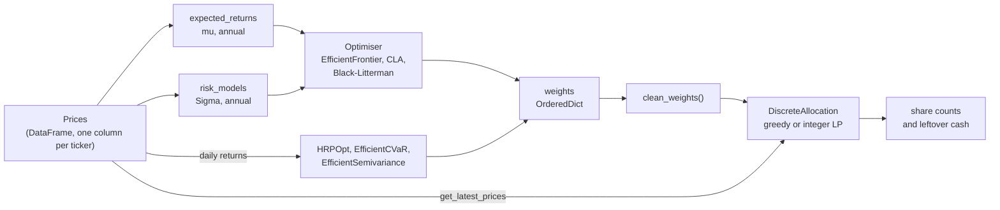
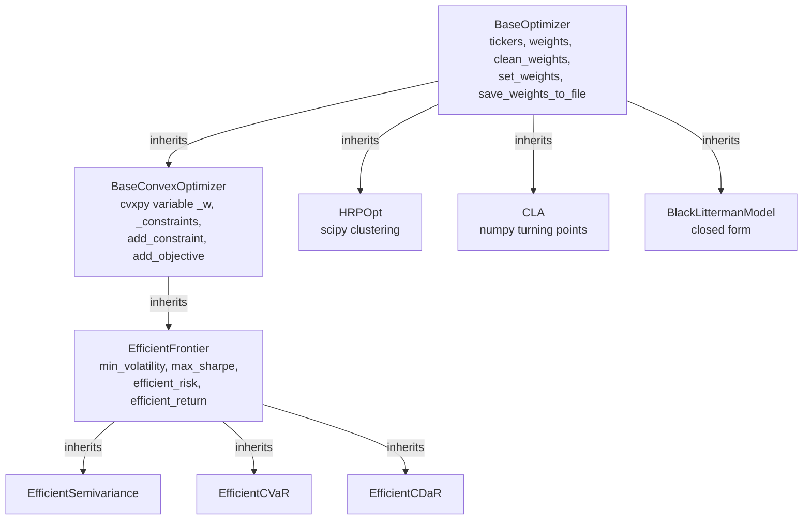

[PyPortfolioOpt](https://github.com/PyPortfolio/PyPortfolioOpt) is an open-source Python library, under the MIT licence, that computes portfolio weights from historical prices. It implements the classical mean-variance model of Markowitz together with later methods (shrinkage covariance, Black-Litterman, Hierarchical Risk Parity, CVaR) and hands each optimisation problem to the convex solver library [cvxpy](https://www.cvxpy.org/). The property this article keeps returning to follows from that design: the library solves the problem it is given exactly, so the weights are only as good as the return and risk estimates fed into it.

This article reads the source at commit `a6638d2` (release 1.6.0 plus eight commits), explains how the modules and the class hierarchy fit together, and runs every example offline on the library's own sample data. Each number quoted below comes from a script kept with the article. Two of those runs exposed behaviours that change the result without raising an error, and the article ends with a security review of the package.

> This article has been made with the help of [Claude Code](https://claude.com/product/claude-code) and several custom skills

[TOC]

## What you need to know first

The article assumes basic Python, pandas and the idea of a stock return. It relies on the following concepts without deriving them in full:

- **Markowitz mean-variance optimisation.** Markowitz's 1952 model describes each asset by an expected return $$\mu_i$$ and the covariances $$\Sigma$$ between assets, and judges a portfolio $$w$$ by two numbers only: its expected return $$w^{\top}\mu$$ and its variance $$w^{\top}\Sigma w$$. For a target return $$r^{*}$$ it solves the quadratic programme

  $$
  \begin{aligned}
  \min_{w}\; w^{\top}\Sigma w \quad \text{subject to} \quad w^{\top}\mu \ge r^{*},\; \textstyle\sum_i w_i = 1,
  \end{aligned}
  $$

  plus $$w_i \ge 0$$ for a long-only portfolio, which is PyPortfolioOpt's default (`weight_bounds=(0, 1)`). Repeating it for every $$r^{*}$$ traces the efficient frontier: the portfolios with the highest expected return for their level of volatility. The minimum-volatility portfolio sits at the left end of the frontier, and the maximum-Sharpe (tangency) portfolio is the point where a line from the risk-free rate touches it.

  The model treats $$\mu$$ and $$\Sigma$$ as exact, so the error in both estimates passes straight into the weights. The later methods each address part of that error: shrinkage improves $$\Sigma$$, Black-Litterman replaces the historical $$\mu$$, and HRP does without $$\mu$$ and without inverting $$\Sigma$$. `EfficientFrontier`, the library's main class, implements the model and its variants.
- **Black-Litterman model.** Black and Litterman (1991) replace historical expected returns with a Bayesian blend of two sources. The prior is the market equilibrium: the excess returns that would make the market-capitalisation weights $$w_{mkt}$$ optimal, $$\Pi = \delta\,\Sigma\,w_{mkt}$$, where $$\delta$$ is the market's risk aversion. When a risk-free rate is given, `market_implied_prior_returns` adds it to $$\Pi$$ to return total rather than excess returns. The investor then states views as $$P\mu = Q$$ with uncertainty $$\Omega$$: each row of $$P$$ picks assets, $$Q$$ gives the expected return of that pick, and $$\Omega$$ how unsure the view is. The posterior expected returns are

  $$
  \begin{aligned}
  E[R] = \Pi + \tau\Sigma P^{\top}\left(P\,\tau\Sigma\,P^{\top} + \Omega\right)^{-1}\left(Q - P\,\Pi\right).
  \end{aligned}
  $$

  For a single absolute view on asset $$i$$, the posterior return moves the fraction $$\tau\sigma_i^2 / (\tau\sigma_i^2 + \omega)$$ of the gap from $$\Pi_i$$ to $$Q$$, so a more certain view (smaller $$\omega$$) pulls harder. Without views and with a zero risk-free rate, the posterior is $$\Pi$$ itself, and maximising $$w^{\top}\Pi - \frac{\delta}{2} w^{\top}\Sigma w$$ with the same $$\delta$$ and $$\Sigma$$ returns $$w_{mkt}$$ exactly. That is why the library's documentation describes Black-Litterman portfolios as more stable than those built on historical means. `BlackLittermanModel` computes this formula (`pypfopt/black_litterman.py`, `bl_returns`).
- **Covariance matrix and positive semidefiniteness.** The $$n \times n$$ matrix $$\Sigma$$ of return covariances gives the portfolio variance $$w^{\top}\Sigma w$$. It must be positive semidefinite (no portfolio with negative variance), otherwise the quadratic problem is not convex and the solver refuses it.
- **Sharpe ratio and the risk-free rate.** The Sharpe ratio is the excess return over a risk-free rate $$r_f$$ divided by volatility. The value of $$r_f$$ changes which portfolio maximises it, and both are expressed per year in this library.
- **Convex optimisation and DCP.** In a convex problem every local optimum is a global one, so a solver that converges has found the best solution. cvxpy accepts a problem only if it is written by the rules of disciplined convex programming (DCP), which is why custom constraints and objectives in PyPortfolioOpt must be built from cvxpy functions.
- **Estimation error.** An expected return estimated from $$T$$ years of data has a standard error of roughly $$\sigma / \sqrt{T}$$, as explained in [Sampling and Standard Error - Estimating a Population Mean from One Random Sample]({{site.url_complet}}/2026/10/26/sampling-standard-error-mean/). For volatile stocks this error is of the same order as the return itself.
- **In-sample and out-of-sample.** A portfolio optimised on a data window and evaluated on the same window is in-sample: its statistics describe the past fit, not a forecast. Only results on data the optimiser did not see say anything about future behaviour.
- **Annualisation.** Daily statistics are scaled to a year with 252 trading days: returns by compounding or by multiplying the mean by 252, variances by 252, volatilities by $$\sqrt{252}$$.

## How PyPortfolioOpt works

The library splits portfolio construction into four steps, each in its own module. The README presents them as "estimates of expected returns, estimates of risk, objective functions, optimizers", and post-processing turns the weights into share counts.



The input is a pandas DataFrame of adjusted closing prices, dates in rows and tickers in columns. Every estimator converts it to daily returns with `pct_change`, then annualises with a `frequency` argument that defaults to 252. Nothing in the library fetches data: the caller provides the DataFrame.

The modules are independent. A user can compute `mu` with PyPortfolioOpt and pass a covariance matrix built elsewhere, or take the weights and ignore `DiscreteAllocation`. The README calls this modularity the main design goal.

## Architecture

### Modules

The package `pypfopt/` has about 5,500 lines of Python. The table maps each module to its job.

| Module | Contents |
|---|---|
| `expected_returns.py` | `mean_historical_return`, `ema_historical_return`, `capm_return`, `returns_from_prices` |
| `risk_models.py` | `sample_cov`, `semicovariance`, `exp_cov`, `CovarianceShrinkage` (Ledoit-Wolf, OAS, manual), `fix_nonpositive_semidefinite` |
| `base/_base_optimizer.py` | `BaseOptimizer`, `BaseConvexOptimizer`, the standalone `portfolio_performance` |
| `efficient_frontier/` | `EfficientFrontier` and its subclasses `EfficientSemivariance`, `EfficientCVaR`, `EfficientCDaR` |
| `objective_functions.py` | variance, return, Sharpe, `L2_reg`, `quadratic_utility`, `transaction_cost`, tracking error |
| `hierarchical_portfolio.py` | `HRPOpt` |
| `cla.py` | `CLA`, the Critical Line Algorithm |
| `black_litterman.py` | `BlackLittermanModel`, `market_implied_prior_returns`, `market_implied_risk_aversion` |
| `discrete_allocation.py` | `DiscreteAllocation`, `get_latest_prices` |
| `plotting.py` | frontier, dendrogram and weight plots (matplotlib or plotly, both optional) |

Runtime dependencies in `pyproject.toml` are cvxpy, numpy, pandas, scipy, scikit-learn and scikit-base. scikit-learn supplies the Ledoit-Wolf estimator.

### Class hierarchy



`BaseOptimizer` holds what every method shares: the list of tickers, a `weights` array, `clean_weights()` and `save_weights_to_file()`. `clean_weights()` sets weights below `1e-4` to zero and rounds the rest to five decimals. The class knows nothing about solvers.

`BaseConvexOptimizer` adds the cvxpy layer. Its constructor creates the decision variable `self._w = cp.Variable(n_assets)`, turns `weight_bounds` (default `(0, 1)`, long-only) into two constraints, and keeps a list `_constraints` and a list `_additional_objectives`. `add_constraint()` takes a callable such as `lambda w: w[0] <= 0.05`, calls it on `_w` and appends the resulting cvxpy expression. `_solve_cvxpy_opt_problem()` builds `cp.Problem(cp.Minimize(objective), constraints)`, solves it, and raises `OptimizationError` unless the status is `optimal` or `optimal_inaccurate`.

`EfficientFrontier` adds the named objectives. The three subclasses replace the variance with another risk measure and disable the methods that do not apply by raising `NotImplementedError` (for example `EfficientCVaR.max_sharpe`). `HRPOpt`, `CLA` and `BlackLittermanModel` inherit only `BaseOptimizer`, because they do not use cvxpy at all. `DiscreteAllocation` has no base class; it uses cvxpy directly for its integer program.

### One problem per object

An `EfficientFrontier` object builds one cvxpy problem and keeps it after the first solve. Changing that problem afterwards is refused:

- `add_constraint()` and `add_objective()` raise `InstantiationError` once the object has been solved;
- a second solve compares the objective and the constraints with those of the first one, and raises the same error if they differ.

For example, adding a constraint after `min_volatility()`:

```python
ef = EfficientFrontier(mu, S)
ef.min_volatility()
ef.add_constraint(lambda w: w[0] >= 0.1)   # raises
```

raises, in the library's own words (`pypfopt/base/_base_optimizer.py`):

```text
pypfopt.exceptions.InstantiationError: Adding constraints to an already solved
problem might have unintended consequences. A new instance should be created
for the new set of constraints.
```

Re-solving the same method with a new target is allowed. `efficient_risk`, `efficient_return` and `max_quadratic_utility` keep their target in a named `cp.Parameter`, so calling the method again with another target only changes that value. Switching objective, for example from `min_volatility` to `max_sharpe`, is not: create a new `EfficientFrontier` for each objective.

### How max_sharpe stays convex

**The problem.** The Sharpe ratio of a portfolio with weights $$w$$ (summing to 1) is

$$
\begin{aligned}
\text{Sharpe}(w) = \frac{(\mu - r_f \mathbf 1)^{\top} w}{\sqrt{w^{\top}\Sigma w}}
\end{aligned}
$$

where $$\mu$$ is the vector of expected returns, $$\Sigma$$ the covariance matrix, $$r_f$$ the risk-free rate and $$\mathbf 1$$ a vector of ones. The numerator is the expected excess return, the denominator the volatility. A ratio like this is not convex, and cvxpy only accepts convex problems, so `max_sharpe` cannot hand it over as it is.

**The trick.** Multiplying every weight by the same positive number $$k$$ multiplies the excess return by $$k$$ and the volatility by $$k$$ too, so the ratio does not change. Only the direction of $$w$$ matters, not its size. The size can therefore be chosen freely, and `max_sharpe` chooses it so that the excess return equals exactly 1. With the rescaled weights $$y = k w$$, maximising the ratio becomes "among the portfolios whose excess return is 1, find the one with the lowest variance":

$$
\begin{aligned}
\min_{y,\,k} \quad & y^{\top}\Sigma y \\
\text{subject to} \quad & (\mu - r_f \mathbf 1)^{\top} y = 1 \\
& \mathbf 1^{\top} y = k, \quad k \geq 0
\end{aligned}
$$

This is a quadratic program, which cvxpy solves exactly. The second line keeps track of the scale: since the original weights summed to 1, the rescaled ones sum to $$k$$. The weights are then recovered as $$w = y / k$$.

The method is the one of Cornuéjols and Tütüncü, cited in the docstring. Three consequences follow from it:

- At least one asset must have an expected return above $$r_f$$, otherwise no portfolio has an excess return of 1, and `max_sharpe` raises a `ValueError` before solving.
- Every constraint is rewritten for the rescaled weights by multiplying its bound by $$k$$: `w <= ub` becomes `y <= ub * k`.
- Extra objectives such as `L2_reg` are not rewritten, so they act on $$y$$ rather than $$w$$. The method warns that they "may not work as expected" with `max_sharpe`.

## Core concepts

### Expected returns

`mean_historical_return` computes, for each asset, the compound annual growth rate over the window ($$T$$ daily returns, `frequency` 252):

$$
\begin{aligned}
\hat\mu_i = \left( \prod_{t=1}^{T} (1 + r_{i,t}) \right)^{252 / T} - 1
\end{aligned}
$$

With `compounding=False` it returns the arithmetic mean times 252 instead. `ema_historical_return` weights recent returns more (default span 500 days), and `capm_return` computes $$r_f + \beta_i (E[R_m] - r_f)$$, using the equal-weighted average of the input assets as the market when no index is given.

Historical means are the weakest input of the whole chain. On the sample data, BABA has 896 prices, about 3.6 years of returns, and an annual volatility of 31.8 %. The standard error of its annualised mean is then about $$0.318 / \sqrt{3.55} \approx 16.9$$ percentage points, so an approximate 95 % interval spans about 34 points on either side of the estimate. The optimiser treats the point estimate as exact and puts the largest weights on the assets whose estimates are highest, which are often those whose estimation error is largest.

### Risk models and shrinkage

The optimiser needs the covariance matrix $$\Sigma$$: the volatility of each asset and how each pair moves together. `sample_cov` estimates it from the price history (annualised), and that estimate is noisy. With the 20 assets of the sample data, the matrix holds 210 distinct numbers, all estimated from the same few years of returns.

The noise matters because the optimiser looks for exactly what noise produces: combinations of assets that appear to move against each other and so look almost riskless. In linear-algebra terms these are the directions with the smallest eigenvalues of the matrix. The optimiser puts large weights on them, and they rarely hold out of sample.

**Shrinkage** pulls the noisy estimate towards a simple, stable matrix $$F$$ (the *target*) with the same overall scale:

$$
\begin{aligned}
\hat\Sigma = \lambda F + (1 - \lambda) S, \quad 0 \leq \lambda \leq 1
\end{aligned}
$$

$$S$$ is the sample matrix and $$\lambda$$ the *shrinkage intensity*: $$\lambda = 0$$ keeps the sample matrix, $$\lambda = 1$$ replaces it with the target. `CovarianceShrinkage.ledoit_wolf()` estimates the $$\lambda$$ that minimises the expected estimation error, from the data itself. On the sample data it is 0.0063. The code calls it `delta`; this article keeps $$\delta$$ for risk aversion.

The available targets:

| Method | Target $$F$$ | Assumes | Computed by |
|---|---|---|---|
| `ledoit_wolf()` (default, `constant_variance`) | identity matrix times the average variance | every asset equally volatile, no correlation | scikit-learn |
| `ledoit_wolf("single_factor")` | covariance implied by one market factor, the equal-weighted average of the assets | assets move together only through that factor | PyPortfolioOpt |
| `ledoit_wolf("constant_correlation")` | sample variances, one average correlation for every pair | the same correlation between all pairs | PyPortfolioOpt |
| `oracle_approximating()` | as `constant_variance`, with the OAS estimator of $$\lambda$$ (Chen et al.) | as `constant_variance` | scikit-learn |

Two other estimators change what is measured rather than how it is smoothed. `semicovariance` counts only returns below a benchmark (default `0.000079` a day, about 2 % a year), so only losses count as risk. `exp_cov` gives recent observations more weight.

Every risk model ends with `fix_nonpositive_semidefinite`. A covariance matrix must never give a negative variance to any portfolio, a property called positive semidefinite. When rounding or missing data break that, the function sets the negative eigenvalues to zero, or adds a small value to the diagonal, and warns that it did.

### The efficient frontier and its objectives

`EfficientFrontier(mu, S)` exposes five objectives. The weights sum to 1; `efficient_risk`, `efficient_return` and `max_quadratic_utility` also accept `market_neutral=True`, which makes them sum to 0 and requires negative lower bounds.

- **`min_volatility()`** minimises $$w^{\top}\Sigma w$$; it ignores `mu`.
- **`max_sharpe(risk_free_rate=0.0)`** maximises $$(w^{\top}\mu - r_f) / \sqrt{w^{\top}\Sigma w}$$ by the transformation above. The default $$r_f$$ is 0.0 in 1.6.0.
- **`efficient_risk(target_volatility)`** maximises return with volatility at most the target.
- **`efficient_return(target_return)`** minimises variance with return at least the target; the target must be a Python `float`.
- **`max_quadratic_utility(risk_aversion=1)`** maximises $$w^{\top}\mu - \frac{\delta}{2} w^{\top}\Sigma w$$.

The last one is the link to utility theory: an investor with a quadratic utility of wealth, or with exponential utility and normally distributed returns, ranks portfolios by exactly this mean-variance trade-off, and $$\delta$$ is the risk aversion. As $$\delta$$ grows, the solution moves along the frontier toward the minimum-variance portfolio.

### Constraints and extra objectives

Constraints are added before solving:

- **Bounds**: `weight_bounds=(0, 0.1)` for every asset, a list of pairs for per-asset bounds, `(-1, 1)` to allow shorting.
- **Linear constraints**: `ef.add_constraint(lambda w: w[i] >= 0.05)`, or a score constraint such as `esg_scores @ w >= 0.5` from the documentation FAQ.
- **Group limits**: `ef.add_sector_constraints(sector_map, sector_lower, sector_upper)` adds one sum constraint per sector.
- **Extra objective terms**: `objective_functions.L2_reg` adds $$\gamma \lVert w \rVert^2$$, which spreads the weights over more assets; `transaction_cost` adds a proportional cost $$k \lVert w - w_{\text{prev}} \rVert_1$$; two functions add the ex-ante or ex-post tracking error against a benchmark.

Everything must be DCP-compliant. A cardinality limit ("at most 10 assets") is not convex; the FAQ shows how to write it with boolean variables, which requires a mixed-integer solver.

### Downside risk: semivariance, CVaR and CDaR

The three `EfficientFrontier` subclasses take a DataFrame of historical (or simulated) daily returns instead of a covariance matrix. `EfficientCVaR` uses the formulation of Rockafellar and Uryasev, which turns the conditional value-at-risk at level $$\beta$$ (default 0.95) into a linear program with one auxiliary variable $$u_i$$ per observation:

$$
\begin{aligned}
\min_{w,\,\alpha,\,u} \quad & \alpha + \frac{1}{(1-\beta) T} \sum_{i=1}^{T} u_i \\
\text{subject to} \quad & u_i \geq 0, \quad u_i \geq -w^{\top} r_i - \alpha
\end{aligned}
$$

At the optimum, $$\alpha$$ is the value-at-risk and the objective is the CVaR, the mean loss on the worst 5 % of days. `EfficientSemivariance` works the same way with downside deviations, and `EfficientCDaR` with drawdowns. Two details follow from the code: the CVaR returned by `portfolio_performance()` is a daily figure next to an annual return, and the returns DataFrame is cut to the rows without any NaN, so with late listings the CVaR and `mu` come from different windows.

### Hierarchical Risk Parity

`HRPOpt` implements López de Prado's Hierarchical Risk Parity and does not use expected returns or cvxpy. `optimize()` follows four steps:

1. Turn correlations into distances, $$d_{ij} = \sqrt{(1 - \rho_{ij}) / 2}$$.
2. Cluster the assets with SciPy's hierarchical `linkage` (default method `single`).
3. Order the assets by the leaves of the tree (quasi-diagonalisation).
4. Bisect the ordered list recursively. At each split, each half receives a share of the weight inversely proportional to its variance, where a half's variance is that of its own inverse-variance portfolio.

HRP never inverts the covariance matrix, so it still runs when the matrix is singular or close to it. It gives every asset a non-zero weight.

### Critical Line Algorithm

`CLA` is the Bailey and López de Prado implementation of Markowitz's Critical Line Algorithm. It computes the turning points of the whole frontier for linear bounds with numpy, then searches between neighbouring turning points for the maximum Sharpe ratio. Its `max_sharpe()` has no risk-free-rate argument and uses 0. On the sample data it returns the same portfolio as `EfficientFrontier.max_sharpe()` with $$r_f = 0$$, which is a useful cross-check of the two solvers.

### Black-Litterman

`BlackLittermanModel` combines a prior $$\Pi$$ with $$K$$ views. The usual prior is the market-implied return $$\Pi = \delta \Sigma w_{\text{mkt}}$$, from `market_implied_prior_returns(market_caps, delta, S)`, with $$\delta$$ from `market_implied_risk_aversion(index_prices)`. Views are a picking matrix $$P$$, a vector $$Q$$ and an uncertainty matrix $$\Omega$$; `absolute_views={"AAPL": 0.20}` builds $$P$$ and $$Q$$ for the user. The posterior returns computed by `bl_returns()` are:

$$
\begin{aligned}
E[R] = \Pi + \tau \Sigma P^{\top} \left( P \tau \Sigma P^{\top} + \Omega \right)^{-1} (Q - P \Pi)
\end{aligned}
$$

with $$\tau = 0.05$$ by default. With `omega="idzorek"` and a confidence $$c_k$$ per view, the code sets $$\Omega_{kk} = \tau \alpha_k \, p_k \Sigma p_k^{\top}$$ with $$\alpha_k = (1 - c_k) / c_k$$. For a single absolute view on asset $$i$$ this simplifies to

$$
\begin{aligned}
E[R_i] = \Pi_i + c \, (Q_i - \Pi_i)
\end{aligned}
$$

so the confidence is the fraction of the distance from prior to view that the posterior covers. The example below checks this numerically. The posterior can then go into `EfficientFrontier(bl.bl_returns(), bl.bl_cov())`.

### Discrete allocation

Weights are fractions; a broker needs whole shares. `DiscreteAllocation(weights, latest_prices, total_portfolio_value)` offers two methods:

- **`greedy_portfolio()`** buys the rounded-down number of shares of each asset, then repeatedly buys one share of the asset furthest below its target weight while cash allows.
- **`lp_portfolio()`** solves an integer program: with $$V$$ the budget, $$p$$ the prices and $$x$$ integer share counts, it minimises $$\sum_i u_i + r$$ subject to $$\lvert w_i V - x_i p_i \rvert \leq u_i$$ and $$r = V - p^{\top} x \geq 0$$.

Both split a long-short portfolio into two long-only sub-problems. `lp_portfolio()` emits a `FutureWarning` when the ECOS package is installed: its default solver changes in 1.7.0, so passing `solver=` keeps the results reproducible.

## Using PyPortfolioOpt: worked examples

### Set-up

All examples run on `tests/resources/stock_prices.csv` from the repository: 20 US stocks, 7,126 daily prices from 1989-12-29 to 2018-04-11. The environment was a `python:3.12-slim` container with PyPortfolioOpt installed from the pinned source, cvxpy 1.9.3, numpy 2.5.5, pandas 3.1.1 and SciPy 1.17.1, with networking disabled. The scripts and their full output are in [the verification directory](https://github.com/rya-sge/access-denied/tree/main/verification/pyportfolioopt-portfolio-optimization).

The sample is not a clean data set. Several tickers start trading late, so their columns are mostly empty at the start:

| Ticker | First price | Share of rows that are NaN |
|---|---|---|
| BABA | 2014-09-19 | 87.4 % |
| FB | 2012-05-18 | 79.2 % |
| GM | 2010-11-18 | 73.9 % |
| MA | 2006-05-25 | 58.0 % |

This matters below. Every figure in this section is in-sample: it describes how the optimiser fitted 1990 to 2018 for 20 stocks chosen in 2018, not what the portfolio would earn.

### Maximum Sharpe and minimum volatility

```python
import pandas as pd
from pypfopt import EfficientFrontier, expected_returns, risk_models

prices = pd.read_csv("stock_prices.csv", parse_dates=True, index_col="date")
mu = expected_returns.mean_historical_return(prices)        # CAGR per asset
S = risk_models.CovarianceShrinkage(prices).ledoit_wolf()  # shrinkage intensity (.delta) = 0.0063 here

ef = EfficientFrontier(mu, S)
ef.max_sharpe(risk_free_rate=0.02)
weights = ef.clean_weights()
ret, vol, sharpe = ef.portfolio_performance(risk_free_rate=0.02)
```

| Objective (Ledoit-Wolf, full window) | Return | Volatility | Sharpe ($$r_f$$ 2 %) | Holdings | Largest weights |
|---|---|---|---|---|---|
| `max_sharpe(0.02)` | 26.9 % | 10.3 % | 2.41 | 8 | BABA 39.7 %, FB 28.5 %, MA 22.8 % |
| `max_sharpe()` ($$r_f$$ 0) | 26.6 % | 10.2 % | 2.61 at $$r_f$$ 0 | | |
| `min_volatility()` | 17.1 % | 8.5 % | 1.77 | 9 | BABA 43.2 %, GM 21.5 %, FB 14.9 % |
| `efficient_risk(0.20)` | 37.6 % | 20.0 % | 1.78 | | |
| `efficient_return(0.20)` | 20.0 % | 8.7 % | 2.07 | | |
| `CLA().max_sharpe()` ($$r_f$$ 0) | 26.6 % | 10.2 % | 2.61 at $$r_f$$ 0 | | |
| `CLA().min_volatility()` | 17.1 % | 8.5 % | | | |

The CLA and cvxpy results agree to the printed precision. The low volatilities and the 40 % weight on BABA, a stock with 3.6 years of history, are the first warning sign; the section on pitfalls explains where they come from.

### Adding constraints

```python
from pypfopt import objective_functions

tech = {t: "tech" for t in ["GOOG", "AAPL", "FB", "BABA", "AMZN", "AMD"]}
ef = EfficientFrontier(mu, S, weight_bounds=(0, 0.10))      # at most 10 % per stock
ef.add_sector_constraints(tech, {}, {"tech": 0.30})          # at most 30 % in tech
ef.add_objective(objective_functions.L2_reg, gamma=0.1)      # spread the weights
ef.min_volatility()
```

The result holds 17 of the 20 stocks, the largest weight is exactly 10 % and the tech group sums to 30 %. The in-sample volatility rises from 8.5 % to 12.0 %, the price of the constraints in this model.

### HRP and CVaR

```python
from pypfopt import HRPOpt, EfficientCVaR

rets = expected_returns.returns_from_prices(prices)
hrp = HRPOpt(rets)
hrp.optimize()
hrp.portfolio_performance(risk_free_rate=0.02)   # (0.214, 0.178, 1.08)

ec = EfficientCVaR(mu, rets)
ec.min_cvar()
ec.portfolio_performance()                        # (0.177, 0.017): annual return, daily CVaR
```

HRP spreads the money over all 20 stocks, with no weight above 11.2 %. Its own `portfolio_performance()` reports 21.4 % return and 17.8 % volatility, but those figures are not comparable with the table above: `HRPOpt` computes them with the arithmetic mean and the sample covariance of the returns it was given, not with `mu` and the Ledoit-Wolf matrix. Measured with the same `mu` and `S` as the other portfolios, the HRP weights give 16.7 % and 14.2 %.

### Black-Litterman with one view

The sample has no market capitalisations, so this example uses equal caps and $$\delta = 2.5$$. It shows the mechanics, not a realistic prior.

```python
from pypfopt import BlackLittermanModel, black_litterman

prior = black_litterman.market_implied_prior_returns({t: 1.0 for t in prices.columns}, 2.5, S)
bl = BlackLittermanModel(S, pi=prior, absolute_views={"AAPL": 0.20},
                         omega="idzorek", view_confidences=[0.5])
bl.bl_returns()["AAPL"]
```

The AAPL prior is 9.8 % (0.09791). At 50 % confidence the posterior is 14.9 % (0.14896), and $$0.09791 + 0.5 \times (0.20 - 0.09791) = 0.148955$$, the formula above. At 100 % confidence the posterior equals the view, 20.0 %. Other assets move through their covariance with AAPL: GOOG goes from 4.4 % to 4.9 %.

### From weights to shares

```python
from pypfopt.discrete_allocation import DiscreteAllocation, get_latest_prices

latest = get_latest_prices(prices)
alloc, leftover = DiscreteAllocation(weights, latest, total_portfolio_value=10_000).lp_portfolio()
```

On a budget of 10,000 US dollars, the integer program buys six lines for 9,946.59 and the greedy method six lines for 9,598.87, each on a new `DiscreteAllocation` object.

## What the numbers do and do not show

### The Ledoit-Wolf matrix fills missing returns with zeros

`CovarianceShrinkage.ledoit_wolf()` with its default target passes `np.nan_to_num(self.X.values)` to scikit-learn. Every missing return becomes a return of 0. A stock that is NaN on 87.4 % of the rows is then treated as flat for almost 25 years, and its variance shrinks by roughly the share of real observations. `sample_cov` does not have this problem, because pandas computes covariances pairwise over the available rows.

| Volatility | `sample_cov` | `ledoit_wolf()` | $$\sigma_{\text{sample}} \sqrt{1 - \text{NaN share}}$$ |
|---|---|---|---|
| BABA | 31.8 % | 11.6 % | 11.3 % |
| FB | 37.0 % | 17.1 % | 16.9 % |

The last column is a back-of-envelope check: scaling the sample volatility by the square root of the observed share reproduces the Ledoit-Wolf value to within a few tenths of a point, and the remainder is the shrinkage itself.

The maximum-Sharpe portfolio puts 39.7 % in BABA and 28.5 % in FB because they look like low-risk, high-return assets, and its 10.3 % volatility is an artefact of the zero-filling. With `sample_cov` the same code gives 29.9 % return, 21.8 % volatility and a Sharpe ratio of 1.38, the figures printed in the project README.

The fix is to trim the data to a window in which every column has prices, or to drop the late listings, before estimating anything.

### The window decides the weights

Restricting the data to the 896 days from BABA's listing on 2014-09-19, where every ticker has prices, and running the same `max_sharpe(0.02)` gives 39.9 % return, 21.1 % volatility, a Sharpe ratio of 1.80 and a different portfolio: AMZN 57.4 %, MA 22.2 %, BBY 10.7 %, JPM 8.8 %, AMD 0.9 %. BABA and FB disappear. Neither window is the right one; the point is that the maximum-Sharpe weights are a function of the window choice as much as of the assets.

### One out-of-sample split

To see how in-sample figures compare with later returns, the optimisers were fitted on the 576 days from 2014-09-19 to 2016-12-30, and the resulting weights were held over the next 320 days, from 2017-01-03 to 2018-04-11:

| Portfolio | Ex-ante return / volatility | Realised return / volatility |
|---|---|---|
| `max_sharpe(0.02)` | 35.1 % / 21.5 % | 28.5 % / 17.3 % |
| `min_volatility()` | 8.5 % / 12.8 % | 3.1 % / 11.6 % |
| HRP | 8.8 % / 13.6 % | 8.3 % / 12.0 % |
| Equal weight | 9.4 % / 16.4 % | 8.6 % / 14.5 % |

This is one split of 15 months in a rising market, so it supports no ranking of the methods. For the two optimised portfolios, the return forecast missed by more than the volatility forecast: 6.6 against 4.2 points for maximum Sharpe, 5.4 against 1.2 points for minimum volatility. That fits the usual observation that means are harder to estimate than variances, but one split does not establish it.

The universe itself carries survivor bias: the 20 tickers were chosen in 2018, when all of them still traded, so any backtest on this file starts from companies that are known to have survived. Monte Carlo resampling of the inputs, as in [Monte Carlo Simulation for DeFi Risk Analysis - From Random Sampling to a Stay-or-Exit Decision]({{site.url_complet}}/2026/10/10/monte-carlo-defi-risk-analysis/), is a better way to see how much the weights move with estimation error.

## Pitfalls found in the code

Five behaviours in 1.6.0 can surprise a caller. Four of them change a result without an exception, and the fifth breaks HRP on a current SciPy. Each was reproduced in the verification scripts.

- **The risk-free rate defaults to 0.0.** `max_sharpe()` and `portfolio_performance()` both default to `risk_free_rate=0.0`. The default was 0.02 until commit `388acf6` of 2024-12-01 ([issue #594](https://github.com/PyPortfolio/PyPortfolioOpt/issues/594)), so older tutorials and results assume 2 %. After `max_sharpe(risk_free_rate=0.02)`, a call to `portfolio_performance()` without the argument does not use 0: it warns that the rate differs and reports the Sharpe ratio at the rate used by the optimiser (2.41). The standalone `portfolio_performance(weights, mu, S)` has no such memory and returns 2.61 for the same weights. Pass the rate explicitly everywhere.
- **Missing prices become zero returns in Ledoit-Wolf.** Shown above. `mean_historical_return` uses each asset's own observations, so the means and the shrunk covariance of the same DataFrame cover different periods.
- **`lp_portfolio()` reads prices by position.** It builds the price vector as `self.latest_prices.values` and the weight vector from the order of the weights dictionary, and pairs them by index. Two ways to break the pairing were reproduced:
  - `greedy_portfolio()` sorts `self.weights` in place (`discrete_allocation.py:177`), so `lp_portfolio()` on the same object afterwards spends 30,743.14 on a 10,000 budget while reporting 9.65 left over.
  - `HRPOpt.optimize()` returns its weights sorted by ticker, while `get_latest_prices()` keeps the column order. Passing that dictionary to `lp_portfolio()` spends 46,218.69 on the same budget. `hrp.clean_weights()`, which keeps the column order, gives 9,997.63. `greedy_portfolio()` looks prices up by ticker and is not affected.
- **HRP fails on SciPy 1.18.** `HRPOpt.optimize()` checks the linkage method against `scipy.cluster.hierarchy._LINKAGE_METHODS` (`hierarchical_portfolio.py:179`), a private name. `pyproject.toml` requires only `scipy>=1.3.0`, so a fresh install picks up 1.18, where the attribute is gone: with SciPy 1.18.1, `optimize()` raises `AttributeError: module 'scipy.cluster.hierarchy' has no attribute '_LINKAGE_METHODS'`. Pinning `scipy<1.18` avoids it until the library changes.
- **Performance figures are not always comparable.** `HRPOpt.portfolio_performance()` uses arithmetic means and the sample covariance, `EfficientCVaR.portfolio_performance()` returns a daily CVaR next to an annual return, and `CLA.max_sharpe()` ignores the risk-free rate. Compare portfolios with one function and one set of inputs, for example the standalone `portfolio_performance(weights, mu, S, risk_free_rate=...)`.

Two smaller ones: `efficient_return(1)` raises `ValueError` because the target must be a `float`, and adding `L2_reg` before `max_sharpe` triggers the warning about unscaled objectives.

## Security review

The library is a candidate dependency of anything that manages money, so the package was reviewed before it was run. The review covered the `pypfopt/` package and the packaging at commit `a6638d2`, read-only, on 2026-11-18; key claims were re-checked with `grep` for this article.

- **Imports.** The package imports numpy, pandas, scipy, cvxpy, scikit-learn, scikit-base and standard-library modules (`collections`, `copy`, `json`, `warnings`, `typing`, `sys`). matplotlib and plotly are imported inside helper functions of `plotting.py`, only when a plot is requested.
- **No network, no dynamic code.** No `eval`, `exec`, `pickle`, `subprocess`, `os.system`, socket or HTTP call, `base64` or environment-variable read appears in `pypfopt/`. The only `open()` calls are the two in `save_weights_to_file()`, which write to a file name the caller chooses.
- **Packaging.** `pyproject.toml` uses the plain `setuptools.build_meta` backend, there is no `setup.py`, no install hook and no console entry point. The runtime dependencies are the six well-known packages listed above.
- **No binaries.** The repository holds Python, reStructuredText, Markdown, CSV, YAML, notebooks and PNG images.
- **Outside the package.** The `Makefile` installs the `uv` tool with `curl -LsSf https://astral.sh/uv/install.sh | ... sh`, and the `cookbook/` notebooks run `pip install`, clone repositories and download prices from Yahoo Finance. None of this runs on `pip install`, but running `make install` or the notebooks executes code from the network.

The verdict is that the package at this commit is safe to use. What it does not cover: the wheels published on PyPI were not compared with the source, the dependencies (cvxpy and its native solvers, scikit-learn) were not reviewed, and a later commit needs its own review. Installing from the reviewed source tree at the pinned commit closes the first and the last of these gaps; pinning dependency versions limits the second without closing it.

The larger risk is not malicious code but silent numerical error. The pitfalls above produce plausible weights and a plausible spend with no exception, which is the failure mode that reaches an order ticket. A check that the share counts times the prices stay within the budget, and that inputs have no NaN-heavy columns, catches the cases found here.

## Where it fits

PyPortfolioOpt starts after the research question is settled: it takes return and risk estimates for a fixed list of assets and returns weights. Producing the estimates, from signals, factor models and backtests, is the job of a research platform such as Microsoft's qlib, covered in [Microsoft qlib - Architecture, Alpha Research Workflow, Backtesting and Security Review]({{site.url_complet}}/2026/11/18/microsoft-qlib-quant-research-platform/).

Pricing an individual instrument, a bond or an option, is the job of a pricing library such as QuantLib, covered in [QuantLib - Architecture of the Open-Source Quantitative Finance Library, with Python and C++ Examples]({{site.url_complet}}/2026/11/18/quantlib-architecture-pricing-library/). Regulated portfolios add hard limits of their own, as in [Building a Compliant EU Money Market Fund Portfolio — Eligible Assets, Diversification Limits, Credit Assessment and WAM/WAL]({{site.url_complet}}/2026/10/01/eu-money-market-fund-portfolio-construction-limits/); in PyPortfolioOpt such limits become bounds and `add_constraint` calls.

## Conclusion

PyPortfolioOpt turns a DataFrame of prices into weights through four separable steps, and hands each optimisation to cvxpy or to a closed-form or numpy algorithm.

- **Architecture.** `BaseOptimizer` carries tickers and weights, `BaseConvexOptimizer` adds the cvxpy variable and constraint list, and `EfficientFrontier` with its semivariance, CVaR and CDaR subclasses adds the objectives. HRP, CLA and Black-Litterman inherit only the base class and do not use cvxpy.
- **Estimators.** Expected returns come from historical CAGR, an exponential average or CAPM; covariances from the sample matrix, shrinkage or downside measures. Black-Litterman blends a market prior with views, and for one absolute view the Idzorek confidence is the fraction of the gap the posterior closes.
- **Results.** On the sample data the cvxpy and CLA solvers agree, and the constraint API works as documented. The headline figures (26.9 % return, 10.3 % volatility, Sharpe 2.41) are in-sample and depend on the Ledoit-Wolf matrix treating missing prices as zero returns; the common-window run and the README's sample-covariance run give very different portfolios.
- **Pitfalls.** The default risk-free rate is 0.0, `lp_portfolio()` pairs weights and prices by position, HRP depends on a private SciPy name, and the performance functions of different optimisers use different estimators.
- **Security.** The package has no network access, no dynamic code execution and no install hooks. The `Makefile` pipes an installer from the network into a shell and the notebooks download packages and prices; both are outside the reviewed package.

The library computes what it is asked to compute. The work left to the user is the input data and the check that the output respects the budget.


## Annex

### Key Terms

| Term | Definition |
|------|------------|
| **Expected return** | The annual return assumed for an asset in the optimisation; in PyPortfolioOpt an estimate from historical prices, not a forecast. |
| **Covariance matrix** | The matrix of pairwise return covariances; it gives the portfolio variance $$w^{\top}\Sigma w$$ and must be positive semidefinite. |
| **Volatility** | The annualised standard deviation of portfolio returns, the square root of the portfolio variance. |
| **Sharpe ratio** | Excess return over the risk-free rate divided by volatility. |
| **Efficient frontier** | The set of portfolios with the highest expected return for each level of volatility. |
| **Tangency portfolio** | The maximum-Sharpe portfolio, where a line from the risk-free rate touches the efficient frontier. |
| **Minimum-variance portfolio** | The portfolio with the lowest volatility; it does not use expected returns. |
| **Quadratic utility** | The objective $$w^{\top}\mu - \frac{\delta}{2} w^{\top}\Sigma w$$, where $$\delta$$ is the risk aversion. |
| **DCP** | Disciplined convex programming, the rule set cvxpy uses to accept only problems it can prove convex. |
| **Shrinkage** | Replacing the sample covariance by a weighted average with a structured target to reduce estimation error. |
| **Ledoit-Wolf** | A method that estimates the optimal shrinkage weight $$\lambda$$ from the data. |
| **Semivariance** | The variance of returns below a benchmark, a measure of downside risk only. |
| **CVaR** | Conditional value-at-risk, the mean loss on the worst $$1-\beta$$ share of days; minimised as a linear program. |
| **CDaR** | Conditional drawdown-at-risk, the same construction applied to drawdowns instead of daily losses. |
| **HRP** | Hierarchical Risk Parity, an allocation that clusters assets by correlation and splits weight by inverse variance without inverting the covariance matrix. |
| **CLA** | The Critical Line Algorithm, which computes the turning points of the mean-variance frontier under linear bounds. |
| **Black-Litterman** | A Bayesian model that combines a prior on returns, usually market-implied, with investor views weighted by their uncertainty. |
| **Idzorek's method** | A way to set the view uncertainty $$\Omega$$ from a confidence between 0 and 1 for each view. |
| **Discrete allocation** | Conversion of continuous weights into whole share counts within a budget, by a greedy rule or an integer program. |
| **In-sample** | Statistics computed on the same data the optimiser fitted, which describe the fit rather than future performance. |
| **Survivor bias** | The distortion caused by selecting assets that still exist at the end of the period, which omits the failures. |

### Integration Notes

| Behaviour | What an integrator should do |
|-----------|------------------------------|
| `risk_free_rate` defaults to 0.0 in `max_sharpe`, `portfolio_performance`, CAPM and Black-Litterman. | Pass the same annual rate explicitly to every call. |
| `CovarianceShrinkage.ledoit_wolf()` replaces NaN returns by 0. | Trim prices to a window where every column has data, or drop late listings, before estimating. |
| A solved `EfficientFrontier` refuses new constraints or objectives (`InstantiationError`). | Create a new object per objective; re-call `efficient_risk`/`efficient_return` only to change the target. |
| `lp_portfolio()` pairs weights and prices by position. | Build the weights dict in the order of `latest_prices.index`, use a new `DiscreteAllocation` per method, and check that shares times prices stay within the budget. |
| `HRPOpt.optimize()` returns weights sorted by ticker. | Pass `hrp.clean_weights()` to `DiscreteAllocation`, not the return value of `optimize()`. |
| `HRPOpt.optimize()` uses a private SciPy attribute removed in 1.18. | Pin `scipy<1.18` or patch the check until upstream changes it. |
| `lp_portfolio()` changes its default solver in 1.7.0. | Pass `solver=` explicitly. |
| `EfficientCVaR` drops rows with any NaN and reports a daily CVaR. | Feed a NaN-free returns window, and do not compare the CVaR with annual volatilities. |
| `max_sharpe` does not scale additional objectives. | Prefer `L2_reg` with `min_volatility` or `efficient_*`, or check the result without it. |

## Frequently Asked Questions

**Q: What are the four building blocks of PyPortfolioOpt, and which module holds each?**

The four blocks and their modules:

- **Expected returns**: `expected_returns.py`.
- **Risk models**: `risk_models.py`.
- **Objective functions**: `objective_functions.py`.
- **Optimisers**: `efficient_frontier/`, `hierarchical_portfolio.py`, `cla.py` and `black_litterman.py`.

Post-processing into share counts is in `discrete_allocation.py`. Each block can be replaced by the user's own estimate.

**Q: Why do HRPOpt and CLA inherit from BaseOptimizer but not from BaseConvexOptimizer?**

`BaseConvexOptimizer` exists to build and solve a cvxpy problem: it creates the weight variable and keeps the constraint list. HRP computes weights by clustering and recursive bisection, and CLA by computing turning points with numpy, so neither has a convex problem to hand to cvxpy. They only need what `BaseOptimizer` provides: tickers, a weights array, `clean_weights()` and file export.

**Q: How does max_sharpe turn a non-convex ratio into a convex problem?**

It substitutes $$y = k w$$ with $$k \geq 0$$ and fixes the scale of the excess return, $$(\mu - r_f)^{\top} y = 1$$. Maximising the Sharpe ratio is then equivalent to minimising $$y^{\top}\Sigma y$$, a convex quadratic. Every existing constraint is rewritten to scale with $$k$$, and the weights are recovered as $$w = y / k$$.

**Q: On the sample data, why does the maximum-Sharpe portfolio put almost 40 % in BABA with only 10.3 % volatility, and how would you check whether to trust it?**

Two effects combine:

- `ledoit_wolf()` fills BABA's 87.4 % missing returns with zeros, which lowers its volatility from 31.8 % to 11.6 %.
- BABA's expected return comes from only about 3.6 years of data, with a standard error near 17 percentage points.

The optimiser sees a high return at low risk and concentrates on it. To check, compare `sample_cov` with `ledoit_wolf()` for the asset, rerun on a window where every ticker has prices (the weight on BABA drops to zero there), and look at how the weights change across windows before trusting any of them.

**Q: In Black-Litterman with Idzorek's method, what does a 50 % confidence in a single absolute view do to that asset's return?**

For one absolute view, the posterior return is $$\Pi_i + c\,(Q_i - \Pi_i)$$: at $$c = 0.5$$ it lands halfway between the prior and the view. In the example the AAPL prior of 9.8 % and the view of 20 % give 14.9 %. Correlated assets move too, through the $$\tau\Sigma P^{\top}$$ term, which is why GOOG rose from 4.4 % to 4.9 % without a view of its own.

**Q: A script calls greedy_portfolio() and then lp_portfolio() on the same DiscreteAllocation object to compare them. What goes wrong, and what is the general rule?**

`greedy_portfolio()` sorts the stored weights by size, in place. `lp_portfolio()` then pairs the sorted weights with the prices in their original order, so each asset is bought at another asset's price. On the sample it spent 30,743.14 of a 10,000 budget while reporting money left over.

The general rule is that `lp_portfolio()` needs the weights in the same order as the price series, which is also why the sorted dictionary returned by `HRPOpt.optimize()` breaks it. Use one new object per method and check the spend against the budget.

**Q: What did the security review cover, and what remains outside it?**

It covered the `pypfopt/` package and its packaging at one commit: imports, network and process calls, dynamic code, file writes, install hooks and binaries, with nothing of concern found. The `Makefile` and notebooks download and run code but are not part of an install. Outside the review are the PyPI wheels, the dependencies with their native solvers, and any later commit.

## Gaps

These points were not settled by the source and the runs; check them before relying on the corresponding statements.

| Gap | Why it matters | What to read or verify |
|-----|----------------|------------------------|
| Whether the NaN zero-filling in `ledoit_wolf()` and the positional pairing in `lp_portfolio()` are already reported upstream was not checked. | Others may meet them silently, and a fix may already exist after `a6638d2`. | [PyPortfolioOpt issues](https://github.com/pyportfolio/pyportfolioopt/issues) and the commits after the pinned one. |
| The Black-Litterman example uses equal market caps and $$\delta = 2.5$$, not real data. | Real priors depend on capitalisations and on the index used for $$\delta$$. | [`cookbook/4-Black-Litterman-Allocation.ipynb`](https://github.com/PyPortfolio/PyPortfolioOpt/blob/a6638d2e06dae6f444fd022cfd4b3c528902a85b/cookbook/4-Black-Litterman-Allocation.ipynb) at the pinned commit. |
| `bl_weights()` falls back on `np.linalg.lstsq(self._A, b)` when the matrix is singular, where `self._A` is the $$K \times K$$ view matrix, not the $$n \times n$$ matrix being solved. | A singular case would likely raise a shape error instead of returning weights; this is a reading of the code, not a run. | [`pypfopt/black_litterman.py`](https://github.com/PyPortfolio/PyPortfolioOpt/blob/a6638d2e06dae6f444fd022cfd4b3c528902a85b/pypfopt/black_litterman.py), method `bl_weights`. |
| The equivalence between quadratic utility and mean-variance for exponential utility with normal returns is stated from general knowledge. | It justifies the reading of `max_quadratic_utility` as utility maximisation. | A portfolio-theory textbook chapter on mean-variance and expected utility. |
| The PyPI wheels and the dependencies were not part of the security review. | A different artifact or a compromised dependency is outside the verdict. | [PyPortfolioOpt on PyPI](https://pypi.org/project/pyportfolioopt/) file hashes against a build of the pinned source. |
| Which PyPI release first shipped the 0.0 risk-free-rate default (commit `388acf6`, 2024-12-01) was not checked; the local clone has only the v1.4.1 and v1.6.0 tags. | A reader comparing with a 1.5.x result needs to know which default it used. | The [PyPortfolioOpt releases](https://github.com/PyPortfolio/PyPortfolioOpt/releases) page and [issue #594](https://github.com/PyPortfolio/PyPortfolioOpt/issues/594). |
| That means are harder to estimate than variances, and that mean-variance optimisers overweight the assets with the largest estimation errors, are stated from general knowledge. | The article uses both to read the out-of-sample table and the BABA weight. | Literature on estimation error in mean-variance optimisation, for example the shrinkage papers in the References and their citations. |
| The out-of-sample table is one split of 15 months. | It cannot rank methods; a rolling or resampled test would be needed. | A walk-forward test over several windows, or Monte Carlo resampling of `mu` and `S`. |

## References

### Analyzed source

- [PyPortfolio/PyPortfolioOpt](https://github.com/PyPortfolio/PyPortfolioOpt) (formerly `robertmartin8/PyPortfolioOpt`) — analyzed at commit [`a6638d2e06dae6f444fd022cfd4b3c528902a85b`](https://github.com/PyPortfolio/PyPortfolioOpt/tree/a6638d2e06dae6f444fd022cfd4b3c528902a85b), eight commits after release [v1.6.0](https://github.com/PyPortfolio/PyPortfolioOpt/releases/tag/v1.6.0), 2026-11-18
- [Verification scripts and outputs for this article](https://github.com/rya-sge/access-denied/tree/main/verification/pyportfolioopt-portfolio-optimization)
- [PyPortfolioOpt documentation](https://pyportfolioopt.readthedocs.io/en/latest/)
- Martin, R. A. (2021), [PyPortfolioOpt: portfolio optimization in Python](https://doi.org/10.21105/joss.03066), Journal of Open Source Software 6(61), 3066

### Papers

- Markowitz, H. (1952), [Portfolio Selection](https://doi.org/10.1111/j.1540-6261.1952.tb01525.x), The Journal of Finance 7(1)
- Black, F. and Litterman, R. (1991), Combining investor views with market equilibrium, The Journal of Fixed Income. Cited by the library's `docs/BlackLitterman.rst`
- Ledoit, O. and Wolf, M. (2004), [Honey, I Shrunk the Sample Covariance Matrix](https://doi.org/10.3905/jpm.2004.110), The Journal of Portfolio Management 30(4)
- Chen, Y. et al. (2010), [Shrinkage Algorithms for MMSE Covariance Estimation](https://arxiv.org/pdf/0907.4698.pdf), IEEE Transactions on Signal Processing 58(10)
- López de Prado, M. (2016), [Building Diversified Portfolios that Outperform Out of Sample](https://papers.ssrn.com/sol3/papers.cfm?abstract_id=2708678), The Journal of Portfolio Management 42(4)
- Bailey, D. and López de Prado, M. (2013), [An Open-Source Implementation of the Critical-Line Algorithm for Portfolio Optimization](https://papers.ssrn.com/sol3/papers.cfm?abstract_id=2197616)
- Rockafellar, R. T. and Uryasev, S. (2000), *Optimization of conditional value-at-risk*, Journal of Risk 2(3); the PDF link in the library documentation returned 404 on 2026-11-18
- Idzorek, T. (2005), [A step-by-step guide to the Black-Litterman model](https://faculty.fuqua.duke.edu/~charvey/Teaching/BA453_2006/Idzorek_onBL.pdf)
- Cornuéjols, G. and Tütüncü, R. (2006), *Optimization Methods in Finance*, cited in the `max_sharpe` docstring; the docstring's PDF link did not respond on 2026-11-18

### Related articles

- [QuantLib - Architecture of the Open-Source Quantitative Finance Library, with Python and C++ Examples]({{site.url_complet}}/2026/11/18/quantlib-architecture-pricing-library/)
- [Microsoft qlib - Architecture, Alpha Research Workflow, Backtesting and Security Review]({{site.url_complet}}/2026/11/18/microsoft-qlib-quant-research-platform/)
- [Sampling and Standard Error - Estimating a Population Mean from One Random Sample]({{site.url_complet}}/2026/10/26/sampling-standard-error-mean/)
- [Monte Carlo Simulation for DeFi Risk Analysis - From Random Sampling to a Stay-or-Exit Decision]({{site.url_complet}}/2026/10/10/monte-carlo-defi-risk-analysis/)
- [Building a Compliant EU Money Market Fund Portfolio — Eligible Assets, Diversification Limits, Credit Assessment and WAM/WAL]({{site.url_complet}}/2026/10/01/eu-money-market-fund-portfolio-construction-limits/)

### Tooling

- [cvxpy](https://www.cvxpy.org/)
- [scikit-learn covariance estimators](https://scikit-learn.org/stable/modules/covariance.html)
- [SciPy hierarchical clustering, `linkage`](https://docs.scipy.org/doc/scipy/reference/generated/scipy.cluster.hierarchy.linkage.html)
- [Claude Code](https://claude.com/product/claude-code)
