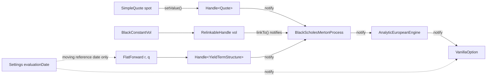
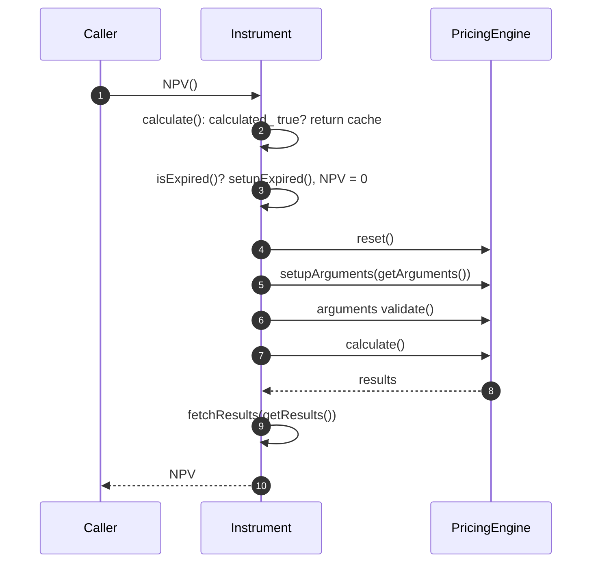

[QuantLib](https://www.quantlib.org/) is a free, open-source C++ library for quantitative finance, released under a BSD 3-Clause licence, with copyright notices going back to 2000. It covers what a pricing desk needs below the user interface: dates and market calendars, yield and volatility curves, cash flows, stochastic processes, models and numerical methods, and the instruments built on them. The same classes are available in Python through a SWIG-generated wheel, so a script and a C++ program share one object model.

That object model rests on one separation: an *instrument* describes a contract, a *pricing engine* computes its value, and market data flows into both through observable quotes and handles. A price is cached and recomputed only when an input it depends on sends a notification. This article reads the library's source at a pinned commit, explains that architecture and the main building blocks, and prices an option, a swap and a bond in Python and C++. Every number shown was produced by running the code in this article.

> This article has been made with the help of [Claude Code](https://claude.com/product/claude-code) and several custom skills

[TOC]

## What you need to know first

The article assumes basic programming and finance vocabulary, and uses the following mechanisms without deriving them:

- **Present value and discounting.** A cash flow paid at a future date is worth less today; a discount factor between 0 and 1 converts it to today's value. Every QuantLib price (`NPV()`, net present value) is a sum of discounted cash flows or an expectation of discounted payoffs.
- **Term structure (yield curve).** A function giving the discount factor, zero rate or forward rate for each future date. QuantLib builds one from quoted deposit and swap rates by *bootstrapping*, solving maturity by maturity so the curve reprices each quote.
- **The Black-Scholes model.** The model behind the closed-form price of a European option, under which the underlying follows a geometric Brownian motion with constant volatility. The site's [Black-Scholes article]({{site.url_complet}}/2026/07/18/black-scholes-option-pricing-model/) derives it; this article uses its formula as a check.
- **Market conventions.** A *calendar* lists business days. A *day counter* such as Actual/360, 30/360 or Actual/365 Fixed turns two dates into a year fraction, and a *business-day convention* such as Following, Modified Following or Unadjusted moves a date that falls on a holiday. Two counterparties using different conventions get different numbers for the same rate.
- **Numerical pricing methods.** When no closed form exists, a price comes from a binomial or trinomial tree, a finite-difference solution of the pricing partial differential equation, or a Monte Carlo average over simulated paths, whose standard error shrinks as one over the square root of the number of paths.
- **Interest-rate swap and fair rate.** A swap exchanges a fixed-rate leg for a floating-rate leg indexed on a rate such as Euribor; its fair rate is the fixed rate that makes its value zero.
- **The Observer pattern.** A design pattern in which an object (the observable) keeps a list of observers and calls their `update()` method when it changes. QuantLib uses it to tell prices that their inputs moved.

## What QuantLib is

QuantLib is maintained on GitHub at [lballabio/QuantLib](https://github.com/lballabio/QuantLib). The source analysed here is the `master` branch at commit `1c418a9` of 18 November 2026, which reports itself as version `1.45-dev`; the latest release at that date is [v1.44](https://github.com/lballabio/QuantLib/releases/tag/v1.44) (tagged 13 October 2026), and the commit is 592 commits after it. The Python examples below use the 1.44 wheel from PyPI, the C++ example uses the library built from the pinned commit. The releases that shaped the library's current form are dated in the [timeline](#timeline) in the annex.

The library is written in C++17 and needs Boost for its headers only. The rules for contributing code are covered under [Extending the library](#extending-the-library).

QuantLib values given instruments under given market data. It does not search for trading signals or choose portfolio weights: those tasks belong to a research platform such as [Microsoft qlib]({{site.url_complet}}/2026/11/18/microsoft-qlib-quant-research-platform/) and to an optimiser such as [PyPortfolioOpt]({{site.url_complet}}/2026/11/18/pyportfolioopt-portfolio-optimization/), covered in two companion articles.

### The source tree

All library code sits under `ql/`, in folders that follow the domain. Header counts at the pinned commit:

| Folder | Headers | Content |
|---|---:|---|
| `ql/time/` | 83 | `Date`, `Period`, `Calendar` (55 calendar headers in `calendars/`), `DayCounter`, `Schedule`, business-day conventions |
| `ql/termstructures/` | 135 | yield curves (flat, bootstrapped, fitted), volatility surfaces, default-probability and inflation curves |
| `ql/instruments/` | 92 | options (vanilla, barrier, Asian, basket, lookback), bonds, swaps, swaptions, caps and floors, credit default swaps |
| `ql/pricingengines/` | 174 | analytic, tree, finite-difference and Monte Carlo engines, grouped by product |
| `ql/cashflows/` | 37 | coupons, leg builders, cash-flow analytics (NPV, yield, duration) |
| `ql/indexes/` | 69 | Ibor and overnight indexes (Euribor, SOFR, €STR, SONIA), swap and inflation indexes |
| `ql/processes/` | 22 | stochastic processes: Black-Scholes family, Heston, Bates, Hull-White, G2 |
| `ql/models/` | 160 | calibratable short-rate, equity and market models |
| `ql/methods/` | 149 | lattices, finite-difference framework, Monte Carlo framework |
| `ql/math/` | 183 | interpolation, root finding, optimisation, distributions, random numbers, statistics |
| `ql/experimental/` | 260 | newer code whose interface may change between releases |

The whole of `ql/` holds 1,463 headers. Next to it, `Examples/` contains 20 complete programs, among them `EquityOption`, `Bonds`, `MulticurveBootstrapping`, `BermudanSwaption`, `CDS` and `CVAIRS`. `test-suite/` holds 191 Boost.Test source files, which double as the most reliable usage reference for any class.

## The core architecture: instrument, engine, market data

### Instruments and pricing engines

An `Instrument` (`ql/instrument.hpp`) holds the terms of a contract: a payoff and an exercise for an option, a schedule and coupons for a bond. It exposes `NPV()`, `errorEstimate()`, `isExpired()` and `setPricingEngine()`, but contains no pricing formula.

A `PricingEngine` (`ql/pricingengine.hpp`) holds the model and the numerical method. Most engines derive from `GenericEngine`, parameterised by two plain structures: the *arguments* the instrument writes into it and the *results* it writes back. At the pinned commit:

```cpp
template<class ArgumentsType, class ResultsType>
class GenericEngine : public PricingEngine,
                      public Observer {
  public:
    PricingEngine::arguments* getArguments() const override { return &arguments_; }
    const PricingEngine::results* getResults() const override { return &results_; }
    void reset() override { results_.reset(); }
    void update() override { notifyObservers(); }

  protected:
    mutable ArgumentsType arguments_;
    mutable ResultsType results_;
};
```

The engine registers with the objects it reads, such as its stochastic process and, for some engines, a discount curve. Its `update()` only passes their notifications on to the instrument, which registered with the engine when the engine was set. The two members are `mutable` because the two getters are `const` methods that hand out pointers the instrument then writes into, on the `const` path that starts at `NPV()`.

*Source:* `ql/pricingengine.hpp`; `Instrument::setPricingEngine()` in `ql/instrument.cpp`; `registerWith(process_)` in `ql/pricingengines/vanilla/analyticeuropeanengine.cpp`.

The engine never holds a reference to the instrument. That is what lets one `VanillaOption` be priced by an analytic engine, then by a tree, then by Monte Carlo, simply by calling `setPricingEngine()` again; and lets one engine serve many instruments of the same type. A product with a new payoff needs a new instrument class and at least one engine, while a new numerical method for an existing product needs only a new engine.

### Quotes, handles and notifications

Market data enters through `Quote` objects. A `SimpleQuote` holds a number and notifies its observers when `setValue()` is called. Objects do not store a quote or a curve directly: they store a `Handle<T>` (`ql/handle.hpp`).

The handle exists so that one change of target reaches every object holding it. It is a shared pointer to a small link object, which in turn points to the quote or curve, and all copies of a handle share the same link. Two classes use this:

- a plain `Handle<T>` has no `linkTo()`, so the objects that receive it cannot change its target;
- a `RelinkableHandle<T>` adds `linkTo()`. Changing the target replaces the pointer inside the shared link, so every copy, including the plain `Handle<T>` copies handed to other objects, sees the new target, and the relink itself sends a notification.

In C++, `RelinkableHandle<BlackVolTermStructure> vol(curveA);` followed later by `vol.linkTo(curveB);` switches every process built on `vol` to `curveB`.

Each object registers with the handles it was given. A notification therefore travels from the quote to the process, to the engine, to the instrument:



The vol handle is drawn as relinkable because the C++ example below changes the volatility with `linkTo()`; the Python example uses a plain handle and moves the volatility through a quote instead. Every `Instrument` also registers with the evaluation date in its constructor (`ql/instrument.cpp`), so a new date reaches the option directly, whatever the curves do; that is how the option sees its own expiry.

The repository keeps maintainer notes on its architecture and build in a `.agents/` folder next to `AGENTS.md`. `.agents/architecture.md` lists six events that start such a chain: `SimpleQuote::setValue()`, a handle relink, a new evaluation date, a term-structure update, an index update (for example a new fixing), and `Instrument::setPricingEngine()`.

### LazyObject: the price is a cache

`Instrument` derives from `LazyObject` (`ql/patterns/lazyobject.hpp`), which is both an observer and an observable. On a notification it does not recompute: it sets a `calculated_` flag to false and forwards the notification. The computation happens on the next call to a result accessor:



Steps 2 and 3, the cache check and the expiry check, are in `Instrument::calculate()`. An expired instrument gets its results from `setupExpired()`, which sets the NPV to 0, and the engine is never called:

```cpp
inline void Instrument::calculate() const {
    if (!calculated_) {
        if (isExpired()) {
            setupExpired();
            calculated_ = true;
        } else {
            LazyObject::calculate();
        }
    }
}
```

`LazyObject::calculate()` then calls `Instrument::performCalculations()`, which matches steps 4 to 9 of the diagram line for line:

```cpp
inline void Instrument::performCalculations() const {
    QL_REQUIRE(engine_, "null pricing engine");
    engine_->reset();
    setupArguments(engine_->getArguments());
    engine_->getArguments()->validate();
    engine_->calculate();
    fetchResults(engine_->getResults());
}
```

`LazyObject::calculate()` sets `calculated_ = true` *before* calling `performCalculations()`, so that a curve bootstrap which indirectly asks for its own values does not recurse forever, and resets it if the computation throws. The Euribor 6M curve [built further down](#a-bootstrapped-curve-a-swap-and-a-bond) is such a case: its swap helpers use an index that projects from the curve being bootstrapped. `freeze()` makes an object keep returning its cached results, and stop forwarding notifications, even after its inputs change, until `unfreeze()` is called; `recalculate()` forces a recomputation.

Two practical consequences follow. Asking for `NPV()` ten times costs one computation if nothing changed. And when a price does not move after an input change, the usual cause is that the input was copied by value instead of being passed through a handle the object registered with: `AGENTS.md` describes this as a missing notification, not a wrong formula.

### The evaluation date and reference dates

`Settings::instance().evaluationDate()` (`ql/settings.hpp`) is the global "today" of every calculation. It is an observable value, so changing it notifies whatever registered with it. Left unset, it returns the machine's current date (`ql/settings.cpp`), which makes results depend on the day a script runs.

A library compiled with the macro `QL_REQUIRE_EXPLICIT_EVALUATION_DATE` throws instead. The macro is off by default: at the pinned commit no CMake option, configure flag or `ql/userconfig.hpp` entry sets it, so it has to be defined by hand when the library is compiled, for example with `-DQL_REQUIRE_EXPLICIT_EVALUATION_DATE`. It already exists in release 1.44, the version of the Python wheel used below.

Term structures add a second date. `ql/termstructure.hpp` describes three ways a curve can track its reference date: fixed at a date given to the constructor, moving with the evaluation date when a number of settlement days and a calendar are given instead, or taken from another structure. The third case covers derived curves: a `ZeroSpreadedTermStructure`, which adds a spread to a base curve, returns the base curve's reference date (`ql/termstructures/yield/derivedtermstructure.hpp`, `RelativeDerivedYieldTermStructure`). A Black-Scholes process measures time to expiry from the risk-free curve's reference date (`GeneralizedBlackScholesProcess::time()` in `ql/processes/blackscholesprocess.cpp`). A curve built with a fixed date therefore ignores a later change of evaluation date, as the Python example below shows.

## The building blocks

### Dates, calendars and conventions

`ql/time/` provides the date arithmetic every other folder relies on:

- **`Date` and `Period`** for dates and tenors such as `6M` or `5Y`.
- **Calendars** for countries and exchanges, such as `TARGET`, `UnitedStates` and `UnitedKingdom`, plus `JointCalendar` and `BespokeCalendar` to combine or define them.
- **Day counters**: `Actual360`, `Actual365Fixed`, `ActualActual` in its ISDA, ISMA and AFB variants, the `Thirty360` variants and `Business252`.
- **`Schedule`**, which generates coupon dates forward or backward from a maturity with a business-day convention and an end-of-month rule.

`Calendar` and `DayCounter` are value types with a swappable implementation behind them, the Bridge pattern, so they can be passed and copied freely.

### Term structures, cash flows and indexes

Yield term structures range from `FlatForward` to `PiecewiseYieldCurve`, which bootstraps from *rate helpers* such as `DepositRateHelper`, `SwapRateHelper` and `OISRateHelper`. Each helper wraps a quote and knows how to reprice it from a candidate curve. Volatility structures for equity, FX, swaptions and caps, as well as default-probability and inflation curves, derive from the same `TermStructure` base class.

Cash flows and legs:

- **`Leg`.** A bond or a swap leg is a `Leg`, which is a type alias for `std::vector<ext::shared_ptr<CashFlow>>`, not a class.
- **Coupons.** Coupons derive from `CashFlow` and `Coupon`. A `FloatingRateCoupon` delegates its rate to a coupon pricer, which is how capped, floored or convexity-adjusted coupons are handled.
- **Leg analytics.** `ql/cashflows/cashflows.hpp` computes NPV, basis-point sensitivity, yield, duration, convexity and z-spread for any leg.

Indexes and fixings: indexes such as `Euribor6M`, `Sofr` and `Estr` produce the floating rates, and an `IndexManager` singleton stores their past fixings.

### Processes, models and numerical methods

An engine combines dynamics with a numerical method, and each comes from its own folder:

- **Processes** (`ql/processes/`) describe the dynamics of an underlying: Black-Scholes-Merton, Heston, Bates, Hull-White, G2.
- **Models** (`ql/models/`) add parameters calibrated to market prices: short-rate models such as Hull-White, Black-Karasinski, CIR and G2, equity models such as Heston and Bates, and the LIBOR market model.
- **Methods** (`ql/methods/`) provide binomial and trinomial lattices, a finite-difference framework of meshers, operators and time-stepping schemes, and a Monte Carlo framework of path generators, pricers and statistics.
- **Mathematics** (`ql/math/`) underneath provides interpolations, one-dimensional solvers such as `Brent` and `Newton`, optimisers such as Levenberg-Marquardt and Simplex, random-number generators such as Mersenne Twister and Sobol, and distributions.

The shipped `EquityOption` example shows the range. It prices one put with spot 36, strike 40, a 6 % rate and 20 % volatility, with European, Bermudan and American exercise, using 21 methods. Run against the pinned commit, it gives:

| Method family | European put | American put |
|---|---|---|
| Black-Scholes formula (exact) | 3.844308 | not applicable |
| Finite differences, integral engine, Sobol quasi-Monte Carlo, six of the seven binomial trees | within 0.001 of 3.844308 | 4.486 to 4.487 (trees and finite differences) |
| Additive-equiprobabilities tree | 3.836911 | 4.480097 |
| Crude Monte Carlo | 3.834522 | not computed |
| Bjerksund-Stensland, an analytic approximation | not applicable | 4.453064 |
| QD+ fixed-point method, high-precision setting | not applicable | 4.486674 |

For the European put every method is close to the exact formula, and the two outliers are the additive-equiprobabilities tree and crude Monte Carlo. For the American put no closed form exists, and the analytic approximations differ more: Bjerksund-Stensland sits 0.034 below the high-precision QD+ value, while the trees and finite differences land within 0.001 of it.

## Using QuantLib from Python

The Python package is a wheel on [PyPI](https://pypi.org/project/QuantLib/), generated from the C++ headers by the QuantLib-SWIG project. Class and method names follow the C++ ones, with `ql.` in front:

```bash
pip install QuantLib==1.44
```

The examples below ran in a container with QuantLib-Python 1.44. All of them fix the evaluation date to 15 January 2025, so they give the same numbers on any day.

### One option, three engines

The contract is a one-year European call, spot 100, strike 100, risk-free rate 3 %, no dividend, volatility 20 %:

```python
import QuantLib as ql

today = ql.Date(15, ql.January, 2025)
ql.Settings.instance().evaluationDate = today          # always set it explicitly

dc, cal = ql.Actual365Fixed(), ql.TARGET()
spot = ql.SimpleQuote(100.0)
vol = ql.SimpleQuote(0.20)
r = ql.YieldTermStructureHandle(ql.FlatForward(today, 0.03, dc))
q = ql.YieldTermStructureHandle(ql.FlatForward(today, 0.00, dc))
v = ql.BlackVolTermStructureHandle(ql.BlackConstantVol(today, cal, ql.QuoteHandle(vol), dc))
process = ql.BlackScholesMertonProcess(ql.QuoteHandle(spot), q, r, v)

maturity = today + ql.Period(1, ql.Years)
call = ql.VanillaOption(ql.PlainVanillaPayoff(ql.Option.Call, 100.0),
                        ql.EuropeanExercise(maturity))

call.setPricingEngine(ql.AnalyticEuropeanEngine(process))
print(call.NPV(), call.delta(), call.gamma(), call.vega() / 100)

call.setPricingEngine(ql.FdBlackScholesVanillaEngine(process, 200, 400))   # time and space steps
print(call.NPV())

call.setPricingEngine(ql.MCEuropeanEngine(process, "pseudorandom", timeSteps=1,
                                          requiredSamples=200000, seed=42))
print(call.NPV(), call.errorEstimate())

call.setPricingEngine(ql.AnalyticEuropeanEngine(process))
put = ql.VanillaOption(ql.PlainVanillaPayoff(ql.Option.Put, 100.0), ql.EuropeanExercise(maturity))
put.setPricingEngine(ql.AnalyticEuropeanEngine(process))
amput = ql.VanillaOption(ql.PlainVanillaPayoff(ql.Option.Put, 100.0),
                         ql.AmericanExercise(today, maturity))
amput.setPricingEngine(ql.BinomialVanillaEngine(process, "crr", 1000))   # 1,000-step CRR tree
print(call.NPV() - put.NPV(), amput.NPV())
```

| Engine | NPV |
|---|---|
| `AnalyticEuropeanEngine` | 9.41340 |
| `FdBlackScholesVanillaEngine` (200 × 400 grid) | 9.41375 |
| `MCEuropeanEngine` (200,000 paths, seed 42) | 9.4044, standard error 0.0315 |

The analytic engine returns the Black-Scholes formula with $$T = 1$$ (365 days under Actual/365 Fixed):

$$
\begin{aligned}
C &= S\,N(d_1) - K e^{-rT} N(d_2) \\
d_1 &= \frac{\ln(S/K) + (r + \sigma^2/2)\,T}{\sigma\sqrt{T}}, \qquad d_2 = d_1 - \sigma\sqrt{T}
\end{aligned}
$$

which evaluates to 9.41340 by hand as well. The finite-difference price is 0.00035 above it, a discretisation error of the 200 × 400 grid. The Monte Carlo estimate is 0.009 below, or 0.29 standard errors, for this one seed; `errorEstimate()` returns that standard error, and a different seed gives a different estimate. The [Monte Carlo and empirical-rule article]({{site.url_complet}}/2026/10/26/monte-carlo-simulation-roulette-law-of-large-numbers/) explains why the error falls as one over the square root of the path count.

The analytic engine also returns the Greeks: delta 0.59871, gamma 0.01933, and vega 0.38667 per volatility point. QuantLib returns `vega()` and `rho()` per unit change (a 100 % move) and `theta()` per year, so they are divided by 100 and by 365 before being read as "per point" or "per day". The 365 follows from the Actual/365 Fixed day counter of the example; with the `Business252` day counter, which divides a count of business days by 252, theta would be divided by 252 instead.

The last lines check put-call parity: the call at 9.41340 minus the put at 6.45796 equals 2.95545, which is 100 − 100e<sup>−0.03</sup>. They also price the American put on a 1,000-step Cox-Ross-Rubinstein tree at 6.74205, 0.28409 above the European put, the value of early exercise.

### Moving inputs: quotes, the evaluation date and expiry

Because the spot and the volatility are `SimpleQuote` objects behind handles, setting them reprices the option without rebuilding anything:

```python
spot.setValue(105.0);  print(call.NPV())   # 12.63876
spot.setValue(100.0)
vol.setValue(0.25);    print(call.NPV())   # 11.34848
vol.setValue(0.20)

ql.Settings.instance().evaluationDate = maturity + 1
print(call.NPV(), call.isExpired())        # 0.0 True
ql.Settings.instance().evaluationDate = today   # back to 15 January 2025
```

This is also how sensitivities are computed in practice: bump a quote, read the NPV, restore the quote.

Moving the evaluation date six months forward from 15 January 2025 is less obvious. With the curves above, built with an explicit date, the price stays at 9.41340: the process still measures time from 15 January 2025. Built with a number of settlement days instead, the curves follow the evaluation date and the price falls to the six-month value. The second script builds a new process and option on such curves, with the same contract:

```python
r = ql.FlatForward(0, cal, 0.03, dc)            # reference date = evaluation date
q = ql.FlatForward(0, cal, 0.00, dc)
v = ql.BlackConstantVol(0, cal, 0.20, dc)
proc = ql.BlackScholesMertonProcess(ql.QuoteHandle(ql.SimpleQuote(100.0)),
                                    ql.YieldTermStructureHandle(q),
                                    ql.YieldTermStructureHandle(r),
                                    ql.BlackVolTermStructureHandle(v))
opt = ql.VanillaOption(ql.PlainVanillaPayoff(ql.Option.Call, 100.0),
                       ql.EuropeanExercise(maturity))
opt.setPricingEngine(ql.AnalyticEuropeanEngine(proc))
ql.Settings.instance().evaluationDate = today + ql.Period(6, ql.Months)
print(opt.NPV())                                # 6.40005 (fixed-date curves: 9.41340)
```

The full script, which runs the fixed and moving versions side by side, is `moving_reference_date.py` in the [verification folder](https://github.com/rya-sge/access-denied/tree/main/verification/quantlib-architecture-pricing-library).

6.40005 is the Black-Scholes value with $$T = 184/365$$, the days from 15 July 2025 to 15 January 2026. Neither version is wrong: a fixed reference date suits a one-off valuation, a moving one suits a risk system that rolls the date forward every day.

### A bootstrapped curve, a swap and a bond

The next script builds a Euribor 6M curve from five quotes:

| Instrument | Tenors and rates | Conventions |
|---|---|---|
| Deposits | 3M 3.0 %, 6M 3.1 % | Actual/360, Modified Following |
| Swaps against Euribor 6M | 2Y 3.2 %, 5Y 3.4 %, 10Y 3.6 % | annual 30/360 fixed leg, Modified Following |


```python
settlement = 2
helpers = [ql.DepositRateHelper(ql.QuoteHandle(ql.SimpleQuote(x)), ql.Period(t), settlement,
                                cal, ql.ModifiedFollowing, False, ql.Actual360())
           for t, x in [("3M", 0.030), ("6M", 0.031)]]
handle = ql.RelinkableYieldTermStructureHandle()
euribor6m = ql.Euribor6M(handle)
helpers += [ql.SwapRateHelper(ql.QuoteHandle(ql.SimpleQuote(x)), ql.Period(t), cal, ql.Annual,
                              ql.ModifiedFollowing, ql.Thirty360(ql.Thirty360.BondBasis), euribor6m)
            for t, x in [("2Y", 0.032), ("5Y", 0.034), ("10Y", 0.036)]]
curve = ql.PiecewiseLogCubicDiscount(settlement, cal, helpers, ql.Actual365Fixed())
curve.enableExtrapolation()
handle.linkTo(curve)            # the index now projects from the curve it helped build
curve.nodes()                   # force the lazy bootstrap
print(max(abs(h.impliedQuote() - h.quote().value()) for h in helpers))   # 2.6e-13

swap = ql.MakeVanillaSwap(ql.Period(5, ql.Years), euribor6m, 0.0)
print(swap.fairRate())          # 0.0340000
```

`PiecewiseLogCubicDiscount` bootstraps discount factors and interpolates them log-cubically between the nodes. It is one of several `Piecewise*` combinations: the C++ class `PiecewiseYieldCurve` takes two template parameters, the bootstrapped quantity (discount factor, zero rate or forward rate) and the interpolation. The bootstrapped quantities are defined in `ql/termstructures/yield/bootstraptraits.hpp`.

The curve's reference date is the spot date, 17 January 2025, two TARGET business days after the evaluation date. Every helper reprices its quote to within 2.6 × 10<sup>−13</sup>, and the five-year discount factor is 0.845681. The relinkable handle is needed because the Euribor index used by the swap helpers must project from the curve those helpers are building; it is linked once the curve exists.

The run shown above is the base case: a spot-starting five-year swap priced on this curve returns the 5Y quote, 3.40000 %, but only because its conventions match the helper's. The variant changes one argument of the swap helpers, the business-day convention of their fixed leg:

```diff
 helpers += [ql.SwapRateHelper(ql.QuoteHandle(ql.SimpleQuote(x)), ql.Period(t), cal, ql.Annual,
-                              ql.ModifiedFollowing, ql.Thirty360(ql.Thirty360.BondBasis), euribor6m)
+                              ql.Unadjusted, ql.Thirty360(ql.Thirty360.BondBasis), euribor6m)
```

The variant curve still reprices its own helpers to 10<sup>−13</sup>, while `MakeVanillaSwap`, which keeps building its fixed leg with Modified Following, returns 3.39981 % on it. The gap is 0.019 basis points here and no error is raised. A conventions mismatch between a curve and the trades priced on it shows up only as a silent difference, whose size depends on the mismatch. Here a different business-day convention moved the rate by 0.019 bp; this example does not measure larger mismatches, such as a different day counter.

The same handle prices a 4 % annual bond issued on 15 March 2023 and maturing on 15 March 2030. The bond is discounted on the Euribor swap curve, with no spread, to keep the example short; a real issuer's bond would need a credit spread or a curve of its own:

```python
sched = ql.Schedule(ql.Date(15, ql.March, 2023), ql.Date(15, ql.March, 2030), ql.Period(ql.Annual),
                    cal, ql.Unadjusted, ql.Unadjusted, ql.DateGeneration.Backward, False)
isma = ql.ActualActual(ql.ActualActual.ISMA)
bond = ql.FixedRateBond(settlement, 100.0, sched, [0.04], isma)
bond.setPricingEngine(ql.DiscountingBondEngine(handle))
y = bond.bondYield(isma, ql.Compounded, ql.Annual)
rate = ql.InterestRate(y, isma, ql.Compounded, ql.Annual)
print(bond.cleanPrice(), bond.accruedAmount(), bond.dirtyPrice(), y,
      ql.BondFunctions.duration(bond, rate, ql.Duration.Modified))
```

| Output | Value |
|---|---|
| Clean price | 102.7483 |
| Accrued interest at settlement (17 January 2025) | 3.3753 |
| Dirty price (clean + accrued) | 106.1237 |
| Yield, annual compounding | 3.4076 % |
| Modified duration | 4.4660 |

The coupon of 15 March 2025, a Saturday, is paid on Monday 17 March: `FixedRateBond` adjusts payment dates with the Following convention by default, even though the schedule itself is unadjusted.

## Using QuantLib from C++

The C++ version of the option example is the same program with types and smart pointers, with one deliberate change: it moves the volatility by relinking the vol handle to a new `BlackConstantVol` instead of setting a `SimpleQuote`, to show the second notification path. Both routes give 11.34848. QuantLib wraps its pointer types in `ql/shared_ptr.hpp` (`ext::shared_ptr`, `ext::make_shared`):

```cpp
#include <ql/quantlib.hpp>
#include <iostream>
using namespace QuantLib;

int main() {
    Date today(15, January, 2025);
    Settings::instance().evaluationDate() = today;
    DayCounter dc = Actual365Fixed();

    auto spot = ext::make_shared<SimpleQuote>(100.0);
    Handle<YieldTermStructure> r(ext::make_shared<FlatForward>(today, 0.03, dc));
    Handle<YieldTermStructure> q(ext::make_shared<FlatForward>(today, 0.0, dc));
    RelinkableHandle<BlackVolTermStructure> vol(
        ext::make_shared<BlackConstantVol>(today, TARGET(), 0.20, dc));

    auto process = ext::make_shared<BlackScholesMertonProcess>(Handle<Quote>(spot), q, r, vol);
    VanillaOption option(ext::make_shared<PlainVanillaPayoff>(Option::Call, 100.0),
                         ext::make_shared<EuropeanExercise>(today + 1 * Years));
    option.setPricingEngine(ext::make_shared<AnalyticEuropeanEngine>(process));

    std::cout << option.NPV() << "\n";                  // 9.41340
    spot->setValue(105.0);                              // notifies process, engine, option
    std::cout << option.NPV() << "\n";                  // 12.63876
    spot->setValue(100.0);
    vol.linkTo(ext::make_shared<BlackConstantVol>(today, TARGET(), 0.25, dc));
    std::cout << option.NPV() << "\n";                  // 11.34848
}
```

Compiled with `g++ -std=c++17 main.cpp -lQuantLib` against the library built from the pinned commit, it prints 9.41340, 12.63876 and 11.34848, the same three values as the Python 1.44 release. `ql/quantlib.hpp` includes the whole library, which is convenient for a test and slow to compile; production code includes the specific headers, and each folder also has an `all.hpp`.

The library itself builds with CMake, Autotools or Visual Studio, as the repository's build notes describe. CMake presets are in `CMakePresets.json`, and the options that build the examples and the test suite are on by default.

Optional build switches change behaviour that the rest of this article takes for granted. They are configure flags in Autotools, and CMake has a matching option for each, off by default:

| Autotools flag | CMake option | Effect |
|---|---|---|
| `--enable-sessions` | `QL_ENABLE_SESSIONS` | singletons such as `Settings` become per session instead of per process |
| `--enable-thread-safe-observer-pattern` | `QL_ENABLE_THREAD_SAFE_OBSERVER_PATTERN` | notifications are protected across threads |
| `--enable-intraday` | `QL_HIGH_RESOLUTION_DATE` | `Date` gains a time of day |

*Source:* `.agents/build-and-test.md`, `configure.ac` and `CMakeLists.txt` at the pinned commit.

### Extending the library

`.agents/extending-quantlib.md` gives the recipe for a new product:

- an instrument class in `ql/instruments/` that overrides `isExpired()`, `setupArguments()` and `fetchResults()`;
- an engine in `ql/pricingengines/<domain>/` deriving from `GenericEngine<arguments, results>`;
- tests in `test-suite/`;
- the new files registered in CMake, Autotools and the Visual Studio project.

`AGENTS.md` at the root of the repository names that registration as one of the two constraints every contribution has to respect. A CI workflow compares the source tree with the file list of each build system and fails on any mismatch, so a file missing from one list blocks the pull request. The other constraint is the language standard: C++17 is the baseline, while continuous integration also compiles under later standards up to C++26.

*Source:* `.agents/registering-new-files.md` (`tools/check_filelists.sh`, run by `.github/workflows/filelists.yml`).

A new term structure implements the `*Impl()` method of its base class (for example `discountImpl`) and chooses a fixed or moving reference date. New or unstable code goes to `ql/experimental/`, whose interfaces the maintainers do not promise to keep across releases.

## Conclusion

QuantLib separates the contract from its valuation and connects both to market data through an observable graph, so a price is recomputed only when an input it depends on changes.

- **Instrument and engine.** An instrument writes its terms into an `arguments` structure, an engine writes `results` back, and the same instrument can be priced by analytic, tree, finite-difference or Monte Carlo engines in turn: 9.41340, 9.41375 and 9.4044 (standard error 0.0315) for the example call.
- **Quotes and handles.** `SimpleQuote::setValue()`, `RelinkableHandle::linkTo()`, a new evaluation date, a curve or index update and a new engine all invalidate the cached result of every dependent instrument.
- **LazyObject.** Results are cached until a notification arrives; an input copied by value instead of passed through a handle never notifies, and the price then stays where it was.
- **Dates.** The evaluation date defaults to the machine's date unless set, and curves built with a fixed reference date do not follow it.
- **Conventions.** A curve and the trades priced on it must share calendars, day counters and business-day conventions; a mismatch moved a five-year fair rate by 0.019 bp in the example without any error.
- **Two languages, one model.** The Python wheel and the C++ library expose the same classes and gave identical results on the same inputs.


## Annex

### Key Terms

| Term | Definition |
|------|------------|
| **Net present value (NPV)** | The value today of an instrument's future cash flows or expected discounted payoff; what `Instrument::NPV()` returns. |
| **Discount factor** | The price today of one unit paid at a future date, read from a yield term structure. |
| **Term structure** | A curve indexed by date: discount factors and rates, volatilities, default probabilities or inflation, each with a reference date and a day counter. |
| **Bootstrapping** | Building a curve maturity by maturity so that it reprices a set of quoted instruments, wrapped in QuantLib as rate helpers. |
| **Rate helper** | An object that wraps one market quote (deposit, FRA, swap, OIS, bond) and computes the quote implied by a candidate curve. |
| **Day counter** | The rule turning two dates into a year fraction, such as Actual/360, Actual/365 Fixed or 30/360. |
| **Calendar** | The set of business days of a market, used to adjust dates and compute settlement dates. |
| **Business-day convention** | The rule moving a date that falls on a non-business day: Following, Modified Following, Preceding or Unadjusted. |
| **Instrument** | The QuantLib class describing a contract's terms; it holds no pricing formula. |
| **Pricing engine** | The QuantLib class that values one type of instrument with one model and one numerical method, through `arguments` and `results` structures. |
| **Stochastic process** | The dynamics of an underlying given to an engine, for example `BlackScholesMertonProcess` or `HestonProcess`. |
| **Quote** | An observable market value; `SimpleQuote::setValue()` notifies every dependent object. |
| **Handle** | A shared, relinkable pointer to a quote or term structure; `RelinkableHandle::linkTo()` changes the target for every holder at once. |
| **Observer pattern** | The mechanism by which an observable calls `update()` on its registered observers when it changes. |
| **LazyObject** | A QuantLib base class that caches its results and recomputes them only on demand after a notification. |
| **Evaluation date** | The global date of every calculation, `Settings::instance().evaluationDate()`; the machine's date if not set. |
| **Reference date** | The date from which a term structure measures time; either fixed or moving with the evaluation date. |
| **Greeks** | Sensitivities of an option price: delta and gamma to the spot, vega to volatility, theta to time, rho to the interest rate. |
| **Fair rate** | The fixed rate at which a swap has zero value on a given curve. |
| **Standard error** | The standard deviation of a Monte Carlo estimate, returned by `errorEstimate()`; it decreases as one over the square root of the number of paths. |

### Integration Notes

| Behaviour | What an integrator should do |
|-----------|------------------------------|
| The evaluation date defaults to the machine's date when it is not set. | Set `Settings.instance().evaluationDate` at the start of every script or job, or compile with `QL_REQUIRE_EXPLICIT_EVALUATION_DATE` so a missing date throws. |
| A curve constructed with an explicit date keeps that reference date when the evaluation date moves. | Use the settlement-days constructors (`FlatForward(0, calendar, rate, dc)`) when the same objects are revalued on several dates. |
| An instrument past maturity prices to 0 without calling its engine. | Check `isExpired()` when an unexpected zero appears, before suspecting the engine. |
| A value passed as a plain number is copied and never notifies. | Pass every input that may move as a `SimpleQuote` behind a handle, and bump the quote to compute sensitivities. |
| `vega()` and `rho()` are per unit change and `theta()` per year. | Divide by 100 or by 365 (or 252) before reporting per point or per day. |
| A bootstrapped curve reprices its own helpers even when its conventions differ from the trades priced on it. | Build the helpers with the conventions of the instruments that will be priced, and check one trade at its fair rate. |
| Monte Carlo engines depend on the seed and the number of paths. | Pass a seed for reproducibility and report `errorEstimate()` with the price. |
| Classes in `ql/experimental/` may change interface between releases. | Pin the QuantLib version in production and read `News.md` before upgrading. |

### Timeline

Events up to 25 November 2026.

| Date | Event | Why it matters here | Source |
|------|-------|---------------------|--------|
| 20 October 2000 | Luigi Ballabio committed the initial revision of QuantLib, 81 files and 6,840 lines. | It is the start of the history behind the copyright notices from 2000 mentioned in the introduction. | [Initial revision, commit `cb6a067`](https://github.com/lballabio/QuantLib/commit/cb6a067a2412c1c3e8eba61e6c5803e72d3ba3dc) |
| 24 February 2010 | QuantLib 1.0 was tagged. | It opens the 1.x series to which every version used in this article (1.44 and `1.45-dev`) belongs. | [QuantLib-v1.0 release page](https://github.com/lballabio/QuantLib/releases/tag/QuantLib-v1.0) |
| 30 August 2019 | Version 1.16.1, the oldest release listed for the `QuantLib` package on PyPI, was uploaded as prebuilt wheels. | The Python examples install the library from this package with `pip install QuantLib==1.44`. | [QuantLib release history on PyPI](https://pypi.org/project/QuantLib/#history) |
| 16 January 2023 | Release 1.29 replaced the internal use of `boost::thread` with `std::thread`, removing the last dependency on Boost binaries. | Since this release, QuantLib can be built against a header-only Boost installation, as the article states. | [QuantLib 1.29 release notes](https://github.com/lballabio/QuantLib/releases/tag/QuantLib-v1.29) |
| 17 July 2023 | Release 1.31 added an option, `alwaysForwardNotifications()` or the `QL_FASTER_LAZY_OBJECTS` switch, so that `LazyObject` forwards every notification instead of only the first one after a recalculation. | It changes the notification path described in the LazyObject section, which by default still forwards only one notification. | [QuantLib 1.31 release notes](https://github.com/lballabio/QuantLib/releases/tag/v1.31) |
| 19 October 2023 | Release 1.32 made all cash flows lazy objects. | Coupons now take part in the same cache-and-notify mechanism as instruments and curves. | [QuantLib 1.32 release notes](https://github.com/lballabio/QuantLib/releases/tag/v1.32) |
| 13 October 2024 | Release 1.36 made a C++17 compiler a requirement and dropped Visual C++ 2015, g++ up to 6.x and clang up to 4. | It is the release from which the library is written in C++17, the standard the C++ example is compiled with. | [QuantLib 1.36 release notes](https://github.com/lballabio/QuantLib/releases/tag/v1.36) |
| 21 July 2025 | Release 1.39 switched the default of `ext::any` and `ext::optional` from the Boost implementation to the standard one. | It moved the library further from Boost and towards the C++17 standard library. | [QuantLib 1.39 release notes](https://github.com/lballabio/QuantLib/releases/tag/v1.39) |
| 13 October 2026 | Release 1.44 removed the Boost implementation of `any` and `optional` and added the `QL_REQUIRE_EXPLICIT_EVALUATION_DATE` switch (pull request #2644). | It is the release used by the Python examples, and the switch is the one recommended in the evaluation-date section and the Integration Notes. | [QuantLib 1.44 release notes](https://github.com/lballabio/QuantLib/releases/tag/v1.44) |

## Frequently Asked Questions

**Q: What is the difference between an instrument and a pricing engine in QuantLib?**

An instrument describes a contract (payoff, exercise, schedule, notional) and exposes results such as `NPV()`, but contains no valuation formula.

A pricing engine contains the model and the numerical method. The instrument copies its terms into the engine's `arguments` structure, the engine fills a `results` structure, and the instrument reads it back. Because the engine never holds the instrument, the same option can be repriced with another engine by calling `setPricingEngine()` again.

**Q: Why might an option's price not change after the spot price used to build it was changed?**

Most often the spot was passed as a plain number, so the process holds a copy that no `setValue()` call reaches. Only an input held in a `SimpleQuote` and passed through a handle notifies the process, the engine and the instrument. If the input is a quote, check next whether an object in the chain was frozen with `freeze()`.

**Q: What happens, step by step, when `NPV()` is called on an instrument whose inputs have not changed since the last call?**

`Instrument::calculate()` finds `calculated_` still true, because no notification reset it, and returns the cached `NPV_` without calling the engine. The engine runs only when a notification has set `calculated_` to false, and then in the order `reset()`, `setupArguments()`, `validate()`, `calculate()`, `fetchResults()`.

**Q: A risk system moves the evaluation date forward each night, but the option prices do not decay. What is the likely cause?**

The curves and volatility structures were built with an explicit reference date. A Black-Scholes process measures time to expiry from the risk-free curve's reference date, so moving the evaluation date does not shorten the option's life. Building the structures with settlement days and a calendar makes them follow the evaluation date: in the article's example, the price then falls from 9.41340 to 6.40005 after six months.

**Q: The analytic, finite-difference and Monte Carlo engines gave 9.41340, 9.41375 and 9.4044 for the same call. Do these disagree?**

No. Each difference has its own explanation:

- The finite-difference price differs by 0.00035, a discretisation error that shrinks with a finer grid.
- The Monte Carlo price differs by 0.009 with a standard error of 0.0315, so it lies 0.29 standard errors from the exact value, well within sampling noise.

A difference of several standard errors, or one that did not shrink with more steps, would point to a wrong setup instead.

**Q: A swap curve bootstrapped from a 5Y quote of 3.40 % reprices all its helpers exactly, yet a 5Y swap on it returns a fair rate of 3.39981 %. How can both be true?**

The helpers and the swap use different conventions. In the article's variant run, the curve was bootstrapped with the swap helpers' fixed legs `Unadjusted`, while `MakeVanillaSwap` builds a fixed leg with Modified Following. The curve reprices instruments built the way its helpers were, not the swap built another way, and QuantLib raises no error because both instruments are valid. Using the same conventions in the helpers and the trades restores 3.40000 %.

**Q: What has to be written to add a new exotic product to QuantLib?**

At minimum, four things:

- an instrument class in `ql/instruments/` overriding `isExpired()`, `setupArguments()` and `fetchResults()`;
- a pricing engine in `ql/pricingengines/` deriving from `GenericEngine<arguments, results>`;
- tests in `test-suite/`;
- the new files registered in CMake, Autotools and the Visual Studio project.

Code whose interface is not settled yet can start in `ql/experimental/`.

## Gaps

The sources were read and the examples run at one commit; the following points were not settled by them.

| Gap | Why it matters | What to read or verify |
|-----|----------------|------------------------|
| The Python wheel is said to be generated by the QuantLib-SWIG project, and SWIG also targets other languages (Java, C#, R); this comes from general knowledge, not from the analysed repository. | The article's statement on how the bindings are produced depends on it. | The [QuantLib-SWIG repository](https://github.com/lballabio/QuantLib-SWIG) and its `SWIG/*.i` files. |
| The Python examples use release 1.44 and the C++ example uses `master` at `1c418a9` (592 commits later); only the European option was compared across both. | A behaviour changed after 1.44 would show only in one language. | `News.md` at the pinned commit, and the [v1.44 release page](https://github.com/lballabio/QuantLib/releases/tag/v1.44). |
| The swap and deposit conventions in the curve example (annual 30/360 fixed leg, Modified Following, two settlement days) are typical EUR conventions, not checked against a market source. | Real quotes on other conventions would give other numbers. | The term sheet of the instruments, or the defaults in `ql/indexes/ibor/euribor.hpp` and `ql/instruments/makevanillaswap.hpp`. |
| Volatility surfaces, credit, inflation and the LIBOR market model are listed but not exercised. | Their conventions (smile interpolation, recovery, lags) differ from the yield-curve case. | `Examples/CDS`, `Examples/MarketModels` and `ql/termstructures/volatility/` in the repository. |
| Session mode, the thread-safe observer and intraday dates were described from `.agents/build-and-test.md` and not tested. | `Settings` and `Date` behave differently when they are enabled. | `configure.ac` and the CMake options at the pinned commit. |
| The Monte Carlo price was run with one seed; the 0.29 standard-error distance is for that seed only. | Another seed gives another estimate. | Rerun `equity_option.py` in the verification directory with several seeds. |
| One engine can serve several instruments, and its `arguments_` and `results_` members are shared and `mutable`; pricing two of those instruments at the same time from two threads was not examined. | Concurrent pricing through a shared engine could mix the arguments or results of two instruments. | The thread-safe observer option in `CMakeLists.txt` and `configure.ac`, `ql/pricingengine.hpp`, and the session notes in `.agents/architecture.md`. |
| How the Python bindings keep a `SimpleQuote` or a curve alive once the Python variable that created it goes out of scope was not checked. | A handle that outlives its target would make the notification chain fail. | The QuantLib-SWIG `*.i` files and the `registerAsObserver` warning in `ql/handle.hpp`. |
| Only a business-day-convention mismatch (0.019 bp) was measured between a curve and a swap; a day-counter or calendar mismatch was not run. | The size of the silent error in practice depends on which convention differs. | Rerun `rates.py` in the verification directory with a different fixed-leg day counter in the helpers. |
| L. Ballabio's book on the library's design was not read for this article. | It explains design choices the source only implies. | [*Implementing QuantLib*](https://leanpub.com/implementingquantlib) (Leanpub). |
| The release dates of the 0.x series, between the initial revision of October 2000 and release 1.0 of February 2010, were not found in the repository, whose tags start at 1.0. | The timeline jumps ten years and does not date the first public release. | The project's download history on SourceForge (not opened for this article) and the `News.txt` file at the [QuantLib-v1.0 tag](https://github.com/lballabio/QuantLib/releases/tag/QuantLib-v1.0). |

## References

### Analyzed source

- [lballabio/QuantLib](https://github.com/lballabio/QuantLib) — analyzed at commit [`1c418a9c1afcd9294c204d8082613e1f81f868a5`](https://github.com/lballabio/QuantLib/tree/1c418a9c1afcd9294c204d8082613e1f81f868a5) (after release [v1.44](https://github.com/lballabio/QuantLib/releases/tag/v1.44); `git describe` gives `v1.44-592-g1c418a9c1`), 2026-11-18. Files read: `AGENTS.md`, `.agents/architecture.md`, `.agents/build-and-test.md`, `.agents/extending-quantlib.md`, `News.md`, `ql/instrument.hpp`, `ql/pricingengine.hpp`, `ql/patterns/lazyobject.hpp`, `ql/settings.hpp`, `ql/settings.cpp`, `ql/termstructure.hpp`, `ql/processes/blackscholesprocess.cpp`, `Examples/EquityOption`.
- [QuantLib-Python 1.44 on PyPI](https://pypi.org/project/QuantLib/) — the wheel used for the Python examples.
- [Verification code for this article](https://github.com/rya-sge/access-denied/tree/main/verification/quantlib-architecture-pricing-library) — the Python and C++ files that produced every number, with their output.

### Documentation and books

- [QuantLib project site](https://www.quantlib.org/) and [reference manual](https://www.quantlib.org/reference/)
- L. Ballabio, [*Implementing QuantLib*](https://leanpub.com/implementingquantlib), Leanpub
- [Black, Fischer, and Myron Scholes. "The Pricing of Options and Corporate Liabilities." *Journal of Political Economy* 81, no. 3 (1973): 637-654.](https://www.jstor.org/stable/1831029)
- [Claude Code](https://claude.com/product/claude-code)

### Timeline sources

- [Initial revision, commit `cb6a067`](https://github.com/lballabio/QuantLib/commit/cb6a067a2412c1c3e8eba61e6c5803e72d3ba3dc) — L. Ballabio, lballabio/QuantLib on GitHub, 2000-10-20.
- [QuantLib-v1.0 release page](https://github.com/lballabio/QuantLib/releases/tag/QuantLib-v1.0) — QuantLib project, GitHub, tag of 2010-02-24.
- [QuantLib release history](https://pypi.org/project/QuantLib/#history) — QuantLib Team, PyPI, oldest release 2019-08-30.
- [QuantLib 1.29 release notes](https://github.com/lballabio/QuantLib/releases/tag/QuantLib-v1.29) — QuantLib project, GitHub, 2023-01-16.
- [QuantLib 1.31 release notes](https://github.com/lballabio/QuantLib/releases/tag/v1.31) — QuantLib project, GitHub, 2023-07-17.
- [QuantLib 1.32 release notes](https://github.com/lballabio/QuantLib/releases/tag/v1.32) — QuantLib project, GitHub, 2023-10-19.
- [QuantLib 1.36 release notes](https://github.com/lballabio/QuantLib/releases/tag/v1.36) — QuantLib project, GitHub, 2024-10-13.
- [QuantLib 1.39 release notes](https://github.com/lballabio/QuantLib/releases/tag/v1.39) — QuantLib project, GitHub, 2025-07-21.
- [QuantLib 1.44 release notes](https://github.com/lballabio/QuantLib/releases/tag/v1.44) — QuantLib project, GitHub, 2026-10-13.

### Related articles

- [The Black-Scholes Model - Pricing Options and Corporate Liabilities]({{site.url_complet}}/2026/07/18/black-scholes-option-pricing-model/)
- [Monte Carlo Simulation - Roulette, the Law of Large Numbers and the Empirical Rule]({{site.url_complet}}/2026/10/26/monte-carlo-simulation-roulette-law-of-large-numbers/)
- [Confidence Intervals and the Central Limit Theorem - MIT 6.0002 Lecture 7 in Python]({{site.url_complet}}/2026/10/26/confidence-intervals-central-limit-theorem/)
- [Credit Default Swaps - Overview]({{site.url_complet}}/2025/05/30/credit-default-swap-overview/)
- [PyPortfolioOpt - How a Python Library Turns Price History into Portfolio Weights]({{site.url_complet}}/2026/11/18/pyportfolioopt-portfolio-optimization/)
- [Microsoft qlib - Architecture, Alpha Research Workflow, Backtesting and Security Review]({{site.url_complet}}/2026/11/18/microsoft-qlib-quant-research-platform/)
