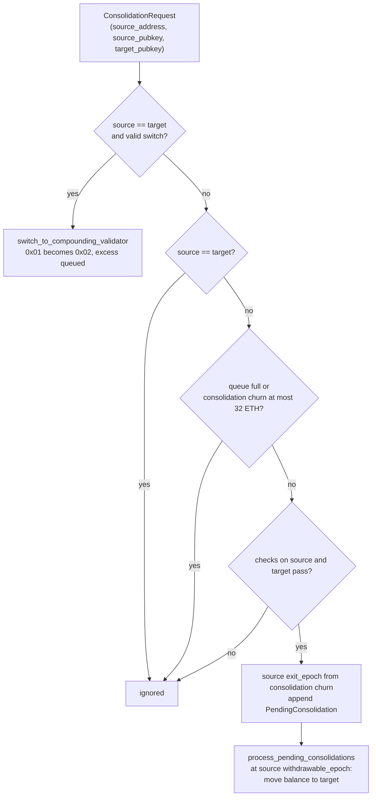
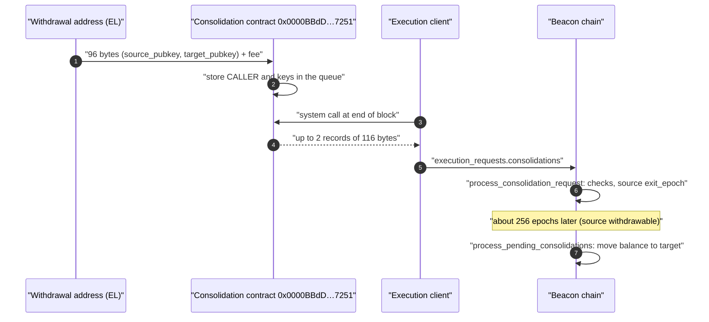

Before the Pectra upgrade of May 2025, a validator on the Ethereum beacon chain could count at most 32 ETH towards its weight in consensus. A staker with 3,200 ETH therefore ran 100 validators, each with its own BLS key, its own attestation every epoch and its own entry in the beacon state, and, for validators with an execution withdrawal address, any reward above 32 ETH was swept to that address instead of being staked.

[EIP-7251](https://eips.ethereum.org/EIPS/eip-7251), *Increase the MAX_EFFECTIVE_BALANCE*, raises that ceiling to 2,048 ETH for validators that opt in with a new `0x02` withdrawal credential, while keeping 32 ETH as the minimum to activate. To make the change usable by operators who already run thousands of validators, it adds an in-protocol *consolidation* that merges one validator into another without passing through the exit and deposit queues, a system contract on the execution layer through which those merges are requested, and a much smaller initial slashing penalty.

This article walks through the specification on both layers: the constants, the consolidation request contract and its fee, the consensus-layer processing of a request, the move from count-based to balance-based churn, and the security arguments the EIP gives for why a few large validators are not a weaker validator set than many small ones.

> This article has been made with the help of [Claude Code](https://claude.com/product/claude-code) and several custom skills

[TOC]

## What you need to know first

The article assumes the reader knows what a validator, a beacon block and an epoch are. The mechanisms below are used without being derived.

- **Balance and effective balance.** Each validator has an actual balance in Gwei and an *effective balance*, a whole number of ETH that the protocol uses for rewards, penalties, proposer selection and committee weight. The effective balance follows the balance with hysteresis: it drops when the balance falls 0.25 ETH below it and rises when the balance exceeds it by 1.25 ETH.
- **Withdrawal credentials.** A 32-byte field fixed at deposit time that says where withdrawn funds go. Prefix `0x00` holds a BLS key hash, `0x01` holds an execution-layer address (`0x01 ‖ 11 zero bytes ‖ address`); EIP-7251 adds `0x02`, with the same layout as `0x01`.
- **Withdrawal sweep.** Since the Capella fork, block proposers walk the validator list in a circle and include automatic withdrawals: the full balance of validators that have exited and reached their withdrawable epoch and, for active ones, any balance above the maximum effective balance.
- **Churn limit.** The amount of stake that may enter or leave the active set per epoch. It bounds how fast the validator set can change, which in turn bounds how long a client can safely stay offline and still sync (the weak subjectivity period).
- **Execution-layer requests ([EIP-7685](https://eips.ethereum.org/EIPS/eip-7685)).** A Pectra mechanism by which an execution block carries typed messages to the consensus layer, committed in the header through `requests_hash`. Deposits use type `0x00`, defined by [EIP-6110](https://eips.ethereum.org/EIPS/eip-6110); withdrawals and exits use `0x01`, defined by [EIP-7002](https://eips.ethereum.org/EIPS/eip-7002); consolidations use `0x02`, defined by EIP-7251.
- **System contract and system call.** A contract at a fixed address that the client calls at the start or the end of every block from `SYSTEM_ADDRESS` (`0xff…fe`), outside the block's gas accounting. The [previous article on system contracts]({{site.url_complet}}/2026/11/04/ethereum-system-contracts/) covers the family in detail.
- **Committees and aggregators.** Every epoch, the active validators are split into attestation committees. Within each committee a few members, chosen by a lottery on their signature, act as *aggregators* that combine the committee's BLS signatures into one.
- **Slashing.** The penalty for a provably malicious action (a double vote or a double proposal). It has an immediate part, applied at once, and a correlation part applied about 18 days later that grows with the total stake slashed in the same window.

## Why 32 ETH was a ceiling

The EIP's motivation section gives the size of the problem at the time it was written:

> As of October 3, 2023, there are currently over 830,000 validators participating in the consensus layer. The size of this set continues to grow due, in part, to the `MAX_EFFECTIVE_BALANCE`, which limits the stake of a single validator to `32 ETH`. This leads to large amounts of "redundant validators", which are controlled by a single entity, possibly running on the same beacon node, but with distinct BLS signing keys.

The 32 ETH ceiling came from the original sharding design, in which small subcommittees had to be honest with overwhelming probability; keeping validator weights equal kept one large validator from dominating a subcommittee. Once that design was abandoned, the subcommittees were left with a single role, choosing aggregators, which only requires *one* honest member (a `1/N` assumption, in the EIP's words).

The cost of keeping the ceiling was paid by everyone:

- **Network load.** Every validator attests once per epoch, so the number of gossip messages and of BLS signatures to aggregate grows with the validator count, not with the stake.
- **State size.** Every validator is a `Validator` record and a balance in the `BeaconState`, which every node keeps in memory and hashes.
- **No compounding.** A `0x01` validator's balance above 32 ETH is paid out at each pass of the withdrawal sweep, so rewards never earn rewards unless the staker redeposits them as a new 32 ETH validator.
- **Coarse increments.** A solo staker with 40 ETH can stake 32 of it; staking the rest needs another 24 ETH to reach a second validator.

Raising the ceiling without changing the floor addresses all four. An operator with 3,200 ETH can run two validators instead of 100, and a solo staker with 40 ETH can stake all of it in one validator.

## The constants

The EIP defines constants on both layers. On the consensus layer, three values carry the feature:

| Name | Value | Role |
|---|---|---|
| `COMPOUNDING_WITHDRAWAL_PREFIX` | `0x02` | Marks a validator whose effective balance may exceed 32 ETH |
| `MIN_ACTIVATION_BALANCE` | 32 ETH | Minimum effective balance to enter the activation queue (and the cap for `0x01`) |
| `MAX_EFFECTIVE_BALANCE_ELECTRA` | 2,048 ETH | Cap for `0x02` validators, 64 times 32 ETH |

The Electra consensus specification adds the limits of the new queues and the slashing quotients:

| Name | Value |
|---|---|
| `PENDING_CONSOLIDATIONS_LIMIT` | 262,144 entries |
| `MAX_CONSOLIDATION_REQUESTS_PER_PAYLOAD` | 2 |
| `MIN_PER_EPOCH_CHURN_LIMIT_ELECTRA` | 128 ETH |
| `MAX_PER_EPOCH_ACTIVATION_EXIT_CHURN_LIMIT` | 256 ETH |
| `MIN_SLASHING_PENALTY_QUOTIENT_ELECTRA` | 4,096 |
| `WHISTLEBLOWER_REWARD_QUOTIENT_ELECTRA` | 4,096 |

The old `MAX_EFFECTIVE_BALANCE` (32 ETH) is not removed. The cap that applies to a given validator is chosen by its credential:

```python
def get_max_effective_balance(validator: Validator) -> Gwei:
    if has_compounding_withdrawal_credential(validator):
        return MAX_EFFECTIVE_BALANCE_ELECTRA
    else:
        return MIN_ACTIVATION_BALANCE
```

## Compounding validators (`0x02` credentials)

A `0x02` credential changes two things, both through `get_max_effective_balance`.

First, the **effective balance can grow** past 32 ETH. `process_effective_balance_updates` now caps the effective balance at the validator's own maximum rather than at a global 32 ETH. Rewards accumulate in the balance, and once the balance exceeds the effective balance by 1.25 ETH, the effective balance moves up to the balance rounded down to a whole ETH. A `0x02` validator at 33.3 ETH therefore has an effective balance of 33 ETH and earns rewards on 33 ETH; a `0x01` validator at 33.3 ETH stays at 32 ETH and has 1.3 ETH swept.

Second, the **automatic partial sweep changes**. `is_partially_withdrawable_validator` now requires the effective balance to equal the validator's own maximum, and the balance to exceed it. For a `0x02` validator that means nothing is swept until it reaches 2,048 ETH. Below that, withdrawals happen only on request (see *Partial withdrawals* below).

A validator obtains `0x02` credentials in one of three ways:

- **At deposit.** A new deposit can carry `0x02` credentials directly; `get_validator_from_deposit` then caps the initial effective balance at 2,048 ETH instead of 32 ETH.
- **By switching from `0x01`.** A consolidation request whose source and target are the same public key converts the validator (details below).
- **There is no direct path from `0x00`.** A validator with BLS credentials first changes to `0x01` with a `BLSToExecutionChange` message, as since Capella.

When a validator switches, any balance above 32 ETH is not credited at once: `queue_excess_active_balance` sets the balance to 32 ETH and appends the excess to `pending_deposits`, so it re-enters the active stake through the same churn-limited queue as a top-up deposit. The pending deposit uses `GENESIS_SLOT` as its slot and the point at infinity as its signature, which marks it as internal rather than a real deposit.

## The consolidation request contract

Consolidations are authorised by the withdrawal address, which lives on the execution layer, so they are requested there. The EIP deploys a contract at `0x0000BBdDc7CE488642fb579F8B00f3a590007251`, built on the same queue design as the EIP-7002 withdrawal request contract. It was deployed with Nick's method (a pre-signed transaction from a key nobody holds), from sender `0x13d1913d623E6a9D8811736359E50fD31Fe54fCA`, so the address is the same on every chain that accepts that transaction.

The contract has no Solidity source and no function selector. It dispatches on the caller and on the calldata length:

| Caller and input | Behaviour |
|---|---|
| `SYSTEM_ADDRESS`, no calldata | End-of-block processing: dequeue, update the fee state, reset the count |
| Any caller, 0 bytes | Fee getter: returns the current fee as a 32-byte word (reverts if value is attached) |
| Any caller, exactly 96 bytes | Add a request: `source_pubkey (48) ‖ target_pubkey (48)`, with `msg.value ≥ fee` |
| Anything else | Revert |

Adding a request stores four storage slots per entry: the caller's address, then the two 48-byte public keys packed into the next three slots, and emits a `LOG0` with the 116-byte record. The contract checks only the fee. It does not check that the public keys exist, that the caller owns them, or that the request makes sense; all of that is left to the consensus layer.

At the end of every block, the system call removes up to `MAX_CONSOLIDATION_REQUESTS_PER_BLOCK = 2` entries from the head of the queue and returns them as consecutive 116-byte records (`source_address ‖ source_pubkey ‖ target_pubkey`). The client places them, in that order, in the block's EIP-7685 request list as type `0x02`. The call has a dedicated 30,000,000 gas limit, does not count against the block's gas, and a block is invalid if the contract has no code or the call fails.

### The fee

The fee rate-limits requests with the same exponential rule as blob gas. The contract keeps an *excess*: after each block, `excess` becomes `excess + count − 1` if that is positive and 0 otherwise, where `count` is the number of requests added in the block and 1 is `TARGET_CONSOLIDATION_REQUESTS_PER_BLOCK`. The fee is

$$
\begin{aligned}
\text{fee} = \left\lfloor e^{\,x / 17} \right\rfloor \text{ wei (approximately)}
\end{aligned}
$$

where $$x$$ is the excess and 17 is `CONSOLIDATION_REQUEST_FEE_UPDATE_FRACTION`. The contract computes it with `fake_exponential(1, excess, 17)`, an integer Taylor expansion, so the result is exact integer arithmetic rather than a true exponential. The fee doubles each time the excess grows by about 11.8 (17 times ln 2):

| Excess | 0 | 17 | 50 | 100 | 200 | 300 | 400 | 500 |
|---|---|---|---|---|---|---|---|---|
| Fee (wei) | 1 | 2 | 18 | 357 | 128,545 | 46,130,791 | 16,542,427,319 | 5,933,467,376,577 |

The excess only changes in the end-of-block system call, so the fee is the same for every transaction in a block. When no request arrives, the excess falls by 1 per block, so a burst of requests decays slowly.

The target of 1 is chosen to rate-limit consolidations as much as possible; the maximum of 2 lets a staker switch a validator to `0x02` and consolidate into it in the same block. Even 1 per block is more than the consensus layer can process (one consolidation every 12 seconds against a churn measured per 6.4-minute epoch), which is why the consensus-layer queue has the hard limit of 262,144 entries discussed below.

### Paying the right fee

The contract keeps any overpayment. The EIP's security section recommends that a calling contract read the fee with a `staticcall` with empty calldata, compare it to a caller-supplied ceiling, and send exactly that amount:

```solidity
function addConsolidation(bytes memory srcPubkey, bytes memory targetPubkey, uint64 requestFeeLimit) private {
    assert(srcPubkey.length == 48);
    assert(targetPubkey.length == 48);

    // Read current fee from the contract.
    (bool readOK, bytes memory feeData) = ConsolidationsContract.staticcall('');
    if (!readOK) {
        revert('reading fee failed');
    }
    uint256 fee = uint256(bytes32(feeData));

    // Check the fee is not too high.
    if (fee > requestFeeLimit) {
        revert('fee is too high');
    }

    // Add the request.
    bytes memory callData = bytes.concat(srcPubkey, targetPubkey);
    (bool writeOK,) = ConsolidationsContract.call{value: fee}(callData);
    if (!writeOK) {
        revert('adding request failed');
    }
}
```

The snippet is quoted from the EIP as written; `ConsolidationsContract` is an address constant the reader declares. According to the EIP, an externally owned account cannot read the fee in the same transaction and therefore always overpays; it recommends simulating the transaction to choose a reasonable value. That statement predates [EIP-7702](https://eips.ethereum.org/EIPS/eip-7702), also in Pectra: an account that has delegated its code can run the read-then-pay logic above itself.

## What the consensus layer does with a request

The beacon block carries the requests in `body.execution_requests`, and `process_operations` applies deposits, then withdrawals, then consolidations. Each consolidation request goes through `process_consolidation_request`, which either switches a validator to compounding, starts a consolidation, or silently does nothing.



### Switching to compounding

When the source and target public keys are equal, `is_valid_switch_to_compounding_request` checks that the validator exists, that `source_address` equals the address in its withdrawal credentials (bytes 12 to 31), that the credentials are `0x01`, that the validator is active, and that it has not started exiting. If so, `switch_to_compounding_validator` rewrites the prefix byte to `0x02` and queues the excess balance. A request with equal keys that fails these checks is ignored, since the spec refuses a consolidation of a validator into itself so that it cannot be used as an exit.

### Starting a consolidation

When the keys differ, the request must pass a list of checks. In the order of the spec:

1. The pending consolidations queue is not full (fewer than 262,144 entries).
2. The consolidation churn limit is **greater than** 32 ETH.
3. Both public keys belong to existing validators.
4. The source has execution credentials (`0x01` or `0x02`) whose address equals `source_address`.
5. The target has `0x02` credentials.
6. Both are active and neither has started exiting.
7. The source has been active for at least `SHARD_COMMITTEE_PERIOD` (256 epochs, about 27 hours).
8. The source has no pending partial withdrawal.

Only the source is authenticated. The spec does not compare the target's withdrawal address with the source's, so the owner of a source validator can consolidate it into any `0x02` validator, including one whose withdrawals go to someone else. The stake then belongs to the target's withdrawal address.

If every check passes, the source starts exiting. Its `exit_epoch` is computed by `compute_consolidation_epoch_and_update_churn`, which works like the exit queue but draws on the consolidation churn, and its `withdrawable_epoch` is set 256 epochs later. A `PendingConsolidation(source_index, target_index)` is appended to the state.

### Completing it

Each epoch, `process_pending_consolidations` walks the queue in order. Entries whose source was slashed in the meantime are dropped. For the first entry whose source is not yet withdrawable, the walk stops. For each ready entry, it moves `min(balance, effective_balance)` of the source to the target:

```python
source_effective_balance = min(
    state.balances[pending_consolidation.source_index], source_validator.effective_balance
)
decrease_balance(state, pending_consolidation.source_index, source_effective_balance)
increase_balance(state, pending_consolidation.target_index, source_effective_balance)
```

The target's effective balance then rises at the next effective balance update, within its 2,048 ETH cap. Whatever is left on the source (the fraction of an ETH above its effective balance) is withdrawn by the normal sweep, since the source is now exited and withdrawable. The balance moved to the target never passed through the activation queue: it was active stake before and remains active stake, which is what saves large operators from exiting and redepositing.



The minimum duration is set by the exit delay: `compute_activation_exit_epoch` adds 5 epochs to the current epoch, and the withdrawability delay adds 256 more, so a consolidation takes at least 261 epochs (about 27.8 hours) once the request is processed, plus any wait in the consolidation churn queue.

## Partial withdrawals from the execution layer

Since a `0x02` validator below 2,048 ETH is never swept, its owner needs another way to take rewards out. EIP-7251 reuses the EIP-7002 withdrawal request contract for that: a request with a non-zero `amount` is a partial withdrawal. `process_withdrawal_request` accepts it only for a `0x02` validator with an effective balance of at least 32 ETH, and caps it so the remaining balance does not fall below 32 ETH:

```python
to_withdraw = min(
    state.balances[index] - MIN_ACTIVATION_BALANCE - pending_balance_to_withdraw, amount
)
```

A validator with 100 ETH can therefore withdraw up to 68 ETH without exiting. The amount is charged to the exit churn through `compute_exit_epoch_and_update_churn`, and the withdrawal is stored as a `PendingPartialWithdrawal` with a `withdrawable_epoch`. The withdrawal sweep processes matured pending partial withdrawals first, up to 8 per block, before the usual validator sweep. A full exit request (`amount == 0`) is refused while a partial withdrawal is pending, and so is a consolidation whose source has one.

## Churn by balance, not by count

Before Electra, the churn limit counted validators: `max(4, active_validators // 65536)` per epoch, with an activation cap of 8 since Deneb ([EIP-7514](https://eips.ethereum.org/EIPS/eip-7514)). Once a validator can weigh anything from 32 to 2,048 ETH, a count no longer bounds how much stake changes per epoch. Electra therefore measures churn in Gwei and splits it three ways:

$$
\begin{aligned}
C_{bal} &= \max\left(128,\ \left\lfloor T / 65536 \right\rfloor\right) \\
C_{ae} &= \min\left(256,\ C_{bal}\right) \\
C_{cons} &= C_{bal} - C_{ae}
\end{aligned}
$$

where $$T$$ is the total active balance in ETH, $$C_{bal}$$ the balance churn per epoch (rounded down to a whole ETH), $$C_{ae}$$ the share used for activations and exits, and $$C_{cons}$$ the share left for consolidations.

The split has three consequences:

- **Activations and exits are each capped at 256 ETH per epoch**, the equivalent of 8 validators of 32 ETH, which keeps the Deneb activation cap and extends it to exits. The two use separate budgets (`deposit_balance_to_consume` and `exit_balance_to_consume`), so 256 ETH can activate and 256 ETH can exit in the same epoch. The cap binds as soon as $$T$$ reaches 16,777,216 ETH.
- **Consolidations get only the surplus.** With an illustrative total active balance of 34 million ETH, $$C_{bal}$$ is 518 ETH, so 256 ETH per epoch goes to activations and exits and 262 ETH per epoch (58,950 ETH per day at 225 epochs per day) to consolidations.
- **Below a total active balance of about 18.94 million ETH, consolidations stop.** `process_consolidation_request` ignores every request while $$C_{cons} \leq 32$$ ETH, which holds until $$T$$ reaches 289 × 65,536 = 18,939,904 ETH. The switch to compounding is not affected, since it is handled before that check.

Deposits follow the same rule. `process_deposit` no longer credits a deposit at once; it appends a `PendingDeposit`, and `process_pending_deposits` applies at most `MAX_PENDING_DEPOSITS_PER_EPOCH = 16` deposits per epoch, within the activation churn and only once the deposit's slot is finalized. A top-up to an existing validator, which was credited immediately before Electra, now waits in the same queue. Because the churn is paid at the deposit stage, `process_registry_updates` activates every eligible validator without a separate activation limit. The EIP's security section states the result as an invariant: activation and exit churn now limit active *weight* rather than validator count.

Consolidation requests reach the beacon chain at a target of one and at most two per block, which can still outrun the consolidation churn. The EIP bounds it with `PENDING_CONSOLIDATIONS_LIMIT = 262,144` entries; a `PendingConsolidation` is two 8-byte indices, so a full queue is 4 MiB of beacon state. Requests that arrive while the queue is full are discarded, and their fee is not refunded.

## Slashing: a much smaller immediate penalty

A larger validator carries a larger penalty when slashed, and before Electra the immediate penalty was linear in the effective balance: 1/32 of it, so 1 ETH for a 32 ETH validator and, had the cap been higher, 64 ETH for a 2,048 ETH one. The EIP notes that this would discourage consolidation, since it raises the stake at risk from a single signing mistake. Electra changes the immediate penalty in `slash_validator` to 1/4,096 of the effective balance:

| Effective balance | Before Electra (1/32) | Electra (1/4,096) |
|---|---|---|
| 32 ETH | 1 ETH | 0.0078125 ETH |
| 2,048 ETH | (not possible) | 0.5 ETH |

The whistleblower reward moves from 1/512 to 1/4,096 of the effective balance as well. The correlation penalty in `process_slashings` is still proportional to the effective balance and to three times the share of stake slashed in the surrounding 36 days, so a validator slashed alone loses little while a validator slashed together with a large fraction of the network still loses most of its stake. Electra only changes the order of its integer divisions, computing the penalty per 1 ETH increment first.

## Security considerations

The EIP's argument is that the change "modifies committees and churn, but doesn't significantly impact the security properties". It addresses each place where validator weight enters consensus:

- **Attestation committees.** Committees are still drawn uniformly by validator index, but finality counts weight. The EIP states that even with full consolidation, the probability of an adversarial takeover of a committee stays low, and the share of honest validators a committee requires remains well below the 2/3 supermajority needed for finality. It gives no figures in the text.
- **Aggregator selection.** Aggregators only need one honest member per committee. The EIP says the VRF lottery is changed to consider weight so that the probability of at least one honest aggregator does not get worse. The Electra specification read for this article does not redefine `is_aggregator`, however, which is listed in *Gaps*.
- **Proposer selection.** Proposers were already sampled by effective balance relative to the maximum. With a 2,048 ETH maximum, a 32 ETH validator is accepted with probability 32/2,048 per draw, so selection loops longer. Electra switches the random value in `compute_proposer_index` from one byte to 16 bits, which keeps the acceptance test fine-grained when the ratio is that small.
- **Sync committees.** Their selection, `get_next_sync_committee_indices`, is weighted the same way and gets the same 16-bit change. Light clients do not change: they check that a supermajority of sync committee members signed, which still holds because selection is weight-based.
- **Churn.** As above, the invariants are kept by measuring churn in balance.

Three operational points complete the section: overpaid fees are kept, requests beyond the queue limit are lost with their fee, and a block is invalid if the system call fails or the contract has no code.

## Conclusion

EIP-7251 separates the two roles that 32 ETH played before Pectra: it stays the minimum to activate a validator, and stops being the maximum stake one validator can carry.

- **Compounding.** A `0x02` withdrawal credential raises a validator's cap to 2,048 ETH, lets rewards raise its effective balance in 1 ETH steps, and turns off the automatic partial sweep below that cap.
- **Consolidation.** A system contract at `0x0000BBdD…7251` queues requests authorised by the source's withdrawal address, with an exponential fee targeting 1 request per block; the beacon chain exits the source through a dedicated consolidation churn and moves its balance to a `0x02` target without leaving the active set.
- **Partial withdrawals.** A `0x02` validator withdraws through EIP-7002 requests, down to 32 ETH, charged to the exit churn.
- **Churn by weight.** Activations, exits and consolidations are limited in ETH per epoch, deposits and top-ups go through a pending queue, and consolidations only receive the churn above the 256 ETH activation and exit cap.
- **Slashing.** The immediate penalty falls to 1/4,096 of the effective balance, while the correlation penalty stays proportional.

The trade-offs are explicit in the specification: only the source is authenticated, the request contract keeps any excess fee, requests that fail the consensus-layer checks are dropped without notice or refund, and consolidations stop entirely when the total active balance is below about 18.94 million ETH.


## Annex

### Key Terms

| Term | Definition |
|------|------------|
| **Validator** | A beacon-chain participant identified by a BLS public key, which attests, proposes blocks and is weighted by its effective balance. |
| **Effective balance** | The whole-ETH value derived from a validator's balance with hysteresis, used for rewards, penalties, selection and voting weight. |
| **Hysteresis** | The rule that the effective balance only moves when the balance drifts 0.25 ETH below or 1.25 ETH above it, so it does not change every epoch. |
| **Withdrawal credentials** | The 32-byte field naming where withdrawn funds go; its first byte (`0x00`, `0x01`, `0x02`) selects the withdrawal behaviour. |
| **`MAX_EFFECTIVE_BALANCE_ELECTRA`** | The 2,048 ETH cap on the effective balance of a validator with `0x02` credentials. |
| **`MIN_ACTIVATION_BALANCE`** | The 32 ETH minimum effective balance to activate, also the cap for `0x01` validators and the floor for partial withdrawals. |
| **Compounding validator** | A validator with `0x02` credentials, whose rewards raise its effective balance instead of being swept. |
| **Withdrawal sweep** | The per-block walk over validators that pays out exited balances and balances above the validator's maximum effective balance. |
| **Consolidation** | The in-protocol merge of a source validator into a `0x02` target, where the source exits and its balance moves to the target. |
| **Switch to compounding** | A consolidation request with equal source and target keys that changes a `0x01` validator to `0x02`. |
| **Consolidation request contract** | The system contract at `0x0000BBdDc7CE488642fb579F8B00f3a590007251` that queues consolidation requests and charges a fee. |
| **System call** | The client's end-of-block call to a system contract from `SYSTEM_ADDRESS`, outside the block's gas accounting. |
| **Execution-layer request** | A typed EIP-7685 message from the execution block to the beacon chain; consolidations are type `0x02`. |
| **Excess** | The counter in the request contract that grows when more than one request per block arrives and sets the fee exponentially. |
| **Churn limit** | The maximum stake, in ETH per epoch, that may activate, exit or consolidate. |
| **Consolidation churn** | The part of the balance churn above the 256 ETH activation and exit cap, reserved for consolidations. |
| **Pending consolidation** | A `(source_index, target_index)` entry in the beacon state, completed when the source becomes withdrawable. |
| **Pending partial withdrawal** | A queued withdrawal of part of a `0x02` validator's balance, payable once its `withdrawable_epoch` is reached. |
| **Slashing** | The penalty and forced exit for a provable double vote or double proposal, with an immediate and a correlation part. |
| **Aggregator** | A committee member chosen by a signature-based lottery to combine the committee's attestations into one aggregate. |

### Invariants

| Invariant | Enforced by | Breaks if |
|---|---|---|
| A `0x01` validator's effective balance never exceeds 32 ETH; a `0x02` validator's never exceeds 2,048 ETH. | `get_max_effective_balance` in `process_effective_balance_updates` and `get_validator_from_deposit` | A code path sets the effective balance without the per-validator cap. |
| Only the source's withdrawal address can start a consolidation or a switch. | `source_address == withdrawal_credentials[12:]`, where `source_address` is the `CALLER` of the request contract | The request contract recorded a value other than `CALLER`. |
| A consolidation never moves stake into a non-compounding validator. | `has_compounding_withdrawal_credential(target_validator)` | The target check is dropped; the moved stake would then be above the target's 32 ETH cap and swept. |
| Activations change at most 256 ETH of active stake per epoch, and exits (including partial withdrawals) at most 256 ETH, each with its own budget. | `get_activation_exit_churn_limit` used by `process_pending_deposits`, `compute_exit_epoch_and_update_churn` and partial withdrawals | A balance increase bypasses `pending_deposits`, as an immediate top-up did before Electra. |
| A partial withdrawal never leaves a `0x02` validator below 32 ETH. | The `min(balance − 32 ETH − pending, amount)` cap in `process_withdrawal_request` and again in `get_pending_partial_withdrawals` | The second cap is removed; penalties between request and payout could then push the balance below 32 ETH. |
| A consolidation cannot be used as a disguised exit. | The `source == target` refusal and the target activity checks | A validator could exit through consolidation churn and skip the exit queue. |

### Integration Notes

| Behaviour | What an integrator should do |
|---|---|
| The request contract keeps any value above the fee. | Read the fee with a `staticcall` with empty calldata in the same transaction and send exactly that amount, with a caller-supplied ceiling. |
| The fee getter reverts before the first post-fork system call (the excess starts at `2**256 − 1`). | Treat a revert of the fee read as "not yet available", not as a zero fee. |
| The contract validates nothing but the fee and the 96-byte length; the beacon chain drops an invalid request silently. | Check on the beacon API, before sending, that both keys exist, the source is active for 256 epochs, the target has `0x02` credentials, and no partial withdrawal is pending on the source. |
| The target's withdrawal address is not checked against the source's. | Verify the target's credentials before consolidating; consolidating into a third party's `0x02` validator transfers the stake to them. |
| The `source_address` is the immediate caller of the contract. | A staking contract that owns withdrawal credentials must call the request contract itself, not through a router or another contract. |
| Requests are ignored while consolidation churn is at most 32 ETH, or when the 262,144-entry queue is full, and the fee is lost. | Check the total active balance and the queue length before submitting large batches. |
| A switch to compounding puts the excess above 32 ETH into `pending_deposits`. | Expect the effective balance to stay at 32 ETH until the activation churn reaches that pending deposit. |
| A `0x02` validator below 2,048 ETH receives no automatic partial withdrawal. | Plan explicit EIP-7002 partial withdrawals (paid and churn-limited) to take rewards out. |
| Top-up deposits are no longer credited immediately. | Account for the finality wait and the pending deposit queue when computing a validator's balance after a deposit. |

## Frequently Asked Questions

**Q: Does EIP-7251 change the minimum stake to run a validator?**

No. `MIN_ACTIVATION_BALANCE` keeps the 32 ETH floor: a validator still needs an effective balance of at least 32 ETH to enter the activation queue. What changes is the ceiling, from 32 ETH for everyone to 2,048 ETH for validators with `0x02` credentials, so stake above 32 ETH can be added to the same validator in 1 ETH steps.

**Q: What is the difference between a `0x01` and a `0x02` validator once Electra is active?**

Both send withdrawals to an execution-layer address with the same byte layout. They differ on three points:

- **Cap.** A `0x01` validator's effective balance stops at 32 ETH; a `0x02` validator's at 2,048 ETH.
- **Sweep.** A `0x01` validator has any balance above 32 ETH swept automatically; a `0x02` validator is swept only above 2,048 ETH.
- **Partial withdrawals on request.** Only a `0x02` validator can make an EIP-7002 partial withdrawal, down to 32 ETH.

**Q: Why does a consolidation take at least about 28 hours, and why can it take much longer?**

The source validator exits rather than transferring stake directly. Its exit epoch is at least 5 epochs in the future, and its balance moves only at its withdrawable epoch, 256 epochs after that: 261 epochs of 6.4 minutes, about 27.8 hours.

On top of that, the exit epoch is taken from the consolidation churn. If many consolidations are queued, or the consolidation churn is small, `compute_consolidation_epoch_and_update_churn` pushes the source's exit epoch further out, by one epoch for each consolidation churn's worth of effective balance ahead of it.

**Q: The consolidation request contract accepted my transaction. Is the consolidation guaranteed?**

No. The contract checks only the fee and the input length; it does not know the beacon state. The beacon chain later applies the checks of `process_consolidation_request`:

- room in the pending consolidations queue and a consolidation churn above 32 ETH;
- both keys belong to existing validators, and the source's withdrawal address equals the caller;
- the target has `0x02` credentials;
- both are active and not exiting, and the source has been active for 256 epochs;
- the source has no pending partial withdrawal.

A request that fails any of them is ignored without an event, and the fee is not refunded. The only way to know is to observe the source validator's `exit_epoch` and the `pending_consolidations` list on the beacon chain.

**Q: An operator holds 64 validators of 32 ETH with `0x01` credentials and wants one validator of 2,048 ETH. Which requests are needed, and why can the first two share a block?**

The operator first converts one validator, the future target, to `0x02` with a request whose source and target are that same key. It then sends 63 consolidation requests with each other validator as source and the converted one as target.

The contract dequeues at most 2 requests per block, and its target of 1 per block makes the fee rise when more arrive. The maximum of 2 exists so that the switch and a first consolidation can land in the same block: the beacon chain processes the requests in order, so the target is already `0x02` when the second one is checked.

With consolidation churn of 262 ETH per epoch and an empty queue, the 63 sources (2,016 ETH) are scheduled over about 8 epochs, after which each completes about 27 hours later. Because the balance moved is capped at each source's effective balance, the fractions of an ETH above 32 on each source are swept as normal withdrawals.

**Q: Does lowering the initial slashing penalty to 1/4,096 make attacks cheaper?**

Only for an isolated fault. The immediate penalty applies to every slashing and scales linearly with the effective balance. At the old quotient of 1/32, a 2,048 ETH validator would have lost 64 ETH immediately for a single fault; at 1/4,096 it loses 0.5 ETH.

The correlation penalty in `process_slashings` is unchanged in substance: it is proportional to the effective balance and to three times the share of stake slashed in the same 36-day window. An attack that needs a large share of the stake to be slashed still costs most of that stake.

**Q: Why does consolidation not use the same churn as exits?**

Activations and exits are each capped at 256 ETH per epoch to protect the weak subjectivity period, and a consolidation moves stake from one active validator to another without changing the active total. Giving consolidations their own share, taken from the balance churn above that cap, lets large operators consolidate without delaying ordinary deposits and exits.

The cost is that the consolidation share is zero until the balance churn exceeds 256 ETH (16,842,752 ETH staked) and too small to accept any request below 18,939,904 ETH.

## Gaps

These points were not settled by the sources read for this article, or rest on reasoning rather than a cited statement.

| Gap | Why it matters | What to read or verify |
|---|---|---|
| The EIP says the aggregator VRF lottery "changes to consider weight", but the Electra specification at commit `065bcd5` does not redefine `is_aggregator`, whose only definition is in phase0. | The article's description of aggregator security depends on which is current. | Compare [`specs/electra/validator.md`](https://github.com/ethereum/consensus-specs/blob/065bcd5c6ad96186cd2c0ac1c435f620a0b25373/specs/electra/validator.md) with [`specs/phase0/validator.md`](https://github.com/ethereum/consensus-specs/blob/065bcd5c6ad96186cd2c0ac1c435f620a0b25373/specs/phase0/validator.md) and the EIP's discussion thread. |
| The 34 million ETH total active balance is an illustrative value, not a measured one. | The consolidation churn of 262 ETH per epoch and the 8-epoch schedule follow from it. | Read the current total active balance from a beacon node and recompute with `check_numbers.py`. |
| The EIP's claim that committee takeover stays unlikely under full consolidation is stated without numbers. | The security argument of the article rests on it. | The analysis linked from the [Ethereum Magicians discussion](https://ethereum-magicians.org/t/eip-7251-increase-the-max-effective-balance/15982). |
| `process_pending_consolidations` does not re-check that the target is still active when the balance moves. | If the target has exited in the meantime, the moved stake would follow the target's exit path; the article does not analyse that case. | Trace a target exit during a pending consolidation in [`specs/electra/beacon-chain.md`](https://github.com/ethereum/consensus-specs/blob/065bcd5c6ad96186cd2c0ac1c435f620a0b25373/specs/electra/beacon-chain.md) and the consensus-spec tests. |
| The churn rules described are those of Electra; the in-development Gloas fork changes them ([EIP-8061](https://eips.ethereum.org/EIPS/eip-8061)) with one quotient of 2^15 shared by activations and exits and a dedicated consolidation quotient of 2^16. | The 256 ETH cap would remain for activations only, exits would be uncapped, and consolidation churn would no longer be the surplus above the cap. | [`specs/gloas/beacon-chain.md`](https://github.com/ethereum/consensus-specs/blob/065bcd5c6ad96186cd2c0ac1c435f620a0b25373/specs/gloas/beacon-chain.md) and EIP-8061. |
| The article gives no adoption figures (number of `0x02` validators, consolidations completed since May 2025). | The practical effect on validator count is not shown. | A beacon-chain explorer or the beacon API validator list. |
| The EIP links the Electra specification at an older commit (`834e406`) than the one read here (`065bcd5`). | A function quoted here could differ from the version the EIP was finalised against. | Diff `specs/electra/beacon-chain.md` between the two commits. |

## References

### Specifications

- [EIP-7251: Increase the MAX_EFFECTIVE_BALANCE](https://eips.ethereum.org/EIPS/eip-7251), Final, read from [ethereum/EIPs](https://github.com/ethereum/EIPs) at commit [`8194528a2ee9a4893a398a5871c470ab0ac3b09a`](https://github.com/ethereum/EIPs/tree/8194528a2ee9a4893a398a5871c470ab0ac3b09a), 2026-11-20
- [EIP-7002: Execution layer triggerable withdrawals](https://eips.ethereum.org/EIPS/eip-7002)
- [EIP-7685: General purpose execution layer requests](https://eips.ethereum.org/EIPS/eip-7685)
- [EIP-6110: Supply validator deposits on chain](https://eips.ethereum.org/EIPS/eip-6110)
- [EIP-7514: Add max epoch churn limit](https://eips.ethereum.org/EIPS/eip-7514)
- [EIP-8061: Increase exit and consolidation churn](https://eips.ethereum.org/EIPS/eip-8061)
- [EIP-7251 discussion on Ethereum Magicians](https://ethereum-magicians.org/t/eip-7251-increase-the-max-effective-balance/15982)

### Analyzed source

- [ethereum/consensus-specs](https://github.com/ethereum/consensus-specs), `specs/electra/beacon-chain.md` and `presets/mainnet/electra.yaml`, analyzed at commit [`065bcd5c6ad96186cd2c0ac1c435f620a0b25373`](https://github.com/ethereum/consensus-specs/tree/065bcd5c6ad96186cd2c0ac1c435f620a0b25373), 2026-11-20
- [ethereum/sys-asm](https://github.com/ethereum/sys-asm), `src/consolidations/main.eas`, analyzed at commit [`f808a29f280f0b844d83fec592d3e1c592d1c92a`](https://github.com/ethereum/sys-asm/tree/f808a29f280f0b844d83fec592d3e1c592d1c92a), 2026-11-20
- Number checks: [verification/eip-7251-max-effective-balance-consolidation](https://github.com/rya-sge/access-denied/tree/main/verification/eip-7251-max-effective-balance-consolidation)

### Related articles

- [Ethereum Upgrade Pectra - Overview]({{site.url_complet}}/2025/05/02/ethereum-pectra-upgrade/)
- [Ethereum's Hidden Contracts: The System Contracts Behind Every Block]({{site.url_complet}}/2026/11/04/ethereum-system-contracts/)
- [Ethereum Staking - How It Works]({{site.url_complet}}/2024/03/28/ethereum-staking/)
- [When a Merkle Proof Breaks at a Hard Fork: Beacon State Proofs from Deneb to Gloas]({{site.url_complet}}/2026/11/04/beacon-state-proofs-hard-fork-deneb-to-gloas/)
- [Ethereum Upgrade Glamsterdam - Overview]({{site.url_complet}}/2026/10/23/ethereum-glamsterdam-upgrade-overview/)
