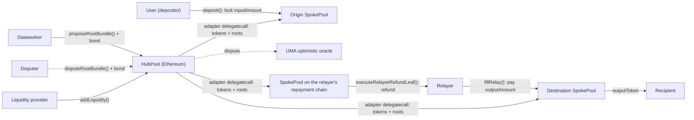
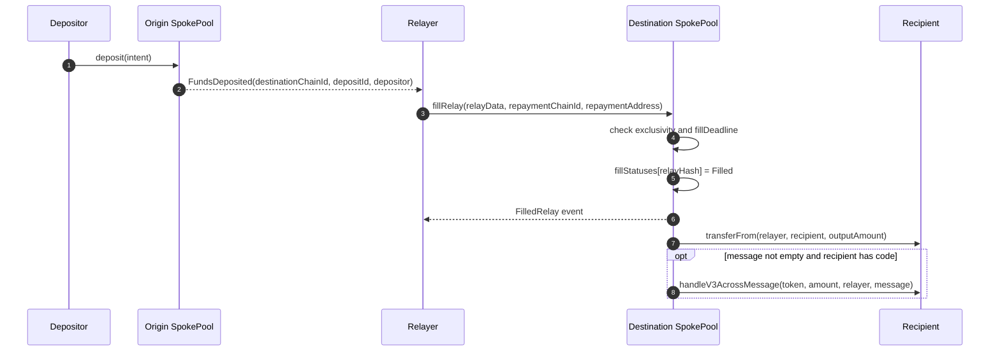
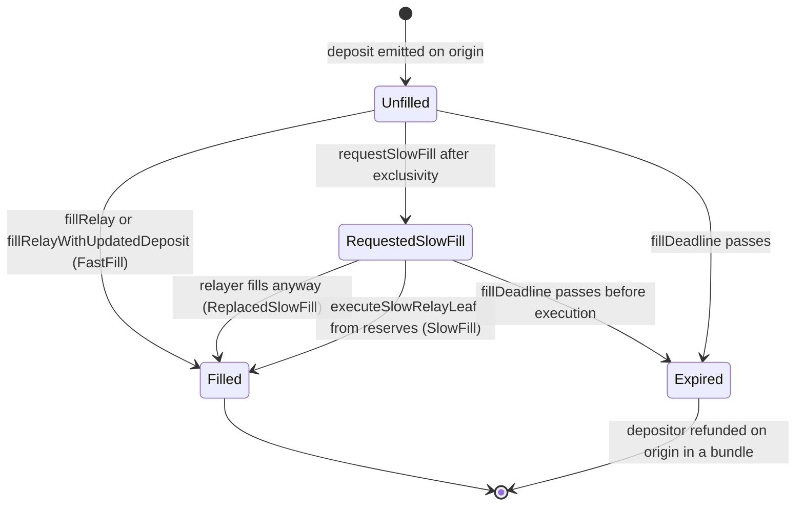
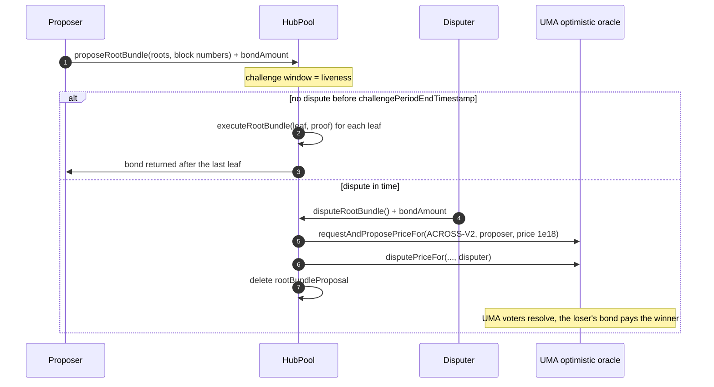

[Across](https://across.to) is a cross-chain bridge built around intents. A user does not send a message to another chain and wait for it to be verified; they lock tokens on the origin chain and state what they want to receive on the destination chain, and an independent relayer pays them there from its own inventory. Verification happens later and only concerns the relayer's repayment, which is settled on Ethereum through [UMA](https://uma.xyz)'s optimistic oracle.

This article follows that design through the `across-protocol/contracts` repository, from the SpokePool deposit and fill paths (with speed-ups, slow fills and expiry) to the HubPool's root bundles, their bond, liveness and dispute. It then covers the fee model and the quote API, the protocol versions from V1 to V5, the Solana and Tron deployments, how to trace a transfer through the events, and the bug classes found in five OpenZeppelin audits. The code, the documentation, the SDK and the audit reports are pinned under References, and a few governance parameters were read from Ethereum on 23 November 2026.

> This article has been made with the help of [Claude Code](https://claude.com/product/claude-code) and several custom skills

[TOC]

## What you need to know first

The article assumes the reader knows smart contracts, ERC-20 tokens and what a cross-chain bridge does. A few mechanisms one level below are used without being derived:

- **Optimistic verification.** A claim is accepted unless someone challenges it within a fixed window, and the challenger and the proposer both post a bond. Safety then rests on one honest observer being online during the window rather than on a quorum of signers. The Across documentation describes UMA's version as a "one-step escalation game", and the HubPool's dispute comments add that a disputed bundle is judged by the voters of UMA's Data Verification Mechanism (DVM).

  *Source:* `user-docs/how-across-works/security.md`; `HubPool.sol`, dispute comments.
- **Merkle roots and inclusion proofs.** A Merkle root commits to a list of leaves; anyone holding a leaf and its proof can show it is in the list without the contract storing the list. Across publishes three roots per settlement period and pays out leaf by leaf.
- **Canonical bridges and L1-to-L2 messaging.** Each rollup or sidechain has its own official bridge for messages and tokens, with its own function names, delays and fee rules. The Across documentation notes that optimistic-rollup bridges can hold funds for up to seven days on the way back to Ethereum.

  *Source:* `user-docs/how-across-works/speed.md`.
- **Finality and reorganisations.** A transaction included in a block can disappear if the chain reorganises. A relayer that pays on the destination before the origin deposit is final takes that risk, which the documentation names *finality risk*.
- **Typed signatures.** [EIP-712](https://eips.ethereum.org/EIPS/eip-712) defines a structured-data hash that a wallet can sign, and [ERC-1271](https://eips.ethereum.org/EIPS/eip-1271) lets a contract account answer "is this signature valid for me?". Across uses both for deposit speed-ups. The site's [ERC-1271 comparison]({{site.url_complet}}/2026/02/13/erc1271-erc7913-signature-verification-comparison/) covers the second one in depth.
- **UUPS proxies.** In the [UUPS pattern](https://github.com/OpenZeppelin/openzeppelin-contracts-upgradeable/blob/cbb66aca87521f818d9c1769c69d5dcc1004977a/contracts/proxy/utils/UUPSUpgradeable.sol), the proxy's address stays fixed and the implementation contract itself contains the upgrade function, guarded by an authorisation hook. The contracts README states that every Across SpokePool is a UUPS proxy.

  *Source:* `contracts/README.md`, "Understanding Upgradeability".

## Architecture and roles

Across separates two problems that a lock-and-release bridge solves at once. Paying the user is done by a relayer, immediately and at the relayer's own risk. Deciding who owes what to whom is done later, in batches, on Ethereum. The repository's own summary puts it as a hub and spokes: one `HubPool` on Ethereum, one `SpokePool` on every supported chain, and chain adapters between them.

*Source:* `contracts/CLAUDE.md`, "Intents System".



The roles and where the code defines them:

| Role | What it does | Where |
|---|---|---|
| Depositor | Sets the intent: output token and amount, recipient, deadlines, optional message. Receives the refund if the deposit expires and may sign a speed-up. | `SpokePool.deposit()` |
| Relayer | Pays `outputAmount` to the recipient on the destination chain, chooses the chain and address where it wants to be repaid. | `SpokePool.fillRelay()` |
| Exclusive relayer | The only address allowed to fill until `exclusivityDeadline` has passed. | `_requireExclusiveFiller()` |
| Dataworker (proposer) | Reads deposits and fills on every chain, builds three Merkle trees and proposes them to the HubPool with a bond. | `HubPool.proposeRootBundle()` |
| Disputer | Posts a bond and challenges a proposal during the liveness window. | `HubPool.disputeRootBundle()` |
| Liquidity provider | Deposits tokens in the HubPool and earns an LP fee on each transfer. | `HubPool.addLiquidity()` |
| HubPool owner | Pauses, sets bond, liveness, routes and adapters, relays admin calls to every SpokePool. | `HubPool.sol` admin section |

The rules a valid bundle must follow are not in Solidity. The documentation points to [UMIP-157](https://github.com/UMAprotocol/UMIPs/blob/master/UMIPs/umip-157.md), an UMA improvement proposal, and to the dataworker's reference implementation. The contracts check proofs and timing; whether a leaf *should* exist is decided off-chain and enforced by the threat of a dispute.

*Source:* `user-docs/how-across-works/overview.md`.

The main contracts:

- **`HubPool`** (Ethereum only) holds LP liquidity, the current root bundle proposal and the dispute logic, and calls chain adapters by `delegatecall`. It is `Ownable` and is **not** a proxy.

  *Implementation:* `HubPool.sol`, contract declaration (line 41).
- **`SpokePool`** is an abstract UUPS contract whose upgrade hook only the cross-chain admin can pass. Each chain variant authenticates a message from Ethereum in that chain's own way: address aliasing on Arbitrum, the cross-domain messenger on OP Stack chains, the FxChild tunnel on Polygon.

  *Implementation:* `SpokePool.sol`, `_authorizeUpgrade()` gated by `onlyAdmin` at line 325; `_requireAdminSender()` in `Arbitrum_SpokePool`, `Ovm_SpokePool`, `Polygon_SpokePool`, `ZkSync_SpokePool`, `Universal_SpokePool` and the other variants.
- **Chain adapters** (`contracts/chain-adapters/`) wrap each canonical bridge, plus CCTP and LayerZero OFT paths. The repository's `AGENTS.md` also names Wormhole, but the pinned commit contains no Wormhole adapter. Adapters are stateless and run in the HubPool's context.
- **Periphery**: `SpokePoolVerifier` wraps native-token deposits, `SpokePoolPeriphery` adds swap-and-bridge and gasless (permit, Permit2, authorisation) deposits, and `MulticallHandler` executes a list of calls on the destination when a fill carries a message.

On chain, the Ethereum SpokePool proxy `0x5c7BCd6E7De5423a257D81B442095A1a6ced35C5` reports the HubPool `0xc186fA914353c44b2E33eBE05f21846F1048bEda` as its `owner()`, which is the cross-chain ownership the repository's README describes for every spoke.

*Source:* `contracts/README.md`, "Understanding Upgradeability".

## The deposit on the origin chain

A deposit is a single call. The current entry point takes every address as `bytes32`, so that the same event can name a Solana account:

```solidity
function deposit(
    bytes32 depositor,
    bytes32 recipient,
    bytes32 inputToken,
    bytes32 outputToken,
    uint256 inputAmount,
    uint256 outputAmount,
    uint256 destinationChainId,
    bytes32 exclusiveRelayer,
    uint32 quoteTimestamp,
    uint32 fillDeadline,
    uint32 exclusivityParameter,
    bytes calldata message
) public payable override nonReentrant unpausedDeposits
```

The deposit id comes from a counter that the SpokePool increments on every deposit, so it is unique per origin SpokePool. The internal deposit function then applies the checks:

- **`depositor`** must be a valid EVM address packed in `bytes32`, but it is a free parameter: it is not forced to `msg.sender`. Whoever is named there receives the expiry refund and is the only one able to sign a speed-up.
- **`outputToken`** must be non-zero.
- **`quoteTimestamp`** must lie in `[now - depositQuoteTimeBuffer, now]`. The LP fee is computed from HubPool utilisation at that timestamp, so a stale one would let a depositor pick an old, cheaper rate.
- **`fillDeadline`** must not exceed `now + fillDeadlineBuffer`. The comment states the purpose: to bound how far back relayers and dataworkers have to look for open deposits. This buffer and the quote-time buffer above are both `immutable`, set when the implementation is deployed.

  *Implementation:* `SpokePool.sol`, `depositQuoteTimeBuffer` and `fillDeadlineBuffer` (lines 149 and 153).
- **`exclusivityParameter`** is read three ways. Zero means no exclusivity. A value up to `MAX_EXCLUSIVITY_PERIOD_SECONDS` (31,536,000 s, one year) is an offset added to the deposit's `block.timestamp`, and the code comment warns that the filler then takes the re-org risk on that timestamp. The exclusivity deadline is part of the relay data that the fill hashes. If the origin block is reorganised and the deposit is included again with another timestamp, the deadline changes, and a fill made with the old one matches no deposit and is not repaid. A larger value is an absolute timestamp. Any non-zero value requires a non-zero `exclusiveRelayer`.
- **Native token.** With `msg.value > 0` and `inputToken` equal to the wrapped native token, `msg.value` must equal `inputAmount` and is wrapped; otherwise `msg.value` must be zero and the token is pulled with `safeTransferFrom`.

*Implementation:* `SpokePool.sol`, `numberOfDeposits++` at line 557 and `_depositV3()` at lines 1383-1462.

The function then emits `FundsDeposited` with the destination chain id, the deposit id and the depositor as indexed topics. No tokens leave the origin chain at this point; the deposit stays in the SpokePool and becomes part of that chain's balance, which later bundles use to repay relayers or send back to the HubPool.

Two other entry points matter in practice:

- **`depositNow`** sets the quote timestamp to the current time and takes a deadline offset instead of an absolute deadline.

  *Implementation:* `SpokePool.sol`, `depositNow()` (lines 744-771).
- **`unsafeDeposit`** takes a caller-chosen nonce and derives the id from a hash of the caller, the depositor and that nonce, `uint256(keccak256(abi.encodePacked(msg.sender, depositor, depositNonce)))`. It lets an integrator compute the relay hash before the deposit is mined. The NatSpec explains the name. The id is not guaranteed unique, and a collision makes the deposit unfillable, so it ends in a refund after the deadline. Worse, "a speed up signature can be re-used for any deposits with the same deposit ID".

  *Implementation:* `SpokePool.sol`, `unsafeDeposit()` and `getUnsafeDepositId()`, NatSpec at lines 646-653.

`SpokePoolVerifier` is a pass-through to `deposit()` meant for native-token deposits, deployed with CREATE2 at the same address on every chain so that a transaction sent to the wrong chain reverts instead of losing its ETH. It checks that the target SpokePool has code, requires the value sent to equal the input amount and sets the depositor to the caller. `SpokePoolPeriphery` passes whatever depositor its caller signed or supplied.

*Implementation:* `SpokePoolVerifier.sol`, `deposit()` with `msg.value == inputAmount` and `depositor = msg.sender` (lines 45-76).

## The fill on the destination chain

A relayer sees the `FundsDeposited` log, decides the deposit is profitable and calls:

```solidity
function fillRelay(
    V3RelayData memory relayData,
    uint256 repaymentChainId,
    bytes32 repaymentAddress
) public override nonReentrant unpausedFills nonV5Fill(relayData.message)
```

The `nonV5Fill` modifier refuses deposits tagged for V5, which have their own fill path (see Versions).

`V3RelayData` repeats the deposit: depositor, recipient, exclusive relayer, input and output tokens and amounts, origin chain id, deposit id, fill deadline, exclusivity deadline and message. The destination SpokePool has no way to read the origin chain, so it cannot check any of these fields. It hashes them instead:

```solidity
function getV3RelayHash(V3RelayData memory relayData) public view returns (bytes32) {
    return keccak256(abi.encode(relayData, chainId()));
}
```

The hash includes the **destination** chain id, the one executing the call. A relayer is repaid only if its relay hash matches a real deposit, which the dataworker checks off-chain. A fill of invented data succeeds on-chain and is never repaid.



A fill runs these checks in this order:

1. `fillRelay` itself calls `_requireExclusiveFiller`, which reverts if `exclusivityDeadline >= now` and the caller is not the exclusive relayer. The deadline is inclusive.
2. The internal fill function reverts if `fillDeadline < now`. The comparison uses the destination chain's clock, while the deposit-time buffer check used the origin's.

   *Implementation:* `SpokePool.sol`, `_fillRelay()` (lines 1707-1744).
3. Read `fillStatuses[relayHash]`. A value of `Filled` reverts. A value of `RequestedSlowFill` makes this a `ReplacedSlowFill`, which tells the dataworker that reserves set aside for a slow fill can return to the HubPool.
4. Set the status to `Filled` and emit `FilledRelay`, then move the tokens.

There are no partial fills, as a code comment in the fill function states, and the status slot only knows three values: 0 for Unfilled, 1 for RequestedSlowFill and 2 for Filled.

*Implementation:* `SpokePool.sol`, comment in `_fillRelay()` (line 1733).

**Native output.** When `outputToken` is the wrapped native token, the SpokePool pulls WETH from the relayer, unwraps it and sends native ETH to an EOA or to an [EIP-7702](https://eips.ethereum.org/EIPS/eip-7702) delegated account, but sends WETH to any other contract:

```solidity
// SpokePool.sol, lines 1630-1637
function _unwrapwrappedNativeTokenTo(address payable to, uint256 amount) internal {
    if (!AddressLibUpgradeable.isContract(address(to)) || _is7702DelegatedWallet(to)) {
        wrappedNativeToken.withdraw(amount);
        AddressLibUpgradeable.sendValue(to, amount);
    } else {
        _safeTransfer(address(wrappedNativeToken), to, amount);
    }
}
```

A tracer therefore sees, on a fast fill, a WETH transfer from the relayer to the SpokePool followed by an internal ETH transfer from the SpokePool to the recipient, or a WETH transfer to the recipient when it is a contract without EIP-7702 delegation.

**Message callback.** If the message, possibly updated by a speed-up, is non-empty and the recipient has code, the SpokePool calls `handleV3AcrossMessage(tokenSent, amount, relayer, message)` on it after the transfer. A revert there reverts the whole fill, so a broken recipient contract makes the deposit unfillable and it ends in an expiry refund. A message sent to an EOA is ignored. The `MulticallHandler` decodes the message as a list of calls plus a fallback recipient. With a zero fallback recipient, a failed call reverts, so the whole fill reverts. With a non-zero one, a failed batch emits `CallsFailed`, and any tokens left in the handler go to the fallback address, after a failed or a successful batch.

*Implementation:* `MulticallHandler.sol`, `Instructions` with `fallbackRecipient` at lines 25-48 and `handleV3AcrossMessage()` at lines 71-86.

A note on the documentation: at its pinned commit of December 2025, it still describes "1 wei" partial fills used to signal a slow fill, while the code at `08df779` has no partial fills and uses `requestSlowFill` for that purpose.

*Source:* `user-docs/how-across-works/speed.md`.

## Speed-ups, slow fills and expiry

A fill can follow three other paths besides a plain fast fill. The `fillStatuses` slot records which one happened:



`Expired` is not a stored value: the slot stays at 0 or 1, and expiry is something the dataworker reads from the deadline.

### Speed-up

A depositor who set too low an output amount, or who wants to change the recipient or message, signs an EIP-712 `UpdateDepositDetails(uint256 depositId, uint256 originChainId, uint256 updatedOutputAmount, bytes32 updatedRecipient, bytes updatedMessage)` under the domain `"ACROSS-V2"`, version `"1.0.0"`. On the origin chain, `speedUpDeposit` checks the signature and only emits an event; nothing is stored. A relayer then calls `fillRelayWithUpdatedDeposit` on the destination with the original relay data, the new values and the signature, and the destination SpokePool verifies it again.

*Implementation:* `SpokePool.sol`, `speedUpDeposit()` emitting `RequestedSpeedUpDeposit` at lines 853-883 and `fillRelayWithUpdatedDeposit()` at lines 1108-1150.

The relay hash is still the hash of the original data, so a sped-up deposit keeps its identity and cannot be filled twice. The signature is checked with OpenZeppelin's `SignatureChecker.isValidSignatureNow`, which accepts ERC-1271 contract signatures. The comment above it states the consequence: "a signature valid now, may not be valid later and vice-versa", and the depositor contract must exist at the same address on the destination chain. `pauseDeposits` does not stop `speedUpDeposit`, so open deposits can still be adjusted while new ones are blocked.

*Implementation:* `SpokePool.sol`, `_verifyDepositorSignature()` (lines 1593-1607).

### Slow fill

When no relayer fills, anyone may call `requestSlowFill(relayData)` on the destination. It is refused during exclusivity and after the deadline, and accepted only for an `Unfilled` hash. The next bundle includes a slow-fill leaf for it; once that bundle passes liveness and its roots reach the SpokePool, anyone calls `executeSlowRelayLeaf`, which pays the recipient from the SpokePool's own balance and credits no relayer (`EMPTY_RELAYER`).

*Implementation:* `SpokePool.sol`, `requestSlowFill()` (lines 1157-1188).

The leaf is rebuilt with `chainId: chainId()` before the proof is checked (`_verifyV3SlowFill`), so a slow-fill leaf for one chain cannot be executed on another. That check exists because of the only Critical finding in the five OpenZeppelin reports read for this article (see below). A NatSpec note adds that slow fills are "not possible" unless the input and output tokens route to the same L1 token. `requestSlowFill` does not check this itself: the request is accepted, and the note means that no slow-fill leaf should follow, which leaves such a deposit to the expiry refund.

The documentation describes slow fills as fills made with LP capital, and adds that "the depositor gets refunded the relayer fee in this case". The amount paid is the leaf's `updatedOutputAmount`, which the dataworker computes; the contract does not show how. Whether that amount is `outputAmount` or `outputAmount` plus the refunded relayer fee is a UMIP-157 rule that was not read (see Gaps).

*Source:* `user-docs/how-across-works/speed.md`.

### Expiry

There is no function a depositor calls to get money back. After `fillDeadline`, the dataworker includes the depositor in a relayer-refund leaf on the **origin** chain, which pays them `inputAmount` of `inputToken` through the ordinary refund path. The code states this in the `unsafeDeposit` NatSpec; the rule itself is part of UMIP-157. A depositor who never gets filled therefore waits for the deadline plus at least one bundle cycle.

## Settlement on the HubPool

### The root bundle

Settlement runs in bundles. Each bundle covers a block range per chain, and the proposal carries the end block of every range; the start is the previous bundle's end plus one.

*Source:* `user-docs/how-across-works/overview.md`.

A bundle commits to three Merkle roots:

- **Pool rebalance root**: one leaf per chain, or several when the chain has too many tokens for one leaf to execute under the block gas limit; the dataworker then splits them by `groupIndex`, and only the group-0 leaf relays the other two roots to the SpokePool. Each leaf carries three per-token arrays:
  - `bundleLpFees`, the LP fees earned on the bundle's relays;
  - `runningBalances`, an unpaid balance carried from bundle to bundle between the HubPool and that SpokePool (positive when the HubPool owes the spoke), only emitted in an event;
  - `netSendAmounts`, the amount the leaf moves, positive when the HubPool pays the spoke and negative when the spoke pays the HubPool. When the off-chain rules call for a rebalance, it is set to the previous running balance plus this bundle's relays minus its deposits, and the running balance returns to zero.

  *Source:* `HubPoolInterface.sol`, `PoolRebalanceLeaf` field comments.
- **Relayer refund root**: per chain and token, the list of `refundAddresses` and `refundAmounts`, plus an `amountToReturn` that the SpokePool sends back to the HubPool.
- **Slow relay root**: the slow fills to execute.

```solidity
function proposeRootBundle(
    uint256[] calldata bundleEvaluationBlockNumbers,
    uint8 poolRebalanceLeafCount,
    bytes32 poolRebalanceRoot,
    bytes32 relayerRefundRoot,
    bytes32 slowRelayRoot
) public override nonReentrant noActiveRequests unpaused
```

A proposal must contain at least one leaf. The HubPool opens a challenge window of `liveness` seconds from the current time, stores the roots and the proposer, and pulls the bond from the proposer. The `noActiveRequests` modifier refuses a new proposal while the current one still has unexecuted pool-rebalance leaves, so only one bundle is in flight at any time. The block numbers are only emitted in the `ProposeRootBundle` event, not stored: anyone checking the bundle, including UMA voters in a dispute, reads them from the event.

*Implementation:* `HubPool.sol`, `proposeRootBundle()` (lines 560-594), which sets `challengePeriodEndTimestamp = now + liveness` and pulls `bondAmount` of `bondToken`.

### Bond, liveness and the bond token

Three parameters set the cost of lying and the time to catch it. The deployed values below were read on 23 November 2026; the proposer list was checked again on 24 November 2026.

- **`liveness`** defaults to 7,200 s in the code, 2 hours "like the rest of the UMA ecosystem", and the documentation repeats the two-hour figure. The owner can change it with `setLiveness`, which only requires more than ten minutes. On 23 November 2026 (Ethereum block 26,477,298), `liveness()` on the deployed HubPool returned **1,800 s, 30 minutes**. The HubPool's `LivenessSet` events show three reductions from the 7,200 s default:

  - 5,400 s on 19 September 2023, block [18,170,873](https://etherscan.io/block/18170873);
  - 3,600 s on 21 April 2024, block [19,704,562](https://etherscan.io/block/19704562);
  - 1,800 s on 3 November 2025, block [23,718,591](https://etherscan.io/block/23718591).

  *Implementation:* `HubPool.sol`, `liveness` declaration and comment (lines 83-85).
- **`bondAmount`** is set by the owner as the chosen amount **plus** UMA's final fee for the bond token, and a zero amount is refused so that the bond cannot equal the final fee. The same read returned `bondAmount() = 0.45` ABT, that is 0.45 ETH, since ABT is issued one for one against Ether (next bullet). UMA's final fee for ABT, the part of that amount that is not the chosen bond, was not read.

  *Implementation:* `HubPool.sol`, `setBond()` (lines 277-297).
- **`bondToken`** returned `0xee1DC6BCF1Ee967a350e9aC6CaaAA236109002ea`, whose `name()` is "Across Bond Token" (ABT). The ABT contract describes it as a WETH9-style token issued one for one against deposited Ether. It turns a token rule into a proposer whitelist in two steps:

  1. `proposeRootBundle` first records the caller as the proposal's proposer, then pulls the bond from that caller with `transferFrom`.
  2. ABT's `transferFrom` refuses any transfer into the HubPool whose sender is the recorded proposer, unless that sender is on the owner-managed `proposers` list.

  Proposing therefore needs the owner's approval. A disputer is not the recorded proposer, so its bond transfer is not restricted. This matches the documentation's "Whitelisted dataworkers are in charge of proposing". The ABT contract's `owner()` is the same Safe that owns the HubPool (see Who owns the HubPool below).

  *Implementation:* `BondToken.sol`, `transferFrom()` and the `proposers` mapping.

  The owner has enabled one proposer since deployment, on 28 August 2023 at block [18,012,106](https://etherscan.io/block/18012106). On 24 November 2026 at 15:10 UTC (Ethereum block [26,485,825](https://etherscan.io/block/26485825)), that address was still enabled, so a single address could propose bundles.

  *Source:* the bond token's only `ProposerModified` event, which enables `0xf7ba…997c`, and its `proposers()` getter.

### Dispute



A dispute is only accepted while the challenge window is open (`now <= challengePeriodEndTimestamp`). It does not ask UMA a fresh question; it makes the HubPool request a price on the identifier `"ACROSS-V2"`, immediately proposes the value 1e18, meaning "the bundle is valid", **on behalf of the original proposer**, and then disputes that proposal on behalf of the disputer.

This pair maps the bundle onto an ordinary UMA request. Both bonds move from the HubPool to UMA's optimistic oracle under the proposer's and the disputer's names, and the vote pays the winner as for any other request. The bundle is deleted at once, so a new proposal can follow without waiting for the vote.

*Implementation:* `HubPool.sol`, `disputeRootBundle()` (lines 715-796).

Two edge cases cancel instead of escalating: if UMA's final fee has risen to at least `bondAmount`, or if the oracle call reverts, the HubPool calls `_cancelBundle()` and returns. A cancel sends the bond back to the proposer and deletes the proposal; it runs before the disputer's bond is pulled, so neither side loses anything. The 2022 audit flagged the case of a bond equal to the final fee, and the fix was partial: `setBond` enforces the margin when the bond is set, but a later rise of the final fee is only handled by cancelling.

The HubPool owner can also remove a proposal with `emergencyDeleteProposal`, which returns the proposer's bond when leaves remain. Its comment says it exists for "an unexecutable bundle" that passed liveness through a non-malicious bug. A second, separate function acts on the spoke side: `emergencyDeleteRootBundle` on a SpokePool, which the owner reaches through the HubPool's admin relay, deletes a root bundle that has already been relayed there.

*Implementation:* `HubPool.sol`, `emergencyDeleteProposal()` at lines 223-240, and `SpokePool.sol`, `emergencyDeleteRootBundle()` at lines 389-397.

### Execution and adapters

After the challenge window, anyone calls `executeRootBundle` with one pool-rebalance leaf and its proof. The function:

1. checks `now > challengePeriodEndTimestamp` and that the leaf was not already claimed;
2. verifies the proof against `poolRebalanceRoot`;
3. sends `netSendAmounts` of each L1 token to the target chain and updates the pooled-token accounting;
4. if `groupIndex == 0`, `delegatecall`s the chain's adapter with `relayMessage(spokePool, relayRootBundle(relayerRefundRoot, slowRelayRoot))`;
5. returns the proposer's bond once the last leaf is executed, which the comment presents as the incentive to execute every leaf.

*Implementation:* `HubPool.sol`, `executeRootBundle()` (lines 612-707).

Because adapters run by `delegatecall`, they execute with the HubPool's storage and balance. The owner sets them per chain with `setCrossChainContracts`, which deliberately accepts invalid or zero addresses so that the owner can block a chain in an emergency.

### Refunds on the SpokePools

When the roots arrive, a SpokePool stores them as a new `rootBundleId` and emits `RelayedRootBundle`. Anyone then calls `executeRelayerRefundLeaf(rootBundleId, leaf, proof)`. The leaf must name this chain (`chainId()`), the proof must verify, and the leaf is marked claimed. `_distributeRelayerRefunds` then loops over the refund addresses:

- it reverts if the running total exceeds the SpokePool's balance at the start, which keeps a leaf all-or-nothing;
- each transfer goes through `_noRevertTransfer`; if it fails (a USDC-blacklisted address, for example), the amount is booked in `relayerRefund[token][address]` and the event carries `deferredRefunds = true`. The owner of that address claims it later with `claimRelayerRefund`, to an address of their choice;
- if `amountToReturn > 0`, the SpokePool bridges that amount back to the HubPool through the chain's canonical route and emits `TokensBridged`.

*Implementation:* `SpokePool.sol`, `executeRelayerRefundLeaf()` (lines 1276-1316) and `_distributeRelayerRefunds()`.

The deferred path is the fix for a 2024 audit finding, where one blacklisted recipient reverted the whole leaf. `executeRelayerRefundLeaf` and `executeSlowRelayLeaf` carry no pause modifier, so already-proven payouts can still be executed while fills are paused.

### Liquidity providers

LPs deposit an L1 token into the HubPool with `addLiquidity` and receive an LP token whose redemption value grows as fees accrue. Fees do not arrive at once: the HubPool releases pending LP fees at `lpFeeRatePerSecond`, set to 1.5e12 in the code and on chain, a rate of 1.5e-6 per second. The comment says this pays out the full amount "in ~ 7.72 days assuming no contract interactions", which is the inverse of that rate. A share `protocolFeeCapturePct` of LP fees can go to the protocol; it was 0 on 23 November 2026.

LP capital is what repays relayers on the chain they chose and what funds slow fills. The share of it in use is the *utilisation* that prices the LP fee. For one L1 token, the HubPool computes it as a ratio. The numerator adds the amount about to be relayed to `utilizedReserves`, the tokens sitting in SpokePools or still in transit back to Ethereum. The denominator adds the liquid reserves held on the HubPool to the same `utilizedReserves`.

The fee curve itself is not in the contracts: a "Rate Model" is stored per L1 token as a string in `AcrossConfigStore`, which its header describes as settings "consumed by off-chain bots".

*Implementation:* `HubPool.sol`, `_liquidityUtilizationPostRelay()` (lines 973-993); `AcrossConfigStore.sol`, `l1TokenConfig`.

The documentation names the consequence for LPs: under heavy volume, so much capital may be sitting on SpokePools or in canonical bridges that not every LP who wants to withdraw can do so at once.

*Source:* `user-docs/how-across-works/overview.md`.

The owner function `haircutReserves` writes a loss into the pool's reserves "in the event of an irrecoverable loss of funds on one of the L2s", spreading it pro rata over LPs.

*Implementation:* `HubPool.sol`, `haircutReserves()` (lines 418-431).

### Who owns the HubPool

Every owner power named in this section sits with one address: the bond, liveness, adapters, proposal deletion, haircuts and the admin relay to the spokes.

On 23 November 2026 (Ethereum block [26,477,298](https://etherscan.io/block/26477298)), `owner()` of the HubPool returned the Safe `0xB524735356985D2f267FA010D681f061DfF03715`, with a threshold of 3 out of 5 owners. The Safe also had one enabled module, a clone of UMA's Optimistic Governor (oSnap), which executes on the Safe without the signers once a proposal approved by a Snapshot vote survives a 48-hour UMA challenge. The HubPool has no timelock, so an owner call takes effect in the transaction that executes it. The Annex, under Risks, gives the module's addresses, rules and bond.

## Fees and quotes

There is no fee field in a deposit. The fee is the spread: the depositor locks `inputAmount` of `inputToken` and asks for `outputAmount` of `outputToken`, and the difference, once both are valued in one unit, pays three things. The NatSpec of `deposit` lists them as the relayer's gas on the destination, the relayer's "opportunity cost of capital while they wait to be refunded following an optimistic challenge window", and the system fee "that they'll be charged". The `fillRelay` NatSpec says the relayer "will receive inputAmount of the equivalent token" on its repayment chain; how the system fee is deducted from that is a bundle rule, not visible in the contract.

The Across API computes a quote. The SDK sends the origin and destination chain, the input and output token, the amount, and an optional recipient and message to the suggested-fees endpoint. The response gives the total relay fee and its three parts, the relayer's capital fee, the relayer's gas fee and the LP fee, each with an amount and a percentage. It adds the output amount, the exclusive relayer, the exclusivity deadline, the fill deadline and a `timestamp` that the SDK's `getQuote` passes on as `quoteTimestamp`.

*Implementation:* `toolkit/packages/sdk/src/api/suggested-fees.ts`, `GET https://app.across.to/api/suggested-fees`, response fields `totalRelayFee`, `relayerCapitalFee`, `relayerGasFee`, `lpFee`, `outputAmount`, `exclusiveRelayer`, `exclusivityDeadline` and `fillDeadline`.

A deposit built from such a quote can therefore name an exclusive relayer chosen by the API. The documentation describes relayer competition as an auction and says that when it "expires without a clearing price", the system falls back to LP capital, that is, to a slow fill.

*Source:* `user-docs/how-across-works/fees.md`.

A relayer may ask to be repaid on any chain, which the documentation calls unique to Across "because of the LP pool". The fees page adds that V3 introduced "a fee optimization" that encourages relayers to accept repayment on a chain other than the destination chain; it does not give the formula (see Gaps).

### A worked example

A user sends 1,000 USDC from Arbitrum to Base. The fee amounts below are **assumed** for illustration, not read from the API. Two steps are only described in prose by the code: the NatSpec says the relayer is repaid `inputAmount` "less a system fee" set by the quote timestamp, and the example takes that system fee to be the LP fee. The exact deduction is a UMIP-157 rule.

| Step | Where | Amount |
|---|---|---|
| Quote: relayer capital fee 0.40, relayer gas fee 0.10, LP fee 0.50 (assumed) | Across API | total relay fee 1.00 USDC |
| `deposit()` locks `inputAmount` | Arbitrum SpokePool | 1,000.00 USDC |
| `outputAmount` = 1,000 - 1.00 | set in the deposit | 999.00 USDC |
| `fillRelay()`: the relayer pays the recipient from its inventory | Base SpokePool | 999.00 USDC |
| Next bundle, after `liveness` (30 minutes on chain on 23 November 2026): a relayer-refund leaf on the chain the relayer chose | repayment chain | 1,000 - 0.50 = 999.50 USDC |
| LP fee, counted in the bundle's `bundleLpFees` and released to LPs at `lpFeeRatePerSecond` over about 7.72 days | HubPool | 0.50 USDC |

The relayer ends with 999.50 USDC repaid for 999.00 paid, a margin of 0.50 USDC (0.05%), which is the capital fee plus the gas fee; its real gas cost on Base comes out of that. The recipient has 999.00 USDC on Base within the fill transaction. The 1,000 USDC deposited stay in the Arbitrum SpokePool. If the relayer chose Arbitrum, its refund leaf is paid from that balance; otherwise the deposit adds to Arbitrum's running balance, which a later pool-rebalance leaf settles with an `amountToReturn` to the HubPool or by using it for other refunds.

## Versions

| Version | What changed | Trace in the current code |
|---|---|---|
| V1 (launched 2021) | One `BridgePool` per L1 token on Ethereum, filling deposits made on L2s (L2-to-L1 only); LPs later migrated to V2. | `contracts-v1` repository, `user-docs/additional-info/migrating-from-v1.md` |
| V2 | HubPool plus SpokePools, UMA-settled root bundles, `relayerFeePct` in the deposit. | UMA identifier and EIP-712 domain `"ACROSS-V2"`; V2 functions kept as reverting stubs with their selectors (`SpokePoolInterface.sol`) |
| V3 | `outputToken`/`outputAmount` intents, exclusivity, `fillDeadline`, `requestSlowFill`. | `V3RelayData`, `FillType`, legacy events `V3FundsDeposited` and `FilledV3Relay` |
| "V3.5" (SDK name) | `bytes32` addresses and `uint256` deposit ids; `FundsDeposited` and `FilledRelay` replace the V3 events. | Current events; the legacy ones are declared but never emitted |
| V5 | Deposits whose message starts with `V5_MAGIC_PREFIX = keccak256("AcrossV5MessagePrefix.V1")` are consumed by a V5 Gateway execution and can only be filled through the two V5 entry points described below. | `V5SpokePoolInterface.sol`, `nonV5Fill` modifier on the other fill paths |

[ERC-7683](https://eips.ethereum.org/EIPS/eip-7683), the cross-chain intents standard, also appears: the SpokePool still has an ERC-7683 `fill()`, marked deprecated.

*Implementation:* `SpokePool.sol`, `fill()` (lines 1190-1197).

V5 ties a deposit to a step of a multi-step execution run by a contract called the Gateway. The deposit carries only a witness: its message is the prefix followed by a *step id*, the Merkle root of the Gateway execution allowed to consume it. What the destination must honour is committed in a leaf under that root instead of crossing the bridge: the recipient, the output token, a minimum output amount and an optional message. The submitter, defined below, supplies the deposit's relay data at fill time.

The SpokePool checks the supplied data against the commitment and the step id the Gateway is executing before it hashes the relay data. Two roles appear:

- the **submitter** is the address that called the Gateway's `execute()` for the current step;
- the **executor** is the contract the current step commits to call.

The fill can happen in two modes:

| Mode | Entry point and caller | Output tokens pulled from | Exclusivity checked against |
|---|---|---|---|
| Executor mode | `executeAcrossV5`, called by the Gateway itself | the Gateway's current submitter | the submitter |
| Adapter mode | `adapterExecuteAcrossV5`, called by the current step's executor | that caller, never a standing submitter allowance | the submitter |

The Gateway contracts are not in the repository; only a read-only interface and the SpokePool side are. The deployed Ethereum SpokePool already answers `gateway()` with `0x998d7c178A1F9607b47eA3A8e22426451b3ce707`.

*Implementation:* `V5SpokePoolInterface.sol`, header comment; `SpokePool.sol`, `executeAcrossV5()` and `adapterExecuteAcrossV5()` (lines 1072-1087).

## Solana, Tron and chains without a native bridge

**Solana.** The `svm_spoke` Anchor program (`DLv3NggMiSaef97YCkew5xKUHDh13tVGZ7tydt3ZeAru` on mainnet) mirrors the EVM instructions: the three deposit variants, fills, slow-fill requests and their execution, relayer-refund execution with a deferred variant, refund claims, bridging tokens back to the HubPool, and receiving messages from Ethereum. Its events are emitted with `emit_cpi!`, a self-call whose data sits in inner-instruction data rather than in logs with topics. Because a transaction is size-limited, large fill parameters can be written to an `instruction_params` account in fragments first. Across uses chain id 34268394551451 for Solana, and the documentation lists only USDC as supported there. The README's deployment procedure sets the program's upgrade authority to a Squads multisig vault.

*Implementation:* `programs/svm-spoke/src/`, instructions `deposit`, `deposit_now`, `unsafe_deposit`, `fill_relay`, `request_slow_fill`, `execute_slow_relay_leaf`, `execute_relayer_refund_leaf` and a `_deferred` variant, `claim_relayer_refund`, `bridge_tokens_to_hub_pool` and `handle_receive_message`; `emit_cpi!` in `instructions/deposit.rs` at line 129 and `instructions/fill.rs` at line 155; `instruction_params` in `lib.rs` at lines 575-609; program id in `Anchor.toml`.

**Tron.** `Tron_SpokePool` extends `Universal_SpokePool`. Tron USDT's `transfer` returns `false` on success, so the contract replaces the return-value checks with a balance-delta check; its header warns that this assumes Tether's `basisPointsRate` fee stays at zero, and that a non-zero fee would make every USDT transfer look failed and "wedge" the routes.

*Implementation:* `Tron_SpokePool.sol`, contract header (lines 10-20).

**Universal SpokePool.** For chains without a canonical bridge from Ethereum, admin messages are stored on Ethereum in `HubPoolStore` and proven on the spoke with a storage proof against an SP1 Helios light client. SP1 Helios is a contract on the spoke chain that tracks Ethereum's beacon chain, with each update checked by an SP1 zero-knowledge proof, and serves Ethereum storage slots at the blocks it has verified. The owner has a fallback, usable only if the light client has not been updated for `ADMIN_UPDATE_BUFFER` seconds. That buffer is `immutable`, set at deployment; the repository's Tron deployment script passes one day (86,400 s), and the deployed values were not read.

*Implementation:* `Universal_SpokePool.sol`, `executeMessage()` and `adminExecuteMessage()` (lines 126-175); `SP1Helios.sol`, contract header; `tron-deploy-universal-spokepool.ts`, `adminUpdateBuffer`.

## Tracing funds through Across

Across events are emitted by the SpokePool proxy on each chain, with addresses left-padded to 32 bytes. The ones that link a deposit to its fill and refund are below; topic0 values are the Keccak-256 of the canonical event signatures, computed with `cast keccak`.

*Implementation:* `V3SpokePoolInterface.sol` and `SpokePool.sol`, event declarations.

| Event | topic0 | Indexed topics |
|---|---|---|
| `FundsDeposited` | `0x32ed1a409ef04c7b0227189c3a103dc5ac10e775a15b785dcc510201f7c25ad3` | destinationChainId, depositId, depositor |
| `FilledRelay` | `0x44b559f101f8fbcc8a0ea43fa91a05a729a5ea6e14a7c75aa750374690137208` | originChainId, depositId, relayer (the `repaymentAddress`) |
| `RequestedSpeedUpDeposit` | `0x45e04bc8f121ba11466985789ca2822a91109f31bb8ac85504a37b7eaf873c26` | depositId, depositor |
| `RequestedSlowFill` | `0x3cee3e290f36226751cd0b3321b213890fe9c768e922f267fa6111836ce05c32` | originChainId, depositId |
| `ExecutedRelayerRefundRoot` | `0xf4ad92585b1bc117fbdd644990adf0827bc4c95baeae8a23322af807b6d0020e` | chainId, rootBundleId, leafId |
| Legacy `V3FundsDeposited` | `0xa123dc29aebf7d0c3322c8eeb5b999e859f39937950ed31056532713d0de396f` | destinationChainId, depositId (uint32), depositor |
| Legacy `FilledV3Relay` | `0x571749edf1d5c9599318cdbc4e28a6475d65e87fd3b2ddbe1e9a8d5e7a0f0ff7` | originChainId, depositId (uint32), relayer |

The non-indexed fields of the two current events sit in the log data as 32-byte words, counted from 0. In `FilledRelay`, the four fields of `relayExecutionInfo` are all fixed-size, so they follow inline as words 11 to 14.

| Word | `FundsDeposited` | `FilledRelay` |
|---|---|---|
| 0 | inputToken | inputToken |
| 1 | outputToken | outputToken |
| 2 | inputAmount | inputAmount |
| 3 | outputAmount | outputAmount |
| 4 | quoteTimestamp | repaymentChainId |
| 5 | fillDeadline | fillDeadline |
| 6 | exclusivityDeadline | exclusivityDeadline |
| 7 | recipient | exclusiveRelayer |
| 8 | exclusiveRelayer | depositor |
| 9 | offset of `message` (dynamic, encoded after word 9) | recipient |
| 10 | | messageHash |
| 11 | | updatedRecipient |
| 12 | | updatedMessageHash |
| 13 | | updatedOutputAmount |
| 14 | | fillType |

**From a deposit to its fill.**

1. In the deposit transaction, take the `FundsDeposited` log: topic1 is the destination chain, topic2 the deposit id, topic3 the depositor. Its data gives `outputToken`, `outputAmount`, `fillDeadline` and the recipient, at words 1, 3, 5 and 7 of the table above. A deposit made through `SpokePoolVerifier` or `SpokePoolPeriphery` is still logged by the SpokePool.
2. Ask the indexer: the SDK queries the deposit-status endpoint with the deposit id and the origin chain id, and reads the status, the fill transaction and whether the destination actions succeeded. The host is the indexer, not `app.across.to/api`.

   *Implementation:* `actions/getFillByDepositTx.ts` in the SDK, `GET https://indexer.api.across.to/deposit/status` with `depositId` and `originChainId`, reading `status`, `fillTx` and `actionsSucceeded`.
3. Without the API, filter `FilledRelay` logs on the destination SpokePool by topic1 = origin chain id and topic2 = deposit id, and also `FilledV3Relay` for older fills. The SDK does exactly this.
4. In the fill, read the depositor, the recipient, the updated recipient and the fill type, at words 8, 9, 11 and 14. The updated recipient is the address that received the tokens; it differs from the recipient only after a speed-up. This layout does not apply to the legacy `FilledV3Relay`, whose data contains dynamic fields. If the output was WETH, look for the internal ETH transfer from the SpokePool; if there was a message, look for `CallsFailed` from the `MulticallHandler`.

**From a fill back to its deposit**, swap the roles: topic1 of `FilledRelay` is the origin chain, and on that chain's SpokePool, `FundsDeposited` with topic1 = the destination chain and topic2 = the deposit id is the match. The match is unique for counter-based ids; `unsafeDeposit` ids are hashes and may collide.

Topic3 of `FilledRelay` is the `repaymentAddress` the relayer chose, which need not be the transaction sender. The relayer's repayment arrives later, aggregated over many fills in one `ExecutedRelayerRefundRoot` leaf on its repayment chain, so there is no on-chain link from a refund to a particular fill. When the depositor's own address appears in `refundAddresses` on the origin chain, that is consistent with an expiry refund, but the same address may also be there as a relayer; confirm that the deposit has no `FilledRelay` before its `fillDeadline`.

When the depositor equals the recipient, the hop is a self-bridge only if that address also funded the deposit: it sent the origin transaction, or signed the periphery authorisation. The `depositor` field is free, so a third party can fund a deposit that names any address on both sides.

## Audit history and bug classes

Five OpenZeppelin reports are stored with the sources, published between May 2022 and July 2024. The contracts README says the code is "continuously audited by OpenZeppelin", so later reports may exist that are not covered here.

| Report | Published | Scope | C / H / M / L / N |
|---|---|---|---|
| [UMA Across V2 Audit](https://www.openzeppelin.com/news/uma-across-v2-audit) | 2022-05-11 | HubPool, SpokePool, four chain spokes and adapters, MerkleLib | 1 / 0 / 4 / 8 / 16 |
| [Across Token and Token Distributor Audit](https://www.openzeppelin.com/news/across-token-and-token-distributor-audit) | 2022-07-21 | ACX token, AcceleratingDistributor | 0 / 1 / 1 / 4 / 7 |
| [Across V2 Incremental Audit](https://www.openzeppelin.com/news/across-v2-incremental-audit) | 2024-01-29 | zkSync spoke and adapter | 0 / 0 / 1 / 0 / 6 |
| [Across V3 Incremental Audit](https://www.openzeppelin.com/news/across-v3-incremental-audit) | 2024-02-21 | V3 SpokePool and spokes, adapters, CCTP, SwapAndBridge, Permit2 depositor, SpokePoolVerifier | 0 / 0 / 4 / 7 / 16 |
| [Across V3 and Oval Incremental Audit](https://www.openzeppelin.com/news/across-v3-and-oval-incremental-audit) | 2024-07-16 | Blast spoke and adapter, ERC-7683 depositor, MulticallHandler; Oval oracle | 0 / 0 / 4 / 7 / 14 |

That is 101 findings in total. Grouped by root cause, the ones that concern the bridge fall into a few classes:

- **Cross-chain replay of shared roots.** The Critical finding of 2022: every SpokePool received the same `slowRelayRoot`, and a slow-relay leaf did not name its destination chain, so "any slow relay can be executed on any spoke chain where the Spoke Pool has sufficient funds". The fix is the `chainId: chainId()` field rebuilt in `_verifyV3SlowFill`; refund leaves carry the same check.
- **Refund denial of service.** In the V3 audit, one USDC-blacklisted address in a refund leaf reverted the whole leaf and blocked every other relayer in it. The current code books the failed amount instead (`_noRevertTransfer`, `claimRelayerRefund`).
- **Canonical-bridge quirks in adapters.** The zkSync adapter assumed a per-deposit limit where zkSync's was cumulative, so an attacker choosing zkSync as repayment chain could stall bundle execution; the Blast adapter called a function the L1 Blast bridge does not expose, so every DAI rebalance reverted. These failures only appear when a bundle executes, after liveness.
- **Signatures.** In 2022 the auditors noted that a speed-up signature checked with ERC-1271 on two chains can give two answers. The item is marked fixed, yet ERC-1271 is still accepted, with the caveat written in the code comment. Permit2 witness type strings that did not match their structs appeared in two separate audits.
- **Deposit and exclusivity fields.** The legacy deposit set an infinite deadline, making deposits that never expire; slow fills could be requested during exclusivity; an ERC-7683 path let anyone set the exclusive relayer and block an order. Each was fixed or removed.
- **Reentrancy through multicall.** On Polygon, a refund leaf and a fill combined in one `multicall` bypassed a lock meant to keep them apart; mixed multicalls are now refused there.
- **Settlement parameters.** The bond-equals-final-fee case described above, and an unvalidated `repaymentChainId`, which was acknowledged: the dataworker rules decide what happens with an invalid one.

The reports never mention the Solana program, the Tron and Universal spokes, `SpokePoolPeriphery`, the counterfactual deposit contracts, the mint-burn sponsored flows or the V5 Gateway path; a search of the five reports for those names returns nothing.

## Conclusion

Across splits a cross-chain transfer into a fast leg the user sees and a slow leg only relayers and LPs carry. The contracts enforce the timing and the proofs; the content of each bundle is enforced by the threat of a dispute under rules written in UMIP-157.

- **Deposit.** One call on the origin SpokePool locks the input and emits `FundsDeposited`; the deposit names its own fee as the gap between input and output, a quote timestamp for the LP fee, a fill deadline and optional exclusivity.
- **Fill.** A relayer pays the recipient from its inventory; the destination SpokePool only records the hash of the claimed deposit and refuses a second fill. A fill that matches no deposit is never repaid.
- **Fallbacks.** Speed-ups are depositor signatures checked on both chains; slow fills pay from SpokePool reserves after a bundle; an expired deposit is refunded on the origin chain in a later bundle, not by a call the user makes.
- **Settlement.** One root bundle at a time, bonded by the proposer, challengeable during `liveness`; a dispute deletes the bundle and sends the question to UMA. The deployed HubPool ran with a 30-minute liveness and a 0.45 ABT bond on 23 November 2026, against a two-hour default in the code and the documentation.
- **Tracing.** `FundsDeposited` and `FilledRelay` share the deposit id and the pair of chain ids in their topics, which is enough to join the two legs; the relayer's repayment is aggregated and does not link to a single fill.
- **Risks.** The user's exposure is short; relayers and LPs carry settlement risk, which rests on an honest disputer during a 30-minute window, on canonical bridges, and on a Safe that owns the HubPool and, through it, can upgrade every EVM SpokePool with no timelock in the contracts. That Safe acts through 3 of 5 signers or through an UMA oSnap module driven by Snapshot votes; the Solana program has its own Squads multisig, and the Universal and Tron spokes have a local owner fallback.


## Annex

### Key Terms

| Term | Definition |
|------|------------|
| **Intent** | A signed or on-chain statement of the outcome a user wants (token, amount, recipient, deadline) that a third party fulfils, instead of a message that a bridge verifies and executes. |
| **Optimistic oracle** | UMA's mechanism in which a proposed answer is accepted after a challenge window unless a bonded disputer escalates it to UMA's voters. |
| **Liveness** | The HubPool's challenge window in seconds, during which a root bundle can be disputed and after which it can be executed. |
| **Bond** | Tokens the proposer (and a disputer) lock; the losing side of a resolved dispute pays the winner from it. |
| **Final fee** | UMA's fixed fee per oracle request in a given currency; the HubPool bond is set to the chosen amount plus this fee. |
| **Canonical bridge** | The official message and token bridge of a rollup or sidechain, wrapped by an Across chain adapter. |
| **SpokePool** | The upgradeable Across contract on each chain that takes deposits, records fills and executes refund and slow-fill leaves. |
| **HubPool** | The Ethereum contract that holds LP liquidity, receives root bundles, handles disputes and sends tokens and roots to SpokePools. |
| **Chain adapter** | A stateless contract the HubPool calls by `delegatecall` to send tokens and messages through one chain's bridge. |
| **Relayer** | An actor that pays depositors on the destination chain from its own funds and is repaid later on a chain it chooses. |
| **Exclusive relayer** | The address named in a deposit that alone may fill it until the exclusivity deadline. |
| **Dataworker** | The off-chain agent that builds and proposes root bundles following UMIP-157. |
| **Root bundle** | A proposal made of per-chain end blocks and three Merkle roots: pool rebalance, relayer refund and slow relay. |
| **Relay hash** | `keccak256(abi.encode(relayData, chainId()))`, the identity of a deposit on the destination SpokePool. |
| **Fill status** | The per-hash slot on the destination SpokePool: Unfilled, RequestedSlowFill or Filled. |
| **Speed-up** | An EIP-712 signature by the depositor that lets a relayer fill with a new output amount, recipient or message. |
| **Slow fill** | A fill paid from the SpokePool's reserves after a bundle includes it, used when no relayer fills. |
| **Expiry refund** | The return of `inputAmount` to the depositor on the origin chain, through a refund leaf, after the fill deadline passes unfilled. |
| **Deferred refund** | A refund whose transfer failed during leaf execution and is kept in `relayerRefund` for the owner to claim. |
| **LP fee** | The part of the deposit spread paid to liquidity providers, priced from HubPool utilisation at the quote timestamp. |

### Security Implementation Checklist

An intent bridge with optimistic settlement is a pattern other teams build too. The rows below are derived from the Across code and its audit history and apply to any such design.

#### Deposits and fills

| Check | Security requirement | Failure mode if violated |
|:---:|------------|------------|
| ☐ | The relay identifier hashes every field the fill depends on, including the origin and the destination chain. | A field left out can be changed by the filler, or one deposit can be filled on several chains. |
| ☐ | The fill deadline is checked on the destination clock at fill time, and bounded at deposit time. | Deposits stay open indefinitely, unbounding the lookback of relayers and dataworkers. |
| ☐ | Only the depositor, or a field the depositor signed, can set the exclusive relayer and the exclusivity window. | A third party names a bogus exclusive relayer and blocks the deposit until its deadline. |
| ☐ | Slow fills cannot be requested while exclusivity is active. | The exclusive relayer loses the fill it priced, and its collateral planning breaks. |
| ☐ | `msg.value` is accepted only for the native input token and must equal the input amount. | Native value sent with an ERC-20 deposit is lost or credited twice. |
| ☐ | A message callback runs after the fill status is written and the tokens are sent, under a reentrancy guard. | A recipient re-enters and fills the same deposit twice or changes state mid-fill. |
| ☐ | The same fill rules apply on every VM (EVM, Solana, Tron), including inclusive or exclusive deadline comparisons. | A deposit valid on one VM is unfillable or double-fillable on another. |

#### Settlement

| Check | Security requirement | Failure mode if violated |
|:---:|------------|------------|
| ☐ | Every Merkle leaf delivered to several chains commits to its destination chain id, and the executing contract compares it with its own. | A leaf meant for one chain is executed on another (the 2022 Critical finding). |
| ☐ | The proposer bond is strictly above the oracle's final fee at proposal time, not only when the bond is set. | Disputes cancel the bundle instead of escalating, so a proposer can be challenged without cost and never punished. |
| ☐ | Only one proposal is live, and execution waits for the end of the challenge window. | Two overlapping bundles pay the same refunds twice. |
| ☐ | Liveness is long enough for an independent disputer to detect and act, and changes to it are visible in advance. | An invalid bundle passes because nobody had time to check it. |
| ☐ | One unexecutable leaf (bridge limit, bad adapter, blacklisted address) cannot halt the whole bundle. | Every refund in the bundle is frozen until an emergency deletion. |

#### Refunds and adapters

| Check | Security requirement | Failure mode if violated |
|:---:|------------|------------|
| ☐ | Payouts in a loop use a no-revert transfer and record failures for a later claim. | One blacklisted recipient reverts the leaf for every other recipient. |
| ☐ | The no-revert transfer treats a call to an address without code as a failure. | A transfer to a non-existent token "succeeds" and funds are lost. |
| ☐ | Each adapter calls the exact function the target bridge exposes for every token, tested on a fork. | Rebalances revert only at bundle execution, after liveness. |
| ☐ | Bridge limits and fees cannot be triggered by a user-chosen repayment chain. | A relayer choosing a limited chain stalls execution for everyone. |
| ☐ | Each spoke's admin check verifies both the calling messenger and the cross-domain sender. | A spoofed message gains admin rights, including upgrades, on that spoke. |

#### Signatures

| Check | Security requirement | Failure mode if violated |
|:---:|------------|------------|
| ☐ | EIP-712 type strings match their structs field by field, with dynamic fields hashed. | Wallets sign one thing and the contract verifies another, or signatures fail everywhere. |
| ☐ | A signature checked on two chains gives the same answer on both, or one chain's check is authoritative. | An ERC-1271 wallet accepts on one chain and rejects on the other, splitting the deposit state. |
| ☐ | Deposit ids used in signatures cannot be reused. | One speed-up signature applies to several deposits sharing an id. |

### Risks

This section looks at what can go wrong for each party: the depositor, the relayer and the liquidity provider. It starts from the code, the documentation's role descriptions and the audit reports, and adds on-chain readings of the HubPool taken on 23 November 2026. The protocol has no separate risk-disclosure page among the sources read. Points marked *derived* come from this article's reading rather than from a source.

#### Smart contracts and transparency

- **Code and audits.** The contracts are public (`across-protocol/contracts`, BUSL-1.1) and five OpenZeppelin reports cover the HubPool, the EVM SpokePool, several adapters and the V3 changes. The Solana program, the Tron and Universal spokes, the periphery, the counterfactual and mint-burn contracts and the V5 Gateway path appear in none of them.
- **Upgradeability, both sides.** The HubPool is not a proxy, so its logic cannot be replaced; a change means a new HubPool and a migration. Every SpokePool is a UUPS proxy whose admin is the HubPool, and the HubPool owner can relay `upgradeTo`, `executeExternalCall` or any other admin call to any spoke with `relaySpokePoolAdminFunction`. A bug in a spoke can be patched quickly, and the same power can replace a spoke's logic. The Solana program's upgrade authority is a Squads multisig according to the README.
- **Unusual mechanisms.** Adapters run by `delegatecall` in the HubPool's context, `emergencyDeleteRootBundle` leaves the claimed bitmap of the deleted bundle in storage (flagged in a code comment), and correctness of every bundle depends on off-chain rules.

#### External dependencies

- **UMA.** Disputes are resolved by UMA's voters under the `"ACROSS-V2"` identifier. A dispute only works if UMA's oracle accepts the request; if it reverts or its final fee rises to the bond, the bundle is cancelled rather than judged.
- **Canonical bridges.** LP capital moves between the HubPool and the spokes through each chain's bridge, CCTP or OFT. A paused or broken bridge holds that capital, and optimistic-rollup withdrawals take up to seven days according to the documentation.
- **Base chains.** A relayer that fills before the origin deposit is final takes the reorganisation risk; offset-style exclusivity also moves with the origin block timestamp.
- **Light client.** Universal and Tron spokes accept admin messages through an SP1 Helios light client, with an owner fallback when it stops updating.

#### Depeg

- Across moves canonical tokens; the documentation states it never mints representative assets. The bridge holds no peg of its own. A user receiving USDC, WETH or USDT receives the token the destination chain already uses, and inherits that token's issuer and bridge risk (*derived*).

  *Source:* `user-docs/how-across-works/security.md`.
- On Tron, the USDT routes depend on Tether's transfer fee staying at zero; if it changes, transfers are read as failed and the routes stop.

  *Implementation:* `Tron_SpokePool.sol`, contract header (lines 10-20).

#### Collateral and market risk

- None found in the sense of a lending protocol: there is no collateral, no liquidation and no internal price. The fee is a spread the depositor accepts, and the LP fee is a function of utilisation at the quote time, bounded by the quote-age buffer. A relayer that fills one token and is repaid in an equivalent token on another chain carries the price difference between them for the duration of settlement (*derived*).

#### Liquidity

- **Depositors** are paid by relayers; if none fills, a slow fill needs SpokePool reserves and a bundle, and an expiry refund needs the deadline plus a bundle. Funds are never stuck by design, but they can wait.
- **Relayers** wait at least one liveness period plus execution before repayment, and longer if a bundle is disputed.
- **LPs** compete with relayer repayments and slow fills for the same capital; the documentation says that under heavy volume, not every LP who wants to withdraw can do so at once.

#### Centralisation and governance

- **HubPool owner.** `owner()` of `0xc186…bEda` returned `0xB524735356985D2f267FA010D681f061DfF03715`, a Safe (version 1.3.0) with a threshold of 3 out of 5 owners, on 23 November 2026. The same Safe owns the bond token. No timelock is visible in the HubPool: owner calls take effect in the transaction that executes them. Who controls the five signer keys was not determined.
- **DAO path through a Safe module.** On 23 November 2026, the Safe had one enabled module, `0x8692B776d1Ff0664177c90465038056Dc64f8991`. The module's avatar and target are both the Safe, and it is an EIP-1167 clone of `0x28CeBFE94a03DbCA9d17143e9d2Bd1155DC26D5d`, the `OptimisticGovernor` address in UMA's published mainnet deployment list, whose verified source on Etherscan carries the same contract name. This contract is UMA's Optimistic Governor, known as oSnap. Its rules accept proposals approved on Snapshot at `acrossprotocol.eth` with a minimum quorum of 6,000,000 and a 72-hour voting period; its challenge window is 172,800 s (48 hours) and its bond is 2 WETH. An enabled module executes transactions on the Safe without the signers, so the HubPool owner can act either through 3 of its 5 signers or through a Snapshot vote that survives a 48-hour UMA challenge.

  *Source:* on-chain reads of the Safe's `getModulesPaginated()` and of the module's `avatar()`, `target()`, `rules()`, `liveness()` and `bondAmount()`; the module's bytecode (`cast code`) for the clone target, and [UMA's `networks/1.json`](https://github.com/UMAprotocol/protocol/blob/master/packages/core/networks/1.json).
- **What the owner can do.** Pause the HubPool, change liveness (above ten minutes) and bond, replace adapters, delete the active proposal, haircut LP reserves, and relay any admin call (upgrade, pause, external call) to every EVM SpokePool. Two exceptions: the Solana program is upgraded by its own Squads multisig, and the Universal and Tron spokes also have a local `owner` that can run any admin call through `adminExecuteMessage` once the Helios light client is stale for `ADMIN_UPDATE_BUFFER`.
- **Proposers.** The bond token restricts who can propose; the documentation describes the dataworkers as whitelisted. Anyone can dispute.
- **Off-chain components.** Quotes, the indexer, relayer software and the dataworker are run by Across or third parties; the validity rules live in UMIP-157, outside the contracts.

#### Loss sharing

- **Users** bear no settlement loss once filled; the documentation states that a disputed bundle does not penalise the user.
- **Relayers** bear the loss of fills that match no valid deposit, fills on reorganised deposits, and delay from disputes.
- **LPs** bear an irrecoverable loss on a chain through `haircutReserves`, which the owner applies pro rata to the pool's reserves. LPs carry losses they did not cause and cannot block (*derived*).

#### Regulatory

- None specific found in the sources. The bridge has no KYC gate in the contracts and moves existing tokens; questions about the tokens themselves (USDC freezes, for example) apply unchanged, and the deferred-refund path exists precisely because such freezes happen.

#### Summary

| Risk | Where it comes from | What the design does about it | What remains |
|---|---|---|---|
| Invalid bundle paid out | Off-chain rules, optimistic acceptance | Bond, dispute to UMA, one live bundle | Needs one honest disputer within 30 minutes (on-chain value 23 Nov 2026) |
| Admin abuse or key compromise | A Safe owns the HubPool and every EVM spoke; it acts through 3 of 5 signers or an oSnap module | Multisig threshold; the oSnap path needs a Snapshot vote and a 48-hour UMA challenge | No timelock in the contracts on the signer path; spoke upgrades are immediate |
| Capital stuck in a bridge | Canonical bridge delays, pauses or bugs | Owner can disable a chain; haircut as last resort | LPs absorb the loss pro rata |
| Unfillable deposit | Bad message recipient, id collision, deadline | Expiry refund on the origin chain | Wait until the deadline plus a bundle |
| Relayer not repaid | Invalid fill, origin reorganisation, dispute | Relay hash check by the dataworker | Relayer bears it by design |
| Unaudited code paths | Solana, Tron, Universal, periphery, V5 | Continuous audits stated by Across | Not in the five reports read here |
| Cross-chain signature mismatch | ERC-1271 speed-ups, reused `unsafeDeposit` ids | Documented in code comments | Integrator must avoid both |

## Frequently Asked Questions

**Q: Why does a user not have to wait for the challenge window when bridging with Across?**

Because the user is paid by a relayer, not by the settlement. The relayer transfers `outputAmount` on the destination chain as soon as it is willing to accept the origin deposit, and the HubPool's challenge window only decides whether the relayer gets its money back. The documentation puts it as the relayer "trading places with the user".

**Q: What exactly identifies a deposit on the destination chain, and what happens if a relayer fills with wrong data?**

The relay hash, `keccak256(abi.encode(relayData, chainId()))`, over every deposit field plus the destination chain id. The destination SpokePool cannot check the origin, so it accepts any data, marks that hash filled and moves the relayer's tokens. If no deposit matches the hash, no bundle will include a refund for it, and the relayer has paid a stranger with its own money.

**Q: What are the three Merkle roots of a root bundle, and on which contract is each one used?**

They are used as follows:

- **Pool rebalance root**: used on the HubPool by `executeRootBundle`, one leaf per chain, to send tokens to each SpokePool and relay the other two roots.
- **Relayer refund root**: used on each SpokePool by `executeRelayerRefundLeaf`, to pay relayers and expired depositors and to send excess back to the HubPool.
- **Slow relay root**: used on each SpokePool by `executeSlowRelayLeaf`, to pay recipients of slow fills from reserves.

**Q: A bundle is disputed. What happens to it, to the next bundle and to the relayers it would have repaid?**

`disputeRootBundle` has the HubPool request a price from UMA, propose "valid" on behalf of the original proposer and dispute it on behalf of the disputer, then deletes the proposal. Nothing in it is executed, and a new proposal can be made right away without waiting for the vote. The relayers' fills are still on chain, so a correct replacement bundle includes them; they are repaid later, not lost. UMA's vote settles which side's bond pays the other.

**Q: Why does the slow-fill leaf include the chain id, and what was the 2022 Critical finding?**

Every SpokePool receives the same slow relay root. In the 2022 V2 audit, slow-relay leaves did not name a destination chain, so a slow fill could be executed on any spoke that held enough of the token, draining reserves meant for other transfers. The current `_verifyV3SlowFill` rebuilds the leaf with `chainId()` of the executing SpokePool before verifying the proof, so a leaf only verifies on the chain it was built for.

**Q: Combining the settlement parameters and the admin powers, what does a relayer or LP rely on for an invalid bundle not to be paid?**

On three things at once:

- an honest party watching every proposal and able to call `disputeRootBundle` within `liveness`, which was 30 minutes on chain on 23 November 2026;
- the bond staying above UMA's final fee, otherwise a dispute cancels rather than punishes;
- the HubPool owner, a Safe acting through 3 of 5 signers or an oSnap module, not changing liveness, adapters or spoke implementations against them, since no timelock in the contracts delays those calls.

**Q: How can a fund tracer tell, from logs alone, that an Across hop was a self-bridge?**

It cannot from the `FilledRelay` log alone. Equal `depositor` and `recipient` (or `updatedRecipient` after a speed-up) are only a first sign; the hop is a self-bridge if that address also sent the origin transaction or signed the periphery authorisation, because the `depositor` field is free. "Tracing funds through Across" gives the word layout and how to find the matching deposit.

## Gaps

These points were not settled by the sources read for this article:

| Gap | Why it matters | What to read or verify |
|-----|----------------|------------------------|
| The deployed SpokePool implementations were not compared with commit `08df779`; the Ethereum proxy's implementation slot pointed to `0x456ac26e5ec083ee9889eba0d1a0a582502b8e84`. | Event layouts, V5 paths and the deposit checks described here may differ on chain. | The verified source of that implementation on Etherscan, and the implementation slot of each spoke. |
| UMIP-157, which defines valid bundles, expiry refunds, slow-fill amounts and invalid repayment chains, was not read. | Every statement on what the dataworker must include rests on code comments and the docs. | [UMIP-157](https://github.com/UMAprotocol/UMIPs/blob/master/UMIPs/umip-157.md) and the dataworker in `across-protocol/relayer`. |
| The documentation says two hours of liveness; the HubPool's events show the value lowered in three steps to 1,800 s by 3 November 2025, and the reason for the change was not found. | The disputer's window is four times shorter than the documentation states. | The governance proposals around those dates in the [Snapshot space acrossprotocol.eth](https://snapshot.org/#/acrossprotocol.eth) and the Safe transactions that called `setLiveness`. |
| The identity of the five Safe signers and whether the oSnap path has ever been used were not checked; the module was confirmed as a clone of UMA's published Optimistic Governor. | The admin-power assessment depends on who holds those keys. | The Safe `0xB524735356985D2f267FA010D681f061DfF03715` transaction history and the [Snapshot space acrossprotocol.eth](https://snapshot.org/#/acrossprotocol.eth). |
| The single allowed proposer `0xf7ba…997c` was not identified (a team-run dataworker or another operator). | Who can propose bundles is part of the liveness and censorship assumption. | The address's transactions on [Etherscan](https://etherscan.io/address/0xf7bac63fc7ceacf0589f25454ecf5c2ce904997c) and the dataworker setup in `across-protocol/relayer`. |
| The V5 Gateway contracts are not in the repository. | The V5 trust model (who triggers `executeAcrossV5`, whose approvals it spends) cannot be reviewed. | Across repositories implementing `IGateway`. |
| OpenZeppelin audits after July 2024, and UMA's own audits of the optimistic oracle, were not read. | Solana, Tron, periphery and V5 may have been audited; oracle bugs would apply to bundle disputes. | [Across audits page](https://docs.across.to/introduction/audits). |
| The V3 "fee optimization" that rewards relayers for taking repayment on a chain other than the destination is named in the fees page without a formula or a contract. | A relayer's margin, and the worked example's repayment amount, depend on it. | The [fees page](https://github.com/across-protocol/user-docs/blob/f7a8e7ab5a68916703ad1cfcb5708f83bd48054f/how-across-works/fees.md) and the repayment rules in [UMIP-157](https://github.com/UMAprotocol/UMIPs/blob/master/UMIPs/umip-157.md). |
| That the documentation's "1 wei" partial fills describe an earlier version is an inference from the code, not stated in the sources. | A reader relying on the documentation may expect partial fills. | The [Across V3 Incremental Audit](https://www.openzeppelin.com/news/across-v3-incremental-audit) and the V2 `SpokePool.sol` in `across-protocol/contracts` history. |

## References

### Analyzed source

- [across-protocol/contracts](https://github.com/across-protocol/contracts) — analyzed at commit [`08df779bcedc4a7b867494cb3e6e50ba5c57995c`](https://github.com/across-protocol/contracts/tree/08df779bcedc4a7b867494cb3e6e50ba5c57995c) (2026-11-17, six commits after v5.1.0), read 2026-11-23; `contracts/spoke-pools/{SpokePool,Universal_SpokePool,Tron_SpokePool}.sol`, `contracts/hub-pool/HubPool.sol`, `contracts/interfaces/V3SpokePoolInterface.sol`, `contracts/periphery/SpokePoolVerifier.sol`, `contracts/handlers/MulticallHandler.sol`, `programs/svm-spoke/src/`, `Anchor.toml`, `README.md`, `CLAUDE.md`
- [across-protocol/user-docs](https://github.com/across-protocol/user-docs) — analyzed at commit [`f7a8e7ab5a68916703ad1cfcb5708f83bd48054f`](https://github.com/across-protocol/user-docs/tree/f7a8e7ab5a68916703ad1cfcb5708f83bd48054f) (2025-12-10), read 2026-11-23; `how-across-works/{overview,fees,security,speed,supported-chains-and-tokens}.md`
- [across-protocol/toolkit](https://github.com/across-protocol/toolkit) — analyzed at commit [`2edb9f61335071bc5b1d9778306f815e9354bd3d`](https://github.com/across-protocol/toolkit/tree/2edb9f61335071bc5b1d9778306f815e9354bd3d) (2026-06-10, `@across-protocol/app-sdk@0.6.1`), read 2026-11-23; `packages/sdk/src/{constants/index.ts,api/suggested-fees.ts,actions/getFillByDepositTx.ts}`
- [across-protocol/contracts-v1](https://github.com/across-protocol/contracts-v1) — commit [`3db515871632b5e470351e5c6e7c2adead10f967`](https://github.com/across-protocol/contracts-v1/tree/3db515871632b5e470351e5c6e7c2adead10f967) (2022-02-08), listed for the V1 history only
- On-chain reads with Foundry `cast` on Ethereum block 26,477,298 (2026-11-23): HubPool `owner()`, `liveness()`, `bondAmount()`, `bondToken()`, `paused()`, `protocolFeeCapturePct()`, `lpFeeRatePerSecond()`; Safe `getThreshold()`, `getOwners()`, `VERSION()`; bond token `name()`, `symbol()`, `owner()`; Ethereum SpokePool `owner()` and implementation slot
- Etherscan API V2, 24 November 2026: the three `LivenessSet` events of the [HubPool](https://etherscan.io/address/0xc186fA914353c44b2E33eBE05f21846F1048bEda#events), the only `ProposerModified` event of the [bond token](https://etherscan.io/address/0xee1DC6BCF1Ee967a350e9aC6CaaAA236109002ea#events), and the verified source of the oSnap clone target `0x28CeBFE9…26D5d`
- Foundry `cast` through PublicNode on Ethereum block [26,485,825](https://etherscan.io/block/26485825), 24 November 2026 at 15:10 UTC: bond token `proposers()`, HubPool `liveness()` and the oSnap module's code

### Audit reports

- OpenZeppelin, [UMA Across V2 Audit](https://www.openzeppelin.com/news/uma-across-v2-audit), 2022-05-11
- OpenZeppelin, [Across Token and Token Distributor Audit](https://www.openzeppelin.com/news/across-token-and-token-distributor-audit), 2022-07-21
- OpenZeppelin, [Across V2 Incremental Audit](https://www.openzeppelin.com/news/across-v2-incremental-audit), 2024-01-29
- OpenZeppelin, [Across V3 Incremental Audit](https://www.openzeppelin.com/news/across-v3-incremental-audit), 2024-02-21
- OpenZeppelin, [Across V3 and Oval Incremental Audit](https://www.openzeppelin.com/news/across-v3-and-oval-incremental-audit), 2024-07-16

### Documentation and standards

- [Across documentation](https://docs.across.to) and [audits list](https://docs.across.to/introduction/audits)
- [UMIP-157, Across dataworker rules](https://github.com/UMAprotocol/UMIPs/blob/master/UMIPs/umip-157.md) (cited, not read)
- [EIP-712: Typed structured data hashing and signing](https://eips.ethereum.org/EIPS/eip-712)
- [ERC-1271: Standard Signature Validation Method for Contracts](https://eips.ethereum.org/EIPS/eip-1271)
- [ERC-7683: Cross Chain Intents](https://eips.ethereum.org/EIPS/eip-7683)
- [EIP-7702: Set Code for EOAs](https://eips.ethereum.org/EIPS/eip-7702)
- [OpenZeppelin UUPSUpgradeable](https://github.com/OpenZeppelin/openzeppelin-contracts-upgradeable/blob/cbb66aca87521f818d9c1769c69d5dcc1004977a/contracts/proxy/utils/UUPSUpgradeable.sol)
- [Claude Code](https://claude.com/product/claude-code)

### Related articles

- [Cross-Chain Bridge Threat Model - Assets, Trust Boundaries, STRIDE and Threat Register]({{site.url_complet}}/2026/07/31/cross-chain-bridge-threat-model/)
- [Cross-Chain Bridge Hacks - Ten Incidents, Five Failure Classes]({{site.url_complet}}/2026/07/31/cross-chain-bridge-hacks/)
- [How LayerZero V2 Works - Endpoint, DVNs, Executors, OFT and the Kelp DAO Lesson]({{site.url_complet}}/2026/11/16/layerzero-v2-architecture/)
- [CoW Protocol - Intent & MEV protection]({{site.url_complet}}/2024/11/21/cow-protocol-overview/)
- [ERC-1271 and ERC-7913 Signature Verification — OpenZeppelin, Solady, Coinbase Smart Wallet, and Solarity Solidity Library]({{site.url_complet}}/2026/02/13/erc1271-erc7913-signature-verification-comparison/)
- [How LI.FI Works - The Bridge Aggregator Diamond, Its Allow-List and Two Approval Drains]({{site.url_complet}}/2026/11/23/lifi-bridge-aggregator-diamond/)
