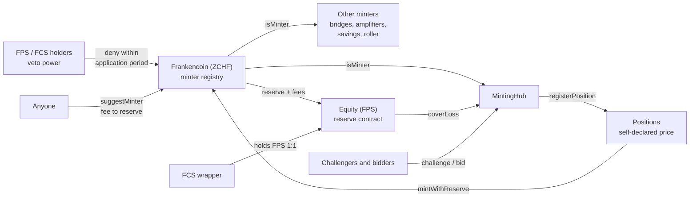
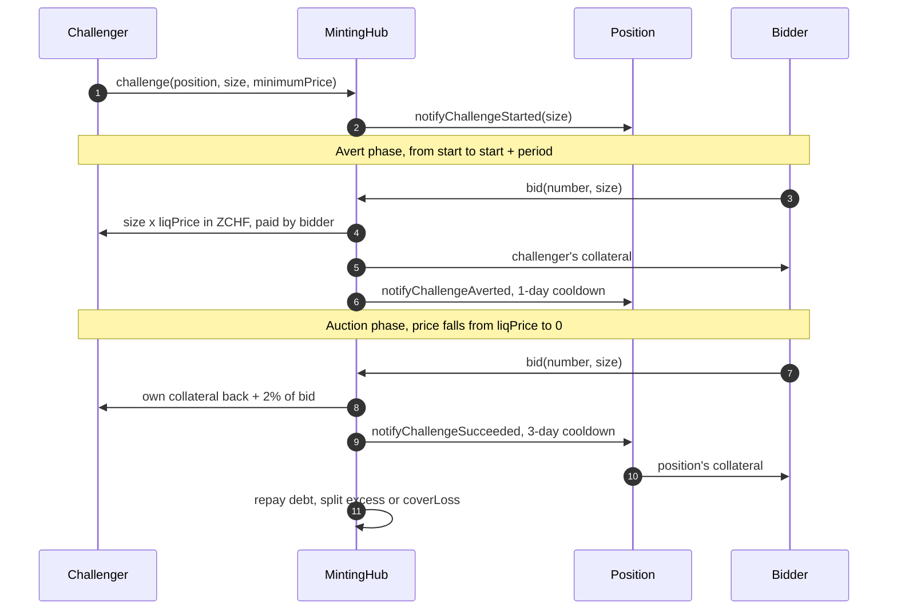
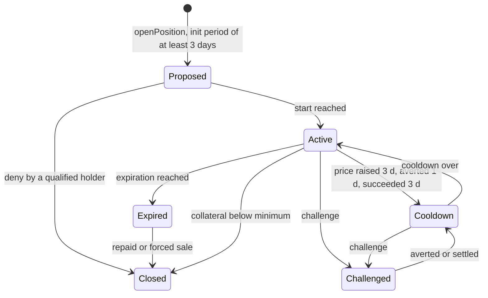

[Frankencoin](https://frankencoin.com) (ZCHF) is an ERC-20 stablecoin on Ethereum, with bridged copies on seven other chains, that is designed to track the Swiss franc. It is minted against crypto collateral, like DAI or LUSD, but it reads no price feed: a borrower declares the liquidation price of their own position, and anyone who thinks that price is too high can start an auction to prove it. Governance works the same way. Nothing is voted in; proposals pass after a waiting period unless a holder with enough voting power vetoes them.

Those two ideas, challenges instead of an oracle and vetoes instead of votes, shape every contract of the system. This article follows them through the source code of the `Frankencoin-ZCHF/Frankencoin` repository at commit `8b4c4ab` (September 2026): the minter registry, the positions and their auctions, the reserve held by the pool-share token FPS and its newer wrapper FCS, the savings module, the bridges and the cross-chain deployment. It then groups what seven audits from 2023 to 2026 found by bug class, and closes with a risk assessment.

> This article has been made with the help of [Claude Code](https://claude.com/product/claude-code) and several custom skills

[TOC]

## What you need to know first

The article assumes familiarity with stablecoins and lending protocols, and relies on the following mechanisms without deriving them.

- **Collateralised debt position (CDP) and liquidation.** A borrower locks collateral and mints a debt token against it; when the collateral is worth too little, a third party repays the debt and takes the collateral at a discount. [MakerDAO]({{site.url_complet}}/2023/11/21/makerdao/) vaults and [Liquity troves]({{site.url_complet}}/2026/10/22/liquity-v1-lusd-troves-stability-pool/) are CDPs. Frankencoin calls them *positions*.
- **Price oracle.** A contract that publishes an off-chain price on-chain, such as a Chainlink feed. Every CDP named above decides liquidations from such a price; Frankencoin decides them from auction results instead.
- **Dutch auction.** An auction whose price starts high and falls over time; the first bidder to accept the current price buys. Frankencoin's challenges end in one, with the price falling linearly to zero.
- **Bonding curve.** A formula that sets the price at which a contract mints or burns its own token as a function of supply or reserves. The pool-share token FPS is issued and redeemed on one.
- **Optimistic (veto-based) governance.** A proposal takes effect after a delay unless someone with enough voting power objects. Safety then depends on someone watching, not on turnout.
- **Time-weighted votes.** Voting power equal to the token balance multiplied by how long it was held, so that freshly bought tokens carry almost no weight. FPS and FCS count votes this way.
- **[ERC-4626](https://eips.ethereum.org/EIPS/eip-4626) vault.** A standard interface for a token that represents shares of an underlying asset, with `deposit`, `redeem` and preview functions. FCS presents FPS behind this interface, with ZCHF as the asset.
- **Cross-chain token pool.** With Chainlink CCIP, a token pool on each chain burns or locks tokens on the source chain and mints or releases them on the destination; a [previous article]({{site.url_complet}}/2026/11/16/chainlink-ccip-architecture/) covers the protocol.

## The system at a glance

The contracts are in `contracts/` of the repository. The main ones, with the name used in the rest of the article:

| Contract | Role |
|---|---|
| `stablecoin/Frankencoin.sol` | The ZCHF token, the minter registry, the reserve accounting (`mintWithReserve`, `burn*`, `coverLoss`) |
| `equity/Equity.sol` (FPS) | Frankencoin Pool Shares: holds the reserve, issues shares on a bonding curve, computes time-weighted votes |
| `equity/shares/FCS.sol` | Frankencoin Shares: wraps FPS one to one as an ERC-4626 vault, now the canonical governance token |
| `minting/MintingHub.sol`, `Position.sol` | Opening, cloning and challenging positions; the auctions |
| `minting/PositionRoller.sol` | Moves debt from one position to another with a flash mint |
| `rate/Leadrate.sol`, `savings/*.sol` | The governance-set base rate and the savings module that pays it |
| `swap/StablecoinBridge.sol` | One-to-one minting against another Swiss franc stablecoin |
| `swap/UniswapAmplifier.sol`, `CurveAmplifier.sol` | Minters that lend the ZCHF side of a liquidity pool position |
| `stablecoin/BridgedFrankencoin.sol`, `bridge/`, `equity/BridgeAccounting.sol` | ZCHF and governance on other chains over CCIP |

The figure shows how value and permissions flow between them.



Two points of the design matter for everything that follows. First, ZCHF is not upgradable, but it accepts new minting modules at any time; the contract comment calls this "flexible but conservative governance" (`Frankencoin.sol:10-16`). Second, loss absorption is layered: a position's own reserve contribution first, then the equity of the FPS holders, then the reserves of other minters (`gitbook/reserve.md`, `gitbook/risks.md`).

## Minters and veto governance

### Proposing a minter

Any address can propose a new minter with `suggestMinter(minter, period, fee, message)` (`Frankencoin.sol:100-112`). The call fails unless the application period is at least `MIN_APPLICATION_PERIOD`, an immutable set to 1,209,600 seconds (14 days) at deployment, and the fee is at least `MIN_FEE` of 1,000 ZCHF. The fee is transferred to the reserve as profit, and the minter becomes active at `block.timestamp + period`. `isMinter` simply checks that this timestamp is set and has passed (`:344-346`).

During the application period, a qualified holder calls `denyMinter` (`:167-172`), which deletes the entry and emits `MinterDenied`. There is no other way to remove a minter: once active, a minter cannot be paused or removed, a property the team accepted when Code4rena raised it in 2023 (finding M-13).

The FCS governance layer added a second route. `MinterGovernance.suggestMinter` requires 60 days and 1,200 ZCHF (`equity/shares/MinterGovernance.sol:16-19`) and records an announcement. Anyone may call `denyUnannouncedMinter` against a minter that was proposed directly on ZCHF without such an announcement; the call uses the FCS contract's own voting power to deny it and pays the caller 10% of a reward pool funded by the announcement fees (`:93-99`). The direct ZCHF route still exists with its 14 days, but as long as the FCS contract is itself qualified in FPS1, a minter that skips the announcement can be vetoed by anyone.

One exception remains: an address that was announced once keeps its announcement after a direct veto on ZCHF, so it can be re-proposed directly with 14 days and `denyUnannouncedMinter` then reverts (FPS2 #028, risk accepted); it is left to qualified holders.

### Vetoes, quorum and time-weighted votes

A veto needs a *qualified* caller. `Governance.checkQualified` adds the caller's votes to those of the helpers who delegated to it, and reverts unless they exceed the quorum (`equity/Governance.sol:78-82`):

```solidity
if (_votes * 10000 <= QUORUM * totalVotes()) revert NotQualified();
```

The quorum depends on which contract is asked:

- **FPS1, the deployed Equity contract** (`0x1bA2…41B2`), requires **at least 2%** of all votes. The mainnet deployment artifact `scripts/deployment/deployments/mainnet/Frankencoin.json`, which embeds the source compiled for ZCHF and the Equity contract it creates, has `QUORUM = 200` and the check `if (_votes * 10000 < QUORUM * totalVotes()) revert NotQualified();`; with a strict `<`, exactly 2% qualifies. `FCS.sol:16` describes the change as "Reduce the veto power threshold from 2% in FPS1 to 1% in FCS", and ChainSecurity's FPS2 report states "a qualifying quorum of 1% of total FPS2 voting power, compared to the 2% threshold in FPS1" (p. 9).
- **FCS and the current source** use `QUORUM = 100`, that is more than **1%**; the comment says it "used to be 200 in earlier versions, most notably in FPS1" (`Governance.sol:12-17`). Exactly 1% is not enough: the comparison was switched to `<=` with FCS (`Governance.sol:80-81`).

The project documentation says otherwise for direct FPS1 actions. Lines 17, 64 and 93 of `gitbook/governance.md` and line 37 of `gitbook/fps-reference.md` state that the same 1% applies. That is true of the current `Equity.sol` source, which inherits the new `Governance.sol`, but not of the deployed FPS1, whose code is immutable and was compiled with `QUORUM = 200`.

An FCS holder acts through the FCS contract, which must itself be qualified in FPS1. The audit notes the consequence: once FCS holds the FPS1 quorum, the effective minimum to act is "as low as 1% of 2%" of FPS1 votes, about 0.02% (pp. 6, 31).

Votes are not balances. FPS stores, for each holder, an anchor time; votes equal balance multiplied by the time since the anchor, with 20 extra bits of sub-second resolution, and receiving tokens moves the recipient's anchor forward in proportion (`Equity.sol:101-151`, `:171-187`). Buying a large block of FPS the day before a vote therefore gives almost no votes. Delegation is transitive and does not remove the delegator's own right to veto.

Two tools destroy votes. `kamikaze` (`:200-220`) lets a holder remove someone else's votes by giving up the same amount of its own. FCS's `shoot`, described below, builds on it.

### What an approved minter can do

The trust placed in a minter is total. `_allowance` returns an infinite allowance whenever the spender is a minter, a position registered by a minter, or the reserve, and the holder has not set an explicit allowance (`Frankencoin.sol:119-128`). A minter can also `mint`, `burnFrom` any holder, and call `coverLoss`. The contract comment is explicit: "We trust minters and the positions they have created to mint and burn as they please".

A hostile minter that survives its application period can therefore drain every balance. The veto window, and people who read proposals during it, are the whole defence.

## Positions

### Opening a position

`MintingHub.openPosition` (`minting/MintingHub.sol:100-147`) takes ten parameters and deploys a full `Position` contract through `PositionFactory`. The hub registers it with ZCHF, charges an opening fee of 1,000 ZCHF and pulls the initial collateral.

| Parameter | Meaning | Checked in code |
|---|---|---|
| `collateral` | ERC-20 token locked | `decimals() <= 24`; must revert on a transfer above balance |
| `minCollateral` | Smallest balance a position or challenge may hold | `minCollateral * liqPrice >= 5,000 ZCHF` |
| `initialCollateral` | First deposit | `>= minCollateral` |
| `mintingMaximum` | Limit shared by the original and its clones | sanity bound on the price |
| `initPeriodSeconds` | Veto window before minting starts | `>= 3 days` (`Position.sol:168`) |
| `expirationSeconds` | Duration after the start | none |
| `challengeSeconds` | Length of each auction phase | **no lower bound** |
| `riskPremiumPPM` | Added to the leadrate | `<= 100%` |
| `liqPrice` | Self-declared liquidation price | `price * minCollateral <= limit * 1e18` |
| `reservePPM` | Share of each mint kept in the reserve | between 2% and 100% |

The collateral check is a probe: the hub tries to transfer `totalSupply() + 1` tokens to a dummy address and expects the call to revert; a token that returns `false` instead is rejected as `IncompatibleCollateral` (`MintingHub.sol:116-122`). The liquidation price is stored with `36 - decimals` decimals, so that multiplying it by a raw collateral amount always gives 36 decimals (`:95-96`).

The init period is the veto window for this position. Until `start`, a qualified holder can call `Position.deny`, which closes the position for good (`Position.sol:246-251`). Proposing a position is thus governed exactly like proposing a minter, with a shorter minimum delay.

### Minting: reserve contribution and upfront interest

`Position.mint` checks that there is no open challenge, no cooldown, that the position is not expired, and that the amount fits in the family limit, then calls `ZCHF.mintWithReserve` (`Position.sol:381-387`). That function splits the gross amount three ways (`Frankencoin.sol:178-189`): the reserve contribution and the interest fee go to the Equity contract, the rest to the borrower, and `minterReserveE6` records the reserve owed back to the borrower on repayment.

Interest is charged once, at mint time, for the whole remaining term. The annual rate is the global leadrate plus the position's risk premium, and the fee fraction is (`Position.sol:366-379`):

$$
\begin{aligned}
f &= \min\left(1,\ \frac{(T_{exp} - \max(t, T_{start})) \cdot (r_{lead} + r_{risk})}{365\ \text{days}}\right) \\
w &= m \cdot (1 - f - \rho)
\end{aligned}
$$

where $$m$$ is the gross amount minted, $$t$$ the current time, $$T_{start}$$ and $$T_{exp}$$ the position's start and expiration, $$r_{lead}$$ and $$r_{risk}$$ the two annual rates, $$\rho$$ the reserve contribution and $$w$$ what reaches the borrower's wallet. The documentation's example (`gitbook/positions/open.md`): a leadrate of 2% and a risk premium of 1% over 365 days give $$f = 3\%$$; a gross mint of 10,000 ZCHF with $$\rho = 10\%$$ sends 1,000 ZCHF to the reserve, 300 ZCHF to equity as interest and 8,700 ZCHF to the borrower. The debt is still 10,000 ZCHF, of which 1,000 ZCHF comes back from the reserve on repayment. Repaying early does not refund the interest.

The collateral condition checked after every adverse change is (`Position.sol:513-516`):

$$
\begin{aligned}
c \cdot P \geq m_{out} \cdot 10^{18}
\end{aligned}
$$

where $$c$$ is the collateral balance, counted as zero below `minimumCollateral`, $$P$$ the liquidation price and $$m_{out}$$ the debt outstanding. The liquidation price is thus the price at which the collateral exactly covers the gross debt, reserve included.

### Cloning and the family limit

A borrower can also copy an existing position instead of proposing a new one. The hub's `clone` function, at `MintingHub.sol:157-169`, creates an [EIP-1167](https://eips.ethereum.org/EIPS/eip-1167) minimal proxy of the original position. `Position.initialize` then copies the parent's price and requires an expiration no later than the original's (`Position.sol:189-195`).

A clone skips the 1,000 ZCHF opening fee and the init period, because the parameters it inherits were already exposed to a veto. The parent must not be challenged, cooling down or expired (`:200`). The original and all its clones share one `limit`, tracked on the original (`:219-241`).

### Adjusting the price and cooldowns

An owner can lower the liquidation price at once if the collateral still covers the debt. Raising it is restricted in the current source: at most three times the current price, and only outside a cooldown, after which minting and withdrawals are blocked for 3 days (`Position.sol:321-333`). Other events also set a cooldown: one day after an averted challenge and three days after a successful one (`:537-543`, `:568`). Price changes are impossible while a challenge is open or after expiry.

The 3-day delay after a price increase is the window for challengers. A borrower who raises the price to mint more must wait three days, during which anyone who disagrees can challenge.

## Challenges: replacing the oracle with an auction

### Starting a challenge

`challenge(position, collateralAmount, minimumPrice)` (`MintingHub.sol:178-194`) pulls the challenger's **own** collateral, of the same token as the position, into the hub. The `minimumPrice` argument protects the challenger: if the owner lowered the price in a front-running transaction, the call reverts with `UnexpectedPrice`. The challenge size must be at least `minimumCollateral`, unless it covers what is left of a partly challenged position (`Position.sol:527-532`).

A challenge then runs in two phases of `challengePeriod` seconds each, which `bid(number, size, postpone)` (`MintingHub.sol:207-220`) dispatches by timestamp.



### Avert phase

Until `start + challengePeriod`, a bid **averts** the challenge (`MintingHub.sol:254-269`). The bidder pays the challenger `size * liqPrice` in ZCHF and receives the challenger's collateral; the position is untouched apart from a one-day cooldown. The challenger may cancel by bidding on its own challenge without paying. A bid in the same block as the challenge is rejected (`require(block.timestamp != _challenge.start)`), a fix for ChainSecurity finding CS-ZCHF-037.

An avert is a sale at the liquidation price. If someone buys the challenger's collateral at that price, the market has confirmed that the collateral is worth at least the declared price, and the position is considered sound. The challenger, who bet the opposite, has sold its collateral at the liquidation price, which it thought too high.

### Auction phase and settlement

If the challenge is still open after the first phase, the auction price falls linearly from the liquidation price $$P$$ at $$t_0 + \tau$$ to zero at $$t_0 + 2\tau$$, where $$t_0$$ is the challenge start and $$\tau$$ the challenge period (`_calculatePrice`, `MintingHub.sol:295-305`):

$$
\begin{aligned}
p(t) = P \cdot \frac{t_0 + 2\tau - t}{\tau}, \qquad t_0 + \tau \lt t \lt t_0 + 2\tau
\end{aligned}
$$

A bid in this phase buys the **position's** collateral at $$p(t)$$, and settlement in `_finishChallenge` (`MintingHub.sol:222-251`) proceeds as follows:

1. The challenger gets its own collateral back. The bidder may instead ask for the return to be postponed into `pendingReturns`, which the challenger claims later; the option exists for tokens whose transfer to the challenger would fail, such as a blacklisted address.
2. The bidder pays the offer $$p(t) \cdot \text{size}$$; 2% of the offer goes to the challenger as a reward (`CHALLENGER_REWARD = 20000` ppm).
3. The position repays $$m_{out} \cdot \text{size} / c$$, the share of the debt matching the collateral sold (`Position.sol:563`), and its minting is blocked for 3 days.
4. If the remaining proceeds exceed that repayment, the excess is split: the reserve contribution ratio of it goes to equity, the rest to the owner. If they are smaller, `coverLoss` takes the difference from the reserve.
5. `burnWithoutReserve` burns the repayment and releases the position's reserve contribution to equity.

The documentation gives a numeric case in `gitbook/reserve.md`. A debt of 5,000 ZCHF is fully liquidated; the position's reserve contribution was 20%, or 1,000 ZCHF; the winning bid is 4,500 ZCHF. The challenger receives 90 ZCHF, 4,410 ZCHF remain against the 5,000 ZCHF burnt, and the 590 ZCHF shortfall comes out of the reserve. The 1,000 ZCHF reserve liability is released at the same time, so equity ends 410 ZCHF higher. The borrower's reserve contribution has absorbed the loss and more.

### Why no oracle is needed, and what that assumes

The auction does two jobs, price discovery and liquidation. An owner who declares too high a price can be challenged by anyone holding the same collateral; defending the price in the avert phase means buying the challenger's tokens at that price, which costs real money if the price is wrong. Nothing in the protocol needs to know the market price; it learns, through bids, whether the market agrees with the declared one.

The argument has conditions, which the documentation states (`gitbook/positions/auctions.md`): challengers must be able to obtain the collateral, and "a collateral asset wholly controlled by the position owner cannot support that mechanism". Auctions also take time. When the challenge period is set to several days, the protocol reacts to a crash days later than an oracle-triggered liquidation would, and the reserve contribution has to cover the price move over that time. The collateral framework sizes it accordingly: retained reserve at least the 99% value-at-risk over twice the auction duration plus 2%, rounded up to 5 percentage points (`frankencoin-collateral-assessments/framework/collateral-risk-framework.md`).

### Expired positions and forced sale

A position that reaches its expiration with debt outstanding is not liquidated by challenge but sold. `buyExpiredCollateral(pos, upTo)` (`MintingHub.sol:348-383`) prices the collateral at ten times the liquidation price at expiry, falling linearly to one times over one challenge period, then to zero over a second one:

$$
\begin{aligned}
p_{exp}(t) = \begin{cases} P + 9P \cdot \dfrac{\tau - \Delta}{\tau} & 0 \leq \Delta \leq \tau \\ P \cdot \dfrac{2\tau - \Delta}{\tau} & \tau \lt \Delta \lt 2\tau \\ 0 & \Delta \geq 2\tau \end{cases}
\end{aligned}
$$

with $$\Delta$$ the time since expiration. `Position.forceSale` repays the debt from the proceeds and the position's assigned reserve, sends any surplus to the owner, and books a loss through `coverLoss` when the collateral is exhausted and the debt is not covered (`Position.sol:433-464`). It is blocked while a challenge is open (`noChallenge`), so that an owner cannot pre-empt a challenge near expiry by forcing a sale on themselves. Both rules are fixes from ChainSecurity's v2024 audit (CS-ZCHF2-001 and -002). The first generation of contracts (`minting/v1/`) had no forced sale at all.

### Position lifecycle



## Reserve and equity: FPS

### Minter reserve and equity

The Equity contract holds one ZCHF balance that serves two purposes. `minterReserve()` is the sum of the reserve contributions still owed back to borrowers; `equity()` is the rest of the balance, the capital of the FPS holders (`Frankencoin.sol:131-161`). Opening fees, minter application fees, interest and liquidation surpluses add to equity; savings interest and liquidation shortfalls are paid from it by `coverLoss`.

`coverLoss` (`Frankencoin.sol:321-330`) transfers the amount from the reserve; if the reserve balance is too small, it transfers what there is and **mints** the rest. Losses never make it revert. Once equity is exhausted, the reserve balance falls below `minterReserve()`, and the functions that return reserves to repaying borrowers scale them down in proportion (`calculateAssignedReserve`, `calculateFreedAmount`, `:284-310`). That is how the third layer of loss absorption, other minters' reserves, takes effect: each repaying borrower recovers less of their contribution.

### The FPS bonding curve

FPS holders own that equity. The share price is set to three times equity per share (`Equity.sol:36`, `:92-99`):

$$
\begin{aligned}
\pi = \frac{3E}{S}
\end{aligned}
$$

where $$E$$ is equity in ZCHF and $$S$$ the FPS supply, so the market capitalisation is always three times the equity. Both directions use the same curve and charge a 0.3% fee. Investing $$a$$ ZCHF mints $$\Delta S$$ new shares, and redeeming $$q$$ shares pays out the proceeds, as computed at `Equity.sol:257-265` and `:316-323`:

$$
\begin{aligned}
\Delta S &= S \cdot \left( \sqrt[3]{\frac{E + 0.997\,a}{E}} - 1 \right) \\
\text{proceeds} &= E \cdot \left( 1 - \left( \frac{S - 0.997\,q}{S} \right)^3 \right)
\end{aligned}
$$

Supply grows with the cube root of equity; the contract's comment gives the table: 1,000 ZCHF of equity for 1,000 FPS at a price of 3, one million for 10,000 FPS at a price of 300. Profits and losses move the price with the supply unchanged.

Three rules restrict the use of FPS:

- **Holding period.** Redemption requires an average holding duration of at least 90 days (`MIN_HOLDING_DURATION`, `:51`, `:117-119`), computed from the same anchor as the votes.
- **Minimum equity.** Investing requires at least 1,000 ZCHF of equity, and at least one share must remain after a redemption (`:232-235`, `:318`).
- **Recapitalisation.** When equity falls below 1,000 ZCHF, a qualified holder may call `restructureCapTable` and burn the FPS of any listed addresses without paying them (`:338-345`), which is the path for recapitalising the system after its equity has been wiped out.

### FCS: the share wrapper

FCS, for Frankencoin Shares, is defined in `equity/shares/FCS.sol`. The documentation now calls it the "canonical governance and share token" (`gitbook/README.md`). It was audited by ChainSecurity under the name FPS2 and renamed afterwards. FCS holds FPS one to one and exposes it as an ERC-4626 vault with ZCHF as the asset:

- **Entry.** `wrap` exchanges FPS for FCS and credits the votes the holder lost in FPS1 (`FCS.sol:52-61`); `deposit` and `mint` invest ZCHF into FPS1 through the vault interface.
- **Binding.** FCS is *binding* when it holds more than two thirds of all FPS1 votes (`isBinding`, `:77-79`). Only then are redemptions through FCS open, and only if FCS's own FPS1 holding satisfies the 90-day rule (`:68-70`).
- **`shoot`.** While binding, anyone can call `shoot(target)`; the function has no caller check beyond `isBinding()` and a guard against shooting FCS itself. It destroys the target's FPS1 votes through `kamikaze`, paid for with an equal amount of the FCS contract's own FPS1 votes (`:89-97`). Above two thirds, each shot raises FCS's share of the votes, which pushes FPS1 holders to migrate.
- **Exit.** `unwrap` is allowed only to holders whose holding duration is at or above the FCS average (`:110-115`), which prevents gas-only wrap and unwrap loops that would drain FCS's votes.

Redemptions through FCS pay the FPS1 proceeds multiplied by a discount factor (`FCSMintRedeem.sol:343-348`):

$$
\begin{aligned}
d = \left( \frac{S - q/2}{S + R} \right)^4
\end{aligned}
$$

where $$S$$ is the FCS supply, $$q$$ the shares being redeemed and $$R$$ the recent redemptions, which decay linearly to zero over a 7-day `RECOVERY_PERIOD`. The withheld ZCHF stays in equity. With no recent redemptions, redeeming 10% of supply at once gives $$d = 0.95^4 \approx 0.81$$, so about a fifth of the proceeds stays behind; a small redemption gets close to the full price. `withdraw` is capped at 10% of supply per call, and the contract comments recommend spreading large exits over days or weeks (`:201-262`).

## Leadrate and savings

The leadrate is the base interest rate. A qualified holder proposes a new rate with `Leadrate.proposeChange`, and anyone applies it after 7 days (`rate/Leadrate.sol:40-55`). Positions read it at every mint through the hub's `rate()`; it is the $$r_{lead}$$ of the fee formula above. Under FCS, `InterestGovernance` exposes separate proposals for the borrowing and the savings rate.

The savings module in `savings/AbstractSavings.sol` pays the savings leadrate to deposited ZCHF as simple interest. Interest accrues in "ticks", a rate in ppm multiplied by seconds. A deposit starts earning after a 3-day delay, an optional referrer may take up to 25% of the interest, and interest is paid on refresh by `ZCHF.coverLoss` (`:30`, `:82`, `:218`). Savings are thus a cost to equity, and, like any loss, they are minted once the reserve balance is empty. The legacy `SavingsV2` contract still deployed for the V2 hub differs: it locks withdrawals while interest ticks lie in the future and has no referral (`minting/v2/SavingsV2.sol`).

## Bridges, amplifiers and other minters

Positions are one kind of minter among several. Each of the following was or must be approved through the same veto process:

- **`StablecoinBridge`** mints ZCHF one to one against another Swiss franc stablecoin, up to an immutable `limit`, and stops minting 52 weeks after deployment (`swap/StablecoinBridge.sol:49-78`). Mainnet bridges exist for XCHF, VCHF and CHFAU. The bridge has no loss write-off: if the other coin fails, the ZCHF minted against it stays in circulation.
- **`UniswapAmplifier`** lends the ZCHF side of a Uniswap V3 ZCHF/USD liquidity position, with the dollar side provided by the owner. The range is limited to about -14%/+10% around a price anchor fixed at deployment, and the owner must provide dollars worth at least four fifths of the borrowed ZCHF at the anchor (`swap/UniswapAmplifier.sol:16-29`, `:47-48`, `:162`). Its own comment warns that the amplifier "becomes exploitable as soon as the market price falls more than about 41% below the anchor price".
- **`CurveAmplifier`** applies the same idea to a Curve pool, requiring the pool's oracle price to stay within 20% of the anchor recorded at deployment (`swap/CurveAmplifier.sol:18`, `:95`).
- **`PositionRoller`** is a minter so that it can flash-mint: `roll` mints the repayment amount to itself, repays the old position, withdraws the collateral, mints from or clones the target position, and burns the flash amount from the caller (`minting/PositionRoller.sol:112-132`). Borrowers use it to extend a maturing loan.
- **`TransferWithAuthorization`** is an [EIP-3009](https://eips.ethereum.org/EIPS/eip-3009) sidecar. Its deployment steps are to propose it as a minter, only to obtain the infinite allowance, which it then uses to execute signed transfers on behalf of holders (`transfer/TransferWithAuthorization.sol:14-21`). Whether it is an active minter today was not checked on chain.

The last item shows how the minter model can be used beyond minting: the infinite allowance makes any approved contract a fully trusted spender.

## Cross-chain deployment

ZCHF exists on Polygon, Arbitrum, Optimism, Base, Avalanche, Gnosis and Sonic as `BridgedFrankencoin`, at the same address on each, with the same minter and veto model (`exports/address.config.ts`). The CCIP token pool on each chain is a minter. Accounting flows back to mainnet:

- **Profits and losses.** On an L2, `coverLoss` mints any shortfall and books it as `accruedLoss`; later profits burn it down. `synchronizeAccounting()` sends the net result to the mainnet `BridgeAccounting`, which collects profits into the reserve or covers the loss (`stablecoin/BridgedFrankencoin.sol:206-257`, `equity/BridgeAccounting.sol:27-69`).
- **Votes.** Governance on an L2 needs mainnet voting power. `GovernanceSender.pushVotes` and `MainnetVotes.pushFCSVotes` send snapshots of selected holders' votes over CCIP to `BridgedGovernance` and `BridgedVotes`. Snapshots cross, tokens do not, and a sync overwrites local delegations (`gitbook/governance.md`).
- **Bridge administration.** `CCIPAdmin` manages the token pool. Adding a remote pool or a chain is a proposal with a 7-day veto window, transferring the admin role takes 21 days, and setting rate limits is immediate for a qualified holder (`bridge/CCIPAdmin.sol:103-212`).

ChainSecurity's trust model for FCS states the dependency plainly: "If CCIP can relay incorrect values, Governance on that chain is fully compromised, which can lead to minting unlimited ZCHF on that chain" (FPS2 report, p. 9).

## What the audits found

### The reports

The repository and the auditors' sites hold seven stored reports, covering three generations of the code. A separate ChainSecurity CCIP Bridge assessment, cited by the FPS2 report, is not among them.

| Report | Date | Scope | Findings as rated |
|---|---|---|---|
| Blockbite | 2023-02 | V1 core | 3 High, 3 Medium, 6 Low |
| [Code4rena contest](https://code4rena.com/reports/2023-04-frankencoin) | 2023-04, report 2023-06-09 | V1 core, 949 lines | 6 High, 15 Medium |
| ChainSecurity | 2023-10-30 | V1 core and bridge | 1 Critical, 3 High, 11 Medium, 16 Low |
| Decurity | 2024-09 | V2 minting and savings | 3 Critical, 3 High, 4 Medium, 5 Low |
| ChainSecurity *v2024* | 2024-11-28 | V2 | 2 High, 4 Medium, 4 Low |
| ChainSecurity *Uniswap Liquidity Amplifier* | 2026-07-30 | `UniswapAmplifier` | 1 Low, 6 Informational |
| [ChainSecurity *FPS2*](https://reports.chainsecurity.com/Frankencoin/ChainSecurity_Frankencoin_FPS2_Audit.pdf) | 2026-07-14 | FCS, governance modules, CCIP admin | 1 Critical, 3 High, 4 Medium, 9 Low, 11 Informational |

Across them: 5 Critical, 20 High and 41 Medium findings. The totals add ratings from auditors with different severity scales, and not every report uses a Critical level, so they describe volume rather than a common measure of risk. The five Critical ones are:

- **ChainSecurity V1, CS-ZCHF-034:** a dust position kept alive by a parallel self-challenge.
- **Decurity 5.1:** `buyExpiredCollateral` front-run by a price change.
- **Decurity 5.2:** a clone that could be re-initialised with a malicious parent.
- **Decurity 5.3:** a challenge period of a few seconds.
- **FPS2 #001:** `shoot` enabling a governance takeover.

### Bug classes

The findings cluster around the features that make Frankencoin unusual. The "today" column is checked against commit `8b4c4ab` and describes the source, not necessarily the deployed contracts.

| Class | Representative findings | Today |
|---|---|---|
| Competing liquidation paths | CS-ZCHF2-001: a forced sale of an expired position made challenging pointless; Decurity 5.1: the owner changed the price after expiry and front-ran the sale | `forceSale` is `noChallenge`, price changes require `alive` |
| Bad debt and reserve accounting | CS-ZCHF2-002: `forceSale` did not book bad debt; Code4rena H-06: the challenger reward, computed from the owner-set price, could drain the reserve | Reward is 2% of the bid; `forceSale` calls `coverLoss` |
| Owner-set values without bounds | Code4rena H-05: `adjustPrice(type(uint256).max)` made challenge arithmetic overflow; Decurity 5.3/5.6: a 30-second challenge period lets the owner win its own auction | Price raise capped at 3x; **no minimum challenge period**, left to the veto (acknowledged) |
| Dust and minimum collateral | CS-ZCHF-034; Code4rena H-03: a top-up just before settlement avoided the cooldown | Positions close below `minimumCollateral`; the 3-day cooldown is unconditional |
| Liquidation denial of service | Code4rena H-04: ownership moved to `address(0)` broke settlement; M-07: a blacklisted recipient stalls it | Zero owner rejected; challenger returns can be postponed, the position's own collateral transfer is still a push |
| Reentrancy and token behaviour | Code4rena H-02: double-entry-point collateral; CS-ZCHF-038: reentrant collateral minting during liquidation | In `bid`, the averting path transfers collateral before updating the challenge (`MintingHub.sol:263-268`); safe only for tokens without transfer hooks, which governance must keep out |
| Governance and votes | FPS2 #001: at a 50% binding threshold, shooting every other holder kept FCS binding and allowed unvetoable minting; #004: free wrap and unwrap loops drained FCS votes | Binding at 2/3, unwrap only above average holding, redemptions only while binding |
| Savings | Decurity 5.4 and 5.5: reward cursor advanced without payment, deposits on behalf of someone else blocked their withdrawal | 5.4 acknowledged, 5.5 fixed with the griefing risk accepted, both for `SavingsV2`; `AbstractSavings` has no withdrawal lock |
| Chain portability | Code4rena M-04: `block.number` used as a clock; FPS2 #006: old CCIP vote snapshots can be replayed | Timestamps now; stale snapshots accepted as a risk |

Code4rena's H-05 shows why an oracle-free design has its own attack surface. The owner sets the price that the liquidation arithmetic multiplies, so an extreme price is a denial of service on the one mechanism that replaces the oracle. The fix bounds the input in two ways: a raise is limited to 3x per step, and `_setPrice` checks `price * minimumCollateral <= limit * 1e18` (`Position.sol:335-338`).

### What is accepted rather than fixed

Several items stay in the code by design or by an accepted risk. They are part of the system's threat model rather than open bugs:

- No minimum challenge period; the veto and the front end are expected to reject short ones (Decurity 5.3).
- `coverLoss` mints when the reserve is empty, so losses dilute holders instead of reverting.
- A minter cannot be removed after its application period (Code4rena M-13).
- `restructureCapTable` burns FPS without payment once equity is below 1,000 ZCHF.
- An FPS redemption can front-run the booking of a loss (Code4rena M-15).
- Transfer-hook and double-entry collateral are kept out by governance, not by code.
- The stablecoin bridge has no write-off path (CS-ZCHF-002); its limit and expiry cap the exposure.
- FPS2 #006 and #025: stale cross-chain vote snapshots can be applied, and CCIP rate-limit changes take effect at once.

No audit among the stored sources covers `CurveAmplifier`, the bridged leadrate or the EIP-3009 sidecar. The team's own reviews of `CurveAmplifier` and the sidecar are design notes in `reports/`; nothing there covers the bridged leadrate. The FPS2 report had `AbstractLeadrate` and `BridgedFrankencoin` in scope, and it refers to a separate "CCIP Bridge code assessment" (p. 9) that is not among the stored sources.

## Conclusion

Frankencoin replaces the two external inputs most CDP stablecoins depend on, a price oracle and an active governance majority, with mechanisms that react to disagreement.

- **Prices come from auctions.** A borrower declares a liquidation price; a challenger who disagrees posts the same collateral; a bid at the declared price averts the challenge, otherwise a Dutch auction sells the position's collateral and pays the challenger 2% of the bid.
- **Governance is a veto.** Minters, positions, rate changes and bridge changes pass after a delay unless a qualified holder objects: at least 2% of FPS1 votes in the deployed contract, more than 1% in FCS and the current source.
- **Approved minters are fully trusted.** They mint, burn and spend any balance without allowance, so the application period is the only protection against a bad one.
- **Losses are layered.** The position's reserve contribution, then FPS equity, then other minters' reserves; `coverLoss` mints what the reserve cannot pay.
- **FPS and FCS hold that equity.** FPS is issued on a bonding curve at three times equity; FCS wraps it as an ERC-4626 vault, becomes binding above two thirds of the votes and discounts large redemptions.
- **The audit history** follows the design: competing liquidation paths, owner-set values without bounds, dust positions, transfer-hook collateral and vote mechanics account for most of the 5 Critical and 20 High findings.
- **The main risks** are a hostile minter or position that nobody vetoes, collateral that challengers cannot obtain or that falls faster than an auction runs, dependence on CCIP for the L2 deployments, and dilution through `coverLoss` once the reserve is empty.


## Annex

### Key Terms

| Term | Definition |
|------|------------|
| **CDP** | Collateralised debt position: collateral locked in a contract against which a debt token is minted; Frankencoin calls it a position. |
| **Price oracle** | A contract that publishes an external price on-chain; Frankencoin's liquidation logic reads none. |
| **Dutch auction** | An auction whose price falls over time until a bidder accepts it; Frankencoin's auction phase falls linearly to zero. |
| **Bonding curve** | A formula that sets the issue and redemption price of a token from supply or reserves; FPS uses one with price equal to three times equity per share. |
| **Veto governance** | Proposals take effect after a delay unless a qualified holder objects; Frankencoin uses it for minters, positions, rates and bridge changes. |
| **Quorum** | The share of total votes a caller needs to be qualified: at least 2% in the deployed FPS1, more than 1% in FCS and the current source. |
| **Time-weighted votes** | Votes equal to balance multiplied by holding time, tracked with an anchor that moves forward when tokens are received. |
| **Minter** | A contract approved after its application period; it can mint, burn and spend any ZCHF balance without allowance. |
| **Application period** | The veto window before a minter becomes active, at least 14 days on the deployed ZCHF and 60 days through FCS `MinterGovernance`. |
| **Position** | A contract holding one borrower's collateral and debt, created by `MintingHub` with a self-declared liquidation price. |
| **Liquidation price** | The owner-set price per collateral unit at which the collateral exactly covers the gross debt; the reference for challenges. |
| **Reserve contribution** | The fraction of each mint kept in the Equity contract and returned on repayment; it absorbs the first loss of the position. |
| **Family limit** | The minting limit shared by an original position and all its clones, tracked on the original. |
| **Challenge** | A claim that a position's price is too high, backed by posting the same collateral; it starts the avert phase. |
| **Avert phase** | The first challenge phase, in which a bidder buys the challenger's collateral at the liquidation price and the position stays untouched. |
| **Forced sale** | The sale of an expired position's collateral, priced from ten times the liquidation price down to zero over two challenge periods. |
| **FPS** | Frankencoin Pool Shares, the Equity contract's token, whose holders own the equity and vote. |
| **FCS** | Frankencoin Shares, an ERC-4626 wrapper holding FPS one to one, binding above two thirds of FPS votes, now the canonical governance token. |
| **Leadrate** | The governance-set base rate, applied after a 7-day delay, added to the risk premium for borrowers and paid to savers. |
| **`coverLoss`** | The ZCHF function that pays a minter's loss from the reserve and mints the remainder when the reserve is empty. |

### Invariants

| Invariant | Enforced by | Breaks if |
|-----------|-------------|-----------|
| A minter is active only after its application period passed without a veto. | `isMinter` checks `block.timestamp >= minters[m]`; `denyMinter` only before that time. | Nobody qualified watches the proposal, or the quorum can be reached cheaply. |
| A position holds collateral worth at least its debt at its own price: $$c \cdot P \geq m_{out} \cdot 10^{18}$$. | `_checkCollateral` after mint, withdraw and price changes (`Position.sol:513-516`). | A path changes collateral, debt or price without calling it. |
| A position with less than `minimumCollateral` is closed. | `_sendCollateral` closes on every outgoing transfer (`Position.sol:497-507`). | A new exit path sends collateral without `_sendCollateral`. |
| No position mints during a challenge, a cooldown, before start or after expiry. | `noChallenge noCooldown alive` on `_mint`. | A modifier is dropped on a new mint path, such as a roller. |
| A price increase is at most 3x and is followed by 3 days without minting. | `_preparePriceIncrease` (`Position.sol:330-333`), in the current source only; the deployed V2 hub has the cooldown but not the 3x cap. | A position is created by a hub without the cap, such as V2. |
| A forced sale cannot run while a challenge is open. | `forceSale` is `noChallenge`. | The modifier is removed (CS-ZCHF2-001). |
| Equity equals the reserve balance minus the minter reserve, floored at zero. | `Frankencoin.equity()`. | A minter burns with a reserve ratio different from the one it minted with. |
| FCS redemptions are possible only while FCS is binding. | `redemptionsEnabled` (`FCS.sol:68-70`). | Binding is redefined below 2/3 (FPS2 #001). |

### Risks

The risks below combine the protocol's own disclosure page (`gitbook/risks.md`), the audit history and the code. Points that come from this article's reasoning rather than a source are marked (*derived*). On-chain ownership and role getters were not queried for this article; see Gaps.

#### Smart contracts and transparency

- **Immutable core, many audits.** ZCHF and Equity have no owner, no pause and no upgrade path (`Frankencoin.sol`, `Equity.sol`); the rules cannot change under a holder, and bugs cannot be patched in place. Fixes ship as new hubs, positions or modules proposed through the veto process, so several generations (V1, V2, current source) run side by side with different rules.
- **Source versus deployment.** This article describes the source at `8b4c4ab`. Which hub, if any, runs the current `minting/` code is not recorded in the repository's deployment exports; the deployed V2 hub lacks, for example, the 3x price-raise cap.
- **Modules without a stored audit.** `CurveAmplifier`, the bridged leadrate and the EIP-3009 sidecar have no external audit among the stored reports; a ChainSecurity CCIP Bridge assessment cited by the FPS2 report was not read and may cover part of the bridged code.

#### External dependencies

- **No price oracle for liquidations.** The core does not depend on a feed, which removes oracle manipulation and staleness from the liquidation path. The `Arbitrage` helper and the amplifiers do read market prices, and the amplifiers depend on Uniswap or Curve pool state.
- **CCIP.** On every L2, governance and supply depend on CCIP delivering correct messages; the audit's trust model says a false relay compromises governance on that chain and can mint unlimited ZCHF there. Rate limits bound the flow, and qualified holders can change them immediately.
- **Other stablecoins.** Each `StablecoinBridge` imports the credit risk of the coin it accepts, up to its limit, with no write-off path.

#### Depeg

- **What holds the peg.** The documentation says ZCHF "has no fixed redemption promise for Swiss francs" and that collateral, reserves, borrowing costs and market activity support its exchange rate (`gitbook/README.md`). In more detail (*derived*), the peg rests on borrowers needing ZCHF to repay, on positions being liquidated before their collateral falls below the debt, and on the bridges' one-to-one minting while they are open.
- **Downward.** A collateral fall faster than an auction can run, or collateral nobody can bid for, leaves bad debt. Once equity and the minter reserves are exhausted, `coverLoss` mints the shortfall, and ZCHF becomes partly unbacked; the documentation warns that aggregate collateral above supply does not rule out a shortfall, because one position's collateral does not cover another's debt.
- **Upward.** Repayment demand near maturities can push ZCHF above parity, the "short squeeze" in `gitbook/risks.md`.

#### Collateral and market risk

- **Reaction time.** When challenge periods last days, the reserve contribution must cover the price move over two auction phases; the collateral framework sizes it with a 99% value-at-risk over twice the auction duration plus 2%.
- **Challenger access.** Challenges need challengers who hold or can borrow the collateral. A thinly traded or owner-controlled token defeats the mechanism (`gitbook/positions/auctions.md`).
- **Token behaviour.** Pausable, blacklistable or hook-enabled tokens can block settlement or reopen the reentrancy ordering in `bid`; only the veto review keeps them out.

#### Liquidity

- **ZCHF holders** exit through market liquidity; selling into a thin pool costs a spread (the documentation's example: 100,000 ZCHF at an average 0.98).
- **FPS holders** cannot redeem before a 90-day average holding period; **FCS holders** redeem only while FCS is binding, at a discount that grows with the size of recent redemptions, with `withdraw` capped at 10% of supply per call.
- **Savers** using `SavingsV2` find withdrawals locked while their interest ticks lie in the future. This is by design: `withdraw` reverts with `FundsLocked` at `minting/v2/SavingsV2.sol:145-148`. A third party can extend the lock by depositing on someone's behalf, a griefing risk the team accepted (Decurity 5.5).

#### Centralisation and governance

- **No admin key in the core.** Power lies with holders above the quorum, each able to veto alone. A single wallet with at least 2% of FPS1 votes, or a group delegating to one, can block any proposal; through FCS, about 0.02% of FPS1 votes can act (FPS2 report, pp. 6 and 31).
- **Monitoring is the security model.** A hostile minter or a mispriced position passes if nobody qualified vetoes it in time. The design assumes holders with enough at stake watch every proposal; the audit adds the assumption that no malicious group holds more than half of FCS votes after binding.
- **`shoot` and `restructureCapTable`** let one group of holders destroy another's votes or balances under specific conditions, by design.
- **Off-chain components.** The front end, the Ponder indexer, the API and the notification bot shape what users see; none controls funds.

#### Loss sharing

- **First loss:** the liquidated position's reserve contribution. **Second:** FPS/FCS equity, including through savings interest. **Third:** the reserve contributions of every other borrower, who recover less on repayment. **Last:** ZCHF holders, through minting of unbacked ZCHF by `coverLoss`.
- Borrowers in sound positions can therefore lose part of their reserve without having been liquidated (`gitbook/risks.md`, "Third Line Bailout").

#### Regulatory

- ZCHF has no issuer that promises redemption in francs at par, unlike the issuer-backed model of e-money tokens; how frameworks such as [MiCA]({{site.url_complet}}/2026/09/17/mica-stablecoins-asset-referenced-tokens-e-money-tokens/) treat such a token is not settled by the sources (*derived*). The project publishes a compliance page.

#### Summary

| Risk | Where it comes from | What the design does about it | What remains |
|---|---|---|---|
| Hostile minter or position | Infinite allowance of minters; owner-set prices | Application period and veto; 3-day init period for positions | Depends on qualified holders watching every proposal |
| Bad debt | Collateral falls faster than a challenge runs | Reserve contribution sized for two auction phases; layered loss absorption | Minting through `coverLoss` once the reserve balance is exhausted |
| Illiquid or hostile collateral | Challengers cannot obtain the token; hooks, pauses, blacklists | Collateral assessments; transfer probe; postponed returns | Enforcement is governance, not code |
| Short challenge period | No lower bound in `openPosition` | Veto and front end | A position that passes the veto with a tiny period |
| CCIP failure | L2 supply and votes rely on CCIP messages | Rate limits; 7- and 21-day delays on pool changes | Instant rate-limit changes; stale snapshots accepted |
| Bridged stablecoin default | `StablecoinBridge` mints 1:1 | Limit and 52-week horizon | No write-off path |
| FCS exit cost | Discount on large redemptions | 7-day recovery, 10% withdraw cap | Holders who must exit fast take the discount |
| Version spread | Old hubs and savings stay deployed | New modules through the veto | V1/V2 positions keep their own rules and known issues |

## Frequently Asked Questions

**Q: How does Frankencoin decide that a position should be liquidated without a price oracle?**

It does not decide in advance. Anyone who thinks a position's declared liquidation price is above the market can challenge it by posting the same collateral. If someone buys that collateral at the liquidation price during the avert phase, the price is considered justified and the position is left alone. If nobody does, the auction phase sells the position's collateral at a falling price, which repays the debt and reveals what the collateral is worth.

**Q: What is the difference between the avert phase and the auction phase, and who loses in each?**

In the avert phase, a bidder buys the *challenger's* collateral at the liquidation price; the challenger has sold at a price it thought too high, and the position only gets a one-day cooldown.

In the auction phase, the bidder buys the *position's* collateral at a price falling linearly to zero. The challenger gets its collateral back plus 2% of the bid; the position repays the matching share of its debt, and any shortfall is taken from the reserve.

**Q: Why is the quorum given as 2% in some places and 1% in others?**

The deployed FPS1 Equity contract was compiled with `QUORUM = 200` (2%), as its mainnet deployment artifact shows, while the current `Governance.sol` and the FCS wrapper use 1%; `FCS.sol:16` and ChainSecurity's FPS2 report (p. 9) say the same. The documentation pages that give 1% for direct FPS1 actions describe the current source, not the deployed contract.

A direct veto on FPS1 needs at least 2% of FPS1 votes; because the comparison is strict, exactly 2% qualifies. A veto through FCS needs more than 1% of FCS votes, and the FCS contract itself must be above the FPS1 quorum, so the effective share of FPS1 votes can be as low as 1% of 2%, about 0.02%.

**Q: A borrower mints 10,000 ZCHF gross with a 10% reserve and a 3% annual rate over one year. What does the wallet receive, and what happens to the rest?**

The wallet receives 8,700 ZCHF:

- 1,000 ZCHF (10%) goes to the Equity contract as the reserve contribution and is returned when the debt is repaid, unless losses have impaired the reserve.
- 300 ZCHF (3% for one year) goes to equity as interest, paid upfront and not refunded on early repayment.

The debt recorded in the position is the full 10,000 ZCHF.

**Q: Which layers absorb a liquidation loss, and why can a borrower who was never liquidated lose money?**

The liquidated position's own reserve contribution comes first, then the equity owned by FPS and FCS holders. When equity is exhausted, the reserve balance drops below the sum of all reserve contributions, and `calculateAssignedReserve` scales every borrower's refund down in proportion. A borrower in a healthy position therefore recovers less of their contribution on repayment. If even that is not enough, `coverLoss` mints the remainder, which dilutes ZCHF holders.

**Q: Why did ChainSecurity rate the FCS `shoot` function Critical, and what changed?**

`shoot` is permissionless while FCS is binding: anyone can call it to destroy an outside FPS1 holder's votes, at the cost of the same amount of the FCS contract's own FPS1 votes. With binding defined at 50%, each shot kept FCS just above 50%.

An outside FPS1 holder could therefore shoot every other holder, then push FCS below binding and drain its votes with free wrap and unwrap loops, and finally submit a position with bad collateral that nobody was left to veto.

Binding now requires more than two thirds, a level at which each shot increases FCS's share; unwrapping requires an above-average holding duration, and redemptions are allowed only while binding.

**Q: Why does the short challenge period found by Decurity remain in the code?**

A challenge period of a few seconds lets an owner avert every challenge cheaply and later buy the collateral back for almost nothing. The team treats the challenge period as a parameter that governance reviews during the init period: a position with an unreasonable period should be denied, and the front end enforces a minimum. The code has no lower bound, so the protection depends on the veto.

## Gaps

These points are not settled by the sources read for this article and should be checked before relying on it.

| Gap | Why it matters | What to read or verify |
|-----|----------------|------------------------|
| Which hub runs the current `contracts/minting/` code, if any, is not recorded in the deployment exports; the deployed V2 hub differs (no 3x cap). | Several behaviours described here may apply only to positions created by a newer hub. | `ignition/deployments/` and the verified sources of hubs newer than `0xDe12…3557` on [Etherscan](https://etherscan.io/address/0xDe12B620A8a714476A97EfD14E6F7180Ca653557). |
| The documentation (`gitbook/governance.md` lines 17, 64, 93; `gitbook/fps-reference.md` line 37) gives 1% for direct FPS1 actions, which disagrees with the deployed code (`QUORUM = 200` in the mainnet deployment artifact) and with `FCS.sol:16`. | A reader of the docs would understate the FPS1 veto threshold. | The [governance page of the documentation repository](https://github.com/Frankencoin-ZCHF/gitbook/blob/8512bc05f312fc6624b411577a3cbfea715a27cd/governance.md); a byte comparison of [Equity `0x1bA2…41B2` on Etherscan](https://etherscan.io/address/0x1bA26788dfDe592fec8bcB0Eaff472a42BE341B2) with the artifact was not made. |
| On-chain getters (minters list, rate limits, `isBinding`, bridge limits and horizons) were not queried. | The risk section describes code, not the current deployed state. | Read calls on the addresses in `exports/address.config.ts` of the [pinned repository](https://github.com/Frankencoin-ZCHF/Frankencoin/blob/8b4c4ab67bb361b91d58c474b87f4608fc4c0566/exports/address.config.ts). |
| Which stablecoin bridges are still open is not settled: the documentation calls the XCHF and VCHF expiry of 15 April 2026 historical. | The exposure to other Swiss franc stablecoins depends on it. | The bridges' `horizon()` and `minted()` on chain, and the [governance application](https://app.frankencoin.com/governance). |
| The ERC-4626 classification of FCS is only partial: ChainSecurity found deviations, some acknowledged (#005, #021). | An integrator relying on strict ERC-4626 semantics may be surprised. | Findings #005 and #021 of the [FPS2 report](https://reports.chainsecurity.com/Frankencoin/ChainSecurity_Frankencoin_FPS2_Audit.pdf). |
| No external audit among the stored sources covers `CurveAmplifier`, the bridged leadrate or the EIP-3009 sidecar; the FPS2 report (p. 9) refers to a separate CCIP Bridge code assessment that was not read. | These modules have no review history in this article. | ChainSecurity's public report site (the [FPS2 report](https://reports.chainsecurity.com/Frankencoin/ChainSecurity_Frankencoin_FPS2_Audit.pdf) is hosted there) for the CCIP Bridge assessment and newer Frankencoin reports, and the team's design notes on `CurveAmplifier` and the sidecar in `reports/` of the [pinned repository](https://github.com/Frankencoin-ZCHF/Frankencoin/tree/8b4c4ab67bb361b91d58c474b87f4608fc4c0566/reports). |
| Finding counts come from per-report digests; the Blockbite and Decurity PDFs were not re-read for this article. | Totals in the audit table could be off by a few. | `audits/V1/blockbite-audit.pdf` and `audits/V2/frankencoin-audit-report-2024-1.1.pdf` in the [pinned repository](https://github.com/Frankencoin-ZCHF/Frankencoin/tree/8b4c4ab67bb361b91d58c474b87f4608fc4c0566/audits). |
| The regulatory remark (no issuer promising redemption at par, unlike e-money tokens) is the article's inference. | It is not a legal assessment. | The project's [compliance page](https://www.frankencoin.com/compliance#compliance-summary) and the MiCA texts. |
| The definitions of CDP, Dutch auction, bonding curve and optimistic governance in the prerequisites come from general knowledge. | They frame the reading but are not from the Frankencoin sources. | Compare with the site's [MakerDAO]({{site.url_complet}}/2023/11/21/makerdao/) and [Liquity V1]({{site.url_complet}}/2026/10/22/liquity-v1-lusd-troves-stability-pool/) articles, and with the [Frankencoin documentation](https://docs.frankencoin.com) for the protocol-specific use. |

## References

### Analyzed source

- [Frankencoin-ZCHF/Frankencoin](https://github.com/Frankencoin-ZCHF/Frankencoin) — analyzed at commit [`8b4c4ab67bb361b91d58c474b87f4608fc4c0566`](https://github.com/Frankencoin-ZCHF/Frankencoin/tree/8b4c4ab67bb361b91d58c474b87f4608fc4c0566), 2026-11-23 (contracts, `exports/`, `audits/`)
- [Frankencoin-ZCHF/gitbook](https://github.com/Frankencoin-ZCHF/gitbook) — analyzed at commit [`8512bc05f312fc6624b411577a3cbfea715a27cd`](https://github.com/Frankencoin-ZCHF/gitbook/tree/8512bc05f312fc6624b411577a3cbfea715a27cd), 2026-11-23 (published at [docs.frankencoin.com](https://docs.frankencoin.com))
- [Frankencoin-ZCHF/frankencoin-collateral-assessments](https://github.com/Frankencoin-ZCHF/frankencoin-collateral-assessments) — analyzed at commit [`8db997f73e736fcd82f9ffba1be6f238a3cd14b2`](https://github.com/Frankencoin-ZCHF/frankencoin-collateral-assessments/tree/8db997f73e736fcd82f9ffba1be6f238a3cd14b2), 2026-11-23 (`framework/collateral-risk-framework.md`)
- [code-423n4/2023-04-frankencoin-findings](https://github.com/code-423n4/2023-04-frankencoin-findings) — report read at commit [`df70ee616c774ecd7a381e1555df4dcf47589690`](https://github.com/code-423n4/2023-04-frankencoin-findings/tree/df70ee616c774ecd7a381e1555df4dcf47589690), 2026-11-23

### Audit reports

- Blockbite, *Audit report Frankencoin*, February 2023: [`audits/V1/blockbite-audit.pdf`](https://github.com/Frankencoin-ZCHF/Frankencoin/blob/8b4c4ab67bb361b91d58c474b87f4608fc4c0566/audits/V1/blockbite-audit.pdf)
- [Code4rena, *Frankencoin* contest report](https://code4rena.com/reports/2023-04-frankencoin), 2023-06-09
- ChainSecurity, *Code Assessment of the Frankencoin Smart Contracts*, 2023-10-30: [`audits/V1/ChainSecurity-audit.pdf`](https://github.com/Frankencoin-ZCHF/Frankencoin/blob/8b4c4ab67bb361b91d58c474b87f4608fc4c0566/audits/V1/ChainSecurity-audit.pdf)
- Decurity, *FrankenCoin Security Audit Report* v1.1, September 2024: [`audits/V2/frankencoin-audit-report-2024-1.1.pdf`](https://github.com/Frankencoin-ZCHF/Frankencoin/blob/8b4c4ab67bb361b91d58c474b87f4608fc4c0566/audits/V2/frankencoin-audit-report-2024-1.1.pdf)
- ChainSecurity, *Code Assessment of the Frankencoin v2024 Smart Contracts*, 2024-11-28: [`audits/V2/ChainSecurity_Frankencoin_Frankencoin_v2024.pdf`](https://github.com/Frankencoin-ZCHF/Frankencoin/blob/8b4c4ab67bb361b91d58c474b87f4608fc4c0566/audits/V2/ChainSecurity_Frankencoin_Frankencoin_v2024.pdf)
- ChainSecurity, *Code Assessment of the Uniswap Liquidity Amplifier*, 2026-07-30: [`audits/amplifier/ChainSecurity_Frankencoin_UniswapLiquidityAmplifier_Audit.pdf`](https://github.com/Frankencoin-ZCHF/Frankencoin/blob/8b4c4ab67bb361b91d58c474b87f4608fc4c0566/audits/amplifier/ChainSecurity_Frankencoin_UniswapLiquidityAmplifier_Audit.pdf)
- [ChainSecurity, *Code Assessment of the FPS2 Smart Contracts*](https://reports.chainsecurity.com/Frankencoin/ChainSecurity_Frankencoin_FPS2_Audit.pdf), 2026-07-14

### Project documentation and standards

- [Frankencoin documentation](https://docs.frankencoin.com)
- [Frankencoin application](https://app.frankencoin.com)
- [EIP-1167: Minimal Proxy Contract](https://eips.ethereum.org/EIPS/eip-1167)
- [EIP-3009: Transfer With Authorization](https://eips.ethereum.org/EIPS/eip-3009)
- [ERC-4626: Tokenized Vaults](https://eips.ethereum.org/EIPS/eip-4626)
- [Claude Code](https://claude.com/product/claude-code)

### Related articles

- [Introduction to MakerDAO]({{site.url_complet}}/2023/11/21/makerdao/)
- [How Liquity V1 Works - LUSD, Troves, the Stability Pool, Redemptions and Recovery Mode]({{site.url_complet}}/2026/10/22/liquity-v1-lusd-troves-stability-pool/)
- [How Liquity V2 Works - BOLD, User-Set Interest Rates, Redemption Routing and Branch Shutdown]({{site.url_complet}}/2026/10/22/liquity-v2-bold-user-set-interest-rates/)
- [Who Absorbs the Loss? Tranched Stablecoins Compared - infiniFi, f(x) Protocol and Liquity]({{site.url_complet}}/2026/11/16/tranched-stablecoins-loss-waterfall/)
- [Chainlink CCIP — from DONs to Cross-Chain Verifiers]({{site.url_complet}}/2026/11/16/chainlink-ccip-architecture/)
- [Stablecoins Under MiCA — Asset-Referenced Tokens and E-Money Tokens (Titles III and IV)]({{site.url_complet}}/2026/09/17/mica-stablecoins-asset-referenced-tokens-e-money-tokens/)
