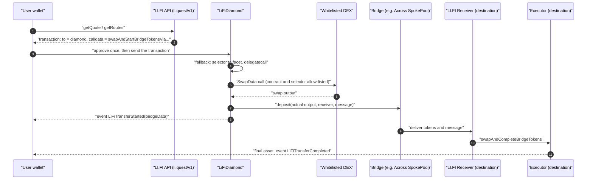
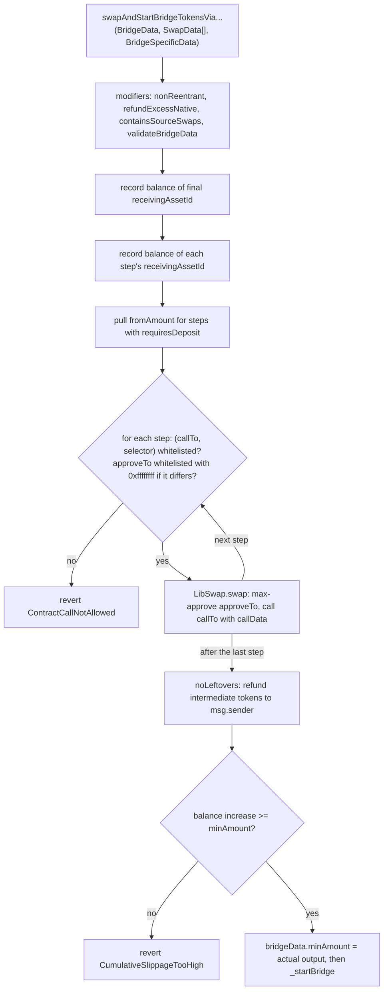
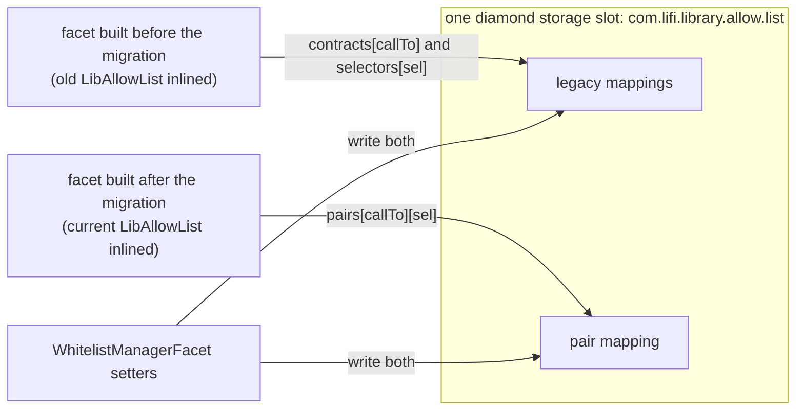
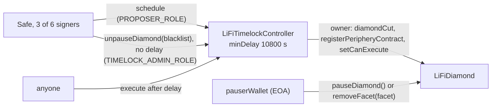

[LI.FI](https://li.fi) is a cross-chain bridge and DEX aggregator: it does not move tokens between chains itself, it picks one of the bridges it integrates (Across, Stargate, Chainflip, the canonical rollup bridges and about thirty more) and the swaps around it, then hands the user one transaction to sign. That transaction always goes to the same contract on each chain, the `LiFiDiamond`, and the user's token approval goes to that contract too. The whole security design follows from that one fact: a contract that holds standing approvals from many users must never let a caller choose what it calls.

This article reads the LI.FI contracts at a pinned commit of `lifinance/contracts-tron` (the TRON-enabled fork of the main contracts repository) and follows the path of a transfer: the execution model and its data structures, the allow-list and the receivers on the destination side, then governance and deployments. It then looks at the March 2022 and July 2024 exploits, which drained users who had approved the diamond, and at the bug classes that LI.FI's 114 audit reports keep finding.

> This article has been made with the help of [Claude Code](https://claude.com/product/claude-code) and several custom skills

[TOC]

## What you need to know first

The article assumes the reader knows smart contracts, ERC-20 tokens, DEX swaps and what a bridge does. A few mechanisms one level below are used without being derived. In the body, a statement marked (*derived*) is this article's own inference from the code or the incidents, not a claim made by LI.FI's sources.

The mechanisms:

- **Allowance and `transferFrom`.** An [ERC-20](https://eips.ethereum.org/EIPS/eip-20) holder calls `approve(spender, amount)`, after which the spender can call `transferFrom(holder, to, amount)` at any later time. Wallets and aggregators often ask for an unlimited allowance, so the approval outlives the transaction it was given for; both LI.FI exploits spent such standing allowances.
- **`call` versus `delegatecall`.** A plain call runs the target's code in the target's context, with the caller as `msg.sender`. A delegate call runs the target's code in the caller's own storage and balance, and keeps the original sender. A proxy forwards every call to a logic contract by delegate call; the site's [proxy summary]({{site.url_complet}}/2022/10/31/proxy-contract-summary/) covers the single-implementation case.
- **Function selector.** The first four bytes of calldata, the truncated Keccak-256 hash of the function signature (`transferFrom(address,address,uint256)` is `0x23b872dd`). Any contract can expose any selector, so a selector alone does not identify what a call does.
- **Diamond proxy ([EIP-2535](https://eips.ethereum.org/EIPS/eip-2535)).** A proxy with many logic contracts, called facets. The proxy keeps a table from selector to facet and `delegatecall`s the facet registered for the incoming selector; `diamondCut` adds, replaces or removes table entries.
- **Signature-based approvals.** [EIP-2612](https://eips.ethereum.org/EIPS/eip-2612) `permit` lets a holder grant an allowance with an off-chain signature instead of an `approve` transaction. Uniswap's [Permit2](https://github.com/Uniswap/permit2) generalises this to any ERC-20 through one shared contract, and its "witness" variant binds extra [EIP-712](https://eips.ethereum.org/EIPS/eip-712) typed data to the signature.
- **Deterministic deployment.** `CREATE2` derives a contract address from the deployer, a salt and the init code. CREATE3 adds an intermediate step so that the address depends only on the deployer and the salt, which lets the same contract land at the same address on many chains even when its constructor arguments differ.
- **Intent bridges.** Some bridges (Across, deBridge DLN, Mayan) let the user state an input and a minimum output; a relayer or solver pays the user on the destination chain from its own funds and is repaid later. The sister article on [Across]({{site.url_complet}}/2026/11/23/across-protocol-intent-bridge/) describes one such protocol in detail, and LI.FI routes through it with three facets.

## The execution model: the API builds, the diamond executes

LI.FI is split in two. The off-chain API at `https://li.quest/v1` computes quotes and routes; for each step it also returns a ready transaction addressed to the `LiFiDiamond`, whose calldata selects one facet entry point. The diamond then pulls the user's tokens, runs the source swaps through allow-listed DEX calls and hands the funds to the bridge.

The split puts a large part of the correctness in the backend. The contracts check the shape of a request: a non-zero receiver and amount, a destination chain other than the current one, and whitelisted swap targets. They do not check every value inside it. `AcrossFacetV4` states it plainly when it rescales the Across output amount after a source swap. That amount, defined in [Swap, then bridge](#swap-then-bridge), is what the user should receive on the destination:

```solidity
// src/Facets/AcrossFacetV4.sol, lines 142-143
// NOTE: please note that we intentionally do not verify the outputAmount any further. Only use LI.FI backend-
//       generated calldata to avoid potential loss of funds.
```

The sequence of a route with a source swap and a destination swap looks as follows.



A route without a destination call stops at the bridge: the bridge pays the user directly and no LI.FI contract runs on the destination chain.

## Architecture: diamond, facets, helpers, libraries and periphery

### The diamond proxy

`LiFiDiamond` is a small contract, tagged version 1.0.0 in its NatSpec. Its constructor sets the owner and installs a single selector, `diamondCut`, which points at the `DiamondCutFacet`. Every other function arrives through the fallback, which looks the selector up in diamond storage and `delegatecall`s the facet:

```solidity
// src/LiFiDiamond.sol, lines 32-67, comments removed; the constructor is at lines 14-27
fallback() external payable {
    LibDiamond.DiamondStorage storage ds;
    bytes32 position = LibDiamond.DIAMOND_STORAGE_POSITION;
    assembly {
        ds.slot := position
    }
    address facet = ds.selectorToFacetAndPosition[msg.sig].facetAddress;
    if (facet == address(0)) {
        revert LibDiamond.FunctionDoesNotExist();
    }
    assembly {
        calldatacopy(0, 0, calldatasize())
        let result := delegatecall(gas(), facet, 0, calldatasize(), 0, 0)
        returndatacopy(0, 0, returndatasize())
        switch result
        case 0 { revert(0, returndatasize()) }
        default { return(0, returndatasize()) }
    }
}
```

Because of the `delegatecall`, every facet runs with the diamond's storage, the diamond's token balances and, most importantly, as the address users approved. A call that a facet makes to a token contract arrives there with `msg.sender` equal to the diamond.

### Code layers

The repository's architecture rules name four directories: facets, periphery, helpers and security, which holds the timelock. They also tell developers to delegate complex logic to the libraries, so the table below adds the libraries as a fifth layer: they are not deployed on their own but compiled into every facet that uses them. Grouped by how the code is deployed:

| Layer | Deployed? | Examples | Role |
|---|---|---|---|
| Facets | Yes, registered in the diamond | `AcrossFacetV4`, `GenericSwapFacetV3`, `DiamondCutFacet` | Thin entry points, one per bridge or admin function |
| Helpers | No, inherited by facets | `SwapperV2`, `Validatable`, `ReentrancyGuard`, `LiFiData` | Swap loop, validation modifiers, a diamond-wide reentrancy lock, constants |
| Libraries | No, internal and inlined | `LibAsset`, `LibSwap`, `LibAllowList`, `LibAccess`, `LibDiamond` | Shared logic and namespaced storage |
| Periphery | Yes, standalone | `Executor`, `Receiver*`, `Permit2Proxy`, `FeeCollector`, `FeeForwarder`, `Patcher`, `LiFiDEXAggregator` | Contracts upgraded independently of the diamond |
| Security | Yes, standalone | `LiFiTimelockController` | Governance: owns the diamond on production networks |

Two periphery contracts come back in the audit section. `Patcher` reads a value at execution time, such as a balance after a bridge transfer, writes it into calldata at a fixed offset and calls an arbitrary target; `config/whitelist.json` lists it as an allowed step on mainnet. `LiFiDEXAggregator` is a copy of Sushiswap's `RouteProcessor4` that swaps across many DEXs, and `GasZipPeriphery` routes its swaps through it.

*Source:* `.agents/rules/002-architecture.md`; `docs/Patcher.md`; the NatSpec of `src/Periphery/LiFiDEXAggregator.sol`; `docs/GasZipPeriphery.md`.

Each library keeps its state at a fixed hashed slot. The allow-list, for example, lives at `keccak256("com.lifi.library.allow.list")`, and the single reentrancy lock that all facets share lives at `keccak256("com.lifi.reentrancyguard")`. That is how forty-odd facets can share one storage space without stepping on each other.

*Implementation:* `src/Libraries/LibAllowList.sol` (lines 28-29). `src/Helpers/ReentrancyGuard.sol` (line 11).

### The facet catalogue

The commit read here has 44 facets in `src/Facets/`. Grouped by purpose:

| Group | Facets |
|---|---|
| Across | `AcrossFacetV4`, `AcrossFacetPackedV4` (packed calldata), `AcrossV4SwapFacet` (Across Swap API) |
| Canonical and rollup bridges | Arbitrum, Optimism, Polygon, Gnosis, Omni, MegaETH bridge facets |
| USDC and stablecoin routes | `CelerCircleBridgeFacet`, `PolymerCCTPFacet`, `PaxosTransitFacet`, `SupersetFacet`, `M0Facet` |
| Liquidity and messaging bridges | `StargateFacetV2`, `FraxFacet`, `AllBridgeFacet`, `SymbiosisFacet`, `SquidFacet`, `GlacisFacet`, `CentrifugeFacet` |
| Intent and solver bridges | `DeBridgeDlnFacet`, `MayanFacet`, `NEARIntentsFacet`, `EcoFacet`, `RelayDepositoryFacet`, `LayerSwapFacet`, `GardenFacet`, `UnitFacet`, `LiFiIntentEscrowFacetV2` |
| Native-chain swaps | `ChainflipFacet`, `ThorSwapFacet` |
| Gas | `GasZipFacet` (native deposits to gas.zip) |
| Attestation | `AttestedBridgeFacet` (dispatches a bridge facet call, then reports it to an attester) |
| Same chain and tools | `GenericSwapFacetV3`, `CalldataVerificationFacet` (read-only decoding of LI.FI calldata) |
| Admin | `DiamondCutFacet`, `DiamondLoupeFacet`, `OwnershipFacet`, `AccessManagerFacet`, `WhitelistManagerFacet`, `PeripheryRegistryFacet`, `WithdrawFacet`, `EmergencyPauseFacet` |

Almost every bridge facet exposes the same pair of entry points: `startBridgeTokensVia<X>` for a bridge-only transfer and `swapAndStartBridgeTokensVia<X>` for a swap followed by a bridge. Two facets differ. The packed Across facet has four packed bridge-only variants and no swap entry, and the attestation facet has the single entry `startBridgeAttested`. Bridge-specific constructor parameters, such as a SpokePool or a router, sit in one JSON file per bridge, and a developer guide describes the template a new facet starts from.

*Source:* `config/<bridge>.json` and `docs/AddingANewBridge.md`.

## The two data structures

Two structures carry almost every request. The first, `ILiFi.BridgeData`, describes the transfer:

```solidity
// src/Interfaces/ILiFi.sol, lines 10-21
struct BridgeData {
    bytes32 transactionId;
    string bridge;
    string integrator;
    address referrer;
    address sendingAssetId;
    address receiver;
    uint256 minAmount;
    uint256 destinationChainId;
    bool hasSourceSwaps;
    bool hasDestinationCall;
}
```

The `transactionId` links every event of one transfer: the start event on the source chain, one swap event per source swap, and the completion or recovery event on the destination chain. The native asset is encoded as `address(0)` in `sendingAssetId`.

*Implementation:* events `LiFiTransferStarted`, `LiFiTransferCompleted` and `LiFiTransferRecovered` in `src/Interfaces/ILiFi.sol`, and `AssetSwapped` in `src/Libraries/LibSwap.sol`.

The second, `LibSwap.SwapData`, describes one step of the swap phase:

```solidity
// src/Libraries/LibSwap.sol, lines 23-31
struct SwapData {
    address callTo;
    address approveTo;
    address sendingAssetId;
    address receivingAssetId;
    uint256 fromAmount;
    bytes callData;
    bool requiresDeposit;
}
```

The library's own NatSpec says a step is "mostly swaps but also other calls such as fee collection, token wrapping/unwrapping or sending gas to destination chain". A `SwapData` is therefore a generic external call with token bookkeeping around it, and `callTo` plus `callData` decide what the diamond does.

*Implementation:* `src/Libraries/LibSwap.sol`, library NatSpec (lines 11-13).

## The swap-then-bridge flow

### Bridge only

`startBridgeTokensViaAcrossV4` is a typical bridge-only entry point. Four modifiers run first, in this order: a reentrancy lock, a refund of excess native value to the caller, the bridge-data validation, and a check that the request declares no source swaps. The body then takes the input. For an ERC-20 it pulls `minAmount` from the caller with a safe transfer; for the native asset it only checks that `msg.value` covers that amount.

The internal `_startBridge` then checks that a non-empty Across message matches the destination-call flag, validates the receiver, approves the SpokePool, calls its `deposit` function and emits `LiFiTransferStarted` as its last action.

*Implementation:* `src/Facets/AcrossFacetV4.sol`, `startBridgeTokensViaAcrossV4()` and `_startBridge()` (lines 96-112 and 157-246); the deposit is `LibAsset.depositAsset()`.

The validation modifiers come from `src/Helpers/Validatable.sol` (lines 14-75):

| Modifier | Reverts when |
|---|---|
| `validateBridgeData` | `receiver == 0`, `minAmount == 0`, or `destinationChainId == block.chainid` |
| `noNativeAsset` | `sendingAssetId` is the native asset |
| `onlyAllowSourceToken`, `onlyAllowDestinationChain` | the token or chain differs from the one the facet is fixed to |
| `containsSourceSwaps`, `doesNotContainSourceSwaps` | the `hasSourceSwaps` flag does not match the entry point |
| `doesNotContainDestinationCalls` | `hasDestinationCall` is true |

`validateBridgeData` does not check that the receiver the bridge will actually pay equals `bridgeData.receiver`. That check is left to each facet, which is why it comes back in the audit history below.

### Swap, then bridge

`swapAndStartBridgeTokensViaAcrossV4` replaces the deposit with a swap phase and overwrites the amount with the real output:

```solidity
// src/Facets/AcrossFacetV4.sol, in the function at lines 118-150
_bridgeData.minAmount = _depositAndSwap(
    _bridgeData.transactionId,
    _bridgeData.minAmount,
    _swapData,
    payable(msg.sender)
);
```

The bridge therefore receives what the swaps produced, not the amount quoted.

Across needs one more value. An Across deposit carries both an input amount and an `outputAmount`, the amount the relayer must pay on the destination chain after its fee. The backend cannot write the final `outputAmount` into the calldata, because the input is only known once the source swap has run. It encodes an `outputAmountMultiplier` instead, a ratio scaled by `1e18` that also absorbs any difference in decimals between the input and output tokens, and the facet computes `outputAmount = minAmount * outputAmountMultiplier / 1e18`. This is the step the comment above says is not verified further; the [worked example](#a-worked-example) below puts numbers on it.

The swap phase, `_depositAndSwap` in `SwapperV2`, runs these steps:

1. It reverts with `NoSwapDataProvided` on an empty array, then records the diamond's balance of the last step's `receivingAssetId`, so that step 7 measures only what this call produced. When that asset is native it subtracts `msg.value`, which is already in the balance when the code runs.
2. It records the pre-swap balance of every step's output asset, so that step 6 refunds only this call's leftovers.
3. It pulls `fromAmount` from the caller for each step flagged `requiresDeposit`.
4. It loops over the steps, checks each one against the allow-list (next section) and executes it through `LibSwap.swap`.
5. `LibSwap.swap` requires the target to have code and a non-zero `fromAmount`. It max-approves the spender for an ERC-20 input, or forwards the amount as value for a native input, then performs the low-level call and emits `AssetSwapped`. A former check of the input balance was removed on purpose, for fee-on-transfer and rebasing tokens. It is the `InsufficientBalance` check that the 2024 attacker satisfied with a fake token (see [July 2024](#july-2024-a-public-helper-that-skipped-swapperv2)).
6. After the loop, the `noLeftovers` modifier on the swap loop sends intermediate outputs and unused inputs, never the final asset, to the leftover receiver, which the facets set to `msg.sender`.
7. It reverts `CumulativeSlippageTooHigh(minAmount, received)` if the final balance increase is below `minAmount`.

*Implementation:* `src/Helpers/SwapperV2.sol`, `_depositAndSwap()` (lines 89-127, balance snapshot at 97-106, slippage check at 122-124). It calls `_fetchBalances()`, `LibAsset.depositAssets()` and `_executeSwaps()`, whose `noLeftovers` modifier is at lines 34-41. `LibSwap.swap()` is in `src/Libraries/LibSwap.sol` (lines 51-108, removed balance check at 78-82).



Same-chain swaps use `GenericSwapFacetV3`, whose gas-optimised entry points include `swapTokensSingleV3ERC20ToERC20` and `swapTokensMultipleV3ERC20ToNative`. They apply the same pair check, send the whole output to the receiver, check the minimum output and emit `LiFiGenericSwapCompleted`.

*Implementation:* `src/Facets/GenericSwapFacetV3.sol`, entry points and `minAmountOut` check (lines 43-90). The pair check is at lines 162-168.

### A worked example

The values below are illustrative, not read from a real transaction. A user on Ethereum sends 1,000 USDT and wants ETH on Arbitrum. The route swaps USDT to USDC on Ethereum, bridges USDC with Across, and swaps USDC to ETH on Arbitrum. Both stablecoins have 6 decimals.

| Field | Value | Why |
|---|---|---|
| `BridgeData.sendingAssetId` | USDC | the asset that is bridged, the output of the source swap |
| `BridgeData.minAmount` (calldata) | 995,000,000 (995 USDC) | the slippage floor the API chose for the source swap |
| `BridgeData.receiver` | the user's address | the address the user signed for |
| `BridgeData.destinationChainId` | 42161 (Arbitrum) | |
| `BridgeData.hasSourceSwaps` | `true` | one `SwapData` step, USDT to USDC through a whitelisted DEX |
| `BridgeData.hasDestinationCall` | `true` | the message carries the USDC to ETH swap for the Executor |
| `SwapData[0].fromAmount` | 1,000,000,000 (1,000 USDT) | pulled from the user because `requiresDeposit` is set |
| `AcrossV4Data.outputAmountMultiplier` | 998,000,000,000,000,000 | a 0.2% relayer fee, times `1e18`, times `10^(6-6)` = 1 for equal decimals |
| `AcrossV4Data.receiverAddress` | LI.FI's `ReceiverAcrossV4` on Arbitrum | a destination call is present |

The run then goes as follows:

1. The swap returns 997.5 USDC. The balance increase, 997,500,000, is above the floor of 995,000,000, so the slippage check passes and `minAmount` becomes 997,500,000.
2. The facet computes `outputAmount` as 997,500,000 × 998,000,000,000,000,000 / 10¹⁸ = 995,505,000, that is 995.505 USDC for the relayer to pay on Arbitrum.
3. The diamond deposits 997.5 USDC into the SpokePool and emits `AssetSwapped` for the swap and `LiFiTransferStarted` as its last action.
4. On Arbitrum, the relayer pays 995.505 USDC to `ReceiverAcrossV4`, which hands it to the Executor. The Executor swaps it to ETH, sends the ETH to the user and emits `AssetSwapped` and `LiFiTransferCompleted`, all with the same `transactionId`.

## The allow-list: contract and selector pairs

The allow-list is the main guard between a caller's `SwapData` and the users' approvals. The check in `SwapperV2._executeSwaps` reads:

```solidity
// src/Helpers/SwapperV2.sol, lines 204-217
if (
    !LibAllowList.contractSelectorIsAllowed(
        callTo,
        bytes4(currentSwap.callData[:4])
    ) ||
    (!LibAsset.isNativeAsset(currentSwap.sendingAssetId) &&
        approveTo != callTo &&
        !LibAllowList.contractSelectorIsAllowed(
            approveTo,
            APPROVE_TO_ONLY_SELECTOR
        ))
) revert ContractCallNotAllowed();

LibSwap.swap(_transactionId, currentSwap);
```

Three properties of this check matter:

- **The key is the pair.** The library stores one entry per contract and selector. A DEX router whitelisted for `swapExactTokensForTokens` cannot be called with any other selector, and whitelisting the selector on that router does not authorise it on any other contract.
- **`approveTo` has its own entry.** Some DEXs take the approval on one contract and the call on another. The library reserves the selector `0xffffffff`, named `APPROVE_TO_ONLY_SELECTOR`, for such spenders: it marks the contract as known without authorising any call to it. Without that rule, a caller could direct the diamond's max approval to any address.
- **The check lives in the caller, not in `LibSwap.swap`.** The swap function itself only checks that the target has code and that the amount is non-zero. Any code path that reaches it without going through a pair check makes an arbitrary call from the diamond. At this commit it is called from the two swap loops of `SwapperV2`, both checked, and from the periphery `Executor`, which is not the diamond and has no allow-list (see [Destination calls](#destination-calls-receivers-and-the-executor)); `GenericSwapFacetV3` does its own pair check before its own call.

*Implementation:* `src/Libraries/LibAllowList.sol`, `contractSelectorIsAllowed()` reading `contractSelectorAllowList[contract][selector]` (lines 140-145). The approve-only selector is documented at lines 16-23.

The allow-list is managed by `WhitelistManagerFacet`, whose two setters edit one pair or a batch. The owner can call them.

The owner can also grant an individual address the right to call one selector of the diamond, a mechanism called method-level access and stored as `execAccess` (see [Ownership](#ownership-governance-and-the-emergency-pause)). An address granted the whitelist setters this way edits the allow-list directly, without the timelock. Whitelisting the diamond itself reverts with `CannotAuthoriseSelf`, and each change emits `ContractSelectorWhitelistChanged`. The intended list is kept in `config/whitelist.json`.

*Implementation:* `src/Facets/WhitelistManagerFacet.sol`, `setContractSelectorWhitelist()` and `batchSetContractSelectorWhitelist()` (lines 18-45). The `LibAccess.enforceAccessControl()` calls, which read `execAccess`, are at lines 24 and 36; the `CannotAuthoriseSelf` guard is at lines 99-101.

The pair keys are recent, and they only bind code built from the current library. Until the 2025 migration, contracts and selectors were whitelisted in two independent mappings, so every whitelisted selector was callable on every whitelisted contract.

The old check has not disappeared, because of how libraries are built. `LibAllowList` is an internal library, so its check is compiled into each facet's bytecode, while the storage it reads is the diamond's, shared by every facet. A facet deployed before the migration still carries the old code, which reads the two separate mappings. The current library therefore keeps writing those mappings next to the pair mapping, and such a facet still accepts any whitelisted selector on any whitelisted contract.



Finding L-1 of Burra Security's November 2025 review showed why that matters. Under the old check, two unrelated entries combine:

1. A DEX D has an entry point whose selector S happens to equal `transferFrom`'s `0x23b872dd`, so S is whitelisted for D.
2. A token contract T is whitelisted as a contract for another reason (the report names one on Base).
3. A facet with the old check tests `contracts[T] && selectors[S]`, finds both true, and lets a step call `T.transferFrom(victim, attacker, x)` from the diamond.

That would have reopened the approval drain through the allow-list itself. LI.FI acknowledged the finding for deployed contracts instead of fixing it there: those contracts still accept any combination of a whitelisted contract and a whitelisted selector, and new contracts must use the pair check. The library keeps the legacy mappings in sync with reference counts, one per selector, so that removing a pair clears a selector from the old list only when no contract uses it any more, and a contract only when none of its selectors is left.

*Implementation:* `src/Libraries/LibAllowList.sol`, legacy mappings in `AllowListStorage` (lines 31-60).

The current source checks pairs, as the excerpt above shows, but `deployments/mainnet.diamond.json` lists some facets at versions older than the source: ChainflipFacet 1.0.0 against 1.0.1, GasZipFacet 2.0.4 against 2.0.5, and DeBridgeDlnFacet 1.0.1 against 1.1.0. Whether those deployed facets embed the old separate check was not inspected for this article.

## Non-EVM destinations

`BridgeData.receiver` is an EVM `address`, which cannot hold a Solana public key or a Bitcoin address. LI.FI uses a marker instead:

```solidity
// src/Helpers/LiFiData.sol, lines 9-10
address internal constant NON_EVM_ADDRESS =
    0x11f111f111f111F111f111f111F111f111f111F1;
```

A route to a non-EVM chain puts this marker in the receiver field and carries the real receiver in the facet's own data, usually as `bytes32` or `bytes`. The same file lists LI.FI's own chain IDs for those chains, which the comment calls "made up by the LI.FI team": Bitcoin 20000000000001, Solana 1151111081099710, TRON 1885080386571452, Sui 9270000000000000, Stellar, Aptos, Litecoin, Dogecoin, Bitcoin Cash and HyperCore.

*Implementation:* `src/Helpers/LiFiData.sol`, the `LIFI_CHAIN_ID_*` constants (lines 12-22).

The Across facet's `_startBridge` shows the two branches:

- **Non-EVM destination.** It requires `receiverAddress != bytes32(0)`, says in a comment that it "cannot validate further", and emits `BridgeToNonEVMChainBytes32(transactionId, destinationChainId, receiverAddress)`.
- **EVM destination.** Without a destination call, the Across receiver must equal `bridgeData.receiver` converted to `bytes32`. With a destination call, the Across receiver is LI.FI's Receiver contract, so the equality is not required. On that branch the facet only checks that the Across receiver is non-zero: it does not check that it is a LI.FI Receiver, nor that the final receiver encoded in the message equals `bridgeData.receiver`. Both come from the backend's calldata, which is the receiver bug class of the audit section.

*Implementation:* `src/Facets/AcrossFacetV4.sol`, `_startBridge()` (lines 172-199).

Other facets emit the `bytes` variant `BridgeToNonEVMChain` (Chainflip, DeBridgeDln, Eco). The marker is a convention that each facet must enforce: it should be accepted only for a non-EVM destination, and the non-EVM receiver should be encoded the way that destination expects. Both conditions have failed in audited facets (see the bug classes below).

## Destination calls: Receivers and the Executor

When `hasDestinationCall` is true, the bridge delivers to a LI.FI Receiver on the destination chain rather than to the user. The Across version, `ReceiverAcrossV4`, handles the bridge message as follows:

- it can only be called by the SpokePool (`onlySpokepool`);
- it decodes `(transactionId, SwapData[], receiver)` from the message;
- it approves the `Executor` for the bridged amount and `try`s `EXECUTOR.swapAndCompleteBridgeTokens`;
- if that call fails, it sends the unswapped bridged tokens to the receiver and emits `LiFiTransferRecovered`;
- it resets the Executor approval to zero at the end.

*Implementation:* `src/Periphery/ReceiverAcrossV4.sol`, `handleV3AcrossMessage()` (lines 57-125, approval reset at line 121).

The other receivers follow the same pattern: `ReceiverChainflip.cfReceive`, `ReceiverStargateV2.lzCompose`, `ReceiverOIF.outputFilled` and `ReceiverAcrossV3`.

The `Executor` runs the destination swaps, sends the leftover bridged asset and the final asset to the receiver, and emits `LiFiTransferCompleted`. Unlike the diamond, it has no allow-list: before each call to `LibSwap.swap`, its swap loop only refuses a step that targets its own token proxy.

*Implementation:* `src/Periphery/Executor.sol`, `_processSwaps()` (lines 138-211). The `callTo == erc20Proxy` check is in `_executeSwaps()` at lines 217-234.

The missing allow-list is safe only because of where the Executor's funds come from. It has two entry points, and neither relies on a standing approval to the Executor itself:

| Entry point | Who holds the approval | What protects it |
|---|---|---|
| `swapAndCompleteBridgeTokens`, called by a Receiver | the Executor, for one call only | the Receiver approves the bridged amount and resets the approval to zero afterwards |
| `swapAndExecute`, called directly | `ERC20Proxy`, a separate contract the caller approves | the proxy only accepts calls from authorised callers, and the Executor pulls only from its own caller |

`ERC20Proxy` is therefore a second contract with standing approvals. Its owner sets the authorised callers, and its constructor authorises the Executor. The Executor's arbitrary-call loop refuses any step whose target is the proxy, so no step can make the Executor, an authorised caller, call `ERC20Proxy.transferFrom` against another user. A user who approved the Executor itself, rather than the proxy, would have no such protection: any step could then call `transferFrom` on the token from the Executor.

*Implementation:* `src/Periphery/ERC20Proxy.sol`, constructor, `setAuthorizedCaller()` and `transferFrom()` with the `authorizedCallers` check (lines 53-59); the pull from `msg.sender` is in `src/Periphery/Executor.sol`, `_processSwaps()`.

## Signature entry: Permit2Proxy

`Permit2Proxy`, version 1.0.4, lets a user enter with a signature instead of an approval to the diamond. It takes the tokens, max-approves the diamond and forwards the calldata to it in a plain call that carries `msg.value`. It has three entry points:

- **`callDiamondWithEIP2612Signature`** calls the token's `permit` with `msg.sender` as owner, then pulls the tokens.
- **`callDiamondWithPermit2`** uses Permit2's `permitTransferFrom`, again with `msg.sender` as owner.
- **`callDiamondWithPermit2Witness`** lets a third party submit for a signer. The witness `LiFiCall(address diamondAddress,bytes32 diamondCalldataHash)` binds the signature to the exact diamond address and calldata.

*Implementation:* `src/Periphery/Permit2Proxy.sol`, the three entry points in the order above (lines 77-127, 136-160 and 168-200). The witness type is at lines 22-28, and the forwarding call `LIFI_DIAMOND.call{value: msg.value}(diamondCalldata)` at lines 288-300.

The binding is the lesson of the proxy's first audit. In version 1.0.0, the EIP-2612 signature covered only the token approval, not `diamondAddress` or `diamondCalldata`; anyone who saw the permit in the mempool could submit it with their own diamond calldata. Sujith Somraaj's November 2024 report rated it High as finding 6.1.1, "Frontrunning callDiamondWithEIP2612Signature leads to permanent loss of user funds". The fix requires the signer to be the caller, or binds the calldata through the witness.

The same report raised two Low findings that bear on refunds:

- **Native refunds.** The proxy could not receive the native refunds that facets send to `msg.sender`. The fix added a `receive()` function with the comment "required to be able to receive native token refunds from the diamond".
- **Unused tokens.** Tokens not fully used by the diamond stay in the proxy, where the next caller can take them. This one was acknowledged, not fixed.

*Implementation:* `src/Periphery/Permit2Proxy.sol`, `receive()` (lines 387-388).

`Permit2Proxy` inherits `WithdrawablePeriphery`, so native value or tokens left in it can be recovered by the proxy owner through `withdrawToken`, not automatically by the user.

*Implementation:* `src/Helpers/WithdrawablePeriphery.sol`, `withdrawToken()` (lines 18-28).

## Fees

Fees are not taken by the facets. They are inserted as one more `SwapData` step that calls a fee contract. The step passes the same pair check as a DEX call, so the fee contract must be on the allow-list; `config/whitelist.json` lists the three `FeeForwarder` entry points among the mainnet periphery entries.

- **`FeeCollector`** credits internal balances, one share for the integrator and one for LI.FI, and emits `FeesCollected`. Integrators withdraw their share themselves; the owner withdraws LI.FI's share.
- **`FeeForwarder`** pushes fees straight to their recipients and emits `FeesForwarded`. It takes either amounts or shares expressed as fractions of `1e18`. Its documentation warns that when the diamond calls it, the diamond must handle the remaining funds, "otherwise funds will remain in the diamond contract and could get stolen".

*Implementation:* `src/Periphery/FeeCollector.sol`, `collectTokenFees(token, integratorFee, lifiFee, integrator)`, `collectNativeFees()`, `withdrawIntegratorFees()` and `withdrawLifiFees()` (lines 54-136). `src/Periphery/FeeForwarder.sol`, `forwardERC20Fees()`, `forwardNativeFees()` and `forwardERC20FeesShares()` (lines 71-197). Documentation: `docs/FeeCollector.md` and `docs/FeeForwarder.md`.

The fee amounts themselves are chosen by the API when it builds the step; no on-chain rule bounds them.

## Ownership, governance and the emergency pause

The diamond has three levels of privilege.

- **Owner.** Only the owner can cut the diamond, register periphery contracts, grant method-level access and unpause. Ownership moves in two steps: the owner names a new owner, who must then confirm the transfer.
- **Method-level access.** The owner can let an address call one selector, recorded as `execAccess[msg.sig][msg.sender]`. `WithdrawFacet` and `WhitelistManagerFacet` use it for non-owners, which is the timelock bypass described in [the allow-list section](#the-allow-list-contract-and-selector-pairs); which addresses hold it on mainnet was not read.
- **Pauser.** `EmergencyPauseFacet` accepts calls from an immutable `pauserWallet` or the owner. The NatSpec describes the pauser as "non-multisig for fast response time".

*Implementation:* `LibDiamond.enforceIsContractOwner()` guards `diamondCut()`, `registerPeripheryContract()`, `setCanExecute()` and `unpauseDiamond()`. The transfer is `transferOwnership()` then `confirmOwnershipTransfer()` in `src/Facets/OwnershipFacet.sol` (lines 43-71). Method-level access is `LibAccess.enforceAccessControl()` in `src/Libraries/LibAccess.sol` (lines 60-64). The pauser check is the `OnlyPauserWalletOrOwner` modifier in `src/Facets/EmergencyPauseFacet.sol` (lines 43-48).

The repository treats timelock ownership as a health-check invariant of every production mainnet diamond, named "Diamond is owned by the timelock (mainnet)". The multisig signing guide states that every active mainnet network has its own Safe and timelock, and describes a bring-up state in which a new network is still owned directly. The Ethereum read below shows the invariant holding there. The timelock is an OpenZeppelin `TimelockController` with an extra canceller wallet; the configured minimum delay is 10800 seconds, three hours.

*Source:* `docs/MultisigSigningProcess.md`, and `CANCELLER_ROLE` and `minDelay` in `config/timelockController.json`.

A read of Ethereum mainnet on 2026-11-23 (block 26,477,304) matched the repository:

| Read | Result |
|---|---|
| `owner()` on the diamond `0x1231DEB6…4EaE` | `0x55117ECc…faEe`, the `LiFiTimelockController` listed in `deployments/mainnet.json` |
| `getMinDelay()` on the timelock | `10800` |
| `TIMELOCK_ADMIN_ROLE`, `PROPOSER_ROLE`, `CANCELLER_ROLE` held by the mainnet Safe `0xE3C8…F357` (`config/networks.json`) | `true` for all three |
| `EXECUTOR_ROLE` held by `address(0)` | `true`: anyone can execute an operation once its delay has passed |
| Safe `getThreshold()` / `getOwners()` | 3 of 6 |
| `pauserWallet()` through the diamond | `0xf9D8BA34…1A4A`, an address with no code (an EOA) |



The pause facet has two levers. `removeFacet(addr)` removes one facet's selectors, but refuses the pause facet itself and the cut facet. It does not store the removed selectors, so only the owner can bring that facet back, through a timelocked `diamondCut`.

`pauseDiamond()` points every selector at the pause facet, so every call reverts with `DiamondIsPaused`, and stores the facet list for later restoration. Unpausing needs the owner. Because the owner is the timelock, the timelock's own `unpauseDiamond` lets the timelock admin unpause without the three-hour delay, on the reasoning that unpausing "can only remove existing facets (blacklist), not add new code".

*Implementation:* `src/Facets/EmergencyPauseFacet.sol`, `removeFacet()` and `pauseDiamond()` (lines 63-87 and 98-127). `src/Security/LiFiTimelockController.sol`, `unpauseDiamond(blacklist)` (lines 70-82).

The resulting asymmetry is intended: a single key can stop the diamond at once, a 3-of-6 Safe can restart it at once, and changing the code takes a Safe proposal plus three hours. Allow-list changes are the exception, through the `execAccess` bypass above.

## Deployments: EVM chains, TRON and CREATE3

The repository keeps two records per network, one with the deployed addresses and one with the facets installed on the diamond, plus a shared log of every deployment. The production diamond on Ethereum is `0x1231DEB6f5749EF6cE6943a275A1D3E7486F4EaE`, logged as version 1.0.0 with a 2023-07-27 timestamp, although the chain shows it was created on 20 October 2022 (block [15,788,692](https://etherscan.io/block/15788692)). The same address is recorded on 21 networks, including Arbitrum, Base, BSC, Optimism and Polygon; other chains use other addresses, zkSync for instance `0x341e94069f53234fE6DabeF707aD424830525715`. On mainnet the main periphery contracts are:

- `Executor`: `0xd9B2…0E88`
- `FeeCollector`: `0x3Ef2…1d6F`
- `Permit2Proxy`: `0x8eEd…CC1c`

*Source:* `deployments/<network>.json`, `deployments/<network>.diamond.json` and `deployments/_deployments_log_file.json`; the mainnet diamond is at line 7 of `deployments/mainnet.json`.

**TRON** runs from the dedicated `contracts-tron` fork. The reason is one token: TRON's canonical USDT declares `transfer` as returning a boolean but never executes its return statement, so the call returns 32 zero bytes, which the decoder reads as false, and Solady's `safeTransfer` reverts. The fork adds a bypass that applies only on TRON's EVM chain ID `728126428` and only for that token address:

```solidity
// src/Libraries/LibAsset.sol, lines 95-104; constants at lines 28-35, rationale at 30-33
if (
    block.chainid == TRON_CHAIN_ID &&
    assetId == TRON_USDT
) {
    IERC20(assetId).transfer(recipient, amount);
    return;
}
```

The fork also changes the helper that lets a periphery contract's owner withdraw tokens: the withdrawal now goes through the library function that holds the bypass, so it works for TRON USDT too.

*Source:* `docs/TronFork.md`, the delta for `WithdrawablePeriphery.sol` (`withdrawToken` through `LibAsset.transferAsset`).

Everything else is synchronised weekly from upstream `lifinance/contracts`, and TRON deployments use TronWeb scripts instead of Foundry broadcasts. The TRON diamond is `TU3ymitEKCWQFtASkEeHaPb8NfZcJtCHLt`. Note that TRON has two identifiers in the code: the EVM chain ID `728126428` that the chain reports at runtime, and LI.FI's API ID `1885080386571452`.

*Source:* `docs/TronFork.md`, Part 1; the scripts in `script/deploy/tron/`; the diamond at line 9 of `deployments/tron.json`.

**CREATE3Factory** is how facets and periphery contracts get identical addresses across chains. LI.FI's fork of the [CREATE3Factory by zeframlou](https://github.com/zeframlou/create3-factory) hashes the caller into the salt before deploying:

```solidity
// create3-factory/src/CREATE3Factory.sol, lines 14-23
function deploy(bytes32 salt, bytes memory creationCode)
    external
    payable
    override
    returns (address deployed)
{
    // hash salt with the deployer address to give each deployer its own namespace
    salt = keccak256(abi.encodePacked(msg.sender, salt));
    return CREATE3.deploy(salt, creationCode, msg.value);
}
```

The resulting address depends on the factory, the deployer and the salt, not on the creation code, so a contract with chain-specific constructor arguments still lands at the same address. Each deployer has its own namespace, which stops a third party from squatting LI.FI's addresses through the same factory. The mainnet factory is `0x93FEC2C00BfE902F733B57c5a6CeeD7CD1384AE1`, and the factory repository records 59 networks. On TRON, LI.FI's own addresses are listed separately in `deployments/tron.json`, and bridge configurations such as `config/eco.json` carry `tron` blocks with the bridges' own TRON contract addresses in base58.

## Off-chain and auxiliary components

The contracts are one part of a larger stack:

- **SDK.** `@lifi/sdk` requests quotes, routes and contract-call quotes, queries the status of a transfer, and executes or resumes a route. It uses `li.quest/v1` by default and refuses to build a client without an integrator name. It has providers for EVM, Solana, Bitcoin, Sui, TRON, Stellar and Zcash; the Bitcoin provider builds on LI.FI's `bigmi` library.
- **Status API.** A status request by transaction hash returns the state of the transfer, from pending to done, failed or cancelled, with the sending and receiving transaction hashes. Combined with the `transactionId` carried by every LI.FI event, it is the way to follow a transfer across chains. The id is indexed in the completion, recovery and non-EVM events, but not in `LiFiTransferStarted` or `AssetSwapped`.
- **Solana tracking program.** `lifi-solana-program-1` is a native Rust program with no custody and one instruction, `TrackV1 { transaction_id: [u8; 8] }`. It validates a clock sysvar and an epoch PDA and logs `LI.FI TX: 0x<id>`, which makes LI.FI-built Solana transactions findable.
- **Token list.** `customized-token-list` feeds the API's token endpoint, including a per-chain `denyTokens/` block list and an `approvalResetTokens/` list of USDT-style tokens that need an approval reset to zero before a new approval.
- **Catapultar.** A separate smart account built on [ERC-7821](https://eips.ethereum.org/EIPS/eip-7821) batch execution, with validators that enforce a minimum outcome for intent fills. It has its own seven audit reports and is outside the diamond.

*Source:* SDK `getQuote()`, `getRoutes()`, `getContractCallsQuote()`, `getStatus()`, `executeRoute()` and `resumeRoute()` in `sdk/packages/`; the default `apiUrl` and the `integrator` check in `sdk/packages/sdk/src/client/createClient.ts`. The API status endpoint `GET /status?txHash=…` returns the states `PENDING`, `DONE`, `FAILED`, `CANCELLED`, `NOT_FOUND` and `INVALID`. Solana tracking instruction in `program/src/instructions/track_v1.rs`.

## Two exploits from one root cause

Both LI.FI incidents spent allowances that users had given to the diamond. Neither broke a bridge. The [timeline](#timeline) in the annex dates them, with the ownership and facet changes around them.

### March 2022: unvalidated `SwapData` in the CBridge swap path

The first diamond, `0x5A9Fd7c39a6C488E715437D7b1f3C823d5596eD1`, exposed `swapAndStartBridgeTokensViaCBridge(LiFiData, SwapData[], CBridgeData)`. For each swap step it pulled the input from the caller, approved `approveTo` and ran `callTo.call(callData)`, with no list of permitted targets. The DeFiHackLabs reconstruction, which does not bundle the facet's source and rebuilds its logic from the trace, replays one attacker call at block 14,420,686 with 38 swap steps:

- **Step 0 was a real swap.** 50 USDT (50,000,000 base units) went through the 0x Exchange Proxy and returned 49,863,998 base units of USDC, which satisfied the facet's check on the bridged asset. That check only required the swaps to leave at least the 40 USDC declared in the bridge data.
- **Steps 1 to 37 were not swaps.** Each pointed the call at a token contract (USDT, USDC, DAI, LINK, AAVE and others), declared the native sentinel `address(0)` as input with an amount of 0, and carried `transferFrom(victim, attacker, amount)` as calldata. The facet pulled and approved nothing for these steps and executed the call; since the diamond was the approved spender, each `transferFrom` succeeded.
- **The bridge step was real.** The facet sent the 49.86 USDC through cBridge to Arbitrum, to the attacker's address.

LI.FI put the whole incident at about $600K, taken from 29 wallets. The check on the bridged asset saw nothing wrong because the 37 drain steps did not touch it.

### July 2024: a public helper that skipped `SwapperV2`

The second incident hit the current diamond, `0x1231DEB6…4EaE`, through a facet added shortly before: `GasZipFacet` at `0xf28A352377663cA134bd27B582b1a9A4dad7e534`. Its bridge entry points went through the swap phase and its allow-list. A helper meant to be used as a `SwapData` step did not. The verified source of the deployed facet reads:

```solidity
function depositToGasZipERC20(
    LibSwap.SwapData calldata _swapData,
    uint256 _destinationChains,
    address _recipient
) public {
    // get the current native balance
    uint256 currentNativeBalance = address(this).balance;

    // execute the swapData that swaps the ERC20 token into native
    LibSwap.swap(0, _swapData);

    // calculate the swap output amount using the initial native balance
    uint256 swapOutputAmount = address(this).balance -
        currentNativeBalance;

    // call the gas zip router and deposit tokens
    gasZipRouter.deposit{ value: swapOutputAmount }(
        _destinationChains,
        _recipient
    );
}
```

The function is public, has no modifier, and passes caller data straight to `LibSwap.swap`.

Because the facet was registered in the diamond, the fallback routed its selector like any other: anyone could call it through the diamond, and the call to USDT came from the diamond, the address users had approved.

In that version the swap function checked three things only: that the target had code, that the amount was not zero, and that the diamond held at least that amount of the input asset, reverting with `InsufficientBalance` otherwise. The attacker pointed the call at USDT with `transferFrom(victim, attacker, balance)` as calldata. To pass the bookkeeping checks, it declared as input a fake token contract that reports a balance of 1 and accepts approvals, with an amount of 1.

The reconstruction forks the chain at block 20,318,962 and replays the attack transaction `0xd82fe84e…3873`, mined in block 20,318,963. In it, one victim with an unlimited USDT allowance to the diamond lost 2,276,295.880553 USDT. LI.FI's incident report puts the whole incident at about $11.6M, taken from 153 wallets on Ethereum and Arbitrum.

### What changed since

| | March 2022 | July 2024 | At `a1a449b` (2026-11-23) |
|---|---|---|---|
| Diamond | `0x5A9F…6eD1` | `0x1231…4EaE` | `0x1231…4EaE` |
| Entry point | `swapAndStartBridgeTokensViaCBridge` | `GasZipFacet.depositToGasZipERC20` | none known |
| Missing check | no allow-list at all | allow-list existed but was bypassed | none in the current source; older deployed facets may use the separate check |
| Drain call | `token.transferFrom(victim, attacker, x)` as a swap step | the same, through one `SwapData` | needs a whitelisted `(token, 0x23b872dd)` pair, a selector collision on a facet using the old separate check, or a new bypass |
| Attacker trick | zero-amount steps with native sentinel | fake token reporting a balance of 1 | none known |

The helper no longer exists in `GasZipFacet`. It now lives in a separate `GasZipPeriphery` contract, which asks the diamond whether the contract-selector pair is whitelisted before calling. Being a separate contract, its calls do not carry the allowances users gave to the diamond (*derived*). Since before 2024, `LibSwap.swap` reverts on a zero amount, which would have rejected the 2022 drain steps as crafted (*derived*), but the 2024 attack shows that such bookkeeping checks are cheap to satisfy and are not a substitute for the allow-list.

*Implementation:* `src/Periphery/GasZipPeriphery.sol`, `depositToGasZipERC20()` with the `isContractSelectorWhitelisted()` check (lines 54-82).

The structural point has not changed: `LibSwap.swap` is still an unrestricted call primitive, and the allow-list is a property of its callers. The first check worth running on any new facet is therefore a search for every path to `LibSwap.swap` or a raw `.call` that does not pass a pair check (*derived*).

## What the audits keep finding

The repository indexes 114 audit reports in `audit/auditLog.json`, from February 2024 to November 2026. Sujith Somraaj wrote 105 of them, Burra Security 6 and Cantina 3. Most are reviews of one version of one facet.

Two of the PDFs are corrupted upstream, which leaves 112 readable LI.FI reports. With Catapultar's 7, that makes 119 reports, whose findings total 0 Critical, 6 High, 30 Medium and 122 Low as the reports rate them.

*Source:* `audit/auditLog.json` and the PDFs in `audit/reports/`. The three Cantina reports are a pre-competition review, a competition, and the review of the Sushiswap fork behind `LiFiDEXAggregator`, which is logged without an auditor handle. The Low count takes the 2025 Cantina competition at the 15 Lows of its summary, of which it details only 7.

The six Highs:

| Report | Finding | Class |
|---|---|---|
| Permit2Proxy v1.0.0 (2024-11) | Front-running `callDiamondWithEIP2612Signature`: the permit did not bind target and calldata | Signature binding |
| ChainflipFacet v1.0.0 (2025-03) | Improper receiver address encoding for Bitcoin | Non-EVM receiver encoding |
| Patcher v1.0.0 (2025-07) | Front-running could lead to loss of caller funds (acknowledged, documented only) | Arbitrary-call periphery |
| AcrossV4SwapFacet v1.0.0 (2026-04) | Incorrect LayerZero endpoint IDs for XDC and Plume | Hard-coded chain ID tables |
| Catapultar (2026-04) | `CATValidator` can validate outcomes with unrelated balance increases | Balance-difference outcome check |
| Catapultar (2026-04) | `CatapultarFactory` allows salt-prefix collisions | Address squatting |

Beyond the Highs, the same classes recur from facet to facet:

- **The receiver actually paid is not `bridgeData.receiver`.** `validateBridgeData` only checks that the receiver is non-zero; the bridge pays a protocol-specific field. Findings in AcrossV3, DeBridgeDln, Relay and Mayan are all variants; in the Mayan case the receiver was decoded from the wrong field of opaque protocol data.
- **Non-EVM receivers.** Wrong width or padding of a `bytes32` receiver (Chainflip, GasZip, AcrossV4), the `NON_EVM_ADDRESS` marker accepted for an EVM destination so that the declared receiver differs from the real one (PolymerCCTP, Eco), EVM-style receivers accepted for Solana, and missing or spoofable `BridgeToNonEVMChain` events.
- **Refund and cancel rights taken from `msg.sender`.** When a facet is reached through `Permit2Proxy`, a relayer or an integrator contract, `msg.sender` is that contract. Refunds then land in a shared contract and cancel rights belong to an address that cannot use them (LayerSwap, PolymerCCTP, Symbiosis, Eco, DeBridge, Garden). The 2026 fixes added an explicit, signed `refundRecipient`.
- **Opaque calldata against runtime amounts.** The facet forwards backend-built protocol data while the amount changes after the source swap: stale minimum outputs (Mayan), linear rescaling on positive slippage that makes deposits unfillable (AcrossV4Swap), value-bearing fields hidden in protocol data and not validated.
- **Last swap output versus `sendingAssetId`, and whole-balance accounting.** If the last swap's output may differ from the bridged asset, a caller can bridge any stray token the diamond holds: the swap phase measures the balance increase of the last step's output, and the facet then bridges that amount of `sendingAssetId`, taken from whatever balance of it the diamond already had. These findings are usually acknowledged with "the diamond holds no funds", a premise that fails as soon as any path leaves funds behind.
- **Native value.** `msg.value` reused across loop iterations, bridge fees paid out of the diamond's own native balance, overpaid fees not refunded.
- **Per-chain constants.** Hard-coded chain ID to provider ID tables (the LayerZero High), two TRON chain IDs defeating a same-chain check, and EIP-7702 delegated accounts that `LibAsset.isContract` treats as EOAs because it requires more than 23 bytes of code.

One item is still open as a lead rather than a finding.

At this commit, 20 facets send excess native value back to `msg.sender`, and their swap variants also send it the swap leftovers. AcrossFacetV4, StargateFacetV2, DeBridgeDln, Chainflip, Garden, Squid, ThorSwap and Unit are among them. When the call comes through `Permit2Proxy`, that sender is the proxy. The proxy's `receive()` function is commented "required to be able to receive native token refunds from the diamond", but no forwarding of such refunds to the user was found in its source; only the proxy owner can recover them, through `withdrawToken`. The audits raised this pattern, but whether a leftover can arise on those paths through the proxy has not been verified.

*Implementation:* each facet's `refundExcessNative(payable(msg.sender))` modifier and the leftover receiver it passes to `_depositAndSwap()`.

## Conclusion

LI.FI is two systems that must agree: an API that decides what to do and builds the calldata, and a diamond that executes it with the allowances users granted. The contracts read here check the structure of a request and leave several values to the backend.

- **Architecture.** `LiFiDiamond` is a minimal EIP-2535 proxy over 44 facets; helpers and libraries are inlined, and periphery contracts (Executor, Receivers, Permit2Proxy, fee contracts) are upgraded separately.
- **Flow.** A swap-then-bridge call pulls the input, runs each `SwapData` step through a contract-selector allow-list, refunds intermediate tokens, checks the output against `minAmount` and bridges the actual output.
- **The allow-list is the security boundary.** It lives in the callers of `LibSwap.swap`, not in `LibSwap.swap` itself. Both exploits (about $600K in 2022, about $11.6M in 2024) were calls from the diamond that no allow-list stopped, and the 2025 move to pair keys closes a third route through the allow-list itself for facets built after the migration.
- **Receivers.** `NON_EVM_ADDRESS` marks non-EVM destinations, and each facet must check that the receiver the bridge pays is the one the user signed for. Most audit findings are variations on that check.
- **Governance.** On Ethereum the diamond is owned by a timelock with a three-hour delay, proposed by a 3-of-6 Safe; a single EOA can pause it or remove a facet at once, and the Safe can unpause without delay.
- **Risks.** The main ones are backend-trusted parameters, upgradeable logic behind a short delay, standing approvals to the diamond, and the bridges and DEXs a route depends on (see the Risks annex).


## Annex

### Key Terms

| Term | Definition |
|------|------------|
| **Allowance** | The amount an ERC-20 holder lets a spender move with `transferFrom`; an unlimited allowance stays usable after the transaction it was given for. |
| **`delegatecall`** | A call that runs another contract's code in the caller's storage and balance, keeping the caller's identity towards third parties. |
| **Function selector** | The first four bytes of calldata, derived from the function signature; it says which function a call targets, not what the target contract does. |
| **Diamond (EIP-2535)** | A proxy that maps each selector to a facet and `delegatecall`s it; `diamondCut` edits that mapping. |
| **Facet** | A logic contract registered in the diamond; LI.FI has one per bridge integration plus admin facets. |
| **Diamond storage** | State kept at a hashed storage slot per library or helper, so that facets sharing one storage space do not collide. |
| **Periphery contract** | A standalone LI.FI contract (Executor, Receiver, Permit2Proxy, fee contracts) deployed and upgraded outside the diamond. |
| **`BridgeData`** | The structure describing a transfer: id, bridge name, integrator, asset, receiver, minimum amount, destination chain and two flags. |
| **`SwapData`** | One step of the swap phase: a target, a spender, input and output assets, an amount, raw calldata and a deposit flag. |
| **`transactionId`** | The `bytes32` id that links the source events, swap events and destination completion event of one transfer. |
| **Contract-selector allow-list** | The `LibAllowList` map of permitted `(contract, selector)` pairs that every swap step must match before the diamond calls it. |
| **`APPROVE_TO_ONLY_SELECTOR`** | The reserved value `0xffffffff` that marks a contract as a permitted spender without authorising any call to it. |
| **Leftovers** | Intermediate or unused tokens left after the swap phase, refunded by `SwapperV2` to the leftover receiver, `msg.sender` in the facets. |
| **`NON_EVM_ADDRESS`** | The marker `0x11f1…11F1` put in `bridgeData.receiver` when the real receiver is on a non-EVM chain and travels in facet data. |
| **Receiver** | A LI.FI contract on the destination chain that a bridge pays when the route has a destination call; it hands the funds to the Executor. |
| **Executor** | The periphery contract that runs destination swaps without an allow-list and delivers the final asset to the user. |
| **Permit2 witness** | Extra typed data bound to a Permit2 signature; `Permit2Proxy` uses it to bind the diamond address and calldata hash. |
| **Timelock** | A contract that delays scheduled operations; LI.FI's timelock owns the diamond with a 10800-second delay. |
| **Pauser wallet** | The immutable address allowed to call `pauseDiamond` and `removeFacet`; on Ethereum it is an EOA. |
| **CREATE3** | A deployment method whose address depends on the deployer and salt only, used to give LI.FI contracts the same address across chains. |

### Security Implementation Checklist

An approval-holding aggregator diamond is a pattern several teams build. The rows below derive from LI.FI's code, exploits and audit findings and apply to any contract that executes caller-supplied calls while holding user allowances.

#### Arbitrary calls and the allow-list

| Check | Security requirement | Failure mode if violated |
|:---:|------------|------------|
| ☐ | Every code path that performs a caller-chosen external call checks a `(contract, selector)` pair allow-list first, including helpers meant to be used as steps. | A single unchecked path turns the contract into a `transferFrom` proxy for every user's allowance (2024 GasZip). |
| ☐ | The allow-list is keyed by pairs, not by contracts and selectors separately. | A whitelisted selector colliding with `transferFrom` on a whitelisted token reopens the drain through the allow-list. |
| ☐ | No token contract is whitelisted with `transfer`, `transferFrom`, `approve` or `permit` selectors. | The contract can be told to move or approve any user's tokens. |
| ☐ | A spender that differs from the call target is separately whitelisted as approve-only. | The contract max-approves an attacker-chosen address. |
| ☐ | The contract cannot whitelist itself or call itself through a step. | A step re-enters privileged entry points with the contract's own identity. |
| ☐ | Contracts that make unrestricted calls by design (executors, patchers) never receive a standing user approval. | Anyone can spend the allowance through the unrestricted call (Patcher High). |

#### Receivers and destinations

| Check | Security requirement | Failure mode if violated |
|:---:|------------|------------|
| ☐ | The address the bridge will pay equals the receiver the user signed for, or a validated non-EVM field when the marker is used. | Funds go to an address different from the one in the event and the quote. |
| ☐ | The non-EVM marker is accepted only for non-EVM destinations, and each destination has a defined receiver encoding (width, padding, wallet or token account). | Funds are sent to an unusable or attacker-controlled address on the destination. |
| ☐ | Destination-call receivers accept calls only from their bridge and reset any approval they give after use. | A third party triggers swaps with bridged funds, or a stale approval remains. |
| ☐ | The destination-call flag matches the presence of a payload. | A payload is executed or dropped against the user's intent. |

#### Refunds, signatures and amounts

| Check | Security requirement | Failure mode if violated |
|:---:|------------|------------|
| ☐ | Refunds, leftovers and cancel rights go to a user-signed recipient, not to `msg.sender`, whenever the entry can be reached through a proxy or relayer. | Refunds accumulate in a shared proxy where the next caller can take them. |
| ☐ | A permit or signed entry binds the target, calldata hash, amount, chain, deadline and nonce. | A front-runner reuses the signature with its own calldata (Permit2Proxy High). |
| ☐ | Amounts inside opaque protocol calldata are recomputed or checked after a source swap changes the input amount. | Stale minimum outputs or unfillable deposits after slippage. |
| ☐ | The last swap's output asset equals the asset that is bridged, and balances are measured as deltas within the call. | A caller bridges or sweeps stray funds the contract happens to hold. |
| ☐ | Native fees are paid from `msg.value`, and excess value is refunded. | Fees are drawn from other users' native balance held by the contract. |
| ☐ | Hard-coded chain ID to provider ID tables are checked against each provider's official list. | Funds are routed to a wrong or non-existent destination (LayerZero eid High). |

#### Governance

| Check | Security requirement | Failure mode if violated |
|:---:|------------|------------|
| ☐ | Code changes go through a multisig and a timelock, and the pause path cannot remove the upgrade or pause facets. | A single key replaces logic, or a pause becomes irreversible. |
| ☐ | Any delay bypass is limited to actions that cannot add code. | The bypass becomes an instant upgrade path. |
| ☐ | A storage change in an inlined library is checked against every deployed facet that embeds the old version. | Older facets read stale or cleared storage. |

### Risks

LI.FI does not hold user deposits between transactions, issue a token or lend; it routes. Its risks are therefore those of the call that moves the user's funds through it and of the parties it routes to. The categories below follow the site's risk template, with "none found" where the design does not create one.

#### Smart contracts and transparency

- **Audited, upgradeable, pausable.** The repository indexes 114 audit reports from 2024 to 2026, mostly one-auditor reviews per facet version. The LiFiDiamond and the 2024 GasZipFacet have verified source on Etherscan according to the exploit write-up. Every facet can be replaced by `diamondCut`: bugs can be patched, and the owner can also install new logic.
- **Backend-trusted parameters.** Several values are not checked on-chain and are correct only if the API built them correctly, such as the Across output amount, protocol-specific data and fee steps. A compromised or faulty API could produce calldata that passes all on-chain checks and still loses value; the user's wallet shows the calldata, but rarely in a form a user can verify (*derived*).
- **Standing approvals.** An unlimited approval to the diamond is exposed to any future facet bug, as in 2022 and 2024. Exact-amount approvals or the `Permit2Proxy` witness path limit that exposure to one transaction (*derived*).
- **Executor without allow-list.** The Executor makes arbitrary calls by design; this is safe only because users do not approve it.

#### External dependencies

- **Bridges.** Each route inherits the trust model and liveness of the bridge used (Across relayers, Stargate pools, Chainflip validators, canonical rollup bridges). A bridge failure after the source transaction leaves funds with that bridge, not with LI.FI.
- **DEXs and allow-listed contracts.** Source and destination swaps call whitelisted third-party contracts; their bugs or upgrades affect LI.FI routes.
- **Off-chain API.** Route choice, quotes, minimum amounts and fees come from `li.quest`. Its server-side logic is not public.
- **Execution.** MEV on the source swap is bounded by `minAmount` (*derived*). A destination swap that fails delivers the bridged token instead (see Liquidity).

#### Depeg

- None found for LI.FI itself: it issues no asset. A user who receives a bridged representation (for example a token minted by a lock-and-mint bridge) carries that bridge's depeg risk.

#### Collateral and market risk

- None found in the collateral sense. Market risk is limited to slippage: `minAmount` and `minAmountOut` set floors, and the facets rescale outputs linearly on positive slippage, which the audits found can create unfillable intent deposits.

#### Liquidity

- Funds do not rest in the diamond, so there is no LI.FI withdrawal queue. Liquidity risk sits with the bridge (relayer capital, pool depth) and the destination DEX. A failed destination swap delivers the bridged token instead of the requested one, through `LiFiTransferRecovered`, rather than reverting the transfer.

#### Centralisation and governance

- **Owner.** On Ethereum the owner is a `LiFiTimelockController` with a 10800-second delay, scheduled by a 3-of-6 Safe that also holds the admin and canceller roles (read on 2026-11-23). Three hours is enough to notice an upgrade, but short for users to revoke approvals at scale (*derived*).
- **Pauser.** A single EOA can pause the diamond or remove any facet other than the pause and cut facets. It cannot add code, but it can stop all routes at once.
- **Unpause.** The Safe can unpause through the timelock without the delay.
- **Other chains.** Each mainnet network has its own Safe and timelock according to the repository; only Ethereum was read on-chain for this article.

#### Loss sharing

- None found in the sources: there is no insurance fund or loss-socialisation mechanism in the contracts. Losses from the two exploits fell on the users whose allowances were spent.

#### Regulatory

- None found that the design specifically raises.

#### Summary

| Risk | Where it comes from | What the design does about it | What remains |
|---|---|---|---|
| Arbitrary call spends user allowances | `LibSwap.swap` is an unrestricted call primitive | Pair allow-list in `SwapperV2`, `GenericSwapFacetV3` and `GasZipPeriphery` | Any new path that skips it; dangerous whitelisted pairs; older deployed facets with the separate check (L-1 acknowledged); `execAccess` holders who can edit the list without the timelock |
| Wrong receiver or encoding | Bridge-specific receiver fields, non-EVM chains | Per-facet equality checks, `NON_EVM_ADDRESS` events | Facet-by-facet correctness; recurring audit class |
| Backend-built values | API computes amounts, protocol data and fees | Structural checks and `minAmount` on-chain | Values not verified on-chain |
| Refunds to `msg.sender` through proxies | 20 facets refund to the caller | `Permit2Proxy` can receive native refunds | Reachability lead not verified; refunds can sit in the proxy |
| Logic replaced by the owner | Upgradeable diamond | Safe 3 of 6, timelock 3 h | Short delay relative to approval revocation |
| Single-key pause | EOA pauser | Cannot add code or remove the cut and pause facets | Can halt all routes |
| Bridge or DEX failure | Third-party protocols on each route | Recovery event on failed destination swaps | Funds held by the failing protocol |

### Timeline

Events up to 25 November 2026.

| Date | Event | Why it matters here | Source |
|---|---|---|---|
| 20 March 2022 | At 02:51 UTC an attacker used unvalidated swap steps in `swapAndStartBridgeTokensViaCBridge` on the first diamond `0x5A9F…6eD1` to drain about $600K from 29 wallets, in block [14,420,687](https://etherscan.io/block/14420687). | It is the first allowance drain, described in [March 2022](#march-2022-unvalidated-swapdata-in-the-cbridge-swap-path). | [LI.FI post (on X)](https://x.com/lifiprotocol/status/1505738407938387971), [attack transaction](https://etherscan.io/tx/0x4b4143cbe7f5475029cf23d6dcbb56856366d91794426f2e33819b9b1aac4e96) |
| 20 October 2022 | The current diamond `0x1231DEB6…4EaE` was created on Ethereum through a factory contract, in block [15,788,692](https://etherscan.io/block/15788692). | It is the address users approve today; the repository's deployment log gives it a later timestamp, 27 July 2023. | [Creation transaction](https://etherscan.io/tx/0x016d94901938295e09d54e0c83782d298b1ad1f08352c0a229a2029ee4407151) |
| 9 November 2023 | Ownership of the diamond moved from the deployer `0x11f1…ce44` to the Safe `0x3734…f51e`, in block [18,534,446](https://etherscan.io/block/18534446). | From then on a multisig, not a single key, held the owner role that cuts the diamond. | [Ownership transfer transaction](https://etherscan.io/tx/0x1e6d8f495e7eb2b16a0b6df635d18dbffa554848a5f62a45b411d6a309ef5776) |
| 16 July 2024 | An attacker drained about $11.6M from 153 wallets on Ethereum and Arbitrum through `GasZipFacet.depositToGasZipERC20`, about two hours after the facet was added in block [20,318,349](https://etherscan.io/block/20318349) (attack transaction in block [20,318,963](https://etherscan.io/block/20318963)). | It is the second drain, described in [July 2024](#july-2024-a-public-helper-that-skipped-swapperv2). | [LI.FI incident report](https://li.fi/knowledge-hub/incident-report-16th-july), [facet added](https://etherscan.io/tx/0xee96ca692ef8f6bdff087e0669d11950e71302896f3af5320b2504540f5d4f26), [attack transaction](https://etherscan.io/tx/0xd82fe84e63b1aa52e1ce540582ee0895ba4a71ec5e7a632a3faa1aff3e763873) |
| 16 July 2024 | The facet's five selectors were removed from the diamond at 12:52 UTC, in block [20,319,191](https://etherscan.io/block/20319191). | The stop was a `diamondCut` by the owner, since the emergency pause facet did not exist yet. | [Removal transaction](https://etherscan.io/tx/0x725c82476ece58c7bbbc2334f90cac99ee46c58cbd2a363ba19540b5c63f63de) |
| 18 October 2024 | `EmergencyPauseFacet`, reviewed by Sujith Somraaj on 13 September 2024, was added to the diamond in block [20,991,172](https://etherscan.io/block/20991172). | It gave the pauser the power to stop every route or remove one facet at once, as described in [Ownership](#ownership-governance-and-the-emergency-pause). | [Diamond cut transaction](https://etherscan.io/tx/0x800ce9560e7a8a41578328c5a5e8af6e35e0b00cb392562a9fb657da204b85c5), [audit report](https://github.com/lifinance/contracts-tron/blob/a1a449ba1a100122bafa3e0d39aba3e6b3304eab/audit/reports/2024.09.13_EmergencyPauseFacet.pdf) |
| 8 May 2025 | Cantina completed its competition on the LI.FI contracts, as dated in `audit/auditLog.json`. | It is one of the three Cantina reports counted in [What the audits keep finding](#what-the-audits-keep-finding). | [Cantina competition report](https://github.com/lifinance/contracts-tron/blob/a1a449ba1a100122bafa3e0d39aba3e6b3304eab/audit/reports/2025.05.08_Cantina_Comp.pdf) |
| 16 July 2025 | Ownership of the diamond moved from the Safe to `LiFiTimelockController` `0x5511…faEe`, in block [22,930,527](https://etherscan.io/block/22930527). | Since then every diamond cut waits the three-hour delay read in the governance section. | [Ownership transfer transaction](https://etherscan.io/tx/0xccb29c20982ef6ae5c480549cc08ca6b59759dbe7a4e536ea1eef588672a4346) |
| 4 August 2025 | The TRON diamond `TU3y…CHLt` was logged as deployed from the `contracts-tron` fork. | It is the deployment that the [TRON USDT bypass](#deployments-evm-chains-tron-and-create3) exists for. | [Deployment log](https://github.com/lifinance/contracts-tron/blob/a1a449ba1a100122bafa3e0d39aba3e6b3304eab/deployments/_deployments_log_file.json) |
| 20 November 2025 | `WhitelistManagerFacet` 1.0.0, reviewed by Burra Security on 4 November 2025, was added to the diamond with a call to an unverified initialisation contract, in block [23,843,569](https://etherscan.io/block/23843569). | It is the facet that edits the pair-keyed allow-list, and the Burra review holds finding L-1 on facets built before the migration. | [Diamond cut transaction](https://etherscan.io/tx/0xe36a7d0447b1cd7afe9acf432dd45ba7d1ebd564fe1e7c26081589f5a0a1543e), [audit report](https://github.com/lifinance/contracts-tron/blob/a1a449ba1a100122bafa3e0d39aba3e6b3304eab/audit/reports/2025.11.04_WhitelistManagerFacet%28v1.0.0%29.pdf) |

Times are UTC, from the block timestamps.

## Frequently Asked Questions

**Q: Why does a call made by a facet carry the users' token allowances?**

The diamond reaches a facet through `delegatecall`, so the facet's code runs as the diamond. When that code calls a token contract, the token sees `msg.sender` equal to the diamond, which is the address users approved. Any `transferFrom` the facet sends is therefore checked against those approvals.

**Q: What are the two parts of the allow-list check in `SwapperV2._executeSwaps`?**

The check has two conditions:

- The pair formed by `callTo` and the first four bytes of `callData` must be in `contractSelectorAllowList`.
- For an ERC-20 input whose `approveTo` differs from `callTo`, `approveTo` must be whitelisted with the reserved selector `0xffffffff`, which permits approvals to it but no calls.

If either fails, the step reverts with `ContractCallNotAllowed` before `LibSwap.swap` runs.

**Q: Why does `swapAndStartBridgeTokensVia<X>` overwrite `bridgeData.minAmount`?**

Because the bridge must receive what the swaps produced, not the amount the quote predicted. `_depositAndSwap` measures the increase in the final asset's balance, reverts if it is below the quoted `minAmount`, and returns it; the facet stores that value in `minAmount` and bridges it. Values derived from the old amount, such as Across's `outputAmount`, are then rescaled, which is one of the places the audits found problems.

**Q: How does a transfer to Solana fit into a structure whose receiver is an EVM address?**

The receiver field holds the marker `0x11f1…11F1`, the destination chain is LI.FI's Solana ID `1151111081099710`, and the real receiver travels in the facet's own data, typically as `bytes32`. The facet checks that this field is non-zero and emits a non-EVM bridge event with it. It cannot check the address further, so the encoding is the backend's responsibility.

**Q: The 2024 attacker had to get past `LibSwap.swap`'s bookkeeping. How, and why did the allow-list not stop it?**

In the 2024 version, `LibSwap.swap` required a non-zero amount, approved the spender for the input asset, and reverted with `InsufficientBalance` if the diamond held less than that amount of the input asset. That balance check is why the fake token had to report a balance. The attacker declared as input a fake token that reported a balance of 1 and accepted approvals, with an amount of 1, while the call went to USDT with `transferFrom(victim, attacker, balance)` as calldata.

The allow-list did not run because `depositToGasZipERC20` called `LibSwap.swap` directly instead of going through `SwapperV2._executeSwaps`, where the check lives. The fix moved that helper into a periphery contract with its own pair check.

**Q: Combine the governance and the audit findings: what can the pauser do if a new facet turns out to have a 2024-style bug, and what can it not do?**

The pauser can call `removeFacet` on the faulty facet, which removes its selectors at once, or `pauseDiamond` to stop every route. Neither needs the Safe or the timelock.

It cannot fix the facet, add code, or remove the pause and cut facets. It also cannot revoke allowances.

Users who approved the diamond stay exposed if the facet is ever restored. As the governance section notes, only the owner can bring a removed facet back, through a timelocked `diamondCut`; after a full pause, `unpauseDiamond(blacklist)` restarts the rest of the diamond and keeps a blacklisted facet out.

**Q: Why does LI.FI need a separate repository for TRON?**

TRON's canonical USDT declares `transfer` as returning a boolean but never executes its return statement, so it returns 32 zero bytes that decode as false, and the safe-transfer library reverts. The fork adds a bypass limited to TRON's chain ID `728126428` and that one token address, routes `WithdrawablePeriphery` withdrawals through the same bypass, and uses TronWeb deployment scripts. The rest of the code is synchronised weekly from the main contracts repository.

## Gaps

The points below were not settled by the sources used for this article.

| Gap | Why it matters | What to read or verify |
|-----|----------------|------------------------|
| The API's server-side logic (route choice, how calldata, `minAmount` and fee steps are computed) is not in any public repository read here. | The on-chain checks rely on it, since facets trust backend calldata. | The [LI.FI documentation](https://docs.li.fi), and one `getQuote` response compared with its decoded calldata using `CalldataVerificationFacet`. |
| The 20 facets that refund to `msg.sender` were not traced through `Permit2Proxy`, and no test was run to see whether a leftover or native refund can arise there. | The Risks table lists it as a lead, not a vulnerability. | `callDiamondWith*` in [Permit2Proxy.sol](https://github.com/lifinance/contracts-tron/blob/a1a449ba1a100122bafa3e0d39aba3e6b3304eab/src/Periphery/Permit2Proxy.sol) followed into each facet, tested in an isolated Foundry fork. |
| Only AcrossFacetV4, GenericSwapFacetV3, the admin facets, `SwapperV2`, `LibSwap`, `LibAllowList`, `Permit2Proxy` and `GasZipPeriphery` were read line by line; other facets are described from their NatSpec and the audit digests. | Receiver checks and refund paths differ per facet. | The facet's source in [src/Facets](https://github.com/lifinance/contracts-tron/tree/a1a449ba1a100122bafa3e0d39aba3e6b3304eab/src/Facets) and its page in `docs/`. |
| The analysed code is the TRON fork; EVM-chain bytecode is built from upstream `lifinance/contracts`, assumed identical except for the delta in `docs/TronFork.md`. | A difference would make a code claim wrong for EVM chains. | A diff of `src/` against [lifinance/contracts](https://github.com/lifinance/contracts) at the matching sync commit. |
| On-chain reads covered Ethereum mainnet only (owner, timelock delay and roles, Safe threshold, pauser code); other chains' owners and the TRON addresses come from repository JSON. | Governance can differ on a chain whose bring-up was not finished. | `owner()` and `getMinDelay()` on each chain's diamond and timelock listed in `deployments/<network>.json`. |
| Both exploit descriptions come from DeFiHackLabs-style reconstructions; the 2022 facet source is not bundled with the reconstruction and its logic was rebuilt from the trace, and that write-up labels the 50 USDT input as "50M". | Amount and code details of the 2022 incident are secondary. | The trace in [DeFiHackLabs](https://github.com/SunWeb3Sec/DeFiHackLabs) and LI.FI's own 2022 post-mortem on Medium (`blog.li.fi/20th-march-the-exploit-e9e1c5c03eb9`, linked from the DeFiHackLabs index), which refused automated access; only LI.FI's summary post on X was read. |
| The incident totals now follow LI.FI (about $600K from 29 wallets in 2022, about $11.6M from 153 wallets in 2024). The local 2022 reconstruction gives about $5.7M and the DeFiHackLabs index $570K; the 2024 reconstruction gives about $10M. Neither total was summed from the chain here. | Third-party figures for the same incident differ by a factor of ten. | The drain transactions of each incident summed on chain, starting from the [2022 attack transaction](https://etherscan.io/tx/0x4b4143cbe7f5475029cf23d6dcbb56856366d91794426f2e33819b9b1aac4e96). |
| Whether users were compensated is not settled. LI.FI's July 2024 report says only that it was evaluating options to compensate affected users, and its March 2022 post on X says users did not have to do anything. | The Loss sharing row says "none found" for the contracts only. | A later LI.FI announcement on compensation, and the full 2022 post-mortem. |
| Whether the older facets deployed on mainnet (`deployments/mainnet.diamond.json`: ChainflipFacet 1.0.0, DeBridgeDlnFacet 1.0.1, GasZipFacet 2.0.4) embed the pre-migration separate contract and selector check was not inspected. | Burra L-1 was acknowledged for deployed contracts, so a selector collision could still apply to them. | Their verified source or bytecode on Etherscan, compared with [LibAllowList.sol](https://github.com/lifinance/contracts-tron/blob/a1a449ba1a100122bafa3e0d39aba3e6b3304eab/src/Libraries/LibAllowList.sol). |
| Which addresses hold `execAccess` on the whitelist and withdraw selectors on each chain was not read. | They can change the allow-list or withdraw without the timelock. | `AccessManagerFacet` events and `addressCanExecuteMethod` on each diamond. |
| Audit reports before February 2024 (if any) are not in the repository's audit folder. | The history before the 2024 incident is thin. | LI.FI's security page and documentation. |
| Permit2's internal behaviour, EIP-2612 and the CREATE3 mechanism are described from general knowledge; the Permit2 and Solady libraries were not fetched. | The prerequisites section depends on them. | [Uniswap Permit2](https://github.com/Uniswap/permit2), [EIP-2612](https://eips.ethereum.org/EIPS/eip-2612) and solmate's `CREATE3.sol` at the version pinned in `contracts-tron/foundry.lock`. |

## References

### Analyzed source

- [lifinance/contracts-tron](https://github.com/lifinance/contracts-tron) — analyzed at commit [`a1a449ba1a100122bafa3e0d39aba3e6b3304eab`](https://github.com/lifinance/contracts-tron/tree/a1a449ba1a100122bafa3e0d39aba3e6b3304eab), 2026-11-23 (contracts, `docs/`, `config/`, `deployments/`, `audit/auditLog.json` and audit reports)
- [lifinance/create3-factory](https://github.com/lifinance/create3-factory) — analyzed at commit [`106273a80711f267dac3bfbdc85d2bc4813e9695`](https://github.com/lifinance/create3-factory/tree/106273a80711f267dac3bfbdc85d2bc4813e9695), 2026-11-23
- [lifinance/sdk](https://github.com/lifinance/sdk) — analyzed at commit [`b941a886877a6a4626b93489aaf8e520be946032`](https://github.com/lifinance/sdk/tree/b941a886877a6a4626b93489aaf8e520be946032), 2026-11-23
- [lifinance/solana-programs](https://github.com/lifinance/solana-programs) — analyzed at commit [`1cfbe831f38b1b6278fb2428c88e893a8ade8706`](https://github.com/lifinance/solana-programs/tree/1cfbe831f38b1b6278fb2428c88e893a8ade8706), 2026-11-23
- [lifinance/customized-token-list](https://github.com/lifinance/customized-token-list) — analyzed at commit [`ba97a2dda7d3d05e691f0a8ba18a78048ff8f528`](https://github.com/lifinance/customized-token-list/tree/ba97a2dda7d3d05e691f0a8ba18a78048ff8f528), 2026-11-23
- [lifinance/catapultar](https://github.com/lifinance/catapultar) — analyzed at commit [`d90d222c67807334d4d67bc6db4c96fd08b66e1e`](https://github.com/lifinance/catapultar/tree/d90d222c67807334d4d67bc6db4c96fd08b66e1e), 2026-11-23 (overview only)
- [lifinance/bigmi](https://github.com/lifinance/bigmi) — analyzed at commit [`75c41237bb75a8fbb7e20f341ba0a421bed7de44`](https://github.com/lifinance/bigmi/tree/75c41237bb75a8fbb7e20f341ba0a421bed7de44), 2026-11-23 (overview only)
- On-chain reads: Ethereum mainnet, block 26,477,304, 2026-11-23: [LiFiDiamond](https://etherscan.io/address/0x1231DEB6f5749EF6cE6943a275A1D3E7486F4EaE), [LiFiTimelockController](https://etherscan.io/address/0x55117ECcC867Db72aEb25f728CCf57C3C3B4faEe), [mainnet Safe](https://etherscan.io/address/0xE3C8121DF9b1c5A7d383Ab4923fF848a6510F357)

### Audit reports

- [LI.FI audit reports folder](https://github.com/lifinance/contracts-tron/tree/a1a449ba1a100122bafa3e0d39aba3e6b3304eab/audit/reports), 114 reports indexed by `audit/auditLog.json`, notably Permit2Proxy v1.0.0 (Sujith Somraaj, 2024-11-22) and WhitelistManagerFacet v1.0.0 (Burra Security, 2025-11-04)
- [Catapultar audit reports](https://github.com/lifinance/catapultar/tree/d90d222c67807334d4d67bc6db4c96fd08b66e1e/solidity/audits), 7 reports

### Exploits

- [DeFiHackLabs](https://github.com/SunWeb3Sec/DeFiHackLabs), proofs of concept `2022-03 LiFi_exp` and `2024-07 Lifiprotocol_exp`
- [2022 diamond 0x5A9F…6eD1 on Etherscan](https://etherscan.io/address/0x5A9Fd7c39a6C488E715437D7b1f3C823d5596eD1)
- [GasZipFacet 0xf28A…e534 (verified source)](https://etherscan.io/address/0xf28A352377663cA134bd27B582b1a9A4dad7e534#code)
- [July 2024 attack transaction 0xd82fe84e…3873 (BlockSec explorer)](https://app.blocksec.com/explorer/tx/eth/0xd82fe84e63b1aa52e1ce540582ee0895ba4a71ec5e7a632a3faa1aff3e763873)
- [LI.FI incident report, 16 July 2024](https://li.fi/knowledge-hub/incident-report-16th-july), LI.FI, 18 July 2024
- [LI.FI post on the March 2022 exploit (on X)](https://x.com/lifiprotocol/status/1505738407938387971), LI.FI, 21 March 2022

### Standards and libraries

- [EIP-2535: Diamonds, Multi-Facet Proxy](https://eips.ethereum.org/EIPS/eip-2535)
- [EIP-20: Token Standard](https://eips.ethereum.org/EIPS/eip-20)
- [EIP-2612: Permit Extension for EIP-20 Signed Approvals](https://eips.ethereum.org/EIPS/eip-2612)
- [EIP-712: Typed structured data hashing and signing](https://eips.ethereum.org/EIPS/eip-712)
- [ERC-7821: Minimal Batch Executor Interface](https://eips.ethereum.org/EIPS/eip-7821)
- [Uniswap Permit2](https://github.com/Uniswap/permit2)
- [zeframlou/create3-factory](https://github.com/zeframlou/create3-factory), the upstream of LI.FI's CREATE3 factory
- [LI.FI](https://li.fi) and [LI.FI documentation](https://docs.li.fi)
- [Claude Code](https://claude.com/product/claude-code)

### Timeline sources

- On-chain reads: Ethereum mainnet, 25 November 2026. Powered by [Etherscan.io](https://etherscan.io) APIs.
  - Etherscan V2 API: `getcontractcreation`, then `getLogs` for the `OwnershipTransferred` and `DiamondCut` events of the [LiFiDiamond](https://etherscan.io/address/0x1231DEB6f5749EF6cE6943a275A1D3E7486F4EaE).
  - PublicNode: block timestamps, the blocks of the two attack transactions, and `getThreshold()` and `getOwners()` on the [2023 Safe](https://etherscan.io/address/0x37347dd595c49212c5fc2d95ea10d1085896f51e).
- [Deployment log](https://github.com/lifinance/contracts-tron/blob/a1a449ba1a100122bafa3e0d39aba3e6b3304eab/deployments/_deployments_log_file.json), LI.FI, `contracts-tron` at `a1a449b`
- [EmergencyPauseFacet audit report](https://github.com/lifinance/contracts-tron/blob/a1a449ba1a100122bafa3e0d39aba3e6b3304eab/audit/reports/2024.09.13_EmergencyPauseFacet.pdf), Sujith Somraaj, 13 September 2024
- [Cantina competition report](https://github.com/lifinance/contracts-tron/blob/a1a449ba1a100122bafa3e0d39aba3e6b3304eab/audit/reports/2025.05.08_Cantina_Comp.pdf), Cantina, 8 May 2025
- [WhitelistManagerFacet v1.0.0 audit report](https://github.com/lifinance/contracts-tron/blob/a1a449ba1a100122bafa3e0d39aba3e6b3304eab/audit/reports/2025.11.04_WhitelistManagerFacet%28v1.0.0%29.pdf), Burra Security, 4 November 2025

### Related articles

- [Across Protocol - How an Intent Bridge Settles Through UMA]({{site.url_complet}}/2026/11/23/across-protocol-intent-bridge/)
- [Cross-Chain Bridge Threat Model - Assets, Trust Boundaries, STRIDE and Threat Register]({{site.url_complet}}/2026/07/31/cross-chain-bridge-threat-model/)
- [Cross-Chain Bridge Hacks - Ten Incidents, Five Failure Classes]({{site.url_complet}}/2026/07/31/cross-chain-bridge-hacks/)
- [The Technical Concepts Behind the 2024 Crypto Hacks]({{site.url_complet}}/2026/10/07/crypto-hacks-2024-technical-concepts/)
- [Programming proxy contracts with OpenZeppelin | Summary]({{site.url_complet}}/2022/10/31/proxy-contract-summary/)
