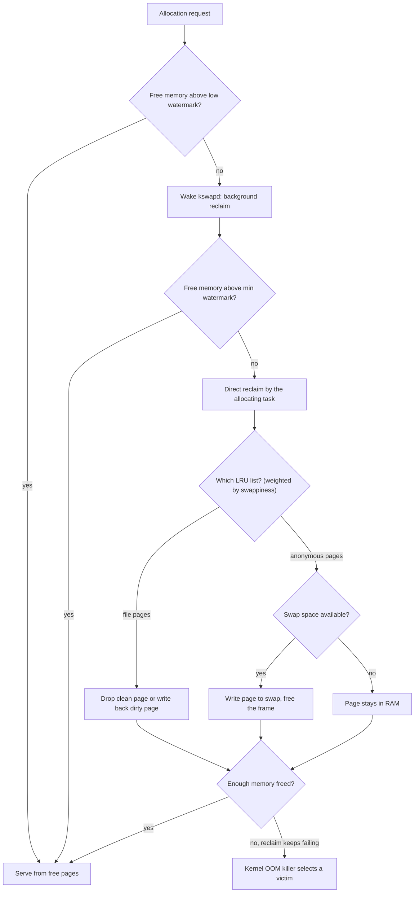
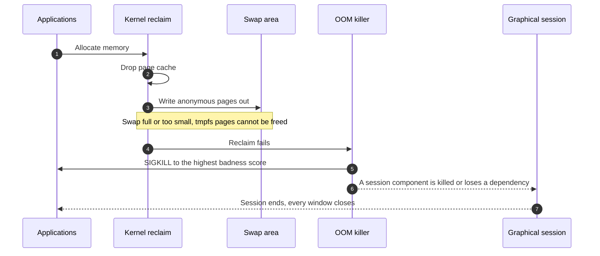

Swap is the part of Linux memory management that most people only notice when it goes wrong: the desktop freezes, the disk light stays on, or every application closes at once. It is often described as "emergency RAM on the disk", and that description leads to the wrong decisions, such as disabling it on machines with a lot of memory or sizing it with an old rule of thumb.

This article explains what swap is for the Linux kernel: a backing store for anonymous memory, which lets the kernel reclaim pages that would otherwise be pinned in RAM. It then covers how the kernel chooses between swapping and dropping the page cache, what the `swappiness` value means, the compressed variants (zram and zswap), what happens when memory runs out, the security consequences of writing memory to a disk, and a careful procedure to add a swap file.

> This article has been made with the help of [Claude Code](https://claude.com/product/claude-code) and several custom skills

[TOC]

## What you need to know first

The article assumes the reader knows what a process, a file system and the kernel are. It relies on the following memory-management concepts without developing them:

- **Virtual memory and pages.** Each process sees its own address space, which the kernel maps to physical memory in fixed-size pages (4 KiB on most x86-64 systems). A page can be mapped, unmapped, or moved to another location without the process noticing.
- **Page fault.** When a process touches a virtual address whose page is not in RAM, the CPU raises a page fault and the kernel brings the page in. Reading a page back from swap is one kind of page fault, called a major fault because it needs I/O.
- **Anonymous and file-backed pages.** File-backed pages hold the contents of a file (program code, a read file, a memory-mapped file) and can be re-read from that file. Anonymous pages hold data created at run time (heap, stack, `malloc()` buffers) and exist nowhere else.
- **Page cache.** The kernel keeps recently read and written file data in otherwise unused RAM. It is the main consumer of "free" memory on a healthy system, and it can be dropped or written back when memory is needed.
- **tmpfs and shared memory.** tmpfs is a file system that lives in memory. Its pages, like POSIX shared memory (`/dev/shm`), are counted as `Shmem` and behave like anonymous pages: they can only leave RAM by going to swap.
- **cgroups v2.** Control groups group processes and apply resource limits to them; the memory controller is what `systemd` uses to account and limit memory per service or per user session. The [Linux isolation article]({{site.url_complet}}/2026/06/29/linux-isolation-primitives-defense-in-depth/) covers them in more detail.

## What swap is

A swap area is a block device or a file that the kernel uses to store anonymous pages that are not currently in RAM. The kernel writes a page out (*swap-out*), frees the physical frame, and records in the page table where the page now lives. When the process touches the page again, the page fault handler reads it back (*swap-in*).

A swap area must be initialised with `mkswap`, which writes a header with a signature, then activated with `swapon`. The active areas are listed in `/proc/swaps` and by `swapon --show`. The `mkswap(8)` man page gives the main limits:

- "Presently, Linux allows 32 swap areas." The kernel reserves some of these type numbers for internal entries (page migration, device memory, hardware-poisoned pages), so the number of usable areas is lower and depends on the kernel configuration.
- The header addresses at most 4,294,967,295 pages; with 4 KiB pages that is about 16 TiB per area, and the rest of a larger device is ignored.
- `mkswap` refuses areas smaller than 10 pages.

### Why the kernel needs it

The page cache and anonymous memory compete for the same RAM. When memory is short, the kernel *reclaims* pages, and the two kinds cost very different amounts to reclaim:

- **A clean file-backed page** can be dropped immediately, since the file still has its content. A dirty one is written back first, then dropped.
- **An anonymous page** has no file behind it. Without swap, it cannot be reclaimed at all: it stays in RAM until the process frees it or exits.

So swap does not mainly add capacity. It gives the kernel a choice. With swap, a page of a background program that has not been touched for hours can be written out, and the RAM it occupied can hold the page cache of the file being compiled now. Without swap, the kernel has to drop the page cache instead, even the hot parts of it, because the anonymous pages are fixed in place. The [In defence of swap](https://chrisdown.name/2018/01/02/in-defence-of-swap.html) essay by a Linux memory-management developer, linked from the `systemd-oomd` documentation, makes this argument in detail.

### What can and cannot be swapped

| Kind of memory | Can leave RAM by | Notes |
|---|---|---|
| Program code, shared libraries | Being dropped and re-read from the file | No swap needed |
| Page cache of read files | Being dropped | No swap needed |
| Dirty page cache | Write-back to the file, then drop | No swap needed |
| Heap, stack, `malloc()` memory | Swap only | Anonymous memory |
| tmpfs files (`/tmp` on many distributions), `/dev/shm` | Swap only | Counted as `Shmem` |
| Pages locked with `mlock()` | Never by swap; copied by hibernation | Used for secrets and real-time code |
| Kernel memory (slab, page tables) | Never by swap | Some caches can be shrunk |

The tmpfs row matters in practice.

The [kernel's tmpfs documentation](https://docs.kernel.org/filesystems/tmpfs.html) states that "tmpfs blocks may be swapped out, when there is a shortage of memory", that the default size limit is "half of your physical RAM without swap", and warns that "if you oversize your tmpfs instances the machine will deadlock since the OOM handler will not be able to free that memory."

On a system where `/tmp` is a tmpfs, large build trees, cloned repositories or test fixtures left in `/tmp` occupy RAM, and with little or no swap that memory cannot be reclaimed. Killing a process does not free it either, because the files outlive the process that wrote them.

## How the kernel decides what to reclaim

### Watermarks, kswapd and direct reclaim

Each memory zone has three watermarks: *min*, *low* and *high*. The kernel's response depends on where the free memory sits relative to them:

- **Above *low***: nothing happens; allocations are served from free pages.
- **Below *low***: the `kswapd` kernel thread wakes up and reclaims pages in the background until free memory is back above *high*.
- **Below *min***: an allocating process has to reclaim pages itself before its allocation succeeds. This *direct reclaim* is what makes a program stall under memory pressure.

The distance between the watermarks is set by `vm.watermark_scale_factor`. The [vm sysctl documentation](https://docs.kernel.org/admin-guide/sysctl/vm.html) gives its unit as "fractions of 10,000": the default of 10 means 0.1% of the available memory, and the maximum of 3000 means 30%. Raising it makes `kswapd` start earlier, which leaves more headroom for bursts of allocation.

Reclaim walks LRU (least recently used) lists. The kernel keeps separate lists for anonymous and file-backed pages, each split into active and inactive parts, and takes pages from the inactive end of each list. How hard it scans the anonymous list compared with the file list is what `swappiness` controls.



### What `swappiness` means

`vm.swappiness` is often explained as "the percentage of RAM in use before swapping starts". That is wrong. The kernel documentation defines it as follows:

> This control is used to define the rough relative IO cost of swapping and filesystem paging, as a value between 0 and 200. At 100, the VM assumes equal IO cost and will thus apply memory pressure to the page cache and swap-backed pages equally; lower values signify more expensive swap IO, higher values indicates cheaper.

The default is 60, so by default the kernel considers swap I/O more expensive than file I/O and prefers to drop the page cache. Two values have a specific meaning:

- **0**: "the kernel will not initiate swap until the amount of free and file-backed pages is less than the high watermark in a zone." It does not disable swap: under real pressure the kernel still swaps.
- **Above 100**: the documentation suggests these "for in-memory swap, like zram or zswap, as well as hybrid setups that have swap on faster devices than the filesystem." Its own example: if random swap I/O is twice as fast as file I/O, `swappiness` should be about 133 (x + 2x = 200).

The value is a cost ratio, not a threshold. A machine with a lot of free memory does not swap whatever the setting, because nothing triggers reclaim, unless a cgroup reaches its own `memory.high` or `memory.max` limit (see below), which starts reclaim inside that group.

### Reading pages back: `page-cluster`

When a page is swapped in, the kernel also reads its neighbours in the swap area, on the bet that they will be needed too. `vm.page-cluster` is "a logarithmic value": 0 means 1 page, 1 means 2 pages, and the default of 3 means eight pages at a time (32 KiB with 4 KiB pages). "Zero disables swap readahead completely", which is the usual setting for zram, where there is no seek cost to amortise.

## Swap partition, swap file and their priorities

Linux treats a swap partition and a swap file almost identically. A swap file is placed on an existing file system; on local file systems such as ext4 and XFS, the kernel maps its blocks once at `swapon` time and then writes to them directly, without going through the file system. That design explains every restriction on swap files:

| | Swap partition | Swap file |
|---|---|---|
| Resizing | Repartition, or resize a logical volume | Create a new file |
| Placement | Its own partition or LVM volume | Any supported file system |
| File system constraints | None | No holes; no copy-on-write |
| Hibernation | `resume=<device>` | `resume=<device>` plus `resume_offset=` |
| Encryption | Its own dm-crypt mapping, or inside an encrypted LVM | Inherits the encryption of the file system it lives on |

The [`swapon(8)`](https://man7.org/linux/man-pages/man8/swapon.8.html) man page documents the file restrictions:

- **No holes.** "Commands like cp(1) or truncate(1) create files with holes. These files will be rejected by swapon."
- **Preallocation depends on the file system.** "Preallocated files created by fallocate(1) may be interpreted as files with holes too depending of the filesystem." It works on ext4 and is supported on XFS since Linux 4.18. The page calls `dd` from `/dev/zero` "the most portable solution".
- **Btrfs needs a no-copy-on-write file.** The [Btrfs documentation](https://btrfs.readthedocs.io/en/latest/Swapfile.html) requires a single-device file system with a single data profile, a preallocated `NODATACOW` file (so no checksums and no compression), and forbids snapshotting a subvolume that holds an active swap file. Since btrfs-progs 6.1, `btrfs filesystem mkswapfile` creates a correct one; since util-linux 2.41, `mkswap --file` sets the no-copy-on-write attribute as well.
- **NFS**: "Swap over NFS may not work."

### Priorities

When several swap areas are active, each has a priority. The [`swapon(2)`](https://man7.org/linux/man-pages/man2/swapon.2.html) man page gives the rules: "Swap pages are allocated from areas in priority order, highest priority first. For areas with different priorities, a higher-priority area is exhausted before using a lower-priority area. If two or more areas have the same priority, and it is the highest priority available, pages are allocated on a round-robin basis between them." A priority set explicitly (`swapon -p`, or `pri=` in `/etc/fstab`) is a value from 0 to 32767; areas without one get negative default priorities, each newer area lower than the previous one.

Two common uses follow. Two swap areas on two different disks with the same priority are used in turn, like a stripe. A fast area (zram, or an NVMe device) with a higher priority than a slow one fills first, and the slow area only takes the overflow.

## Compressed swap: zram and zswap

Both mechanisms compress pages in RAM, on the basis that compressing a page costs far less time than writing it to a disk. They differ in where they sit:

- **zram** is a block device. The [zram documentation](https://docs.kernel.org/admin-guide/blockdev/zram.html) describes "RAM-based block devices named /dev/zram<id>", where "pages written to these disks are compressed and stored in memory itself." Formatted with `mkswap` and activated with `swapon`, it is a swap area like any other, with no disk behind it. The documentation notes there is "little point creating a zram of greater than twice the size of memory since we expect a 2:1 compression ratio." With `CONFIG_ZRAM_WRITEBACK`, idle or incompressible pages can be written to a backing partition.
- **zswap** is a cache in front of an existing swap area. The [zswap documentation](https://docs.kernel.org/admin-guide/mm/zswap.html) calls it "a lightweight compressed cache for swap pages": it intercepts pages on their way to swap, keeps them compressed in a RAM pool, and "evicts pages from compressed cache on an LRU basis to the backing swap device when the compressed pool reaches its size limit" (`max_pool_percent`).

| | zram as swap | zswap |
|---|---|---|
| Needs a disk swap area | No | Yes, as the backing store |
| Where cold pages end up | Stay compressed in RAM (or a writeback partition) | Written to the disk swap area |
| Incompressible pages | Stored anyway, using RAM | Can go to disk |
| Typical setup | `systemd-zram-generator`, or a distribution default | Kernel parameter `zswap.enabled=1` |
| Touches the disk | No (without writeback) | Yes, on eviction |

The choice follows from the hardware. A machine with no disk swap, or one where writing memory to a disk is undesirable, uses zram. A machine with a disk swap area gains from zswap, which absorbs most of the swap traffic in RAM and writes only the pages it evicts or cannot compress well. Running both at once is possible but wasteful, since zswap would compress pages that are on their way to a device that compresses them again.

## When memory runs out

### Thrashing

Swap delays an out-of-memory situation; it does not prevent one. When the working set (the pages that processes actively use) is larger than RAM, the kernel keeps writing out pages that are needed again a moment later. The system then spends its time on swap I/O and page faults: the mouse pointer still moves, but applications take seconds to respond. This state is called thrashing, and on a slow disk it can last minutes before anything is killed.

### Pressure stall information

[Pressure stall information (PSI)](https://docs.kernel.org/accounting/psi.html) measures this directly. `/proc/pressure/memory`, and the `memory.pressure` file of every cgroup, contain two lines:

```text
some avg10=0.00 avg60=0.00 avg300=0.00 total=0
full avg10=0.00 avg60=0.00 avg300=0.00 total=0
```

The `some` line is "the share of time in which at least some tasks are stalled on a given resource", and the `full` line "the share of time in which all non-idle tasks are stalled on a given resource simultaneously", as percentages over 10, 60 and 300 second windows. A high `full` value on memory means the machine is doing nothing but waiting for reclaim, which is thrashing measured.

### The kernel OOM killer

When reclaim keeps failing, the kernel invokes the out-of-memory (OOM) killer. It gives each candidate process a *badness* score from 0 to 1000; the [`proc_pid_oom_score_adj(5)`](https://man7.org/linux/man-pages/man5/proc_pid_oom_score_adj.5.html) man page says the units are "roughly a proportion along that range of allowed memory the process may allocate from, based on an estimation of its current memory and swap use". The per-process value `/proc/<pid>/oom_score_adj`, from -1000 to +1000, is added to that score; -1000 "is equivalent to disabling OOM-killing entirely for that task". Browsers set a positive value on their content processes so that a tab dies before the browser does.

The kernel killer has two weaknesses on a desktop:

- **It acts late.** It only runs once reclaim has failed, which on a system with swap on a slow disk can follow minutes of thrashing.
- **It kills single processes, not applications.** The victim may be one helper of a larger program. If that helper is part of the graphical session (the compositor, the display server, or a component they depend on), the session ends, and every application running in it ends with it. The user sees all windows close at once, with no warning.

Where memory is used by tmpfs or shared memory, killing processes frees little, so the killer may have to kill several processes in a row.



### Earlier, user-space killers

User-space daemons watch memory and act before the kernel has to:

- **[systemd-oomd](https://www.freedesktop.org/software/systemd/man/latest/systemd-oomd.service.html)** "uses cgroups-v2 and pressure stall information (PSI) to monitor and take corrective action before an OOM occurs in the kernel space." It monitors units that set `ManagedOOMSwap=kill` or `ManagedOOMMemoryPressure=kill`, and when a limit is exceeded, it kills a whole descendant cgroup, so an application goes as a unit rather than piece by piece. By default it acts when memory pressure, measured as the fraction of time stalled in a 10-second window, stays above 60% for 30 seconds (`DefaultMemoryPressureLimit=`, `DefaultMemoryPressureDurationSec=` in [`oomd.conf(5)`](https://www.freedesktop.org/software/systemd/man/latest/oomd.conf.html)); a unit can set its own limit with `ManagedOOMMemoryPressureLimit=`.
- **[earlyoom](https://github.com/rfjakob/earlyoom)** checks available memory and free swap and kills the process with the highest `oom_score` when both fall below a threshold. It is simpler than systemd-oomd and does not need cgroup accounting.

The systemd-oomd documentation makes a point that links these tools back to swap: "It is highly recommended for the system to have swap enabled for systemd-oomd to function optimally. With swap enabled, the system spends enough time swapping pages to let systemd-oomd react. Without swap, the system enters a livelocked state much more quickly and may prevent systemd-oomd from responding in a reasonable amount of time." Swap is what turns a sudden failure into a gradual one that a monitor can see coming.

### Limits per cgroup

The cgroup v2 memory controller, described in the [kernel's cgroup v2 documentation](https://docs.kernel.org/admin-guide/cgroup-v2.html), bounds a group of processes rather than the whole machine:

- **`memory.max`** is the hard limit: "If a cgroup's memory usage reaches this limit and can't be reduced, the OOM killer is invoked in the cgroup."
- **`memory.high`** throttles: processes over it are "put under heavy reclaim pressure", and "going over the high limit never invokes the OOM killer".
- **`memory.swap.max`** is a swap hard limit: once reached, "anonymous memory of the cgroup will not be swapped out."
- **`memory.oom.group`**, when set, makes the cgroup "an indivisible workload by the OOM killer": its tasks "are killed together or not at all."

With systemd, the limits are set through `MemoryMax=`, `MemoryHigh=` and `MemorySwapMax=` on a service, a slice or a scope, and the group kill through `OOMPolicy=kill` on a service or a scope, which sets `memory.oom.group` to 1. A runaway build or test run confined to a scope with `MemoryMax=` hits its own limit and is killed alone, instead of pushing the whole machine into reclaim.

## Security considerations

Swap writes the contents of process memory to a device. Whatever a process holds in an anonymous page can end up in the swap area: a decrypted document, a password typed into a prompt, a private key or a session token. That data stays there after the process exits and after a reboot, until the slot is overwritten. An attacker with access to the disk, or to a backup or image of it, can search the swap area for such data.

The defences fall into four groups:

- **Encrypt the swap area.** Swap inside an encrypted LVM volume, or a swap file on an encrypted file system, is encrypted at rest with the rest of the disk. A swap partition can also be given its own dm-crypt mapping with a random key generated at each boot; the [`crypttab(5)`](https://man7.org/linux/man-pages/man5/crypttab.5.html) man page shows the form `cswap /dev/sda6 /dev/urandom plain,cipher=aes-xts-plain64,size=256,hash=sha1,swap`. With a random key, the contents become unreadable at shutdown, but hibernation is no longer possible, since the key needed to read the image back is lost.
- **Restrict access to the swap file.** The file must belong to root with mode `0600`. A world-readable swap file lets any local user read memory of every process, including root's. `mkswap` and `swapon` warn about insecure permissions, but the warning does not stop them.
- **Keep secrets out of swap in the program.** [`mlock(2)`](https://man7.org/linux/man-pages/man2/mlock.2.html) and `mlockall()` "lock part or all of the calling process's virtual address space into RAM, preventing that memory from being paged to the swap area." Password managers, `gpg-agent` and key-handling libraries use it for their key material. It is limited by `RLIMIT_MEMLOCK` for unprivileged processes.
- **Treat hibernation as writing all of RAM to disk.** The [swsusp documentation](https://docs.kernel.org/power/swsusp.html) states that "swsusp saves the state of the machine into active swaps". The image includes memory that `mlock()` kept out of normal swap: the `mlock(2)` man page warns that suspend to disk "will save a copy of the system's RAM to disk, regardless of memory locks." It also includes the keys of mounted encrypted volumes, which the kernel holds in RAM. Hibernation is only safe on an encrypted swap area whose key is not stored next to it.

zram without a writeback device avoids the disk entirely, so its contents disappear at power-off. It is the option that keeps the reclaim benefit of swap with no persistent copy, at the cost of using RAM to hold the compressed pages.

## Adding a swap file safely

The procedure below adds an 8 GiB swap file on ext4 or XFS. Each step only runs if the previous one succeeded, the file system table is backed up first, and the entry is not added twice if the command runs again:

```bash
sudo cp /etc/fstab /etc/fstab.bak.$(date +%F) && \
sudo fallocate -l 8G /swapfile && \
sudo chmod 600 /swapfile && \
sudo mkswap /swapfile && \
sudo swapon /swapfile && \
{ grep -q '^/swapfile ' /etc/fstab || echo '/swapfile none swap sw 0 0' | sudo tee -a /etc/fstab; }
```

Some details of the order:

- **`chmod 600` comes before `mkswap` and `swapon`.** The file is created with the default mode, but at that point it holds no data; it is restricted before any page is written to it.
- **`fallocate` is fine on ext4 and XFS.** On a file system where it creates a file `swapon` rejects, replace it with `sudo dd if=/dev/zero of=/swapfile bs=1MiB count=8192`. On Btrfs, use `sudo btrfs filesystem mkswapfile --size 8G /swapfile` instead of both.
- **The file inherits the disk's encryption.** If the root file system is not encrypted, neither is the swap file; see the previous section.

Then check the result:

```bash
swapon --show          # the file is listed with its size and priority
ls -l /swapfile        # -rw------- 1 root root
sudo findmnt --verify  # no error in /etc/fstab
```

To remove it: `sudo swapoff /swapfile && sudo rm /swapfile`, then delete the line from `/etc/fstab`. `swapoff` has to read every page in the area back into RAM, so on a busy machine it can take a while and can itself fail if RAM is not large enough to hold them.

### How much swap

There is no single rule. The amount depends on what the swap is for:

- **Reclaim of cold anonymous memory** needs little: a few gigabytes let the kernel move idle pages out and keep the page cache for active work.
- **Absorbing bursts** (a large build, many browser tabs, a virtual machine started on top of the rest) needs enough to cover the burst, ideally with a user-space OOM daemon that kills the offender before the machine thrashes.
- **Hibernation** needs room for the memory image. The kernel tries to keep the image under `/sys/power/image_size`, which defaults to about two fifths of RAM, by freeing memory first; if it cannot, it writes a larger image. A swap area at least as large as that default, with margin, is the usual minimum, and a heavily loaded machine needs more.

On fast storage, more swap mostly costs disk space. On a slow disk, a large swap area can make thrashing last longer before anything is killed, which is the case where a user-space killer and cgroup limits matter most.

## Conclusion

Swap is a backing store for anonymous memory, and its main role is to let the kernel choose which pages to keep in RAM, not to extend RAM.

- **Without swap**, anonymous pages and tmpfs files cannot leave RAM, so the kernel can only reclaim the page cache, and runs out of options sooner.
- **`swappiness`** sets the relative cost of swap I/O against file I/O on a 0 to 200 scale (default 60), not a usage threshold.
- **Swap files** behave like partitions as long as the file has no holes and no copy-on-write; Btrfs needs a dedicated procedure.
- **zram** keeps compressed pages in RAM with no disk, unless a writeback device is configured; **zswap** is a compressed cache in front of a disk swap area.
- **The kernel OOM killer** acts late and kills single processes, which on a desktop can end the whole graphical session. **systemd-oomd** and **earlyoom** act earlier on pressure or free memory, and the systemd-oomd documentation recommends swap so that pressure builds slowly enough for it to react.
- **cgroup limits** (`memory.max`, `memory.high`, `memory.swap.max`) confine a runaway workload to its own group.
- **Security**: swap stores memory contents on a device. It should be encrypted, readable only by root, and kept free of secrets with `mlock()`; a hibernation image contains everything.


## Annex

### Key Terms

| Term | Definition |
|------|------------|
| **Page** | The fixed-size unit (4 KiB on most x86-64 systems) in which the kernel maps, reclaims and swaps memory. |
| **Page fault** | A CPU exception raised when a process touches a page that is not mapped in RAM; a major fault needs I/O, such as a swap-in. |
| **Anonymous page** | A page of memory with no file behind it (heap, stack, `malloc()` buffers); swap is its only backing store. |
| **File-backed page** | A page holding file contents, which can be dropped and re-read from the file without swap. |
| **Page cache** | File data the kernel keeps in otherwise unused RAM; favoured for reclaim over anonymous memory under the default `swappiness`. |
| **Shmem** | Memory used by tmpfs and shared memory; it behaves like anonymous memory and can only leave RAM through swap. |
| **Reclaim** | The kernel freeing pages by dropping, writing back or swapping them out when free memory is low. |
| **Watermarks** | The min, low and high thresholds of free memory that wake `kswapd` and trigger direct reclaim. |
| **kswapd** | The kernel thread that reclaims memory in the background when free memory falls below the low watermark. |
| **Direct reclaim** | Reclaim performed by the allocating process itself below the min watermark, which makes it stall. |
| **Swap area** | A partition or file initialised by `mkswap` and activated by `swapon`, holding swapped-out anonymous pages. |
| **swappiness** | The `vm.swappiness` sysctl, from 0 to 200, giving the relative cost of swap I/O against file I/O (default 60). |
| **zram** | A compressed block device in RAM, usable as a swap area with no disk behind it. |
| **zswap** | A compressed RAM cache in front of a disk swap area; pages it evicts, or cannot store, go to the disk. |
| **Thrashing** | The state where the working set exceeds RAM and the system spends its time swapping pages in and out. |
| **PSI** | Pressure stall information: the share of time tasks are stalled on memory, CPU or I/O, in `/proc/pressure/`. |
| **OOM killer** | The kernel mechanism that kills the process with the highest badness score when reclaim fails. |
| **oom_score_adj** | A per-process value from -1000 to +1000 added to the badness score; -1000 exempts the process. |
| **systemd-oomd** | A user-space daemon that kills whole cgroups based on memory pressure and swap use, before the kernel OOM killer. |
| **mlock()** | The system call that locks pages in RAM so they are never written to swap. |

### Security Implementation Checklist

Swap is configured by every administrator rather than implemented once, so the checklist targets a configuration: a machine is checked against each row.

#### Storage and access

| Check | Security requirement | Failure mode if violated |
|:---:|------------|------------|
| ☐ | The swap area is encrypted: inside an encrypted volume, or its own dm-crypt mapping. | Memory contents (keys, passwords, documents) are readable from the disk or a disk image after shutdown. |
| ☐ | A swap file belongs to root and has mode `0600`. | Any local user can read the memory of every process, including root's. |
| ☐ | A swap file has no holes and, on copy-on-write file systems, the no-copy-on-write attribute. | `swapon` rejects the file, or on Btrfs the file system cannot guarantee direct writes. |
| ☐ | Disk images and backups that include the swap area are treated as containing memory dumps. | Secrets leak through a backup that was considered harmless. |

#### Secrets in memory

| Check | Security requirement | Failure mode if violated |
|:---:|------------|------------|
| ☐ | Programs holding keys lock them with `mlock()` and clear them after use. | Key material is written to swap and persists on the disk. |
| ☐ | Hibernation is only enabled on an encrypted swap area whose key is not stored next to it. | The hibernation image exposes all of RAM, including disk encryption keys. |
| ☐ | Swap with a random per-boot key is not combined with hibernation. | The resume image cannot be read back, and the hibernated session is lost. |

#### Availability

| Check | Security requirement | Failure mode if violated |
|:---:|------------|------------|
| ☐ | A user-space OOM daemon (systemd-oomd or earlyoom) is active, with limits that fit the workload. | The machine thrashes, then the kernel kills processes late, possibly a session component. |
| ☐ | Large or untrusted workloads run in a cgroup with `memory.max` (`MemoryMax=`). | One runaway process pushes the whole machine into reclaim and out of memory. |
| ☐ | tmpfs mounts have a `size=` limit that fits the RAM plus swap, and large data is not left in them. | tmpfs data occupies RAM that no OOM kill can free; the kernel warns oversizing deadlocks the machine. |
| ☐ | Critical services have a negative `oom_score_adj` (`OOMScoreAdjust=`), used sparingly. | The OOM killer kills an essential service, or, if overused, has no acceptable victim left. |

## Frequently Asked Questions

**Q: Does a machine with a lot of RAM still need swap?**

It benefits from a small swap area.

Without swap, anonymous pages that no process has touched for hours stay in RAM permanently, and the kernel can only reclaim the page cache, even its active parts. With swap, those cold pages can be moved out and the RAM used for caching. A machine that never comes close to filling its RAM does not swap at all, whatever the configuration, so the swap area costs only disk space there.

Swap also gives systemd-oomd time to react before a sudden out-of-memory event.

**Q: What does `vm.swappiness=10` do, and what does it not do?**

It tells the kernel that swap I/O is much more expensive than file I/O, so under memory pressure reclaim takes pages from the page cache far more than from anonymous memory. It does not mean "swap when RAM is 90% full": `swappiness` is not a threshold, and nothing is reclaimed while free memory stays above the watermarks. It does not disable swap either; even at 0 the kernel swaps once free and file-backed pages fall below the high watermark.

**Q: What is the difference between zram and zswap, and when is each one used?**

zram is a compressed block device in RAM that serves as a swap area on its own; swapped pages stay in RAM, compressed, and are never written to a disk unless writeback is configured.

zswap is a compressed cache in front of a disk swap area: pages are compressed in RAM first and written to the disk only when the pool is full.

zram suits machines with no disk swap or where memory must stay off the disk; zswap suits machines that already have a disk swap area and want to reduce its I/O.

**Q: Why can a desktop close every application at once when memory runs out, and what reduces the risk?**

The kernel OOM killer acts only after reclaim has failed, and it kills individual processes. If the process it kills, or a process the session depends on, belongs to the graphical session (the compositor or the display server), the session ends and every application in it ends too. The risk grows when memory is held by tmpfs or shared memory, which no kill frees, and when swap is too small to absorb the burst. Three measures reduce it:

- Enough swap, so pressure builds gradually instead of failing at once.
- A user-space OOM daemon (systemd-oomd with a pressure limit on the user session, or earlyoom) that kills one heavy application early.
- Cleaning or limiting tmpfs mounts such as `/tmp`, and running large jobs in a cgroup with `MemoryMax=`.

**Q: Why is a swap file created with `cp` or `truncate` rejected, while one created with `dd` works?**

The kernel maps the blocks of a swap file once, at `swapon` time, and then writes to them directly without the file system. A file with holes has ranges with no blocks allocated, so there is nothing to map. `cp` of a sparse file and `truncate` create such holes; `dd` from `/dev/zero` writes every block, so they are all allocated. `fallocate` allocates blocks without writing them, which ext4 and XFS accept and some other file systems treat as holes.

**Q: How can secrets leak through swap, and which measures prevent it?**

Any anonymous page can be written to the swap area, and what is written stays on the device after the process exits and after a reboot. A decrypted key, a typed password or a session token can therefore be recovered from the disk or from an image of it.

Encryption of the swap area protects the data at rest; mode `0600` on a swap file stops other local users from reading it; `mlock()` keeps key material out of swap; and zram without writeback avoids writing memory to any persistent device. Hibernation writes all of RAM, locked pages included, so it needs an encrypted swap area whose key is not stored with it.

**Q: A build job in a cgroup has `MemoryMax=4G` and `MemorySwapMax=0`. What happens when it needs 5 GiB?**

The job cannot swap, because `memory.swap.max` is 0, so once it reaches 4 GiB the kernel reclaims what it can inside the cgroup (its page cache). When that is not enough, the OOM killer is invoked inside the cgroup, so a process of the build job is killed and the rest of the machine is not affected. With `memory.oom.group` set (`OOMPolicy=kill` on a service), the whole job is killed together instead of leaving it half-running.

## Gaps

Some points in this article come from general knowledge rather than from the sources cited, or depend on the kernel version.

| Gap | Why it matters | What to read or verify |
|-----|----------------|------------------------|
| The storage of the swap location in the page table entry, and the swap cache, are described from general knowledge. | The "What swap is" section relies on them. | [Kernel memory-management documentation](https://docs.kernel.org/mm/index.html), the swap and page-table chapters. |
| The LRU description (active and inactive anonymous and file lists) predates the multi-generational LRU (MGLRU), which recent kernels can enable. | Reclaim order differs when MGLRU is active. | [Multi-Gen LRU documentation](https://docs.kernel.org/admin-guide/mm/multigen_lru.html). |
| The watermark behaviour (kswapd below low, direct reclaim below min) is a simplification from general knowledge. | Exact triggers depend on allocation flags and zones. | The `min_free_kbytes` and `watermark_scale_factor` entries of the [vm sysctl documentation](https://docs.kernel.org/admin-guide/sysctl/vm.html). |
| The defaults of zswap (enabled state, compressor, pool size) depend on kernel build options and distributions. | Whether zswap is active by default varies from one system to another. | `/sys/module/zswap/parameters/` on the target system and the [zswap documentation](https://docs.kernel.org/admin-guide/mm/zswap.html). |
| The earlyoom thresholds and selection logic are summarised, not quoted. | Its exact defaults decide when it kills. | The [earlyoom README](https://github.com/rfjakob/earlyoom). |
| The swap sizing guidance, including "about the size of the RAM in use" for hibernation, is general practice, not a documented rule. | A hibernation image that does not fit fails to write. | Distribution documentation on hibernation, and the [swsusp documentation](https://docs.kernel.org/power/swsusp.html). |
| That browsers give their content processes a positive `oom_score_adj` is general knowledge of Chromium and Firefox, not from a cited source. | The OOM section uses it as an example of the adjustment. | `/proc/<pid>/oom_score_adj` of a running browser, and the browser's source. |
| `vm.page-cluster=0` as the usual setting with zram is common distribution practice, not stated in the kernel documentation. | A reader may apply it to disk swap, where readahead helps. | The zram setup of the reader's distribution, for example [zram-generator](https://github.com/systemd/zram-generator). |
| Linux on ext4 accepting `fallocate`-created swap files is general practice; `swapon(8)` only names XFS. | The procedure uses `fallocate`. | Test `swapon` on the target file system, or use `dd`. |
| The number of usable swap areas (32 minus internal reservations) depends on `CONFIG_MIGRATION`, `CONFIG_DEVICE_PRIVATE` and `CONFIG_MEMORY_FAILURE`. | The article does not give the exact number. | `MAX_SWAPFILES` in `include/linux/swap.h` of the running kernel. |
| That running zram and zswap together is wasteful, and that `zswap.enabled=1` is the usual way to enable zswap, are general practice. | A reader may combine them or rely on a distribution default. | The [zswap documentation](https://docs.kernel.org/admin-guide/mm/zswap.html) and the distribution's defaults. |
| That `gpg-agent` and password managers lock their key material with `mlock()` is general knowledge, not checked in their source. | The security section uses them as examples. | The source of the tools concerned. |
| The default of `DefaultOOMPolicy=` is not given in the local `systemd-system.conf(5)`. | The FAQ assumes a partial kill without `OOMPolicy=kill`. | `systemctl show -p DefaultOOMPolicy` on the target system. |
| The statement that `mkswap` and `swapon` warn about insecure permissions without refusing comes from general knowledge of util-linux. | A reader may rely on the tools to enforce mode `0600`. | The util-linux source of `mkswap` and `swapon`. |

## References

### Kernel documentation

- [Documentation for /proc/sys/vm/](https://docs.kernel.org/admin-guide/sysctl/vm.html): `swappiness`, `page-cluster`, `watermark_scale_factor`, `overcommit_memory`
- [zswap](https://docs.kernel.org/admin-guide/mm/zswap.html)
- [zram: Compressed RAM-based block devices](https://docs.kernel.org/admin-guide/blockdev/zram.html)
- [Control Group v2](https://docs.kernel.org/admin-guide/cgroup-v2.html): memory controller interface files
- [PSI - Pressure Stall Information](https://docs.kernel.org/accounting/psi.html)
- [Tmpfs](https://docs.kernel.org/filesystems/tmpfs.html)
- [Swap suspend](https://docs.kernel.org/power/swsusp.html)

### Manual pages

- [`swapon(8)`](https://man7.org/linux/man-pages/man8/swapon.8.html) and [`mkswap(8)`](https://man7.org/linux/man-pages/man8/mkswap.8.html), util-linux
- [`swapon(2)`](https://man7.org/linux/man-pages/man2/swapon.2.html): swap priorities
- [`proc_pid_oom_score_adj(5)`](https://man7.org/linux/man-pages/man5/proc_pid_oom_score_adj.5.html)
- [`mlock(2)`](https://man7.org/linux/man-pages/man2/mlock.2.html)
- [`crypttab(5)`](https://man7.org/linux/man-pages/man5/crypttab.5.html)
- [`systemd-oomd.service(8)`](https://www.freedesktop.org/software/systemd/man/latest/systemd-oomd.service.html) and [`oomd.conf(5)`](https://www.freedesktop.org/software/systemd/man/latest/oomd.conf.html)

### Other sources

- [Btrfs documentation, Swapfile](https://btrfs.readthedocs.io/en/latest/Swapfile.html)
- [In defence of swap: common misconceptions](https://chrisdown.name/2018/01/02/in-defence-of-swap.html), Chris Down, 2018
- [earlyoom](https://github.com/rfjakob/earlyoom)
- [Claude Code](https://claude.com/product/claude-code)

### Related articles

- [Linux Isolation Primitives - Defense in Depth Beyond the Castle Model]({{site.url_complet}}/2026/06/29/linux-isolation-primitives-defense-in-depth/)
- [System Calls, Binary Images and Processes - How a Program Reaches the Kernel]({{site.url_complet}}/2026/09/16/system-calls-binary-image-process/)
- [The Process Control Block, fork/exec/waitpid/exit and the Context Switch]({{site.url_complet}}/2026/09/16/process-control-block-fork-exec-context-switch/)
