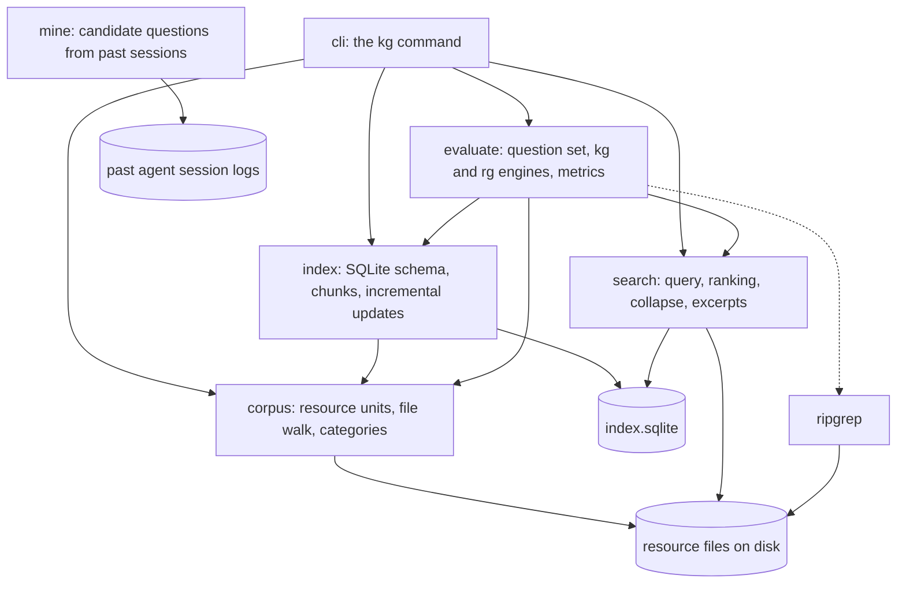
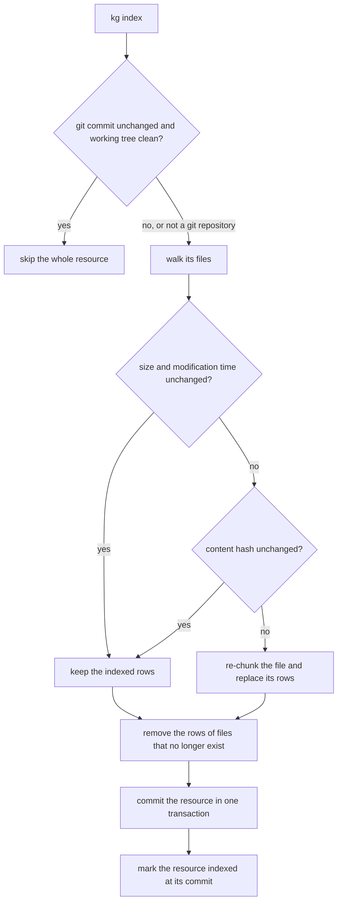
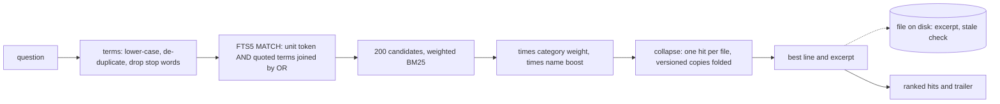
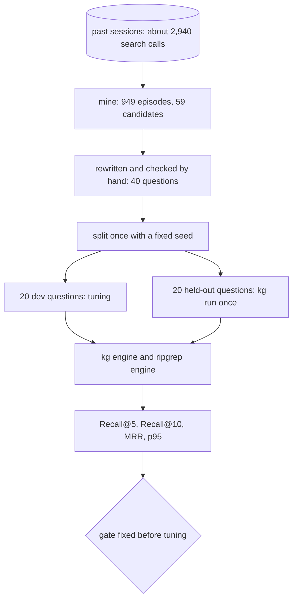
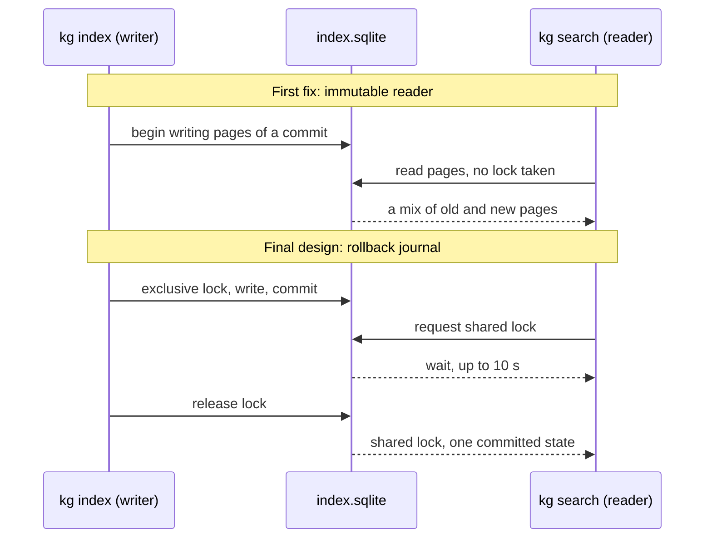

An AI coding agent such as [Claude Code](https://claude.com/product/claude-code) works on a local machine and reads files with the same shell tools a developer uses. When the material it must consult is a collection of a few hundred repositories, specifications and documentation sets, the agent usually knows *which* project answers a question, because an index file, generated from the collection, lists every project with a one-line description. It does not know *where inside it* the answer is. It then runs `grep` or `ripgrep` again and again, reads files that turn out to be wrong, and spends its context window on navigation.

`kg` is a small command-line tool written to fix that one problem. It keeps a local full-text index of every file in such a collection, built with [SQLite FTS5](https://www.sqlite.org/fts5.html), and answers `kg search "<question>" --repo <project>` with a few ranked, line-anchored results, each with the reason it was ranked there. This article describes the problem, the architecture, how it was evaluated against `ripgrep`, the defects its verification found, the design choices and their trade-offs, and what is left to improve.

> This article has been made with the help of [Claude Code](https://claude.com/product/claude-code) and several custom skills

[TOC]

## What you need to know first

The article assumes familiarity with the command line, git and SQL, and relies on the following mechanisms without deriving them.

- **Inverted index.** A full-text index maps every term to the list of documents (and positions) that contain it, so a query reads a few short lists instead of scanning the text. `kg` indexes *chunks* of files rather than whole files.
- **BM25.** The standard relevance score for keyword search: a document scores higher when it contains the query's terms often, when those terms are rare in the collection, and when the document is short. SQLite exposes it as the `bm25()` function, with one weight per column.
- **SQLite FTS5 contentless tables.** An FTS5 table normally stores a copy of the text it indexes. A *contentless* table (`content=''`) stores only the index, so the text must be read back from the original files. With `contentless_delete=1`, rows can be deleted by their id.
- **SQLite journal modes.** In WAL mode, readers and writers share two side files (`-wal`, `-shm`) next to the database. In the classic rollback-journal mode (`DELETE`), a reader only takes a shared lock on the file, and a writer keeps a temporary `-journal` file during its transaction.
- **Recall@k and MRR.** Recall@k is the share of questions whose expected file appears in the top k results. MRR (mean reciprocal rank) averages 1/rank of the first correct result, so 1.0 means "always first" and 0.5 roughly "usually second".
- **Git submodules.** A repository can pin other repositories at a given commit. Most of the indexed collection is made of submodules, which gives `kg` a cheap way to know whether a project changed: its commit.

## The problem, measured

Before any code was written, the problem was measured on real usage rather than assumed. The past sessions of the coding agent contained about 2,940 search calls (`grep`, `rg`, `find`) into the collection. Grouped into *episodes*, consecutive calls on one project, they gave a median of **5 search and read calls per lookup** and **17 at the 90th percentile**. An early experiment on part of the sessions, with 564 episodes, and the later mining run described in the evaluation, with 949 episodes, gave the same two figures.

Two causes stood out when the episodes were read:

- **Noise.** A keyword appears in vendored dependencies, generated files, build artefacts, translated copies and test fixtures as often as in the file that explains it. `ripgrep` has no notion of which match matters.
- **No ranking.** `ripgrep` returns matches in path order. The agent then opens files one by one until one answers.

The collection itself is large and uneven: about 340 resource units (git submodules, documentation scrapes and plain folders), 20 GB on disk, and about 700,000 files after the junk is skipped. Two thirds of those files were first classified as configuration, almost all of it JSON, and 400,000 of them sat in a single security-advisory database.

## Goals and non-goals

The first proposal for the project was much broader: a knowledge graph of 24 entity types and 24 relationship types, AI-written summaries, and a PDF export for an LLM to read. It was rejected for this use for three reasons. An agent with a shell can grep text but not a PDF, a graph of a 20 GB corpus would need constant upkeep, and nothing showed that such a structure would find files better than a simple index.

The project therefore kept one goal: **find the right file inside a known resource faster and with less noise than `ripgrep`, and prove it on real questions before building anything bigger.** That gave a short list of non-goals for the first version: no embeddings, no graph, no call graphs, no MCP server, no PDF, no cloud service, and the existing project index file left untouched. That file stays step one, choosing the project, and `kg` is step two, finding the file.

## Architecture

`kg` is about 3,000 lines of Python using only the standard library (`sqlite3`, `argparse`, `subprocess`). It has six modules, each exposing a few public functions and hiding the rest. The diagram shows the main calls: solid arrows are calls, the dashed arrow is the evaluation's baseline that bypasses the index.



- **`corpus`** lists the resource units and walks their files, skipping what is never worth indexing and tagging the rest with a category.
- **`index`** owns the database: its schema, how files are cut into chunks, change detection, and the only code that writes.
- **`search`** turns a free-text question into a safe query, ranks the matches, folds duplicates, and reads excerpts back from disk.
- **`evaluate`** scores an engine (`kg` or `ripgrep`) on a fixed question set.
- **`mine`** extracts candidate questions from the agent's past sessions; it is a build-time tool only.
- **`cli`** is the `kg` command, with compact text or stable JSON output.

The tuning numbers of the search engine, such as size limits, weights and timeouts, are named in one constants file.

## The corpus: what gets indexed, and how it is labelled

### Resource units

A *resource* is the unit a question names with `--repo`. There are three kinds, recognised with the same rules the project index file uses:

- **Submodules**, listed in the collection's `.gitmodules`. A submodule nested in another belongs to the outer one.
- **Documentation scrapes**, recognised by their folder name (ending in `-docs` or `.git`) or by an `_index.md` file.
- **Folders**: one unit per top-level folder for whatever is left, so a stray README is still searchable.

A resource is named by its path in the collection, for example `ethereum/consensus-specs`. A basename that no other resource shares, here `consensus-specs`, works as an alias, and an exact id always wins over an alias.

### Skipped files and categories

Some files are never indexed: `.git`, `node_modules`, build outputs, binaries, images, archives, fonts, lockfiles, minified files and symlinks. Every other file gets one of eight categories, assigned by an ordered table of path patterns and by one check on disk for Foundry dependencies, described below:

| Category | Examples | Ranking weight |
|---|---|---|
| `source` | `.sol`, `.rs`, `.go`, `.py`, `.ts` files | 1.0 |
| `doc` | Markdown, reStructuredText, AsciiDoc, HTML pages | 1.0 |
| `config` | `.json`, `.toml`, `.yaml`, build files | 0.8 |
| `test` | `test/` folders, `*_test.go`, mocks | 0.6 |
| `other` | anything unrecognised | 0.6 |
| `generated` | `gen/` folders, `*.pb.go`, deployment records | 0.4 |
| `vendor` | `vendor/`, dependency checkouts under `lib/` in Foundry projects | 0.4 |
| `data` | `.csv`, `.hex`, `.jsonl`, fixtures, advisory records | 0.4 |

The categories serve two purposes. Each one is a weight in the ranking (the last column), so an implementation file outranks its test or its vendored copy. Each is also a filter the caller controls: `--exclude tests vendor` drops them, and the output says how many hits were dropped. Tests are indexed rather than skipped, because a test often shows how something behaves more clearly than the implementation.

Three rules came from measuring the corpus rather than from the first design:

- **Size limit by kind of file.** Code and configuration over 1 MB are skipped, but documentation may reach 5 MB. A flat 5 MB limit would have added 573 text files and about 1 GB of text, mostly machine-written JSON and logs with only four documentation files among them, while one of the evaluation questions needed a 1.28 MB book chapter.
- **Data files are indexed by name only.** The 400,000 advisory records keep their path and file name in the index but not their text, which removed most of the "config" noise. Translation-pipeline state files were treated the same way.
- **Versioned documentation copies collapse.** Documentation sites often keep a full copy of their pages per version (`versioned_docs/version-5.2.0/...`). Such a file is flagged, and in the results it is folded under the current page it mirrors when that page also matched the query. The match is made on whole path segments: `developer_versioned_docs/version-v5.2.0/docs/x.md` folds under `docs-developers/docs/x.md`, and `x.md` never matches `foo_x.md`.

[Foundry](https://getfoundry.sh/), a Solidity build tool, keeps each dependency as a full checkout in a `lib/` subfolder. Path patterns already tag the Solidity files of such a checkout as vendored. The rest of the checkout, such as its README, licence and configuration, is recognised on disk, because a Ruby or Python project's own `lib/` folder holds that project's source code and a path rule alone cannot tell the two apart. A subfolder of `lib/` counts as a dependency in two cases:

- it holds its own Foundry configuration file;
- the project around it is a Foundry project, and the subfolder looks like a separate checkout: it has its own package manifest, git entry or licence file, or it contains Solidity files.

## The index

### Schema and chunks

The database has four ordinary tables and one FTS5 table. `resources` holds one row per unit, with what change detection needs. `files` holds one row per file, with its category, size, modification time and content hash. `chunks` holds the line ranges. The FTS5 table indexes, for each chunk, five columns: the path, the file name, a title, the body, and a `unit` column holding one token per resource, `u` followed by the resource's row id (`u42`).

```sql
CREATE VIRTUAL TABLE fts USING fts5(
    path, name, title, body, unit,
    content='', contentless_delete=1, tokenize="unicode61 tokenchars '_'");
```

Three choices in that declaration matter:

- **Contentless.** The text is indexed but never stored, so the database does not hold a second copy of the corpus. Excerpts are read from the original file at display time, and a hit whose file changed since indexing is marked `stale`.
- **`_` is part of a token.** `process_slashings` is one token, so an identifier is found exactly. The cost is that `fake` does not match `fake_expo` (see the limits).
- **A `unit` column.** A query scoped to one resource adds `unit:<token> AND (...)`. FTS5 then intersects two posting lists, instead of ranking every match in the corpus and filtering afterwards.

Files are cut into chunks so that results point to lines. A Markdown file is cut at its headings, with each fenced code block kept inside its section and tagged with its language: many specifications define their functions inside Markdown, so `def process_slashings` in a spec is found as code. Every other file is cut into consecutive, non-overlapping windows of 60 lines. The full index holds about 1.84 million chunks, on average 2.6 per file.

### Incremental updates

Re-reading 20 GB after every change would make the index useless, so `kg index` decides per resource, cheapest test first, what to redo. The flow below is read from top to bottom, and each "yes" branch skips work.



Each resource is written in one transaction and marked as indexed only when that transaction commits. An interrupted run therefore leaves every finished resource in place and resumes at the first unfinished one. A folder resource has no commit, so it always starts at the per-file test. A resource that disappeared from the collection is dropped.

`kg status` answers whether the index is current without changing it. A git resource is current when its indexed commit is still the checked-out commit and the list of locally modified files, as git reports it, has not changed since indexing. A folder resource is current when its file count and newest modification time are unchanged.

That list names *which* files are modified, not their content, so a second edit to a file that was already modified is not seen by the status check. The indexer does not have this blind spot: it re-walks every resource with local modifications, and a search marks a hit as stale when its file changed after indexing.

### Costs

All figures below were measured on the collection described above:

| Operation | Time | Result |
|---|---|---|
| First full index, one process per resource | 851 s | 684,982 files, 1.97 million chunks, 1.76 GB |
| Forced re-index of every file | 53 min | 257,209 files with their text indexed |
| `kg index --rebuild`, one process | 465 s | 708,864 files, 1.84 million chunks, about 1.4 GB |
| Incremental run with nothing to do | 5.6 s | every resource skipped |
| `kg status` on about 340 resources | 9 to 24 s, depending on load | current or not, per resource |

The rows are not directly comparable, and the differences have causes. Between the first index and the rebuild, the collection grew by a few dozen resources and the size limit for documentation was raised, so the rebuild holds more files. Before the second run, the advisory records and the translation-pipeline files were reclassified as data files, which are indexed by name only, so each of them is one chunk instead of several. That is why the rebuild has fewer chunks and a smaller file. The forced re-index row counts only the files whose text is indexed.

A forced re-index is much slower than a fresh build because deleting rows from a contentless FTS5 table costs about 11 ms per file on large resources. The rebuild command exists for another reason, explained in "Scores that drifted" under "What verification found"; its speed is a side benefit.

## Search and ranking

### From question to score

The question is split into word terms, which are lower-cased, de-duplicated and stripped of common stop words. Each term is then quoted and the terms are joined by an OR, so punctuation and operators in the question are always searched as text and never interpreted as FTS5 syntax.

FTS5 returns up to 200 candidate chunks, a fixed cut-off rather than a tuned value, ranked by BM25 with one weight per column: 10 for the path, 8 for the file name, 5 for the title, 1 for the body, and 0 for the `unit` column, which only scopes the query. A match in the path or the file name therefore counts far more than one in the body.

Each candidate's final score multiplies that relevance by two factors:

$$
\begin{aligned}
\text{score} = B_w \times p_{\text{category}} \times b_{\text{name}}
\end{aligned}
$$

where:

- $$B_w$$ is the weighted BM25 relevance of the chunk, with its sign flipped so that a higher value is better;
- $$p_{\text{category}}$$ is the category weight of the table above, shown as `prior` in the output, and multiplied by 0.5 for a versioned copy that could not be folded under a current page;
- $$b_{\text{name}}$$ is 1.3 when a query term equals the file's name without its extension, or when a term of at least four characters appears inside that name, as `roll` does in `PositionRoller`; it is 1 otherwise.

The whole path from a question to the printed result is short. The diagram reads left to right; the dashed arrow is the file read that also decides whether a hit is stale.



The output then goes through two clean-ups:

- **Collapse.** Several chunks of one file become one hit, the best chunk, and versioned copies fold under their current page. The trailer reports how many were collapsed among the candidates.
- **Line and excerpt.** The reported line is the line of the chunk that holds the most distinct query terms, with a heading or a definition line (`def`, `function`, `contract`, ...) preferred over a call site. The excerpt is three lines read from the file from that line on, and a line longer than 160 characters is cut at a word and ends with `…`.

### What a result looks like

Every hit carries its resource, path, line, category, score and the signals that produced the score, so the agent can judge it without opening the file:

```text
$ kg search "process_slashings" --repo ethereum/consensus-specs --limit 2
1. ethereum/consensus-specs  specs/electra/beacon-chain.md:1076  [doc]  22.34
      #### Modified `process_slashings`

      *Note*: The function `process_slashings` is modified to use a new algorithm to
      why: bm25 22.34, prior doc ×1.0
2. ethereum/consensus-specs  specs/altair/beacon-chain.md:802  [doc]  18.08
      def process_slashings(state: BeaconState) -> None:
          epoch = get_current_epoch(state)
          total_balance = get_total_active_balance(state)
      why: bm25 18.08, prior doc ×1.0
0 filtered, 6 collapsed
```

The trailer counts what was left out: `filtered` is the number of files dropped by `--include` or `--exclude`, per category, and `collapsed` is the number of extra chunks of the same file and of versioned copies folded under their current page, counted among all 200 candidates before the limit is applied. That is why it reads 6 here although only two hits are shown. Without `--repo`, the search runs over the whole collection.

With `--format json`, the same search with `--limit 1` returns a flat object that scripts and agents can parse. Only the excerpt is shortened here:

```json
{"query": "process_slashings", "resource": "ethereum/consensus-specs",
 "hits": [{"resource": "ethereum/consensus-specs",
           "path": "specs/electra/beacon-chain.md", "line": 1076, "end_line": 1078,
           "category": "doc", "score": 22.33884510494144,
           "signals": ["bm25 22.34", "prior doc ×1.0"],
           "excerpt": "#### Modified `process_slashings` ...", "stale": false}],
 "filtered": {}, "collapsed": 6}
```

## Evaluation: proving it before building more

### The question set

The questions came from the same past sessions that measured the problem. The `mine` tool found 949 episodes and 59 candidates that paired a search with a file read afterwards. Nineteen candidates were dropped: some searched only for a structural pattern, such as every heading of a file, some ended on a data file or a draft being edited, and some had no answer in the file read.

Each kept candidate was rewritten as a natural-language question, and its expected file was confirmed by opening it. In about ten cases the file the session last read was not the answer, and the file that answered was used instead. The result is **40 questions over 27 resources**: Solidity, Rust, Go, Python and Ruby source, protocol specifications, and documentation sites.

The diagram shows the whole evaluation pipeline, from the sessions to the gate:



The 40 questions were split once, with a fixed random seed, into **20 dev questions** for tuning and **20 held-out questions** that no engine was tuned on. The split is stored with its seed and is never redrawn.

### The baseline

The `ripgrep` engine models the searches the sessions made. Each question is split into terms, `rg --count-matches -i -F <term>` runs in the resource's folder with ripgrep's default ignore rules, and files are ranked by their total match count. Nested resources are excluded so that both engines search the same files.

### The gate

The rule that decided whether the project continued was fixed before tuning. On the 20 held-out questions, `kg` had to:

- find an expected file in its top 5 for **at least four more questions** than `ripgrep`;
- have a higher MRR;
- answer 95% of searches in under one second.

With only 20 questions this is a sanity check rather than a statistic: each question is worth five points of recall.

### Results

Tuning on the dev split changed one thing that mattered: the name boost. It was narrowed from "a term equals the file name or a folder name" to "the file name holds a term", and its factor lowered from 2.0 to 1.3. Folder names such as `contracts` had lifted every file under them. Column weights and category weights were tried at several values and kept as designed.

| Dev split (20 questions) | Recall@5 | Recall@10 | MRR | p95 |
|---|---|---|---|---|
| `kg`, before tuning, on a re-indexed index | 0.80 | 0.85 | 0.503 | 311 ms |
| `kg`, after tuning, same index | 0.80 | 0.85 | 0.674 | 285 to 718 ms (two runs, the second under load) |
| `kg`, after tuning, after `kg index --rebuild` | 0.80 | 0.85 | 0.665 | 186 ms |
| `ripgrep` | 0.35 | 0.40 | 0.249 | 514 ms |

The first two rows compare the same index before and after tuning, so the MRR gain from 0.503 to 0.674 belongs to the tuning. That index had been fully re-indexed once, so its BM25 statistics had drifted (see "Scores that drifted" below). The third row is the code at the time of the gate, after a fresh rebuild. Between the second and third rows the drift was removed, but the Foundry vendor rule also changed and about thirty resources were added, so the difference of about one percentage point cannot be attributed to the drift alone.

The `kg` engine was run on the held-out split once, after every fix, on a freshly rebuilt index. The `ripgrep` row is from the same day, on the same questions:

| Held-out split (20 questions) | Recall@5 (questions) | Recall@10 | MRR | p95 |
|---|---|---|---|---|
| `kg` | **0.90 (18)** | 0.90 | **0.783** | **131 ms** |
| `ripgrep` | 0.20 (4) | 0.25 | 0.110 | 3,363 ms |

`kg` found the expected file in its top 5 for 14 more questions than `ripgrep`, against the four the gate required. It missed two of the 20. The first asked which audit covers a given contract version; its answer is an entry of a 50 KB JSON audit log. `ripgrep` ranked that file first because it contains the question's words more often than any other file, while `kg` ranked scripts and documents that mention audits above a configuration file. Neither engine found the second, a Go message handler, in its top 10.

The response times are single runs on a desktop machine that was doing other work, so they show an order of magnitude, not a precise figure. An earlier `ripgrep` run on the same held-out questions had a p95 of 1.28 s; one question over a 59,000-file resource alone took 12.4 s.

## What verification found

After the build, a separate verifier agent, one that had written none of the code, walked four user stories on the real index: search, filtering, evaluation and incremental indexing. It reported its findings, the builders fixed them, and the verifier walked the affected stories again: four walks and three rounds of fixes in all. Four of the findings are worth describing, because each is a trap of the chosen stack rather than a typo.

**Readers that wrote.** `kg status` and the evaluator opened the database read-write, which set the journal mode and created or removed WAL side files next to the index. No data changed, but a read command that writes fails on a read-only copy of the index, and changing the journal mode needs a lock that competes with a running `kg index`. A read-only entry point was added (`mode=ro`, no pragma, no migration).

**Readers that could tear.** The first read-only fix opened the database with SQLite's `immutable` flag, which removes the side files by telling SQLite the file can never change. That is false while `kg index` runs, and a reader could then read half-written pages. The final design switches the index to the rollback-journal mode, where a reader creates no file at all, which also settles the previous finding. Readers take a shared lock for each query, wait up to 10 seconds for a writer, and otherwise refuse with "retry when kg index is done". The two sequences below show the difference.



Each query sees one committed state. A search runs several queries in a row: the resource lookup, the FTS5 match, then one lookup per versioned copy to find its current page. A commit between them can change which copies are folded, but not the ranked matches themselves.

**Scores that drifted.** BM25 uses collection-wide statistics: the number of rows and the average length of each column. A contentless FTS5 table cannot subtract a deleted row from those totals, because it no longer has the row's text, so every re-index of a file inflated them. Call the row count behind BM25 divided by the number of live chunks the *drift ratio*: 1.00 on a fresh index, higher after re-indexing. On the real index it had reached 2.23 (4,113,529 rows for 1,844,329 live chunks).

The effect was measured on a scratch index of the dev questions' 16 resources, with no change in code or data between the rows:

| Forced re-indexes of the scratch index | 0 (fresh) | 1 | 2 | 3 |
|---|---|---|---|---|
| Dev MRR | 0.647 | 0.673 | 0.698 | 0.698 |

Rankings depended on the index's history. The fresh value differs from the 0.665 of the results table, most likely because that index holds the whole collection and BM25's statistics depend on everything in the index.

The fix is a fresh build: `kg index --rebuild` writes a new database next to the live one and swaps it in with an atomic rename, so a reader sees either the old or the new file. `kg status` now prints the drift ratio and recommends a rebuild above 1.25, a threshold chosen by judgement rather than measured. The held-out gate was run only after a rebuild, at a ratio of 1.00.

**Vendored files that leaked.** `--exclude vendor` still returned a Foundry dependency's `README.md` and `CONTRIBUTING.md`, because only its source folders were tagged. The whole `lib/<dependency>/` checkout is now `vendor`, recognised on disk as described earlier.

A smaller finding remains open: a rebuild killed with `SIGKILL` leaves its temporary file next to the index until the next rebuild.

## Design choices and their trade-offs

| Choice | Alternative | Why this one | What it costs |
|---|---|---|---|
| SQLite FTS5 in one file | A search server (Elasticsearch, Meilisearch) | No service to run, Python's standard library, a file that can be deleted and rebuilt | One writer at a time; no distributed search |
| Contentless FTS5 table | Store the text in the database | The index stays near 1.4 GB instead of carrying a second copy of the corpus | Excerpts depend on the files on disk; deleted rows inflate BM25 until a rebuild |
| Chunks (headings, 60-line windows) | Whole files | Results point to lines, and a long file does not dilute its best section | In code, the reported line is often a comment near the top of the window, not the definition |
| Lexical search only | Embeddings and vector search | Many questions name an identifier or a specific concept, which exact terms match; no model, no GPU, deterministic results that can be explained | A question phrased with different words than the file finds nothing |
| Categories as weights and filters | Exclude tests and vendored code from the index | Tests stay searchable, and the caller decides | A wrong category demotes a right file |
| Rollback journal, per-query locks | WAL mode | Readers create no files next to the index | A reader can wait up to 10 s while a writer commits |
| A command-line tool | An MCP server | The agent already runs shell commands; nothing to keep running | No push notifications or typed tool schema |
| Evaluation before features | Build symbol and context commands first | The gate showed the core works before more was built on it | 40 questions are a small sample |

## Running it

The commands an agent or a person uses:

- `kg search "<question>" --repo <id> [--include docs] [--exclude tests vendor] [--format json]`
- `kg index` for an incremental update, `kg index --rebuild` for a fresh build; `kg index --force` re-reads every file in place, which is slower and raises the drift ratio
- `kg status` to see which resources are stale and the drift ratio
- `kg eval --engine kg|rg --split dev|heldout` to re-run the evaluation

The index is a derived file, stored in a `.kg/` folder at the root of the collection. It is ignored by git and rebuilt on a new machine in about eight minutes once the repositories are checked out: `kg index --rebuild`, then `kg status` to confirm that every resource is current and the drift ratio is 1.00. It should never be committed. At about 1.4 GB in one binary file, it exceeds the 100 MiB per-file limit of common git hosts, and every update would add another full copy to the history.

## How it was built

The project was planned and built with an agent workflow that writes a plan, has it read by a reviewer that was not in the conversation, and then runs the work on several agents with a separate verifier. The [Charrette architecture article]({{site.url_complet}}/2026/10/13/charrette-agent-skills-architecture/) describes that workflow. The plan fixed 33 decisions and the gate before any code.

Four builder agents and one verifier agent then produced the tool in five phases:

1. the foundations: file walk, index, evaluator and question set, after which a person reviewed the questions;
2. search and the `kg` command;
3. tuning and unit tests;
4. verification;
5. documentation.

The suite has 184 unit tests on a small synthetic corpus, and none of them reads the real collection.

Two operational lessons came out of the run. A permission check refused an agent's one-time switch of the real index from WAL to the rollback journal, which was the right outcome: the person ran that step, and the rebuild, themselves. And the database's behaviour was found by the verifier, not by the builders' unit tests: the side files by comparing the index folder before and after each read command, and the drift by a concurrency test whose rankings kept changing after the writer had stopped.

## Limits and possible improvements

The evaluation and the verification left these points open, ordered roughly by how much they would help:

- **Commands for the next step of a lookup**, left out until the search core had passed the gate:
  - `kg symbol`: the definitions of a name;
  - `kg source`: a line range with the symbols it holds;
  - `kg map`: a short overview of a resource;
  - `kg context`: a reading list for a question, within a size budget.
- **Line accuracy in code.** The reported line is the chunk's line with the most query terms, and in a 60-line window of code that is often a comment or an import near the top rather than the definition. Chunking code by function would fix it for the main languages.
- **Partial identifiers.** Because `_` is part of a token, `fake` does not match `fake_expo`. Prefix matching found that question but made searches take two to three seconds, so it was rejected. Indexing each identifier also split at `_` would avoid the cost.
- **Answers inside large records.** The one question `ripgrep` won had its answer in one entry of a large JSON log, which `kg` ranks below source and documentation by design. Scoring the record's entries rather than 60-line windows, or a `ripgrep` fallback inside the chosen resource, would cover that case.
- **Vendored code without markers.** Dependencies copied without any Foundry file around them (for example contract source dumps from block explorers) are only partly tagged as `vendor`.
- **A larger question set.** Twenty held-out questions make the gate a sanity check. More questions, from other kinds of sessions, would make finer tuning meaningful.
- **A blind spot in `kg status`.** It compares the list of modified files, so a second edit to a file that was already modified goes unseen until `kg index` runs. Comparing modification times inside dirty resources would close it.
- **Cleanup after a killed rebuild**, and a clearer message when a rebuild is interrupted with Ctrl-C.

## Conclusion

`kg` answers one question for an AI coding agent: where, inside a known project of a large local collection, the answer to a question is.

- **Design.** A contentless SQLite FTS5 index of file chunks, with file categories used both as ranking weights and as filters, incremental updates keyed on git commits and content hashes, and a command-line interface with explained, line-anchored results.
- **Evidence.** On 20 held-out questions taken from real sessions, `kg` put the expected file in its top 5 for 18 questions against 4 for `ripgrep`, with an MRR of 0.783 against 0.110 and a 95th-percentile response time of 131 ms against 3.4 s.
- **Stack traps found by verification.** A contentless FTS5 table keeps deleted rows in its BM25 statistics, so rankings drift until a fresh rebuild. An `immutable` read-only connection is unsafe beside a writer, and readers must create no side files.
- **Assumptions.** The questions are mostly about exact identifiers and named concepts, the repositories are on disk, and the index is rebuilt when the drift ratio says so.


## Annex

### Key Terms

| Term | Definition |
|------|------------|
| **Inverted index** | A map from each term to the documents and positions containing it, read at query time instead of scanning the text. |
| **BM25** | A relevance score that rises with how often a query term occurs in a document and with the term's rarity in the collection, normalised by document length. |
| **FTS5** | SQLite's full-text search extension, providing virtual tables, a query syntax and the `bm25()` ranking function. |
| **Contentless table** | An FTS5 table declared with `content=''`, which stores the index but not the text, so the text is read from its original source. |
| **Chunk** | The unit `kg` indexes: a Markdown section, or a window of 60 lines of any other file, with its line range. |
| **Resource unit** | One project of the collection (a git submodule, a documentation scrape or a top-level folder), named with `--repo`. |
| **Category** | One of eight labels given to every indexed file (`source`, `doc`, `config`, `test`, `other`, `generated`, `vendor`, `data`), used as a ranking weight and a filter. |
| **Collapse** | Folding several chunks of one file, or a versioned documentation copy, into a single hit. |
| **Drift ratio** | The FTS5 row count behind BM25 divided by the number of live chunks; above 1 the statistics include deleted rows. |
| **Rollback journal** | SQLite's classic transaction mode, in which readers take a shared lock and a writer keeps a temporary `-journal` file. |
| **Recall@k** | The share of questions whose expected file appears among the first k results. |
| **MRR** | Mean reciprocal rank: the average of 1/rank of the first correct result over all questions. |
| **Held-out split** | The questions kept aside and never used for tuning, on which the final comparison is made. |
| **Gate** | The pass-or-stop rule, fixed before tuning, that decided whether the project continued. |

### Invariants

| Invariant | Enforced by | Breaks if |
|-----------|-------------|-----------|
| Only `kg index` writes the database. | Every read command opens it through a read-only connection with no pragma and no migration. | A command reaches the read-write entry point to read. |
| A reader sees one committed state per query. | Rollback-journal mode and SQLite's shared lock, with a 10 s busy timeout. | The database is switched back to WAL with `immutable` readers. |
| An interrupted update leaves every finished resource intact. | One transaction per resource, marked indexed only on commit. | Several resources are written in one transaction. |
| A rebuild never leaves a half-built live index. | The new database is built in a sibling file and swapped in with an atomic rename. | The rebuild writes into the live file. |
| The ranking depends on the corpus and the code only. | A drift ratio of 1.00 after `kg index --rebuild`. | Files are re-indexed many times without a rebuild. |
| An exact resource id wins over a basename alias. | The resolver tries the exact id first. | Alias matching runs before the exact match. |

### Integration Notes

| Behaviour | What an integrator should do |
|-----------|------------------------------|
| Multi-valued options (`--include`, `--exclude`) take several words. | Put the query before them: `kg search "q" --exclude tests vendor`. |
| `kg status` exits 1 when any resource is stale, even an unrelated one. | Read its per-resource lines rather than the exit code alone. |
| A reader blocked by a writer for more than 10 s exits 2 with a retry message. | Retry after `kg index` finishes. |
| A hit can be `stale`: the file changed since indexing. | Trust the excerpt only after `kg index`, or open the file. |
| Data files are indexed by path and name only. | Search their contents with `ripgrep` or a dedicated tool. |
| The reported line of a code hit is often a comment or import near the top of its 60-line window. | Read the excerpt and the window, not only the line number. |

## Frequently Asked Questions

**Q: What problem does kg solve that ripgrep does not?**

`ripgrep` finds every match but does not rank them, and it cannot tell a file that explains a concept from its vendored copy, its generated twin or its test fixture. `kg` ranks matches with BM25, weights them by file category, folds duplicates and returns a few line-anchored results with the reasons for their rank. On the held-out questions this took the expected file from the top 5 for 4 questions to the top 5 for 18.

**Q: Why is the FTS5 table contentless, and what does that choice cost?**

A contentless table stores only the index, which keeps the database near 1.4 GB instead of adding a second copy of a 20 GB corpus. It has two costs:

- **Excerpts depend on the files on disk.** A file edited since indexing gives a `stale` hit.
- **Deleted rows stay in the BM25 statistics.** The table cannot subtract a row whose text it does not have, so re-indexing inflates the document count and the average lengths until a fresh rebuild.

**Q: How does kg decide that a resource does not need re-indexing?**

It tests the cheapest signal first. A git resource whose commit and working-tree status are unchanged is skipped without reading a file. Otherwise each file is checked by size and modification time, then by content hash, and only a file whose hash changed is cut into chunks again. Each resource is committed in one transaction, which is also what lets an interrupted run resume.

**Q: Why did the first read-only fix (`immutable`) have to be replaced?**

`immutable` tells SQLite the file never changes, so SQLite takes no lock and creates no side files. That stops readers from writing next to the index, but it is false while `kg index` runs: a reader could read pages in the middle of a commit. Switching the index to the rollback journal gives readers a shared lock per query instead, so each query sees one committed state, and the side files exist only during a write.

**Q: Why was the held-out gate run on a freshly rebuilt index, and what would have happened otherwise?**

The real index had accumulated deleted rows in its BM25 statistics, a drift ratio of 2.23. On a scratch index of the dev questions' resources, the same questions scored between 0.647 and 0.698 in MRR, depending only on how many times files had been re-indexed.

A gate measured on a drifted index would therefore have depended on the index's history rather than on the ranking. After `kg index --rebuild` the ratio was 1.00, so the held-out result reflects the code and the corpus.

**Q: A question names a function that appears in a dependency's copy and in the project's own code. How do the categories and the ranking interact?**

Both files match, but the dependency's file is tagged `vendor` and gets a weight of 0.4 against 1.0 for `source`, so the project's own file ranks above it at similar BM25 relevance. If the caller passes `--exclude vendor`, the dependency's file is removed and counted in the trailer. For a Foundry project this only works because the whole `lib/<dependency>/` checkout is recognised on disk, README and configuration included.

## Gaps

These points were not settled by the measurements or the sources, and limit what the article can claim.

| Gap | Why it matters | What to read or verify |
|-----|----------------|------------------------|
| The evaluation has 40 questions from the sessions of a single agent setup, 20 of them held out. | A five-point difference in recall is one question; the result may not transfer to other collections or question styles. | Rerun `kg eval` on a larger question set from other sessions. |
| Several figures come from the build's own run records: the mining counts, the rebuild and delete timings, and the drift measurements. | They cannot be checked from a public source, and some cannot be reproduced without rebuilding the index. | The figures can be re-measured with `kg index --rebuild`, `kg index --force` and `kg eval` on a copy of the collection. |
| The tool's source code is not published. | A reader cannot inspect the implementation the article describes. | Nothing public to check: this article is the only description, written from the code as merged on 25 November 2026. |
| The cost of a contentless delete (about 11 ms per file) was measured on this machine and corpus only. | The forced re-index time may differ elsewhere. | Time `kg index --force` on another machine. |
| Whether the drift effect on BM25 is documented by SQLite was not checked; it was observed on the averages record of the FTS5 table. | The explanation rests on observation of the record and on the contentless-table design. | The [SQLite FTS5 documentation](https://www.sqlite.org/fts5.html), sections on contentless and contentless-delete tables. |
| The `ripgrep` baseline models the sessions' searches; an expert's hand-tuned `rg` command with globs could do better. | The comparison is against typical, not best-case, use of `ripgrep`. | Compare with `rg` runs that exclude vendor and generated folders by glob. |
| The gap between a fresh scratch index of 16 resources (dev MRR 0.647) and the fresh full index (0.665) is explained by collection-wide BM25 statistics, not measured. | The size of the drift effect depends on which index it is measured on. | Rebuild the full index, force-re-index it, and compare dev MRR on the same index. |
| Embedding-based search was not tried. | It might find questions phrased with different words than the file; the claim that lexical search suffices rests on this question set. | Add a vector index as a third engine in `kg eval`. |

## References

### Software and documentation

- [SQLite FTS5 Extension](https://www.sqlite.org/fts5.html) (contentless tables, `contentless_delete`, `bm25()`)
- [SQLite file locking and concurrency](https://www.sqlite.org/lockingv3.html) (rollback journal and shared locks)
- [SQLite URI filenames](https://www.sqlite.org/uri.html) (`mode=ro` and `immutable`)
- [ripgrep](https://github.com/BurntSushi/ripgrep)
- [Claude Code](https://claude.com/product/claude-code)
- [Charrette](https://github.com/Ovich/charrette) (since renamed Swarmstorm), the agent workflow used to plan and build the tool

### Background

- S. Robertson and H. Zaragoza, *The Probabilistic Relevance Framework: BM25 and Beyond*, Foundations and Trends in Information Retrieval, vol. 3, no. 4, 2009

### Related articles

- [How Charrette Works: Architecture of an Agent Skill Collection That Plans Before It Codes]({{site.url_complet}}/2026/10/13/charrette-agent-skills-architecture/)
- [Security in Claude Code: Architecture, Safeguards, and Best Practices]({{site.url_complet}}/2026/01/13/claude-code-security/)
- [How the MCP Python SDK Server Works: Architecture, Request Lifecycle and Security]({{site.url_complet}}/2026/10/19/mcp-python-sdk-server-architecture-security/)
